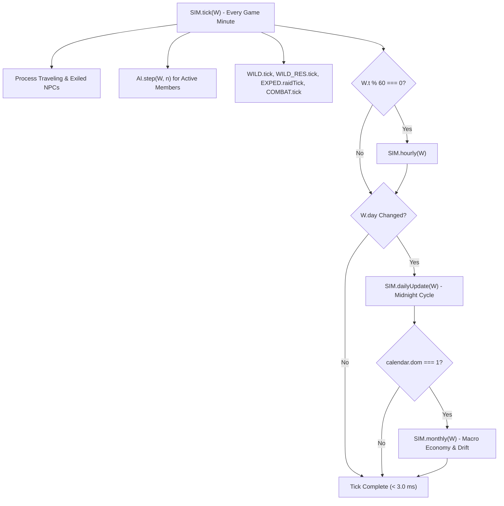
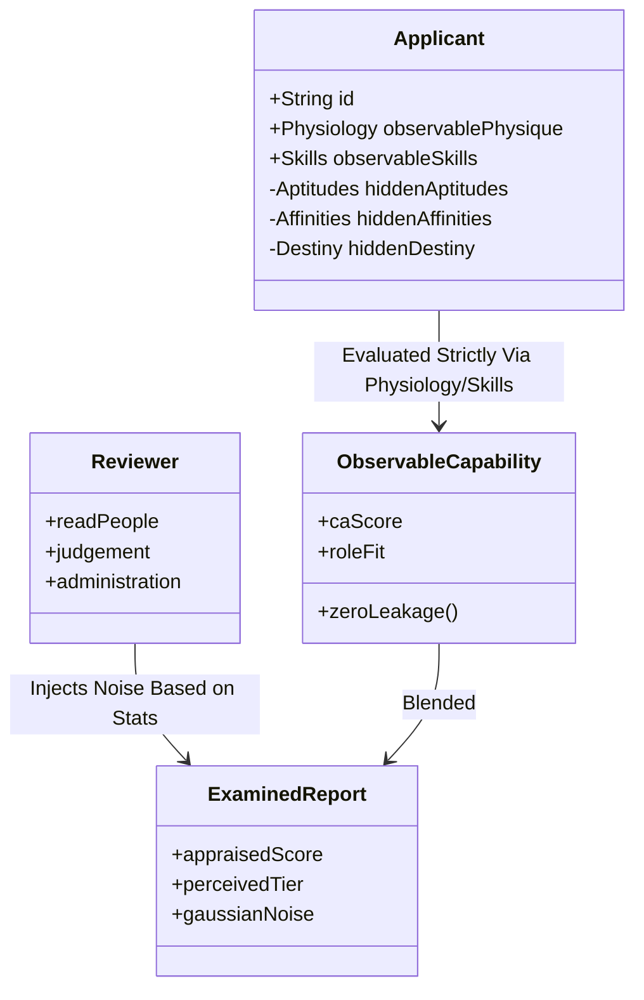

# JianghuSect Evolution — Macro-Simulation & Sect Governance Architectural Blueprint (`js/sim.js`, `js/sect.js`, `index.html`, `test/load.js`)

This skill is the definitive master specification for JianghuSect Evolution's core engine architecture. It governs the strict 40-script-tag load invariant, the single authoritative world state (`W`), deterministic PRNG simulation lifecycle (`js/sim.js`), comprehensive sect governance, succession, and facility management (`js/sect.js`), strict CA/PA applicant evaluation boundaries, ancestral shrine legacy tablets, and the single-file offline build pipeline (`tools/build_single.js`).

---

## 1. System Architecture & The 40-Script-Tag Invariant

JianghuSect Evolution operates with **zero external build bundlers** (no Webpack, Vite, or Rollup). Every module is an Immediately Invoked Function Expression (IIFE) that runs cleanly in both modern browser DOM/Canvas environments and headless Node.js VM test harnesses (`test/load.js`).

```javascript
(function (g) {
  'use strict';
  // Module definition attaches to global namespace g
  const SECT = {};
  // ...
  g.SECT = SECT;
  if (typeof module === 'object' && module.exports) module.exports = SECT;
})(typeof globalThis !== 'undefined' ? globalThis : this);
```

### 1.1 The Exact 40-Script Load Order (`index.html` lines 42–83 & `test/load.js`)
The execution order is strictly deterministic and hard-wired. Any modification to tag counts breaks regression test suites (`test_overhaul_pack.js` asserts `scriptTags.length === 40`).

| Stage | Script Count | File Path | Global Namespace Attached | Purpose & Invariants |
| :--- | :--- | :--- | :--- | :--- |
| **Data Layer** | 1 | `data/data_core.js` | `g.JD.CORE` | Base definitions, factions, geography |
| | 2 | `data/data_cult.js` | `g.JD.CULT` | 9 Cultivation Paths, stages, stat curves |
| | 3 | `data/data_items.js` | `g.JD.ITEMS` | Equipment, recipes, pill catalogs, drop tables |
| | 4 | `data/data_bt.js` | `g.JD.BT` | Breakthrough tribulations, requirements, gates |
| | 5 | `data/data_cb.js` | `g.JD.CB` | Combat move definitions, archetypes, stances |
| | 6 | `data/data_cp.js` | `g.JD.CP` | Contribution point store tiers, exchange rates |
| | 7 | `data/data_tech.js` | `g.JD.TECH` | Martial manuals, mantras, innate techniques |
| | 8 | `data/data_beasts.js` | `g.JD.BEASTS` | Spirit beasts, species catalog, pack profiles |
| | 9 | `data/data_expansion.js` | `g.JD.EXP` | 78 Subpaths, 9-Realm specialization tracks |
| | 10 | `data/data_martial.js` | `g.JD.MARTIAL` | 18 Equipment resonance sets, weapon families |
| | 11 | `data/data_ecology.js` | `g.JD.ECO` | World ecology nodes, regional resource biomes |
| **Core Systems** | 12 | `js/util.js` | `g.U` | Fast PRNG (`U.RNG`), math helpers, clamp, uuid |
| | 13 | `js/human_core.js` | `g.HC` | 12-layer Human Core model (fingerprint frozen) |
| | 14 | `js/world_map.js` | `g.MAP` | 240×192 World Map, terrain grid, Southern River |
| | 15 | `js/cultivation.js` | `g.CULT`, `g.ELEM` | Qi progression, 9-Realm tracks, elemental matrix |
| | 16 | `js/economy.js` | `g.ECO` | Facility crafting, stockpile, market ledgers |
| | 17 | `js/sect.js` | `g.SECT` | Governance, offices, succession, applicants, Edit Hub |
| | 18 | `js/ai.js` | `g.AI` | NPC Psychological Utility AI, station lifecycle |
| | 19 | `js/combat.js` | `g.COMBAT` | Turn/tick combat engine, weapon tactics, damage |
| | 20 | `js/expedition.js` | `g.EXPED` | Caravans, world map travel, sect defense raids |
| | 21 | `js/explore.js` | `g.EXPLORE` | Nine-Dao Pagoda, 5-Elemental Realms, Sanctums |
| | 22 | `js/bottleneck.js` | `g.BN` | Bottleneck resolution, tribulation failure wounds |
| | 23 | `js/skills.js` | `g.SK` | Combat move selector, cooldowns, channeling |
| | 24 | `js/stats.js` | `g.STATS` | Composite stat calculator, timed buffs, caching |
| | 25 | `js/cpeco.js` | `g.CPE` | Contribution point ledger, item distribution |
| | 26 | `js/external_market.js` | `g.EXT` | Wandering merchants, caravan trade accords |
| | 27 | `js/content.js` | `g.CONTENT` | Cross-sect diplomacy, treaties, political events |
| | 28 | `js/martial.js` | `g.MARTIAL` | Weapon mastery, passive reconciler, resonances |
| | 29 | `js/proficiency.js` | `g.PROF` | Crafting & combat move proficiency mastery |
| | 30 | `js/knowledge.js` | `g.KNOW` | Ancient insights, secret art research |
| | 31 | `js/retraining.js` | `g.RETRAIN` | Cultivation path realignment, foundation cleansing |
| | 32 | `js/cognition.js` | `g.COG` | Goal-Driven Cognition, office directives, agenda |
| | 33 | `js/wildlife.js` | `g.WILD` | Wildlife ecology, roaming spirit packs |
| | 34 | `js/wild_resources.js`| `g.WILD_RES` | Wilderness forage & mining resource nodes |
| | 35 | `js/sim.js` | `g.SIM` | Master clock, tick/hour/day/month simulation |
| | 36 | `js/visitors_clues.js` | `g.VC` | Wandering cultivators, clues, legendary weapons |
| | 37 | `js/fishing.js` | `g.FISHING` | River fishing Monte Carlo loot, rod mastery |
| **Browser Only**| 38 | `js/render.js` | `g.Render` | Canvas 2D renderer, viewport camera, sprites |
| | 39 | `js/ui.js` | `g.UI` | Wuxia DOM UI panels, Edit Hub modal, tabs |
| | 40 | `js/main.js` | `g.G` | Animation loop, requestAnimationFrame, input |

---

## 2. Authoritative Single World State (`W`) & Deterministic PRNG

All simulation state exists inside a single serializable JavaScript object `W`. Modules never store state in local variables across ticks.

### 2.1 Authoritative Schema (`SIM.create` lines 146–218 - v2.0.17)
- `W.v`: Engine version string (`'v2.0.17'`).
- `W.seed`: Deterministic root world seed string.
- `W.rng`: Root deterministic pseudorandom number generator instance (`new U.RNG(seed + ':world')`).
- `W.t`: Master timeline integer in simulation minutes (1 tick = 1 minute).
- `W.day`: Current elapsed day index (`Math.floor(W.t / 1440)`).
- `W.season`: Current seasonal cycle (0: Spring, 1: Summer, 2: Autumn, 3: Winter).
- `W.npcs`: Flat array of all living, dead, away, and exiled NPC objects.
- `W.byId`: Fast O(1) hash map indexing NPCs by ID (`W.byId[id]`).
- `W.sect`: Core sect state object:
  - `name`, `archetype`: Sect name and foundational archetype.
  - `masterId`, `deputyId`: Active leadership NPC IDs.
  - `posts`: Record mapping post keys (`'martial'`, `'alchemy'`, etc.) to NPC IDs.
  - `policy`: 7-axis governance policy + 5-axis focus weights.
  - `stones`: Sect spiritual stone treasury balance.
  - `stock`, `gear`, `crystals`: Sect warehouse inventories.
  - `reserveDirectives`, `shortageDirectives`: Autonomous supply chain directives.
  - `legacyTablets`: Ancestral shrine memorial inscriptions.
  - `ascendedLegacyHistory`: Ascended elder records (capped at 50).
  - `mentorship`: Direct disciple bonds, coaching logs, and synthesized heritage arts (`SECT.MENTORSHIP`).
  - `supportDoctrine`, `specialistFacilities`: Support AI & specialist building levels.
- `W.world`: Regional macro-state (`sects`, `politics`, `nodes`, `caravans`):
  - `jianghu`: Tavern rumors, karma bonds, and sworn allies (`SECT.JIANGHU`).
- `W.map`: Sect compound spatial grid, building definitions (`W.map.buildings`), and station states.

### 2.2 Time & Calendar Units (`SIM.calendar`)
```
1 tick          = 1 simulation minute
60 ticks        = 1 hour (runs SIM.hourly)
1440 ticks      = 1 day (runs SIM.dailyUpdate at midnight)
30 days         = 1 month (day % 30 === 0 runs SIM.monthly)
90 days         = 1 season (Spring, Summer, Autumn, Winter)
360 days        = 1 cultivation year (4 seasons × 90 days)
```

---

## 3. The Master Simulation Lifecycle (`js/sim.js`)

Simulation steps execute along strict performance budgets: **< 3.0 ms per tick for 80 NPCs**, supporting simulation speeds up to **80x+**.



### 3.1 Per-Tick Engine Loop (`SIM.tick` lines 290–308)
1. **Clock Advance:** `g.STATS.now = W.t; W.t++;`
2. **Midnight Transition:** If `Math.floor(W.t / 1440) !== W.day`, advances `W.day`, syncs `HC.nowDay = W.day`, and triggers `SIM.dailyUpdate(W)`.
3. **NPC Stepping:**
   - Skips `n.dead`.
   - If `n.travel`: updates coordinates, executes `AI.needs(W, n)`, `EXPED.travelStep(W, n)`, and if `n.away && n.exiled`, triggers `SIM.retire(W, n)`.
   - If active (`!n.away`): executes `AI.step(W, n)`.
4. **Ecological & Combat Subsystems:**
   - Executes `WILD.tick(W)` and `WILD_RES.tick(W)`.
   - If sect compound is under attack (`W.foes.length > 0`), executes `EXPED.raidTick(W)`.
   - Executes `WILD.clampCombat(W)` and `COMBAT.tick(W)`.
5. **Hourly Trigger:** If `W.t % 60 === 0`, invokes `SIM.hourly(W)`.

### 3.2 Hourly Phase Operations (`SIM.hourly` lines 325–375)
- **Timed Buff Expiration:** Calls `STATS.purgeExpired(n, W.t)` for all NPCs to clean expired combat/cultivation modifiers.
- **Support & Regen Updates:** Applies `vitalRegen` passive healing (`+5% hpMax`), cools down puppet constructs (`ms.heat`, `ms.charge`), ticks `AI.healTick`, `STATS.recover`, and `CPE.autoUse`.
- **Equipment Wear:** Deducts durability for active combatants (`-0.5 durability`).
- **Building Construction Complete:** Checks `W.map.buildings` for `b.building.until <= W.t` and invokes `SIM.finishBuilding(W, b)`.
- **Station Congestion Tracking:** Records facility demand spikes into `W.sect.facilityDemand`.
- **Armory Allocation:** Every 6 hours (`W.t % 360 === 0`), evaluates stock distribution via `SECT.distributeSectStock(W, { onlyGear: true, maxGifts: 2 })`.

### 3.3 Midnight Daily Cycle (`SIM.dailyUpdate` lines 454–511)
- **Natural Mortality:** Rolls natural life expectancy checks (`age > lifeExpectancy * 0.92`).
- **Graveyard Cleanliness:** Buries dead corpses after 4 days into `W.graveyard`.
- **Succession Emergency Gate:** If `W.sect.masterId` is dead or missing, immediately triggers `SECT.succession(W, 'เจ้าสำนักเดิมถึงแก่อนิจกรรม')`.
- **Roster & Assistant Sync:** Updates sect guards via `SIM.guardRoster(W)` and assigns facility assistants via `SIM.assistants(W)`.
- **Sequential Daily Domain Updates:**
  ```javascript
  SECT.daily(W);                  // Governance, hall orders, applicant aging
  COG.syncOfficeAuthority(W);     // Synchronize officeholder cognitive authorities
  EXPED.daily(W);                 // Caravan arrivals, raid spawns, world events
  EXPLORE.daily(W);               // Pagoda resets, realm node regeneration
  BN.daily(W);                    // Bottleneck tribulation checks
  CPE.daily(W);                   // Contribution point salary & ledger roll
  CONTENT.daily(W);               // Cross-sect diplomatic treaties & envoy timers
  EXT.daily(W);                   // Wandering merchant refresh
  FISHING.daily(W);               // River bait & fishing spot ecology
  ```
- **Specialist & Pet Maintenance:** Moves orphaned beasts to `W.sect.reservePets`, feeds hungry pets (`CULT.feedPet`), repairs puppets, and checks 9-Realm specialization tracks (`CULT.checkTrackGates`).

### 3.4 Monthly Macro Phase (`SIM.monthly` lines 582–624)
- **Policy Drift:** Blends current sect policy toward the target policy (`tp`) by 20% (`policy[k] += (tp[k] - policy[k]) * 0.2`).
- **Salary & Tribute:** Disburses sect salaries via `SECT.paySalaries(W)` and collects regional protection tribute (`150 + 26 * sqrt(fame)`).
- **Facility Upkeep:** Deducts stone maintenance based on member count and building levels, with discount applied from the Treasury Elder's `administration` skill.
- **Grain/Meal Spoilage:** Applies spoilage decay if grain or meal stockpiles exceed storage capacity thresholds.
- **Mortal Awakening:** Rolls cultivation awakening chance for mortal disciples (`rank 0`), granting them starter cultivation paths.

---

## 4. Sect Governance & Identity Engine (`js/sect.js`)

`js/sect.js` (3,988 lines) is the central governing engine for sect identity, offices, applicant appraisal, succession, and facility progression.

### 4.1 14 Foundational Sect Archetypes (`SECT.ARCHETYPES` & `SECT.ARCHETYPE_WEAPON`)
Each archetype defines the cultural, martial, and economic identity of a sect:

| Archetype ID | Name | Primary Path | Starter Subpaths | Starter Weapon | Master Weapon |
| :--- | :--- | :--- | :--- | :--- | :--- |
| `sword` | สำนักกระบี่เมฆา | `SWORD` | `SWORD_GHOST`, `SWORD_BLOOD` | `W:WOOD_SWORD` | `W:CELESTIAL_SWORD` |
| `blade` | สำนักดาบศิลาดำ | `BLADE` | `BLADE_BERSERK`, `BLADE_SHADOW` | `W:IRON_BLADE` | `W:DRAGON_BLADE` |
| `spear` | สำนักทวนมังกรคราม | `SPEAR` | `SPEAR_PIERCE`, `SPEAR_SWEEP` | `W:IRON_SPEAR` | `W:PHOENIX_SPEAR` |
| `fist` | สำนักหมัดแปดทิศ | `FIST` | `FIST_IRON`, `FIST_PALM` | `W:CLOTH_GLOVES` | `W:VAJRA_GLOVES` |
| `alchemy` | สำนักโอสถสวรรค์ | `PILL` | `PILL_HEAL`, `PILL_POISON` | `W:BRONZE_CENSER` | `W:DIVINE_CAULDRON`|
| `bow` | สำนักธนูเก้าตะวัน | `BOW` | `BOW_SNIPER`, `BOW_RAPID` | `W:HUNTING_BOW` | `W:SUN_FALL_BOW` |
| `staff` | สำนักพลองอรหันต์ | `STAFF` | `STAFF_CRUSH`, `STAFF_WHIRL` | `W:WOODEN_STAFF` | `W:BUDDHA_STAFF` |
| `focus` | สำนักเวทย์ดวงดาว | `FOCUS` | `FOCUS_ASTRAL`, `FOCUS_VOID` | `W:SPIRIT_MIRROR` | `W:VOID_ORB` |
| `god` | อารามเทพยุทธ์ | `BODY` | `GOD_FIST`, `GOD_ARMOR` | `W:HEAVY_GAUNTLET`| `W:GOD_SPLITTER` |
| `demon` | พรรคมารโลหิต | `GHOST` | `DEMON_DEVOUR`, `DEMON_CHAOS` | `W:BONE_DAGGER` | `W:BLOOD_SCYTHE` |
| `mech` | นครกลจักรโบราณ | `FORMATION`| `MECH_PUPPET`, `MECH_ARRAY` | `W:WRENCH_STAFF` | `W:TITAN_CONTROLLER`|
| `karma` | พุทธาวาสวิปัสสนา | `SCHOLAR` | `KARMA_BOND`, `KARMA_REINCARN` | `W:PRAYER_BEADS` | `W:KARMA_BELL` |
| `beast` | หุบเขาสัตว์วิญญาณ | `BEAST` | `BEAST_PACK`, `BEAST_SYMBIOSIS` | `W:BEAST_WHIP` | `W:SOVEREIGN_WHIP` |
| `sage` | สำนักมหาปราชญ์ | `SCHOLAR` | `SAGE_CALLIGRAPHY`, `SAGE_CHESS`| `W:SCHOLAR_BRUSH` | `W:DAO_CHRONICLE` |

### 4.2 7 Sect Ranks & 16 Assignable Offices
- **7 Ranks (`SECT.RANKS`):**
  - `0`: ผู้ฝึกหัด (Mortal Trainee / Novice)
  - `1`: ศิษย์สายนอก (Outer Disciple)
  - `2`: ศิษย์สายใน (Inner Disciple)
  - `3`: ศิษย์แกนกลาง (Core Disciple)
  - `4`: ผู้อาวุโส (Elder)
  - `5`: รองเจ้าสำนัก (Deputy Master)
  - `6`: เจ้าสำนัก (Sect Master)
- **16 Assignable Posts (`SECT.POSTS`):**
  `martial` (ฝึกยุทธ์), `alchemy` (ปรุงโอสถ), `forge` (หลอมศาสตรา), `scripture` (หอคัมภีร์), `discipline` (คุมกฎ), `treasury` (คลังสำนัก), `mission` (ภารกิจ), `guard` (พิทักษ์), `registry` (ทะเบียนศิษย์), `healer` (หอโอสถ), `disciples` (ศิษย์สืบทอด), `commander` (แม่ทัพยุทธ์, ต้องการสมาชิก >= 12), `provision` (เสบียง), `herbal` (สวนสมุนไพร), `wildwarden` (พิทักษ์ป่า), `steward` (ผู้ดูแลทั่วไป, ต้องการสมาชิก >= 16).

### 4.3 Identity-Driven Governance Policy Engine (`SECT.styleOf`, `SECT.targetPolicy`)
Governance policy is not a static configuration file; it is synthesized continuously from the psychological traits (`HC`) of leadership:
- **Weighting Matrix:**
  - **Sect Master:** **78%** influence
  - **Deputy Master:** **14%** influence
  - **Council Elders:** **8%** distributed influence
- **7 Policy Axes:**
  1. `openness`: Derived from `socializing`, `empathy`, inverse `caution`.
  2. `strictness`: Derived from `discipline`, `integrity`, `caution`.
  3. `meritocracy`: Derived from `rationality`, `fairness`, `martialPeak`.
  4. `expansion`: Derived from `ambition`, `courage`, `powerStatus`.
  5. `generosity`: Derived from `empathy`, `hospitality`, inverse `materialism`.
  6. `secrecy`: Derived from `caution`, `intrigue`, `solitude`.
  7. `risk`: Derived from `courage`, `gambling`, inverse `caution`.
- **5 Focus Weights:** `martial`, `craft`, `scholar`, `commerce`, `faith`.

---

## 5. Strict CA/PA Privacy Boundary & Applicant Appraisal

JianghuSect Evolution enforces a strict architectural boundary between **Current Ability (CA)** and **Potential Ability (PA)** to prevent omniscient AI or UI cheats.



### 5.1 5 Talent Tiers (`SECT.TALENT_TIERS`) & Fame Weighting
- `COMMON` (สามัญ, Tier 1): Aptitudes ~35–50
- `STEADY` (มั่นคง, Tier 2): Aptitudes ~50–65
- `GIFTED` (มีพรสวรรค์, Tier 3): Aptitudes ~65–78
- `PRODIGY` (อัจฉริยะ, Tier 4): Aptitudes ~78–90
- `HEAVENLY_CHILD` (ลูกรักสวรรค์, Tier 5): Aptitudes ~90–100
- **Weighting Formula (`SECT.applicantTierWeights`):** Higher sect fame exponentially increases high-tier rolls while compressing common applicants.

### 5.2 Strict CA/PA Privacy Invariant (`SECT.observableCapability`)
`SECT.observableCapability(W, n)` computes Current Ability strictly from observable exterior attributes:
- **Allowed Attributes:** Observable physical strength, endurance, agility, exterior demeanor, and active skill proficiencies.
- **Strictly Forbidden Attributes (Never Read):**
  - `n.h.aptitudes.*` (Cultivation, comprehension, combat talent)
  - `n.h.affinities.*` (Elemental and weapon affinities)
  - `n.h.life.destiny`, `n.h.intellect.*`, `n.ext.applicant`
- **Zero-Leakage Assurance:** Tests in `test/run_all.js` inspect runtime memory access during appraisal to guarantee no private PA attributes are accessed.

### 5.3 Appraisal Noise Injection (`SECT.examineApplicant`)
The sect appraises applicants through an appointed officer (Priority: `registry` Elder → `master` → `deputy`):
```javascript
const eye = evaluator ? (HC.eff(evaluator, 'intellect.readPeople') * 0.55 + HC.eff(evaluator, 'intellect.judgement') * 0.45) : 40;
const noiseStdDev = Math.max(1.5, (100 - eye) / 10);
const perceivedScore = trueScore + W.rng.gauss(0, noiseStdDev);
```
An evaluator with low perception introduces severe appraisal noise, potentially mistaking a common applicant for a prodigy or rejecting a heavenly genius.

---

## 6. Grand Martial Assembly & Peak Trial Arena (`SECT.assembly`)

Every 90–120 days, the sect convenes the Grand Martial Assembly to evaluate disciples, award Contribution Points (CP), and resolve external disputes.

### 6.1 3 Division Brackets (`SECT.ASSEMBLY_BRACKETS`)
1. **JUNIOR (`รุ่นเยาว์·หลอมปราณ`):** Stages T1–T2. Rewards: 50 CP, 60 stones, T3 tailored gear/recipe, +2 sect fame.
2. **CORE (`รุ่นแกนหลัก·แก่นทองคำ`):** Stages T3–T4. Rewards: 100 CP, 120 stones, T3–T5 tailored gear/recipe, +4 sect fame.
3. **ELDER_PEAK (`รุ่นผู้อาวุโส·ยอดเขายุทธ์`):** Stages T5–T7. Rewards: 180 CP, 220 stones, T5–T6 tailored gear/recipe, +6 sect fame.

### 6.2 Bout Simulation & Tactical Interaction (`SECT.simulateAssemblyBout`)
Bouts simulate dynamic combat math without full tick-by-tick simulation overhead:
```javascript
const tacA = COMBAT.resolveWeaponTactics(a, b, { dist: 2.2 });
const resA = MARTIAL.evaluateResonanceSet(a);
const scoreA = CULT.power(a) * (tacA.dmgMult || 1) * (1 + resA.pieces * 0.04) * (0.88 + W.rng.next() * 0.24);
```
Tactical weapon advantages (e.g. Spear keeping Fist at bay, Blade bypassing light armor) and 18-set resonance pieces provide significant modifiers.

### 6.3 Tailored Equipment Rewards & Allied Guests
- **Tailored Gear Minting (`SECT.tailoredAssemblyReward`):** Champions are awarded bespoke gear and matched crafting recipes suited to their primary weapon and path.
- **Allied Sect Prodigies:** Allied sects (`treaty: 'ALLIANCE'` or `attitude >= 40`) dispatch guest prodigies to compete in the tournament.
- **Rival Envoy Challenges (`SECT.resolveRivalEnvoyChallenge`):** Defeating hostile sect challenge envoys yields massive CP, prestige, and forces treaty negotiations.

---

## 7. Ancestral Shrine, Legacy Tablets & Blessings

When prominent elders or leaders perish, their memory is immortalized in the Ancestral Shrine (`SECT.inscribeLegacyTablet`), granting enduring spiritual blessings to subsequent generations.

### 7.1 Inscription Qualification (`SECT.inscribeLegacyTablet`)
An NPC qualifies for tablet inscription upon death if:
- Rank is `4` (Elder), `5` (Deputy), or `6` (Master).
- Cultivation stage is `T4` (Core Formation) or higher.
- Inscription captures their signature weapon, highest technique, path, and subpath.

### 7.2 Tablet Bonuses & Ancestral Prayer (`SECT.prayAtAncestralShrine`)
- **Breakthrough Bonus:** `+0.04` to `+0.12` breakthrough success rate.
- **Comprehension Bonus:** `+0.08` to `+0.22` manual study speed.
- **Path Synergy Multipliers:**
  - Exact Subpath Match: **1.35x** multiplier + complete tribulation injury shield.
  - Same Major Path: **1.0x** multiplier + tribulation injury shield.
  - Different Path: **0.65x** multiplier (general wisdom).
- **Psychological Cleansing:** Reduces Heart Demon (`-8` to `-12`) and removes stress (`-8`).

---

## 8. Facility Demand, Housing Caps & Autonomous Directives

### 8.1 Authoritative Housing Bed Capacities
Housing capacity is strictly defined by dedicated dormitory facilities:
```javascript
SECT.housingCapacity = W => {
  const outer = W.map.byId.dorm_outer?.level || 1;
  const inner = W.map.byId.dorm_inner?.level || 0;
  const core  = W.map.byId.dorm_core?.level || 0;
  // Outer (max L5): 16, 24, 32, 44, 56 beds
  // Inner (max L4):  0,  8, 16, 28 beds
  // Core  (max L3):  0,  0,  8, 16 beds
  // Absolute maximum capacity = 56 + 28 + 16 = 100 members
};
```
Non-housing facilities (farms, mines, libraries) **never** generate bed stations.

### 8.2 Autonomous Stock Allocation (`SECT.distributeSectStock`)
The sect autonomously balances its treasury through directives:
1. **Safety Reserves:** 14 days of grain, 20 emergency meals, and 4 units of essential recovery medicines (`P:BASIC_HP`, `P:BASIC_WOUND`).
2. **Stock Evaluation Matrix (`SECT.evaluateStockDistribution`):**
   - **Reserve:** Preserved for emergency crises and scheduled sect raids.
   - **Sale:** Exported via external caravans and merchant accords.
   - **Gift:** Distributed to deserving disciples based on merit, combat post, and elemental resonance.
3. **Anti-Exploit Safeguard:** Player-spawned items are tagged (`playerSpawned = true`) and yield **0 CP** when donated to prevent infinite currency exploits.

---

## 9. Support Doctrine & Specialist Facilities (v2.0.9 Engine)

### 9.1 Support Doctrine (`SECT.ensureSupportDoctrine`, `SECT.setSupportDoctrine`)
Configures autonomous NPC healer and support behavior:
- **Triage Priorities:** `BALANCED`, `ELDER_FIRST`, `SEVEREST_FIRST`, `VANGUARD_FIRST`.
- **Health Thresholds:** Trigger emergency healing when ally HP drops below `minHpThreshold` (default 65%).
- **Reserve Qi Protection:** Support units reserve `reserveQiPercent` (20%) to prevent total qi exhaustion.

### 9.2 Specialist Facilities (`SECT.ensureSpecialistFacilities`)
- `mech_workshop`: Speeds up construct readiness recovery and maintains sect guardian puppets.
- `beast_menagerie`: Enhances spirit beast breeding success rates and manages nutrition.
- `harmonic_pavilion`: Boosts support healing efficiency and buff duration by `+15%` per level.

---

## 10. Edit Hub Architecture (`SECT.EDITOR`)

The Edit Hub is an administrative debugging and testing engine embedded in `SECT.EDITOR`:
- `EDITOR.memberEditState(W, npcId)`: Validates whether a character can be edited (guards against dead or exiled states).
- `EDITOR.spawnItem(W, opts)`: Spawns provisions, materials, pills, equipment, technique manuals, and subpath crystals directly into sect warehouses or member bags.
- `EDITOR.applyDiplomacyAction(W, opts)`: Modifies faction relations, signs treaties, and clears diplomatic cooldowns.
- `EDITOR.applySanctumAction(W, opts)`: Simulates instant sanctum runs, sets floor clears, and dispenses refinement catalysts.
- `EDITOR.applyPetAction(W, opts)`: Manages beast pets, awakens sovereign bloodlines, and mutates puppet/karma states.

---

## 11. Single-File Build Pipeline (`tools/build_single.js`)

To guarantee standalone distribution without server dependencies, JianghuSect Evolution compiles into a single monolithic HTML bundle:

```bash
cd /data/data/com.termux/files/home/jhevo-work/GAME_SOURCE
node tools/build_single.js
```

### 11.1 Build Mechanics
1. Reads `index.html`.
2. Inlines all external CSS stylesheets (`css/style.css`).
3. Reads all 40 JavaScript files in exact sequence and inlines them inside `<script>` blocks.
4. Verifies syntax and outputs `GAME_SOURCE/JianghuSect_single.html`.
5. Ensures zero missing asset references or unclosed tags.

---

## 12. Verification & Acceptance Checklist

Whenever modifying system architecture, macro lifecycle, or sect governance:
- [ ] **40-Script Load Invariant:** Ensure script tag count in `index.html` and `test/load.js` remains exactly 40.
- [ ] **Failsafe Fingerprint:** Ensure `GAME_SOURCE/js/human_core.js` is unmodified (`HC.FINGERPRINT === '155:2f9c9dd7'`).
- [ ] **CA/PA Privacy:** Verify that `SECT.observableCapability` never reads hidden potential traits.
- [ ] **Performance Budget:** Ensure per-tick time remains `< 3.0 ms` for 80 NPCs.
- [ ] **Data Schema Validation:** Run `node tools/validate_data_schema.js` and verify **0 Errors**.
- [ ] **Full Test Suite:** Run `node test/run_all.js` and ensure all 83 test suites pass.
- [ ] **Single-File Compilation:** Run `node tools/build_single.js` and ensure clean generation.

## Patch v2.0.18 Additions: World Map Topology & Hegemony Loop
- Integrated `EXPED.ensureWorldTopology(W)`, `EXPED.tickHegemony(W)`, and `EXPED.harvestResourceNodes(W)` into `EXPED.daily(W)` and `CONTENT.ensure(W)` while maintaining `1.351 ms/tick` for 80 active NPCs.
- **Save Policy Update:** Backwards compatibility with older save versions is not required (`"ไม่จำเป็นต้องทำให้เซฟเก่าเล่นต่อได้"`), allowing clean architectural evolution.
