# 📘 แผนแม่บทสถาปัตยกรรมฉบับสมบูรณ์ของ Opus (Opus Master Blueprint)
## โครงการ: "SME Crisis: The Electronics Workshop Sim" (เกมบริษัท v0.1.0)
> **เอกสารนี้คือ:** การถอดบันทึกความคิดเชิงลึก (Deep Architecture & Mathematical Blueprint) ทั้งหมด 32,722 Tokens ของ Claude Opus ที่ถูกคิดและวางแผนไว้อย่างสมบูรณ์แบบก่อนโควต้าหมด  
> **สาขา Git:** `company`  
> **เป้าหมาย:** บันทึกโครงสร้าง สถิติ สูตรคำนวณ ผังพื้นที่ และตรรกะระบบทั้งหมด เพื่อเป็นฐานการพัฒนาที่จับต้องได้ 100% ไม่สูญหาย

---

## 📌 สารบัญ (Table of Contents)
1. [ภาพรวมและเป้าหมายการเล่น (Core Game Loop & Victory Conditions)](#1-ภาพรวมและเป้าหมายการเล่น)
2. [ตัวเลขเศรษฐกิจและกระแสเงินสด (Economic Model & Runway Calculations)](#2-ตัวเลขเศรษฐกิจและกระแสเงินสด)
3. [แกนมนุษย์และจิตวิทยาพนักงาน (Human Core Architecture — CHC v1.0.0)](#3-แกนมนุษย์และจิตวิทยาพนักงาน)
4. [ผังสองโซนและระบบนำทาง (Dual-Zone Floor Plan & BFS Pathfinding)](#4-ผังสองโซนและระบบนำทาง)
5. [ห่วงโซ่การผลิต สินค้า และวัตถุดิบ (Product, BOM & Quality DAG)](#5-ห่วงโซ่การผลิต-สินค้า-และวัตถุดิบ)
6. [วงจรการจำลองเวลาและงานประจำวัน (Daily Simulation Loop & State Machine)](#6-วงจรการจำลองเวลาและงานประจำวัน)
7. [การแสดงผล Canvas 2D และแอนิเมชัน (Visual Presentation & Sprites)](#7-การแสดงผล-canvas-2d-และแอนิเมชัน)
8. [โครงสร้างโมดูลและการทดสอบ (Module Architecture & Verification Suite)](#8-โครงสร้างโมดูลและการทดสอบ)

---

## 1. ภาพรวมและเป้าหมายการเล่น (Core Game Loop & Victory Conditions)

### 1.1 ธีมและบริบทของเกม
- **ประเภทกิจการ:** โรงงานและออฟฟิศประกอบอุปกรณ์อิเล็กทรอนิกส์ขนาดเล็ก (SME Electronics Workshop)
- **สถานการณ์:** บริษัทเพิ่งกู้เงินมาตั้งต้น แต่เงินสดเหลือน้อยมาก ดอกเบี้ยเดินทุกวัน และต้องแย่งชิงความอยู่รอดในตลาด
- **บทบาทผู้เล่น:** ผู้บริหารระดับนโยบาย (CEO / Founder) — ไม่ใช่ตัวละครเดินสั่งการพนักงานแบบหุ่นเชิด แต่กำหนด:
  - การรับ/ปฏิเสธออเดอร์ลูกค้า (Lead Acceptance)
  - นโยบายจัดซื้อวัตถุดิบและสต็อกขั้นต่ำ (Reorder Points)
  - นโยบายการทำงานล่วงเวลา (Overtime Policy) และสวัสดิการ (เช่น กาแฟฟรี vs จ่ายเอง)
  - การกำหนดทิศทาง R&D วิจัยสินค้าใหม่และเครื่องมือ
  - การบริหารคน (จ้างงาน, เลิกจ้าง, ปรับเงินเดือน, จัดตำแหน่งหลักเป็น Soft Bias)

### 1.2 เงื่อนไขชัยชนะ (Victory Conditions)
- **เงื่อนไขชนะหลัก (พลิกฟื้นบริษัท):**
  1. ล้างหนี้ธนาคาร `฿150,000` จนเหลือ **`฿0`**
  2. สะสมเงินสดสำรองในบัญชีได้ `>= ฿60,000`
  3. ค่าชื่อเสียงบริษัท (Reputation) `>= 60`
  4. ทำสำเร็จภายใน **วันที่ 120**
- **เงื่อนไขแพ้ (Bankruptcy & Seizure):**
  1. เงินสดติดลบเกิน `-฿30,000` (หนี้ล้นพ้นตัว)
  2. เงินสดติดลบต่อเนื่อง **3 คืนติดต่อกัน** (ขาดสภาพคล่องสิ้นเชิง)
  3. พนักงานลาออกหมดบริษัท (Team Collapse)
  4. ครบวันที่ 120 แล้วยังมียอดหนี้คงค้างอยู่ (เจ้าหนี้ยึดทรัพย์สิน)

---

## 2. ตัวเลขเศรษฐกิจและกระแสเงินสด (Economic Model & Runway Calculations)

### 2.1 สถานะการเงินเริ่มต้น (Day 1 State)
- **เงินสดในบัญชี (Cash):** `฿85,000`
- **หนี้สินธนาคาร (Debt):** `฿150,000` (อัตราดอกเบี้ยคิดเป็นรายวัน หักตอนเที่ยงคืน)
- **ค่าใช้จ่ายคงที่ต่อวัน (Daily Burn Rate):**
  - เงินเดือนพนักงาน 8 คน: รวม ~`฿4,600` / วัน (จ่ายจริงเป็นรายสัปดาห์ ทุก 7 วัน)
  - ค่าเช่าสถานที่และสาธารณูปโภค (Rent & Utilities): ~`฿2,000` / วัน
  - ดอกเบี้ยเงินกู้: ~`฿500` / วัน
  - **รวมเงินไหลออกเฉลี่ย:** ~**`฿7,100` / วัน**
- **Runway เริ่มต้น:** เพียง **~12 วัน** หากไม่มีรายได้จากการส่งมอบสินค้าเข้ามาเติม!

### 2.2 โครงสร้างต้นทุนและกำไรสินค้าเริ่มต้น (Product 1: Bluetooth Speaker)
- **วัตถุดิบ 3 รายการต่อ 1 ชิ้น:**
  1. แผงวงจร (PCB Board): `฿120`
  2. เคสตัวถัง (Casing): `฿70`
  3. ดอกลำโพง (Audio Driver): `฿80`
  - **รวมต้นทุนวัตถุดิบ (BOM Cost):** **`฿270`** / ชิ้น
- **ราคาขายเฉลี่ย:** **`฿600 – ฿900`** / ชิ้น (ตามความเคี่ยวของลูกค้าและระดับความด่วน)
- **กำไรขั้นต้น (Margin):** **`฿330 – ฿630`** / ชิ้น (เฉลี่ย ~`฿570`)
- **จุดคุ้มทุน (Break-Even):** บริษัทต้องผลิตและส่งมอบให้ได้เฉลี่ย **13 ชิ้น / วัน** จึงจะครอบคลุมค่าใช้จ่ายรายวันของทั้งบริษัท ซึ่งพอดีกับกำลังการผลิตสูงสุดของช่างประกอบ 2 คนที่ทำงานเต็มเวลา!

---

## 3. แกนมนุษย์และจิตวิทยาพนักงาน (Human Core Architecture — CHC v1.0.0)

ออกแบบเป็นโมดูลแกนกลาง `COMPANY_SOURCE/js/company_human_core.js` ที่ **ล็อกโครงสร้างถาวร (Locked Core)** หลังผ่านการตรวจรับ

### 3.1 เจ็ดมิติบุคลิกภาพ (7 Personality Dimensions: 0–100, ค่าเฉลี่ย 50, กระจายแบบ Normal Bell-Curve)
1. **`sociability` (การเข้าสังคม):** สูงชอบคุยที่ตู้กดน้ำ ได้พลังจากคนอื่น; ต่ำชอบความสงบที่ระเบียง นั่งคุยนานแล้วเหนื่อย
2. **`conscientiousness` (ความรอบคอบและสำนึกรับผิดชอบ):** สูงมาทำงานตรงเวลา/ก่อนเวลา ทำงานสม่ำเสมอ พยายามทำงานเสร็จก่อนกลับ; ต่ำมีความยืดหยุ่นสูงแต่มีโอกาสทำงานตกหล่น
3. **`agreeableness` (การร่วมมือและเห็นอกเห็นใจ):** สูงยอมรับคำขอ OT ง่าย ชอบช่วยเหลือเพื่อน; ต่ำกล้าปฏิเสธ ปกป้องผลประโยชน์ตัวเอง
4. **`openness` (ความเปิดรับและอยากรู้อยากเห็น):** สูงชอบงาน R&D ชอบลองสเปกสินค้าใหม่; ต่ำชอบทำงานรูทีนที่คุ้นเคย
5. **`riskTaking` (ความกล้าเสี่ยง):** สูงกล้าทำงานใกล้เดดไลน์ ตัดสินใจเร็ว; ต่ำต้องการความปลอดภัย ไม่ชอบความเสี่ยง
6. **`stressReactivity` (ความไวต่อความเครียด):** สูงเครียดง่ายเมื่อเจองานด่วนหรือเงินบริษัทเหลือน้อย; ต่ำทนแรงกดดันได้นิ่งสงบ
7. **`assertiveness` (ความกล้าแสดงออกและสิทธิ์เสียง):** สูงกล้าขอขึ้นเงินเดือน กล้าต่อรอง OT กล้าสะท้อนปัญหา; ต่ำมักเงียบและสะสมความอึดอัดจนระเบิดด้วยการลาออก

### 3.2 แปดคุณค่าชีวิต (8 Value Dimensions: 0–100)
`security` (ความมั่นคง), `income` (รายได้), `autonomy` (อิสระในการทำงาน), `fairness` (ความยุติธรรม), `belonging` (ความรู้สึกเป็นพวกพ้อง), `learning` (การเรียนรู้สิ่งใหม่), `achievement` (ความสำเร็จ/ผลงาน), `meaning` (ความหมายและคุณค่าของงาน)

### 3.3 แปดความถนัดติดตัว (8 Innate Aptitudes: 0–100)
`analytical` (การคิดวิเคราะห์), `creativity` (ความคิดสร้างสรรค์), `communication` (การสื่อสาร), `organization` (การจัดระบบ/ระเบียบ), `precision` (ความแม่นยำ/ละเอียด), `dexterity` (ความคล่องแคล่วของมือ/ทักษะช่าง), `learningSpeed` (ความเร็วการเรียนรู้), `stamina` (ความอึดของร่างกาย)

### 3.4 ระบบลงทะเบียนทักษะแบบเปิดกว้าง (Extensible Skills Registry)
ทักษะไม่ผูกตายในแกน แต่ใช้ Sub-seed แยกตาม ID (`fnv1a`) ทำให้เพิ่มทักษะในอนาคตได้โดย Seed เดิมไม่เพี้ยน:
- `sales` (ทักษะการขาย/หา Lead ลูกค้า) ➔ อาศัย `communication`, `organization`
- `admin` (ทักษะเอกสาร/ออก PO/ออก Invoice) ➔ อาศัย `organization`, `precision`
- `engineering` (ทักษะวิจัย/เขียนแบบ/R&D) ➔ อาศัย `analytical`, `creativity`, `learningSpeed`
- `assembly` (ทักษะการประกอบวงจร/ชิ้นงาน) ➔ อาศัย `dexterity`, `stamina`, `precision`
- `quality` (ทักษะการตรวจสอบ QC/หาจุดบกพร่อง) ➔ อาศัย `precision`, `analytical`
- `logistics` (ทักษะการรับของ/แพ็กสินค้า/จัดส่ง) ➔ อาศัย `organization`, `stamina`

### 3.5 สถานะชีพที่เปลี่ยนแปลงได้ (Vitality & Changing States: 0–100)
- `energy` (พลังงานกาย): ลดลงตามชั่วโมงทำงาน ฟื้นฟูด้วยกาแฟ ข้าวเที่ยง และการนอน
- `focus` (สมาธิ): ลดลงเมื่องานยาก ฟื้นฟูเมื่อได้หยุดพัก
- `stress` (ความเครียด): สะสมเมื่องานล้นมือ/บริษัทใกล้เจ๊ง ลดลงเมื่อพักผ่อนที่เลานจ์หรือสูบบุหรี่ที่ระเบียง
- `morale` (ขวัญกำลังใจ): ปัจจัยหลักที่กำหนดการลาออก ได้รับผลจากความพึงพอใจในเงินเดือนและความมั่นคง
- `lifeBurden` (ภาระชีวิตภายนอก): ภาระครอบครัว/หนี้ส่วนตัว ทำให้บางวันมาสาย หรือต้องการเงินมากกว่าปกติ

### 3.6 สูตรคำนวณประสิทธิภาพและคุณภาพ (Effectiveness & Quality Formulas)
$$\text{Effectiveness} = \text{Skill} \times \text{AptitudeFit} \times \text{StateMult}$$
$$\text{StateMult} = f(\text{energy}) \times f(\text{focus}) \times \text{StressCurve}(\text{stress}) \times f(\text{health})$$
- **Stress Curve:** ความเครียดระดับปานกลาง (30–60) ให้ประสิทธิภาพสูงสุด (ตื่นตัว); หากเครียดเกิน 75 ประสิทธิภาพจะดิ่งเหว
- **โอกาสเกิดชิ้นงานสมบูรณ์ (Quality Chance):**
  $$\text{QualityChance} = \text{clamp}(0.30 + (\text{Skill} \times 0.005) + (\text{Precision} \times 0.002) - \text{FatiguePen} - \text{StressPen}, \; 0.30, \; 0.99)$$

### 3.7 สิทธิเสียงของพนักงาน (Employee Agency & Voice)
- **การตอบรับคำขอ OT ตอน 17:00 น. (`respondToRequest`):**
  - คะแนนความเต็มใจ (Willingness Score) คำนวณจาก ค่าตอบแทน OT, ระดับพลังงานคงเหลือ, ภาระชีวิต (`lifeBurden`), ความเกรงใจ (`agreeableness`), และความกลัวตกงาน (`security`)
  - ผลลัพธ์: **Accept (ยอมทำเต็มเวลา)** / **Negotiate (ขอทำแค่ครึ่งเดียว)** / **Decline (ปฏิเสธพร้อมเหตุผลภาษาไทย)**
- **การเรียกร้องก่อนลาออก (`workplaceVoice`):** พนักงานที่มี `assertiveness` สูง จะยื่นเรื่องขอขึ้นเงินเดือนหรือขอลดภาระงานก่อน หากผู้เล่นปฏิเสธและ Morale ต่ำ จึงจะตัดสินใจยื่นใบลาออก

---

## 4. ผังสองโซนและระบบนำทาง (Dual-Zone Floor Plan & BFS Pathfinding)

ขนาดผังพิกัด **32 x 20 แผ่นกระเบื้อง (Tiles)** แบ่งครึ่งซ้าย-ขวา กั้นด้วยผนังทึบและมี **ประตูกระจกเชื่อม 2 บาน**:

```
+----------------------------------[ผนังบน]-----------------------------------+
| [โซนออฟฟิศ - พรมสีเทาฟ้า]        |ประตูกระจก| [โซนโรงงาน - พื้นปูนขัดลายเส้นเหลืองดำ]  |
|                                  +----------+                                      |
| [DESK_CEO]   [DESK_SALES]                   [ASSEMBLY_1]  [ASSEMBLY_2]  [ASSEMBLY_3] |
|                                             (โต๊ะประกอบ 1) (โต๊ะประกอบ 2) (โต๊ะประกอบ 3)|
| [DESK_ADMIN] [DESK_RND]                     [REFLOW_OVEN] (เครื่องจักรตกแต่ง)           |
|                                                                                    |
| [MEETING_TABLE] (โต๊ะประชุม 6 ที่)           [QA_STATION_1]  [QA_STATION_2]         |
|                                             (แท่นตรวจ QC ส่องแว่นขยาย)                 |
| [PANTRY_COFFEE] [WATER_COOLER]                                                     |
| (เคาน์เตอร์กาแฟ)  (ตู้กดน้ำนินทา)              [PACKING_TABLE] (โต๊ะแพ็กกล่อง)             |
|                                                                                    |
| [LUNCH_TABLE] (โต๊ะกินข้าว 8 ที่) +----------+ [RAW_SHELVES] (ชั้นวางวัตถุดิบ 5 ช่อง)   |
| [LOUNGE_SOFA] (โซฟาพักผ่อน)       |ประตูกระจก| [FINISHED_SHELF] (ชั้นวางสินค้าพร้อมส่ง)  |
|                                  +----------+                                      |
| [BALCONY_DECK] (ระเบียงสูบบุหรี่)             [RECEIVING_DOCK]    [SHIPPING_DOOR]   |
| [ENTRANCE_DOOR] (ประตูเข้างาน)                (ประตูรับของเข้า)     (ประตูส่งสินค้าออก)  |
+----------------------------------[ผนังล่าง]----------------------------------+
```

### 4.1 ระบบนำทางลื่นไหลไร้ภาระ (Precomputed BFS Distance Fields)
- แทนที่จะรันอัลกอริทึมหาเส้นทาง (A*) ใหม่ทุกครั้งที่มีคนเดิน ระบบจะคำนวณตารางระยะทาง (Distance Field) จากเป้าหมายสำคัญทั้ง 25 จุดไว้ล่วงหน้าเพียงครั้งเดียวตอนเริ่มเกม
- เวลาพนักงานเดิน จะก้าวไปยังช่องที่มีค่าระยะทางลดลงเสมอ เดินแบบ 8 ทิศทางพร้อม Interpolate พิกัดลอยตัว (Float) ลื่นไหล ไม่กระตุก CPU

---

## 5. ห่วงโซ่การผลิต สินค้า และวัตถุดิบ (Product, BOM & Quality DAG)

ห่วงโซ่การทำงานถูกออกแบบให้ทุกขั้นตอนเชื่อมต่อกัน และ **เป็นระบบเศรษฐกิจแบบปิด 100% (Closed-Loop)**:

```mermaid
flowchart LR
    A["ฝ่ายขาย (SALES) หา Lead"] --> B["ผู้เล่นอนุมัติ Order"]
    B --> C["ฝ่ายธุรการ (ADMIN) ออก PO"]
    C --> D["จ่ายเงินสดซื้อวัตถุดิบ"]
    D --> E["Supplier ส่งของเข้า Dock"]
    E --> F["พนักงานคลังจัดเข้า Raw Shelf"]
    F --> G["ช่างประกอบ (ASSEMBLY) เบิกของทำชิ้นงาน"]
    G --> H{"หน่วยตรวจ QC (QA)"}
    H -- "ผ่านเกณฑ์" --> I["สินค้าสำเร็จรูป (Finished Goods)"]
    H -- "พบของเสีย (Defect)" --> J["คิวส่งซ่อม (Rework 40% Work)"]
    J --> H
    I --> K["แพ็กเกจจิ้ง (PACKING)"]
    K --> L["ส่งมอบสินค้า (SHIPPING)"]
    L --> M["ADMIN ออก Invoice เรียกเก็บเงิน"]
    M --> N["ลูกค้าโอนเงินเข้าบัญชี (Cash เพิ่ม)"]
```



### 5.1 รายการวัตถุดิบ (Raw Materials Catalog)
1. `raw_pcb`: แผงวงจรหลัก ชิ้นละ `฿120` (Lead time ขนส่ง 1.5 วัน)
2. `raw_case`: กล่องและโครงพลาสติก ชิ้นละ `฿70` (Lead time ขนส่ง 1.0 วัน)
3. `raw_driver`: ดอกลำโพงแม่เหล็ก ชิ้นละ `฿80` (Lead time ขนส่ง 2.0 วัน)
4. `raw_led`: หลอดไฟ LED กำลังสูง (สำหรับโคมไฟ) ชิ้นละ `฿90`
5. `raw_sensor`: เซ็นเซอร์สัมผัสและสวิตช์ ชิ้นละ `฿50`

### 5.2 ผลิตภัณฑ์ในเกม (Product Blueprints)
1. **`prod_speaker` (ลำโพงบลูทูธ - ปลดล็อกตั้งแต่เริ่มเกม):**
   - BOM: `raw_pcb` x1, `raw_case` x1, `raw_driver` x1
   - แรงงานที่ต้องใช้: ประกอบ 45 นาที, ตรวจ QC 15 นาที, แพ็ก 10 นาที
   - ราคาขาย: `฿650 - ฿850`
2. **`prod_lamp` (โคมไฟอัจฉริยะปรับแสง - ต้องวิจัย R&D 300 แต้ม):**
   - BOM: `raw_pcb` x1, `raw_case` x1, `raw_led` x2, `raw_sensor` x1
   - ต้นทุนวัตถุดิบ: `฿380` | ราคาขาย: `฿1,100 - ฿1,400` (กำไรต่อชิ้นสูงมาก)

---

## 6. วงจรการจำลองเวลาและงานประจำวัน (Daily Simulation Loop & State Machine)

### 6.1 มาตรส่วนเวลา (Time Scale)
- **1 วินาทีจริง = 10 นาทีในเกม** (ที่ความเร็ว 1x)
- วันทำงาน (09:00 – 18:00 น.) ใช้เวลาจริงประมาณ **54 วินาที**
- กลางคืน (18:00 – 09:00 น. วันรุ่งขึ้น) จะประมวลผลสรุปบัญชีและข้ามอย่างรวดเร็ว (Fast-Forward)

### 6.2 ตารางชีวิตพนักงานใน 1 วัน (Employee Daily Schedule)
- **08:30 – 09:15 น.:** พนักงานทยอยเดินเข้าประตูออฟฟิศ (เวลามาถึงขึ้นกับความรับผิดชอบและภาระทางบ้าน)
- **09:15 – 12:00 น.:** ช่วงปั่นงานเช้า (Focus Work) สลับเดินไปจิบกาแฟเมื่อ Energy ลด
- **12:00 – 13:00 น.:** พักเที่ยง — เลือกนั่งคุยที่โต๊ะอาหารกลาง (เพิ่มความสัมพันธ์) หรือออกไปกินข้างนอก
- **13:00 – 17:00 น.:** ช่วงปั่นงานบ่าย เคลียร์คิวประกอบและแพ็กของ
- **17:00 น.:** ระบบสอบถามคำขอ OT — พนักงานตอบรับ/ต่อรอง/ปฏิเสธ
- **18:00 น.:** คนที่ไม่ได้ทำ OT เก็บของเดินออกจากออฟฟิศ ส่วนคนที่ทำ OT นั่งทำงานต่อตามเวลาที่ตกลง
- **ช่วงข้ามคืน (Nightly Processing):**
  - ตัดเงินค่าเช่า, ดอกเบี้ยเงินกู้
  - ถ้าเป็นวันที่ 7: จ่ายเงินเดือนพนักงาน (ถ้าเงินไม่พอจ่าย จะติดค้างจ่ายและ Morale ดิ่งลงทันที)
  - พนักงานนอนพักผ่อนที่บ้าน ฟื้นฟู Energy และลด Stress ตามคุณภาพการนอน

---

## 7. การแสดงผล Canvas 2D และแอนิเมชัน (Visual Presentation & Sprites)

### 7.1 กราฟิกสไตล์ Procedural Chibi Sprite (ไม่ต้องโหลดรูปภายนอก เล่นออฟไลน์ได้ 100%)
- วาดตัวละครด้วย Canvas 2D Vector:
  - หัวทรงกลม, ผมแยกทรง/สีตามเพศและบุคลิก, ลำตัวเสื้อเชิ้ต/ชุดช่าง
  - ขาและแขนมีแอนิเมชันแกว่งสลับไปมาเวลาเดิน
  - เวลานั่งทำงาน แขนจะขยับเคาะคีย์บอร์ดหรือประกอบชิ้นงานบนโต๊ะ
- **วงแหวนใต้เท้า (Status Ring):** แสดงสีตามระดับความเครียด (เขียว = สบายใจ, เหลือง = เริ่มเหนื่อย, ส้ม = เครียดจัด, แดง = เข้าใกล้ Burnout)
- **บอลลูนอีโมจิเหนือหัว (Activity Emoji Balloons):**
  - ☕ = กำลังจิบกาแฟที่ Pantry
  - 💬 = ยืนเมาท์มอยที่ตู้กดน้ำ
  - 🔧 = กำลังประกอบสินค้าหน้าโต๊ะช่าง
  - 🔍 = กำลังส่องไฟตรวจ QC
  - 📦 = กำลังแพ็กกล่องเตรียมส่ง
  - 💻 = กำลังเขียนแบบ R&D หรือคีย์ข้อมูล
  - ⚠️ = กำลังยืนรอวัตถุดิบ (เกิด Bottleneck)
  - 💤 = สลบคาโต๊ะเพราะพลังงานหมด

---

## 8. โครงสร้างโมดูลและการทดสอบ (Module Architecture & Verification Suite)

```
COMPANY_SOURCE/
├── index.html                   # หน้าจอหลัก Standalone HTML5 + Modern CSS + Canvas
├── CORE_LOCK.json               # ไฟล์บันทึก SHA-256 Fingerprint ล็อกแกนมนุษย์ถาวร
├── js/
│   ├── company_human_core.js    # [แกนที่ถูกล็อก] จิตวิทยา 7 บุคลิก, 8 ค่านิยม, 8 ความถนัด, สูตรคำนวณ
│   ├── company_data.js          # ทะเบียนทักษะ, รายการวัตถุดิบ, สเปกสินค้า, รายชื่อซัพพลายเออร์
│   ├── company_office.js        # ผัง 32x20 tiles, พิกัดสถานีทำงาน 25 จุด, BFS Distance Field
│   ├── company_sim.js           # เอนจินเวลา, Cash Runway, ระบบบัญชีปิด, Save/Load, Autopilot Bot
│   └── company_render.js        # เรนเดอร์ผังออฟฟิศ+โรงงาน, พรม, เครื่องจักร, Chibi Sprites
├── tools/
│   └── lock_core.js             # สคริปต์คำนวณ SHA-256 และบันทึกลง CORE_LOCK.json
└── test/
    └── company_core_test.js     # ชุดทดสอบ Node.js 100%: แกนมนุษย์, ผังเดิน, เศรษฐกิจปิด, 30 วันจำลอง
```

### 8.1 เกณฑ์การทดสอบผ่าน (Acceptance Criteria)
1. **Core Invariant Check:** รหัส SHA-256 ของ `company_human_core.js` ต้องตรงกับ `CORE_LOCK.json` 100%
2. **Deterministic Seed Check:** ตัวละคร 200 ตัวที่สุ่มจาก Seed เดียวกัน ต้องได้ค่าสถิติเดิมทุกประการ
3. **Conservation Law Check:** ทุกบาททุกสตางค์ในกระแสเงินสด และทุกชิ้นของวัตถุดิบ ต้องตรวจสอบที่มาที่ไปได้ในงบบัญชี (ไม่มีของเสกฟรี)
4. **Performance Benchmark:** การรัน Tick จำลองเวลาสำหรับพนักงาน 8–30 คน ต้องใช้เวลา **`<= 2.0 ms/tick`**
5. **Autopilot 30-Day Stability:** บอททดสอบสามารถเล่นต่อเนื่อง 30 วันโดยระบบไม่พังและไม่มี Memory Leak
