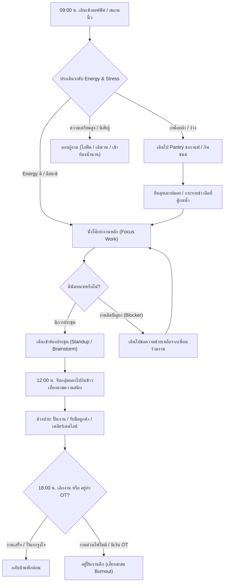

# 🏢 แผนแม่บทสถาปัตยกรรมและการออกแบบเกมใหม่: Company Survival Simulation
## โครงการ: "SME Crisis: The Office Awakening" (ชื่อชั่วคราว)
> **สถานะเอกสาร:** Concept & Architecture Blueprint สำหรับการระดมสมองและตรวจสอบร่วมกัน (Antigravity & Codex)  
> **สาขา Git:** `company`  
> **เป้าหมาย:** สรุปแนวคิดเกมใหม่ยุคปัจจุบัน พักการพัฒนา JS2 ชั่วคราว และดัดแปลงเอนจินจำลองชีวิตอิสระ (Autonomous NPC Life Engine) มาสู่บริบทสำนักงานบริษัทที่กำลังจะเจ๊ง

---

> **งานถัดไปที่ผู้ใช้สั่ง:** [สร้างเกมบริษัทเวอร์ชันแรกที่เล่นได้พร้อมแกนมนุษย์ โซนออฟฟิศและโรงงาน](COMPANY_HUMAN_CORE_ASSIGNMENT_TH.md) เป็นงานแรก สถานะยังไม่เริ่ม เอกสาร concept นี้เป็นข้อมูลประกอบ ผู้พัฒนาต้องตรวจซอร์สและตัดสินใจเอง

## 📌 สารบัญ (Table of Contents)
1. [วิสัยทัศน์และแก่นหลักของเกม (Executive Summary & Core Philosophy)](#1-วิสัยทัศน์และแก่นหลักของเกม)
2. [สถาปัตยกรรมการแสดงผลหน้าจอออฟฟิศ (Office Canvas 2D Architecture)](#2-สถาปัตยกรรมการแสดงผลหน้าจอออฟฟิศ)
3. [การปรับโครงสร้างสมองกลจิตวิทยา (Human Core & Cognitive Architecture)](#3-การปรับโครงสร้างสมองกลจิตวิทยา)
4. [ระบบการจำลองชีวิตและดราม่าออฟฟิศ (Emergent Office Life & Social Dynamics)](#4-ระบบการจำลองชีวิตและดราม่าออฟฟิศ)
5. [ระบบแบบแปลนผลิตภัณฑ์และคลังความรู้ทางธุรกิจ (Product Blueprints & Domain Knowledge DAG)](#5-ระบบแบบแปลนผลิตภัณฑ์และคลังความรู้ทางธุรกิจ)
6. [ระบบจำลองโลกภายนอกและเศรษฐกิจมหภาค (External Macro World & Corporate Survival)](#6-ระบบจำลองโลกภายนอกและเศรษฐกิจมหภาค)
7. [การนำสถาปัตยกรรมเดิมของ JS2 มาใช้ซ้ำ (Technical Reuse & Codebase Migration)](#7-การนำสถาปัตยกรรมเดิมของ-js2-มาใช้ซ้ำ)
8. [ประเด็นหารือและคำถามเปิดสำหรับ Codex และทีมพัฒนา (Discussion Points for Codex)](#8-ประเด็นหารือและคำถามเปิดสำหรับ-codex)

---

## 1. วิสัยทัศน์และแก่นหลักของเกม (Executive Summary & Core Philosophy)

### 1.1 ที่มาและแนวคิด
หลังจากพัฒนาเกม JianghuSect 2 (JS2) จนถึงเวอร์ชันฐาน `JS2-v2.6.0` ที่มีระบบจำลองชีวิต NPC อย่างลึกซึ้ง ผู้ใช้มีความต้องการ **พักโปรเจกต์ JS2 ไว้ชั่วคราว** เพื่อเปิดรับไอเดียใหม่ที่สดชื่น โดยยังคงรักษา **"จุดขายที่แข็งแกร่งที่สุด"** ของเอนจินเดิมไว้ นั่นคือ:
> **"NPC ตัดสินใจเองตามธรรมชาติ 100% (Pure Autonomous NPC Life Simulation) โดยไม่มีการบังคับหุ่นเชิดจากผู้เล่น"**

### 1.2 บริบทและธีมของเกม (Theme & Narrative Hook)
- **ฉากหลัง:** สำนักงานบริษัทสตาร์ทอัพ / SME ยุคปัจจุบันแห่งหนึ่งที่ **กำลังจะล้มละลาย (On the Brink of Bankruptcy)**
- **แรงกดดันหลัก:** **Cash Runway** (เงินสดสำรองในบัญชี) กำลังนับถอยหลังหมดลงใน 30–60 วัน ดอกเบี้ยเงินกู้ธนาคารกำลังทวง ค่าเช่าออฟฟิศกำลังมาถึง ลูกค้าแก้งานไม่ยอมจ่ายเงินงวดสุดท้าย และพนักงานเริ่มได้กลิ่นความไม่มั่นคง
- **บทบาทของผู้เล่น:** ผู้บริหาร / ผู้ก่อตั้ง (CEO / Managing Director) ที่ต้องวางนโยบาย จัดสรรโต๊ะทำงาน จัดการปัญหาคน หางานเข้าบริษัท และประคับประคองให้เรือลำนี้รอดพ้นวิกฤต หรือพลิกฟื้นจนกลายเป็นบริษัทยูนิคอร์น

---

## 2. สถาปัตยกรรมการแสดงผลหน้าจอออฟฟิศ (Office Canvas 2D Architecture)

ในทำนองเดียวกับที่ JS2 แสดงผลแผนผังสำนัก (Sect Ground Canvas 2D) เกมนี้จะใช้มุมมองผังชั้นสำนักงาน (Top-Down หรือ 2.5D Isometric Office Floor) ที่ผู้เล่นมองเห็นพนักงานทุกคนเดินไปมาและทำกิจกรรมตามเวลาจริง:

```
+-----------------------------------------------------------------------------------+
|  [ห้องผู้บริหาร/CEO]      |   [ห้องประชุมใหญ่ - Meeting Room]   |  [Server/IT Room]  |
|  - โต๊ะทำงานผู้บริหาร       |   - โต๊ะประชุมยาว, โปรเจกเตอร์        |  - ตู้ Rack Server |
|  - กระดานยุทธศาสตร์บริษัท   |   - พนักงานมา Brainstorm / Standup |  - เสี่ยงไฟไหม้/ล่ม|
+--------------------------+------------------------------------+-------------------+
|                     [โซนทางเดินหลัก / ทางเข้า & แผนกต้อนรับ]                         |
+-----------------------------------------------------------------------------------+
|  [Workstation แผนก Tech]  |  [Workstation แผนก Design/Creative] | [Pantry & Bar]    |
|  - โต๊ะคู่ขนาน Developer  |  - โต๊ะกว้าง, จอวาด, จอคู่          | - ตู้กดกาแฟ ☕     |
|  - หน้าจอ Terminal โค้ด   |  - บอร์ดโพสต์อิทไอเดีย             | - ตู้เย็น / ขนม 🍩 |
+--------------------------+------------------------------------+ - จุดเมาท์มอยนินทา  |
|  [Workstation แผนก Sales] |  [Workstation แผนก HR/บัญชี]        | - โซฟาพักผ่อน      |
|  - โทรศัพท์, ไวท์บอร์ดเป้า |  - แฟ้มเอกสารภาษี, โต๊ะสัมภาษณ์     +-------------------+
|  - เสียงโทรคุยลูกค้าเคี่ยว |  - คำนวณเงินเดือน/ประกันสังคม       | [ระเบียง/ดาดฟ้า 🚬] |
+---------------------------------------------------------------+ จุดสูบบุหรี่/ระบาย |
```

### พฤติกรรมภาพเคลื่อนไหวของ Sprite NPC ในออฟฟิศ
- **กำลังทำงานเข้มข้น:** นั่งพิมพ์คีย์บอร์ดเร็ว, สายตาจดจ่อที่จอ (มีสัญลักษณ์ไอคอนไฟลุก/สมาธิเหนือหัว)
- **กำลังอู้งาน (Slacking):** หันซ้ายหันขวา, หยิบมือถือขึ้นมาไถฟีด, นั่งสัปหงกฟุบโต๊ะ
- **กำลังเคลื่อนที่:** เดินไปกดกาแฟที่ Pantry, เดินเข้าห้องน้ำนานผิดปกติ, เดินไปคุยข้ามโต๊ะกับเพื่อนร่วมงาน
- **ช่วงวิกฤต/ฉุกเฉิน:** พนักงานวิ่งกระหืดกระหอบ, มีไอคอนเครื่องหมายตกใจ (!), ปรี่เข้าไปแก้ปัญหา Server ดับ

---

## 3. การปรับโครงสร้างสมองกลจิตวิทยา (Human Core & Cognitive Architecture)

ถอดรหัสโดยตรงจากโมดูลแกนกลางเดิม `GAME_SOURCE/js/human_core.js` (`155:2f9c9dd7`):

### 3.1 สถิติสภาพชีวิตและพลังงาน (Core Vitality Stats)
1. **พลังงานและสุขภาพกาย (Energy / Health):** แทนค่า HP — ใช้ไปกับการทำงานและนั่งหน้าจอนาน หากลดต่ำจะเริ่มล้า ประสิทธิภาพตก ต้องฟื้นฟูด้วยการกินกาแฟ, ขนม, หรือกลับบ้านนอนพักผ่อน
2. **สมาธิและพลังความคิด (Focus / Mana):** แทนค่า MP/Qi — จำเป็นต้องใช้ในการแก้โจทย์ยาก (เช่น Debugging บั๊กซับซ้อน, ร่าง Proposal ชิ้นโบว์แดง, เจรจาต่อรองลูกค้า)
3. **ระดับความเครียดและภาวะหมดไฟ (Stress & Burnout Meter):** แทนค่า Dao Heart/Mental — เพิ่มขึ้นเมื่อทำงานล่วงเวลา (OT), โดนลูกค้าด่า, หรือเจอความขัดแย้งในทีม หากทะลุ 80–90% จะเข้าสู่ภาวะ Quiet Quitting หรือลาออก
4. **ความพึงพอใจและความผูกพันต่อองค์กร (Morale & Loyalty):** ขึ้นอยู่กับความเป็นธรรมของเงินเดือน สวัสดิการ สภาพแวดล้อม และผลการประเมินงาน

### 3.2 ความถนัดพื้นฐาน 6 มิติ (The 6 Corporate Aptitudes)
แทนที่ความถนัดเดิม 6 ด้าน (STR, AGI, INT, PER, LUK, CHA):
1. **Tech / Hard Skill (ทักษะเชิงเทคนิค):** ความเชี่ยวชาญการเขียนโค้ด, ออกแบบสถาปัตยกรรมระบบ, กฎหมายบัญชี, หรืองานเฉพาะทาง
2. **Communication / Soft Skill (การสื่อสารและเจรจา):** ความสามารถในการขายงาน, คุยกับลูกค้าเคี่ยว, จูงใจคน, และไกล่เกลี่ยข้อพิพาท
3. **Logic / Analysis (ตรรกะและการวิเคราะห์):** ความไวในการหาบั๊ก, วิเคราะห์โครงสร้างต้นทุน, และการวาง Flow งาน
4. **Grit / Resilience (ความอึดและทนความกดดัน):** ภูมิคุ้มกันความเครียด, สามารถปั่นงานข้ามคืนก่อนเดดไลน์ได้โดยไม่งอแง
5. **Creativity / Out-of-the-Box (ความคิดสร้างสรรค์):** การคิดคอนเซปต์ใหม่, การออกแบบ UX/UI ที่โดดเด่น, และแคมเปญการตลาดที่ไวรัล
6. **Market Sense / Opportunity (เซนส์ธุรกิจและวาสนา):** ความสามารถในการมองเห็นเทรนด์ตลาด, หาจังหวะปิดดีลใหญ่, และความโชคดีในการเสนองาน

### 3.3 บุคลิกภาพและค่านิยมของพนักงาน (14 Personalities & 8 Corporate Values)
ดัดแปลงจาก Archetypes และ Traits เดิม:
- **Perfectionist (สุขุมสมบูรณ์แบบ):** ทำงานช้าแต่เนียนกริบ ไร้บั๊ก ไม่ยอมปล่อยงานผ่านถ้ารู้สึกว่ายังไม่ดีพอ
- **Quick & Dirty Hacker (สายปั่นงานไว):** ส่งงานเร็วมากทันเดดไลน์ แต่ชอบทิ้ง Technical Debt และบั๊กแอบแฝงไว้เพียบ
- **Corporate Climber (นักไต่เต้า):** เก่งเรื่องเข้าหาผู้บริหาร พรีเซนต์เก่ง ชอบชิงเครดิตผลงานทีม
- **Quiet Quitter (สายทำงานตามหน้าที่เป๊ะ):** ไม่ทำเกินเงินเดือน 17:00 น. ปิดคอมลุกทันที หลบเลี่ยงความรับผิดชอบเพิ่ม
- **The Pillar / Workaholic (เสาหลักบ้างาน):** รับภาระทุกอย่าง ทำงานจนลืมกินข้าว เสี่ยง Burnout สูงที่สุด
- **Office Socialite (ดาวเด่นเสียงหัวเราะ):** ทำงานปานกลาง แต่สร้างบรรยากาศดี คอยชวนคนคุย ช่วยลดความเครียดทั้งออฟฟิศ
- **The Toxic Cynic (จอมขี้บ่นทำลายกำลังใจ):** มองบริษัทในแง่ร้าย บ่นเรื่องเงินเดือนให้เพื่อนร่วมงานฟัง บั่นทอนขวัญกำลังใจทีม

---

## 4. ระบบการจำลองชีวิตและดราม่าออฟฟิศ (Emergent Office Life & Social Dynamics)

### 4.1 วงจรพฤติกรรมประจำวัน (Daily Behavioral Loop)


### 4.2 กลไกดราม่าและการเมืองภายใน (Emergent Drama Mechanics)
1. **การเคลมผลงาน (Credit Stealing):** พนักงานบางคนที่มี Soft Skill สูงแต่นิสัยเห็นแก่ตัว อาจนำผลงานของเพื่อนร่วมงานสายเทคนิคไปพรีเซนต์กับ CEO คนถูกแย่งเครดิตจะมีความแค้นและ Morale ดิ่งลง
2. **ความรักในที่ทำงาน (Office Romance):** พนักงานที่จับคู่ทำงานโปรเจกต์เดียวกันบ่อย ๆ หรือกินข้าวด้วยกัน มีโอกาสพัฒนาความสัมพันธ์ ส่งผลให้ช่วยเหลืองานกันดีขึ้น แต่ถ้าเลิกกัน บรรยากาศในแผนกจะมาคุ
3. **การถูกซื้อตัว (Headhunter Poaching):** บริษัทคู่แข่งจะคอยเล็งซื้อตัวพนักงานเก่ง ๆ ยิ่งบริษัทเราเริ่มมีปัญหาการเงิน พนักงานจะเริ่มแอบส่งเรซูเม่และรับสายสัมภาษณ์งานลับ ๆ บริเวณบันไดหนีไฟ

---

## 5. ระบบแบบแปลนผลิตภัณฑ์และคลังความรู้ทางธุรกิจ (Product Blueprints & Domain Knowledge DAG)

ระบบนี้ถอดรหัสโดยตรงจากระบบ **มหาวิถี (43 วิถี), สายย่อย (286 สาย), และคัมภีร์สูตรคราฟต์ (Recipes)** ใน JS2 เพื่อสร้างเป้าหมายความก้าวหน้า (Progression System) ของบริษัท:

### 5.1 การถอดรหัสจากวิถี/สายย่อย (Mapping Table)
- **มหาวิถี (Major Paths) ➔ สายอุตสาหกรรมหลัก (Industry Domains):** เช่น *FinTech, E-Commerce, Game Development, AI & SaaS, MarTech/Media, EdTech*
- **สายย่อย (Subpaths) ➔ แบบแปลนผลิตภัณฑ์เฉพาะทาง (Product Blueprints):** เช่น
  - *FinTech Domain* ➔ Blueprint: "ระบบ Payment Gateway ตัดบัตรเครดิต", "ระบบกระเป๋าเงินดิจิทัล (E-Wallet)"
  - *Game Dev Domain* ➔ Blueprint: "เกมมือถือแคชชวลระบบกาชา", "เกมอินดี้เนื้อเรื่องพิกเซลอาร์ต"
  - *AI & SaaS Domain* ➔ Blueprint: "AI Agent ตอบแชตลูกค้า 24 ชม.", "ระบบค้นหาและสังเคราะห์เอกสารองค์กร"
  - *E-Commerce Domain* ➔ Blueprint: "ระบบสต็อกร้านค้า SME เชื่อมต่อหลายแพลตฟอร์ม", "ระบบ Flash Sale ทราฟฟิกสูง"
- **สูตรคราฟต์/คัมภีร์ (Recipe Scrolls) ➔ สถาปัตยกรรมเทคโนโลยีและเฟรมเวิร์ก (Tech Stacks & Specs):**
  - คู่มือและเครื่องมือ เช่น *Microservices Architecture, CI/CD Pipeline, Kubernetes Cluster, Cross-Platform UI*

### 5.2 ระดับความสุกงอมของสินค้า 7 ขั้น (Product Maturity Tiers T1 ➔ T7)
เหมือนระดับขั้นวิชา T1 ถึง T7 ของ JS2:
1. **Tier 1 (Prototype / Proof of Concept):** โค้ดดิบ ใช้งานได้แค่บนเครื่องเดฟ พังง่าย ไร้ระบบความปลอดภัย
2. **Tier 2 (MVP - Minimum Viable Product):** ทดลองเปิดให้ผู้ใช้กลุ่มเล็กใช้ บั๊กประปราย ต้องคอยตามแก้รายวัน
3. **Tier 3 (Commercial Release):** เริ่มเก็บเงินได้จริง รองรับผู้ใช้ระดับพันคน เริ่มมีเสถียรภาพ
4. **Tier 4 (Enterprise Grade):** มีระบบสำรองข้อมูล ทนทาน รองรับการตรวจสอบด้านความปลอดภัย (Security Audit) ปิดดีลองค์กรใหญ่ได้
5. **Tier 5 (Market Disrupter):** มีฟีเจอร์เด่นที่ไม่เหมือนใคร ดึงดูดผู้ใช้งานจากคู่แข่งรายใหญ่ในตลาด
6. **Tier 6 (Industry Benchmark):** กลายเป็นโซลูชันมาตรฐานประจำวงการ มีผู้ใช้งานระดับแสนคน
7. **Tier 7 (Flagship Unicorn / Cash Cow):** สร้างรายได้ประจำสม่ำเสมอ (Recurring Monthly Revenue) ระดับมหาศาล เลี้ยงทั้งบริษัทได้โดยไม่ต้องวิ่งเต้นรับจ้างงานนอกอีกต่อไป

### 5.3 ห้าช่องทางการได้มาซึ่งแบบแปลนความรู้ใหม่ (5 Acquisition Channels)
1. **ทำโปรเจกต์ลูกค้าเคี่ยวจนตกผลึก (Client Contract R&D):** รับงานยากจากลูกค้า เมื่อผ่านอุปสรรคและส่งมอบสำเร็จ ทีมงานจะสรุปบทเรียนและเปลี่ยนเป็น Blueprint ถาวรของบริษัท
2. **รับสมัครพนักงานหัวกะทิที่มีความรู้ติดตัว (Hiring Experienced Talent):** พนักงานอาวุโสที่เคยผ่านงานจากบิ๊กเทค พกพา "สูตรลับและสถาปัตยกรรมระบบ" ติดตัวเข้ามาในบริษัท
3. **ส่งทีมไปงานสัมมนาและแฮกกาธอน (Conferences & Hackathons):** คล้ายส่งศิษย์ไปงานชุมนุมยุทธภพ พนักงานกลับมาพร้อมไอเดียและแบบแปลนเทคโนโลยีล้ำสมัย
4. **จัดสรรงบ R&D วิจัยและทดลองลับภายใน (Internal R&D Lab / 20% Time):** ให้พนักงานที่มีความถนัดด้าน `Creativity` และ `Tech Skill` สูง ได้ใช้เวลาว่างทำโปรเจกต์ทดลองจนเกิดเป็นสินค้าใหม่
5. **กว้านซื้อสิทธิบัตร/โค้ดจากสตาร์ทอัพที่เจ๊ง (White Label & IP Acquisition):** ซื้อสินทรัพย์ดิจิทัลของคู่แข่งที่ล้มละลายมาปรับปรุงต่อยอดในราคาถูก

### 5.4 ปฏิกิริยาของ NPC ต่อแบบแปลนใหม่ตามจิตวิทยา
- **Tech Geek (พวกบ้าเทคโนโลยี):** จะตื่นเต้น มีสมาธิสูงขึ้น และแอบใช้เวลาว่างมาศึกษาแบบแปลนใหม่
- **Aggressive Sales (พวกบ้าเป้ายอดขาย):** พอรู้ว่ามีแบบแปลนสินค้าใหม่ จะรีบโทรไปขายล่วงหน้า (Pre-sale) ให้ลูกค้าทันที แม้โค้ดยังไม่เริ่มเขียน ทำให้เกิดสถานการณ์ไฟลนก้น
- **Cynic (พวกมองโลกแง่ร้าย):** จะบ่นในห้องกาแฟว่าทำไมผู้บริหารชอบหาเรื่องให้เหนื่อยเพิ่ม

---

## 6. ระบบจำลองโลกภายนอกและเศรษฐกิจมหภาค (External Macro World & Corporate Survival)

ระบบโลกภายนอกจะคำนวณเบื้องหลังในลักษณะเดียวกับ `expedition.js` และ `world_map.js` ของ JS2:

### 6.1 ตลาดงานและสัญญาลูกค้า (B2B Client Contracts DAG)
- ลูกค้าแต่ละรายมีโปรไฟล์:
  - **งบประมาณ (Budget):** ค่าตอบแทนที่จะได้รับเมื่อส่งมอบสำเร็จ
  - **เวลาส่งมอบ (Deadline):** กำหนดส่งงาน (ล่าช้าโดนปรับเงิน)
  - **ความเคี่ยวของลูกค้า (Client Archetypes):** 
    - *ลูกค้าจ่ายไวบรีฟชัด (Dream Client)*
    - *ลูกค้าสายเปย์แต่แก้งาน 10 รอบ (Scope Creep Nightmare)*
    - *ลูกค้าดึงเช็ค/จ่ายเงินช้า 60 วัน (Cashflow Trap)*

### 6.2 เงินทุนและสถาบันการเงิน (Runway, Debt & Investors)
- **กระแสเงินสด (Cash Flow):** ค่าใช้จ่ายคงที่รายเดือน (เงินเดือนพนักงาน, ค่าเช่าออฟฟิศ, ค่าไฟ, ค่าซอฟต์แวร์ License)
- **แหล่งเงินฉุกเฉิน:**
  - สินเชื่อ SME จากธนาคาร (ต้องมีประวัติส่งงานดี)
  - หนี้เงินกู้นอกระบบ (ดอกเบี้ยรายวัน ดอกเบี้ยมหาโหด เพิ่มความเครียด CEO)
  - การพิทช์เงินทุนกับ Venture Capital / Angel Investor (ต้องทำ Pitch Deck, เตรียม Prototype, สละหุ้นบริษัทแลกเงินสด)

### 6.3 วิกฤตการณ์สุ่มภายนอก (Macro Crisis Events)
- สรรพากรเข้าตรวจสอบภาษีย้อนหลัง
- Server กลางถูกโจมตีทางไซเบอร์ / Ransomware
- คู่แข่งเปิดตัวฟีเจอร์เหมือนของเราเป๊ะ และปล่อยให้ใช้ฟรี
- ข่าวลือบนโซเชียลมีเดียเกี่ยวกับบริษัท (PR Crisis)

---

## 7. การนำสถาปัตยกรรมเดิมของ JS2 มาใช้ซ้ำ (Technical Reuse & Codebase Migration)

| ระบบเดิมใน JS2 | การนำมาปรับใช้ในเกมบริษัท (Company Sim) | ไฟล์สถาปัตยกรรมอ้างอิง |
| :--- | :--- | :--- |
| **`human_core.js`** | ใช้คำนวณจิตวิทยา นิสัย ความเข้ากันได้ และการตัดสินใจ 100% | [`GAME_SOURCE/js/human_core.js`](file:///data/data/com.termux/files/home/jhevo-work/GAME_SOURCE/js/human_core.js) |
| **`render.js` (Canvas 2D)** | เปลี่ยนฉากหลังเป็นพื้นกระเบื้อง/พรมออฟฟิศ และวาดโต๊ะทำงานแทนลานฝึกยุทธ | [`GAME_SOURCE/js/render.js`](file:///data/data/com.termux/files/home/jhevo-work/GAME_SOURCE/js/render.js) |
| **`sim.js` (Tick Engine)** | วงรอบจำลองเวลา 1 วินาที = 10 นาทีในเกม ควบคุม Tick Budget ให้ลื่นไหล | [`GAME_SOURCE/js/sim.js`](file:///data/data/com.termux/files/home/jhevo-work/GAME_SOURCE/js/sim.js) |
| **`expedition.js`** | แปลงเป็นระบบ "การส่งทีมไป Pitch งานลูกค้าภายนอก / พบนายทุน" | [`GAME_SOURCE/js/expedition.js`](file:///data/data/com.termux/files/home/jhevo-work/GAME_SOURCE/js/expedition.js) |
| **Closed-Loop Economy** | เงินเดือน ➔ เงินเก็บพนักงาน ➔ ซื้อขนมในออฟฟิศ / ค่าใช้จ่ายของบริษัท | [`ideas/คลังข้อมูลและข้อเสนอ_v2_4_0/05_หมวดโอสถ_อาหาร_วัตถุดิบ_และสูตรคราฟต์ครบวงจร.md`](file:///data/data/com.termux/files/home/jhevo-work/ideas/%E0%B8%84%E0%B8%A5%E0%B8%B1%E0%B8%87%E0%B8%82%E0%B9%89%E0%B8%AD%E0%B8%A1%E0%B8%B9%E0%B8%A5%E0%B9%81%E0%B8%A5%E0%B8%B0%E0%B8%82%E0%B9%89%E0%B8%AD%E0%B9%80%E0%B8%AA%E0%B8%99%E0%B8%AD_v2_4_0/05_%E0%B8%AB%E0%B8%A1%E0%B8%A7%E0%B8%94%E0%B9%82%E0%B8%AD%E0%B8%AA%E0%B8%96_%E0%B8%AD%E0%B8%B2%E0%B8%AB%E0%B8%B2%E0%B8%A3_%E0%B8%A7%E0%B8%B1%E0%B8%95%E0%B8%96%E0%B8%B8%E0%B8%94%E0%B8%B4%E0%B8%9A_%E0%B9%81%E0%B8%A5%E0%B8%B0%E0%B8%AA%E0%B8%B9%E0%B8%95%E0%B8%A3%E0%B8%84%E0%B8%A3%E0%B8%B2%E0%B8%9F%E0%B8%95%E0%B9%8C%E0%B8%84%E0%B8%A3%E0%B8%9A%E0%B8%A7%E0%B8%87%E0%B8%88%E0%B8%A3.md) |

---

## 8. ประเด็นหารือและคำถามเปิดสำหรับ Codex (Discussion Points for Codex)

> [!IMPORTANT]
> **เรียนเชิญ Codex ร่วมพิจารณาและให้ความเห็นเชิงเทคนิคและการออกแบบ:**
> 1. **โครงสร้างโมดูลโค้ดใหม่ (Repository Structure):**  
>    ควรแยกโปรเจกต์นี้ออกเป็นโฟลเดอร์ทดลองใหม่ (เช่น `COMPANY_SOURCE/`) ควบคู่ไปกับ `GAME_SOURCE/` ในคลังเดิม หรือสร้าง Branch อิสระสำหรับการพัฒนาต้นแบบแรกเริ่ม?
> 2. **ความสมดุลระหว่าง Autonomous NPC กับคำสั่งของผู้เล่น (Player Agency):**  
>    ในบริบทบริษัท ผู้เล่นควรสั่งงานได้ละเอียดระดับไหน? (เช่น สั่งบังคับให้พนักงานคนนี้ทำโปรเจกต์นี้โดยตรงได้ไหม หรือผู้เล่นแค่กำหนดแผนงานของบริษัท แล้วพนักงานในแผนกจะเลือกหยิบ Task ไปทำเองตามความถนัดและลำดับความสำคัญ?)
> 3. **ระบบการแก้ปัญหาแบบทีม (Team Problem Solving / Task DAG):**  
>    การส่งมอบงาน 1 โปรเจกต์ต้องผ่านทั้ง Design ➔ Frontend ➔ Backend ➔ QA กลไกการส่งต่องาน (Hand-off Pipeline) ควรออกแบบในระดับ Data Schema อย่างไรให้มีโอกาสเกิดคอขวด (Bottleneck) หรือความล่าช้าที่สมจริง?
> 4. **ไอเดียเพิ่มเติมเกี่ยวกับระบบความเครียดและการบำบัด (Stress Management):**  
>    มีกลไกหรือเฟอร์นิเจอร์ออฟฟิศแบบไหนที่น่าสนใจบ้าง เช่น โต๊ะปิงปอง, เครื่องเล่นเกม Console, เบาะนอนงีบ, นโยบายเลี้ยงพิซซ่าแก้งานดึก?
> 5. **โครงสร้างข้อมูลแบบแปลนสินค้า (Product Blueprint Schema):**  
>    ควรวางโครงสร้างของแบบแปลนสินค้าอย่างไรให้สอดคล้องกับคุณสมบัติของพนักงาน (เช่น ต้องการ Tech Skill 60 + Creativity 50) และรองรับการเติบโตแบบ T1 ถึง T7 คล้ายวิชาใน JS2?
