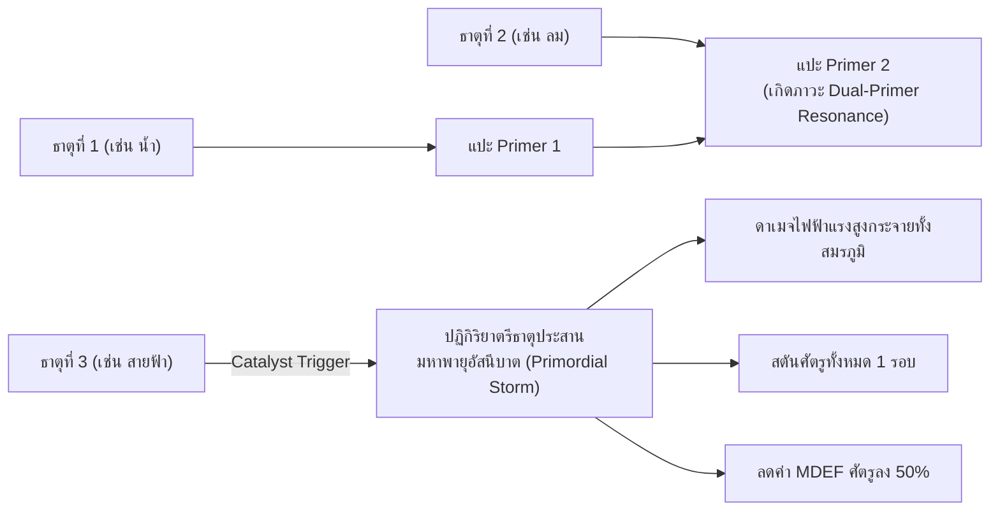
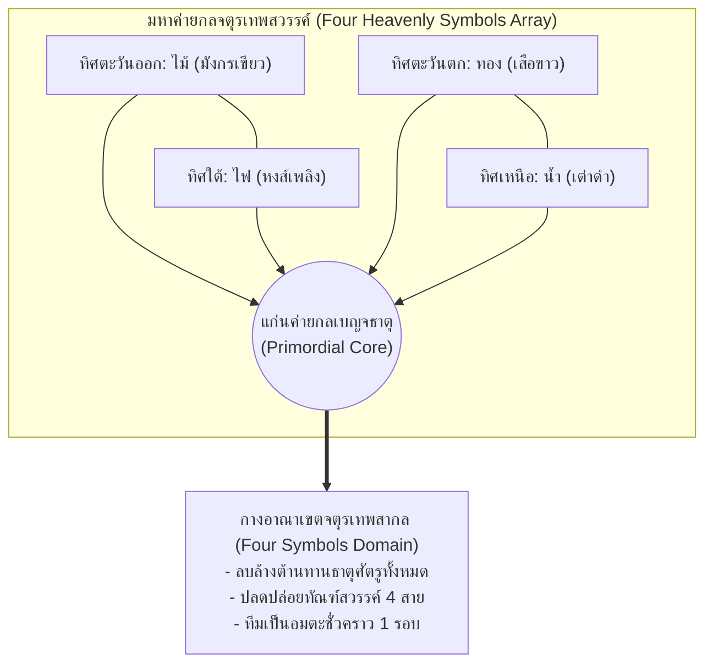
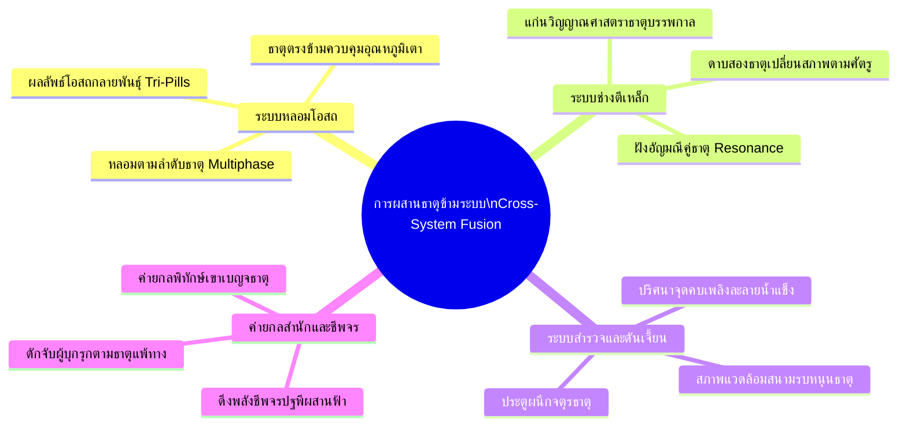

# Jianghu Evolution (JHEvo) — Future Systems Roadmap & Conceptual Blueprints
> **เอกสารโร้ดแมปและคลังรวบรวมแนวคิดการพัฒนาระบบในอนาคต (Future Roadmap & Architectural Blueprints)**
> ออกแบบและบันทึกไว้เพื่อการพัฒนาอย่างยั่งยืน รักษาสมดุล และความเท่าเทียมของทุกวิถีบำเพ็ญ

---

## 1. ปรัชญาแกนกลาง: ความเท่าเทียมกันของ 9 วิถีบำเพ็ญ (Core Principle: Universal 9-Path Equity)

ในการพัฒนาแพตช์ v2.0.9 ได้มีการตัดแนวคิด "การสร้างดันเจี้ยนเฉพาะทางสำหรับ 4 วิถีใหม่" ออกไป เนื่องจากในเกมเดิม 5 วิถีตั้งต้น (`XIAN`, `BODY`, `GOD`, `DEMON`, `HEART_SOUL`) ไม่มีดันเจี้ยนที่จำกัดเฉพาะวิถีของตนเอง การสร้างดันเจี้ยนเฉพาะให้เพียง 4 วิถีใหม่จะทำให้โครงสร้างเกมเกิดความลำเอียง (Faction Bias) และทำลายสมดุลของระบบสำรวจส่วนกลาง

**หลักการสำหรับการขยายระบบในอนาคต:**
1. **Universal Equal Access**: ทุกพื้นที่สำรวจ ดันเจี้ยน หรือด่านทดสอบที่เพิ่มเข้ามา ต้องเปิดให้ผู้ฝึกตนทั้ง 9 วิถีสามารถเข้าถึงและใช้ประโยชน์ได้เท่าเทียมกัน
2. **Equivalence-Driven Rewards**: รางวัลและโบนัสที่ได้รับต้องผูกกับระบบเทียบเคียงระดับตบะ (`Stage Equivalence`: `CULT.equivalentStage` / `CULT.effectiveTechStage`) ไม่ว่าจะเป็นวิถี 4 ขั้น, 5 ขั้น, 8 ขั้น หรือ 9 ขั้น
3. **Cross-Path Synergy**: การจัดปาร์ตี้ข้ามวิถีต้องได้รับผลตอบแทนที่ดีกว่าการใช้วิถีเดียวล้วน (ส่งเสริมความหลากหลายของศิษย์ในสำนัก)

---

## 2. แผนพิมพ์เขียวที่ 1: เจดีย์เก้าวิถีทดสอบสัจธรรม & แดนปฐมภูมิเบญจธาตุ (Universal Nine-Dao Trial Pagodas & Elemental Realms)

แทนที่จะทำดันเจี้ยนแยกวิถี ให้สร้างระบบ **"หอคอยทดสอบสากล"** ที่มีด่านทดสอบและรางวัลรองรับครบทั้ง 9 วิถีอย่างเท่าเทียม:

### 2.1 หอคอยเก้าวิถีทดสอบสัจธรรม (Nine-Dao Trial Pagoda)
* **โครงสร้าง**: หอคอยโบราณ 9 ชั้น แต่ละชั้นมีด่านทดสอบที่สอดคล้องกับแก่นแท้ของแต่ละวิถี:
  1. *ชั้นกระบี่และเวหา (Xian & Sword Trial)*: ทดสอบความคมของกระบี่บินและความเร็ว
  2. *ชั้นกายาวัชระ (Body & Fortitude Trial)*: ทดสอบความทนทานต่อแรงกระแทกและพิษ
  3. *ชั้นเทวบัญชา (God & Faith Trial)*: ทดสอบพลังวิญญาณศักดิ์สิทธิ์และแสงสุริยัน
  4. *ชั้นห้วงอเวจี (Demon & Shadow Trial)*: ทดสอบการต่อกรกับมารในใจและเงามืด
  5. *ชั้นสัจธรรมดวงจิต (Heart-Soul & Meditation Trial)*: ทดสอบตบะจิตและภาพมายา
  6. *ชั้นกลจักรศาสตรา (Mech & Puppet Trial)*: ทดสอบการแก้ปริศนาค่ายกลฟันเฟืองและหุ่นศิลา
  7. *ชั้นกงล้อสังสารวัฏ (Karma & Fate Trial)*: ทดสอบการแบกรับและสลายหนี้กรรม
  8. *ชั้นหมื่นอสูรประจัญ (Beast & Sovereign Trial)*: ทดสอบการสื่อสารและปราบสัตว์วิญญาณ
  9. *ชั้นมหาโอสถสวรรค์ (Sage & Support Trial)*: ทดสอบการถอนพิษ การสกัดจุด และการรักษาสนามพลัง
* **กลไกการเล่น**: ศิษย์ทุกคนสามารถเข้าท้าทายได้ทุกชั้น แต่หากตรงกับวิถีของตนเองจะได้รับคะแนนความเข้าใจ (`Comprehension Insights`) สูงเป็นพิเศษ และได้รับผลึกสัจธรรม (`Resonance Crystals`) เพื่อนำมาอัปเกรดอาวุธและวิชา

### 2.2 แดนปฐมภูมิเบญจธาตุ (Five-Elemental Primordial Realms)
* แบ่งพื้นที่ตาม **5 ธาตุหลัก (ดิน, น้ำ, ไฟ, ไม้, ทอง)** และ **ธาตุพิเศษ (ลม, อสนี, หยิน, หยาง)**
* ผู้ฝึกตนทุกวิถีที่มีรากวิญญาณ (`ELEM.root`) หรือวิชาที่สอดคล้องกับธาตุนั้น จะได้รับบัฟสภาพแวดล้อม และมีโอกาสค้นพบ "แก่นธาตุบริสุทธิ์" สำหรับนำไปขัดเกลาอาวุธหรือหลอมโอสถทะลวงขั้น

---

## 3. แผนพิมพ์เขียวที่ 2: มหายุทธการอสูรสงครามและพาหนะวิญญาณ (Spirit Beast Warfare & Mounts)

ต่อยอดจากระบบสัตว์เลี้ยงสากล (`n.pets`) และระบบเพาะพันธุ์ (`CULT.breedBeasts`) ในแพตช์ v2.0.9:

### 3.1 กองกำลังอสูรพิทักษ์สำนัก (Sect Beast Defense Vanguard)
* ให้สำนักสามารถจัดสรรสัตว์วิญญาณจากคอกสำนัก (`W.sect.beasts`) ให้ทำหน้าที่เป็น **"สัตว์พิทักษ์ประตูสำนัก" (Gate Guardians)**
* เมื่อมีกองโจร สัตว์อสูรคลั่ง หรือสำนักคู่อริเข้ามารุกราน (`EXPED.spawnRaid`) สัตว์พิทักษ์จะออกรบร่วมกับเวรยามโดยอัตโนมัติ ช่วยลดความเสียหายต่อสิ่งปลูกสร้างในสำนัก

### 3.2 ระบบสัตว์พาหนะวิญญาณ (Spirit Mount System)
* สัตว์วิญญาณสายวิหค (`AVIAN`) และสัตว์กีบ/สัตว์สี่เท้า (`CANINE`, `FELINE`, `UNGULATE`) ที่ได้รับการฝึกฝน สามารถตั้งเป็นสัตว์พาหนะสำหรับคณะสำรวจ (`EXPED.parties`)
* **ผลลัพธ์**: ลดระยะเวลาเดินทางภารกิจนอกสำนักลง 25–40% และเพิ่มน้ำหนักสัมภาระที่บรรทุกกลับมาได้

---

## 4. แผนพิมพ์เขียวที่ 3: ชุมนุมยัณฑ์ยุทธภพและการทูตเมืองขึ้น (All-Jianghu Martial Conference & Vassalage)

ต่อยอดจากระบบประลองยุทธ์สำนัก (`SECT.assembly`) และการทูต (`content.js`):

### 4.1 ชุมนุมยัณฑ์ยุทธภพ (Grand Jianghu Martial Conference)
* จัดขึ้นทุก ๆ 3 ปีจำลองในเกม โดยเชิญยอดฝีมือจากทุกสำนักทั่วแผนที่โลกมาร่วมประลอง
* การแข่งขันแบ่งตามระดับเทียบเคียง (`Junior`, `Core`, `Elder/Peak`)
* สำนักที่คว้าแชมป์จะได้รับค่าชื่อเสียงยุทธภพ (`Fame`) มหาศาล และดึงดูดศิษย์อัจฉริยะที่มีรากวิญญาณสวรรค์เข้ามาสมัครเข้าสำนักจำนวนมาก

### 4.2 สนธิสัญญาเมืองขึ้นและบรรณาการ (Tributary & Vassalage Treaties)
* เมื่อเอาชนะสำนักคู่อริในศึกชี้ชะตา หรือมีค่าความสัมพันธ์/อำนาจเหนือกว่าอย่างเด็ดขาด สามารถบีบให้ทำสัญญา "สำนักเจ้าหนี้/เมืองขึ้น" (`VASSAL_TREATY`)
* สำนักเมืองขึ้นจะส่งบรรณาการประจำฤดูกาลเป็นศิลาวิญญาณ สมุนไพรหายาก และคัมภีร์วิชา

---

## 5. แผนพิมพ์เขียวที่ 4: ด่านเคราะห์สวรรค์และการจุติสู่แดนบน (Heavenly Tribulation & Ascension) — Implemented in v2.0.11

### 5.1 ด่านเคราะห์อัสนีบาตสวรรค์ (Tribulation Lightning Trial)
* เมื่อผู้ฝึกตนบรรลุถึงจุดสูงสุดของวิถีตนเอง (ขั้น 8 หรือ ขั้น 9) การจะก้าวข้ามสู่ความเป็นอมตะต้องเผชิญกับ "เคราะห์ทัณฑ์สวรรค์" (Heavenly Tribulation)
* ทั้งสำนักต้องร่วมมือกัน: กางค่ายกลคุ้มภัย จัดเตรียมโอสถฟื้นฟู และให้ศิษย์สายซัพพอร์ตช่วยหนุนปราณป้องกันสายฟ้าทัณฑ์

### 5.2 จารึกมรดกเซียนจุติ (Ascension Legacy & Astral Blessing)
* ผู้ฝึกตนที่ผ่านเคราะห์สวรรค์และจุติสู่แดนบน จะทิ้ง "กายทิพย์จำลอง" หรือ "เจตจำนงเซียน" ไว้ที่ศาลบรรพชน (`Ancestral Shrine`)
* มอบพรระดับตำนานถาวรแก่คนรุ่นหลังในสำนัก เป็นเกียรติประวัติสูงสุดของการบริหารสำนักยุทธภพ

---
*เริ่มบันทึกแนวคิดใน v2.0.9; ระบบในหัวข้อ 5 ส่งมอบแล้วใน v2.0.11 ส่วนหัวข้อก่อนหน้าเป็นระบบที่ส่งมอบใน v2.0.10*


---

## 10. คลังแนวคิดเอฟเฟกต์ คุณสมบัติ และกลไกใหม่ (Effect, Property & Mechanic Idea Vault) — เพิ่มหลัง v2.0.34

> **สถานะ:** เป็นข้อเสนอเชิงออกแบบทั้งหมด **ยังไม่มีในซอร์ส** ณ v2.0.34 ไม่ใช่งานที่ต้องทำพร้อมกัน
> **ลำดับก่อนหลัง:** ต้องแก้ช่องว่างใน `NEXT_PATCH_PROMPT_V2_0_35.md` ก่อน (ตัวประเมิน Condition, Trigger Case, ท่าร่างมีผลจริง, Action ที่ยังเป็นแค่ชื่อ) เพราะหลายข้อด้านล่างต่อยอดจากกลไกกลางเหล่านั้น
> **หลักการ:** ทุกกลไกต้องเป็นข้อมูล (`composableSpec`/`effects`) ให้ออกแบบวิชา ไอเทม โอสถ สายย่อยได้โดยไม่ต้องเขียนโค้ดใหม่ต่อชิ้น ยึด Universal Equal Access ของ 12 วิถี และดูแลงบ `SIM.tick` < 3.0 ms

### 10.1 กลไกการต่อสู้ใหม่ (Combat Mechanics)

| รหัสข้อเสนอ | ชื่อกลไก | แนวคิด | ตัวอย่างการใช้ออกแบบ | ต้องมีก่อน |
| :--- | :--- | :--- | :--- | :--- |
| **C01** | **ยั่วยุและแย่งความสนใจ (Taunt / Aggro)** | สถานะ `taunt` บังคับศัตรูเลือกผู้ร่ายเป็นเป้า มีค่า `threat` สะสมจากดาเมจ/รักษา | วิชาแนวหน้าสาย `BODY`/`GOD` ดึงศัตรูมาที่ตนเอง, เกราะติดตัวเพิ่ม threat | Condition Evaluator |
| **C02** | **ผลัก ดึง รวมกลุ่ม (Knockback / Pull / Vacuum)** | เปลี่ยนพิกัด `(x, y)` ของเป้าหมายตามทิศ มีการต้านทาน (`poise`) | หมัดผลักศัตรูชนกำแพงเพิ่มดาเมจ, หุบเหวดึงศัตรูเข้าวงค่ายกล | Stance จริง |
| **C03** | **แถวหน้า–หลังและแนวป้องกัน (Row / Bodyblock)** | วิชาระยะประชิดเข้าถึงแถวหลังไม่ได้จนกว่าแถวหน้าล้ม; ศิษย์ป้องกันคุ้มกันแถวหลัง | ทำให้การจัดทีมมีความหมาย (ผู้สนับสนุนสาย `SAGE_SUPPORT` อยู่หลัง) | C01 |
| **C04** | **ดาเมจหน่วงเวลาและเสียงสะท้อน (Delayed Echo)** | คิวดาเมจที่ระเบิดอีก N รอบ ตามสัดส่วนดาเมจที่เป้าหมายรับระหว่างรอ | วิชา "ชะตาหน่วงเวลา" สะสมดาเมจแล้วระเบิดทีเดียว | Action `DELAYED_ECHO` ของ v2.0.35 |
| **C05** | **สเกลตามสถานะ (Dynamic Scaling)** | ตัวคูณจากค่าปัจจุบัน: เลือดที่หายไป, มารในใจ, พิษสะสม, จำนวนตรา, ระดับกรรม | "ยิ่งเจ็บยิ่งแรง", "ยิ่งจิตมารลึกยิ่งคม" โดยมีเพดานกันพังบาลานซ์ | Condition Evaluator |
| **C06** | **ตัดจังหวะร่ายและเกจต้านทาน (Interrupt / Poise Gauge)** | วิชาร่ายนานมีเกจ `poise`; ถูกตีจนเกจแตกจะถูกขัดจังหวะและติดสถานะมึนงง | สร้างทางเลือก "ร่ายแรงเสี่ยงถูกขัด" กับ "ร่ายเบาเร็ว" | `onStruck` เดิม |
| **C07** | **ร่ายต่อเนื่องแบบชาร์จ (Charge / Hold)** | กดชาร์จได้ 1–3 ระดับ แลกกับเวลาและความเสี่ยง | ธนู/พิณ/ยันต์ ชาร์จแล้วเพิ่มระยะ, ฮิต หรือพื้นที่ | C06 |
| **C08** | **ร่ายคู่ประสานวิชา (Co-Cast / Duet Skill)** | ศิษย์ 2 คนเงื่อนไขตรงกัน (คู่บำเพ็ญ, อาจารย์–ศิษย์, ยอดเขาเดียวกัน) ร่ายวิชาผสานทันที | คู่บำเพ็ญ "กระบี่คู่ฟ้าดิน", อาจารย์–ศิษย์ "ถ่ายทอดกระบวนท่าขั้นสุดท้าย" | Condition `SAME_PEAK_ALLY_PRESENT` |
| **C09** | **สลายสถานะและยกระดับ (Cleanse-to-Power)** | ล้างดีบัฟตนเอง แล้วแปลงจำนวนที่ล้างเป็นโบนัส (โล่/คริ/ปราณ) | สาย `HEART_SOUL` "ชำระจิตให้เป็นพลัง" | Action `ABSORB_DOT_TO_SHIELD` เดิม |
| **C10** | **สถานะแพร่กระจายตามระยะ (Contagion)** | ดีบัฟ DoT กระโดดไปเป้าหมายใกล้เคียงเมื่อเป้าหมายแรกตาย | พิษหมอกลามทั้งสนามรบ ต้องมีเพดานจำนวนกระโดด | Target Selector เดิม |
| **C11** | **ฟื้นฟูเมื่อใกล้ตายครั้งเดียวต่อศึก (Phoenix Clause)** | เงื่อนไขสละบางอย่างเพื่อรอดตายครั้งเดียว มีราคาที่ต้องจ่ายหลังศึก (ตบะลด/อายุขัยลด) | โอสถ/ยันต์ "ชุบชีวิตแลกอายุ" | Condition `SELF_HP_BELOW_PCT` |
| **C12** | **สมรภูมิและเขตแดน (Battlefield Domain)** | เขตแดนต่อเนื่องหลายรอบ เปลี่ยนกติกา: ธาตุเด่น, ห้ามฟื้นฟู, ความเร็วเปลี่ยน | `DOMAIN_ASTRAL_STARFIELD` ฯลฯ ที่รายงาน v2.0.34 อ้างถึงแต่ยังไม่มีโค้ด | Pillar 6 ของ v2.0.35 |

### 10.2 คีย์เวิร์ดเงื่อนไขและทริกเกอร์ที่ควรเพิ่ม (New Conditions & Triggers)

- **Conditions:** `TARGET_IS_ELEMENT:<ธาตุ>`, `TARGET_HAS_STATUS_COUNT_GTE:n`, `SELF_HAS_BUFF:<id>`, `ALLY_COUNT_ALIVE_GTE:n`, `ENEMY_COUNT_ALIVE_GTE:n`, `ROUND_NUMBER_GTE:n`, `WEATHER_IS:<สภาพ>`, `TIME_OF_DAY_IS:<ช่วง>`, `LOCATION_TAG_IS:<ภูมิภาค/แดน>`, `SELF_HEART_DEMON_ABOVE_PCT`, `SELF_TOXICITY_ABOVE_PCT`, `WIELDING_WEAPON_TYPE:<ชนิด>`, `FIRST_STRIKE_IN_FIGHT`, `TARGET_IS_BOSS_OR_ELITE`, `COMPANION_PRESENT` (คู่บำเพ็ญ), `MENTOR_OR_DISCIPLE_PRESENT`
- **Triggers:** `ON_ROUND_START`, `ON_ROUND_END`, `ON_ALLY_FALL`, `ON_ENEMY_FALL`, `ON_DEBUFF_RESISTED`, `ON_SKILL_COOLDOWN_READY`, `ON_COMBO_CHAIN_N`, `ON_FIRST_STRIKE`, `ON_ENTER_REALM`/`ON_LEAVE_REALM` (แดนลับ), `ON_BREAKTHROUGH_SUCCESS`/`ON_BREAKTHROUGH_FAIL`, `ON_PILL_CONSUMED`, `ON_ITEM_CRAFTED`, `ON_DAWN`/`ON_DUSK`
- **Tag/Keyword กลาง:** แท็กให้วิชา/ไอเทม/สถานะ เช่น `#FIRE`, `#BLOOD`, `#SOUND`, `#SEAL`, `#TRUE_DMG`, `#SUMMON`, `#PHYSICAL` แล้วให้เอฟเฟกต์อ้าง "ทุกสิ่งที่มีแท็กนี้" แทนการระบุ ID ทีละอัน (ลดข้อมูลซ้ำซ้อนอย่าง EFX_BURNING กับ EFX_BURNING_DOT)

### 10.3 คุณสมบัติสถานะและทรัพยากรใหม่ (New Status & Resource Properties)

| รหัส | ชื่อ | แนวคิด |
| :--- | :--- | :--- |
| **S01** | **ภูมิต้านทานสะสม (Diminishing Resistance)** | สถานะควบคุมซ้ำจะสั้นลงตามลำดับ ป้องกันล็อกตาย |
| **S02** | **สถานะซ้อนชั้นหลากรูป (Layered Stacks)** | สแต็กแยกตามผู้ร่าย ต่างจากตรา 5 ชั้นเดิมที่รวมกัน |
| **S03** | **พิษอันตรกิริยา (Toxin Synergy)** | โอสถ/พิษ 2 ชนิดผสมกันเกิดผลที่ชนิดเดียวไม่มี (ทั้งดีและเสีย) |
| **S04** | **พลังงานรอง (Secondary Resource)** | ทรัพยากรเฉพาะสาย เช่น `ลมปราณหนาว`, `จิตสังหาร`, `ลายค่ายกล`, `แต้มกลไก` ใช้ร่วมกับ Condition/Action โดยไม่แตะ `human_core.js` (เก็บใน `cult`/`ext`) |
| **S05** | **ค่าความคุ้นเคยอาวุธ (Weapon Affinity Ramp)** | ใช้อาวุธเดิมในศึกต่อเนื่องแล้วโบนัสสะสม รีเซ็ตเมื่อเปลี่ยน |
| **S06** | **ภาวะสั่นพ้องธาตุ (Elemental Attunement)** | ใช้ธาตุเดียวต่อเนื่องเพิ่มพลัง แต่ธาตุตรงข้ามแรงขึ้น ผูกกับ `elementalOvercharge` เดิม |
| **S07** | **สัญญาและคำสาบาน (Vow / Oath)** | เลือกข้อจำกัดโดยสมัครใจ (ไม่ใช้โอสถ, ห้ามฆ่า) แลกกับโบนัสถาวรหรือทะลวงด่านง่ายขึ้น; ผิดสัญญามีโทษ |
| **S08** | **ร่องรอยกรรมสะสม (Karma Ledger)** | ตัวเลขกรรมต่อการกระทำจริง (ช่วย/ฆ่า/ผิดคำสาบาน) ส่งผลต่อทัณฑ์สวรรค์และวาสนา เชื่อมกับ `KARMA_SAMSARA` |

### 10.4 กลไกไอเทมและอุปกรณ์ใหม่ (Item & Equipment Mechanics)

1. **อาวุธเติบโตตามผู้ใช้ (Living Weapon):** ขยายระบบจิตวิญญาณศาสตราใน `SECT.SOUL_FORGE` ให้เลือกสาขาวิวัฒนาการตามพฤติกรรมของเจ้าของ (ฆ่า/ปกป้อง/ค้นพบ) เปลี่ยนเอฟเฟกต์ประจำอาวุธจริง
2. **ชุดเกราะปรับตัวตามศัตรู (Adaptive Armor):** หลังรับดาเมจธาตุเดิมซ้ำ ต้านทานธาตุนั้นสะสม (มีเพดาน) แต่เปิดช่องธาตุอื่น
3. **ไอเทมคู่ (Paired Items):** สองชิ้นเป็นคู่ (กระบี่ผู้–เมีย, ตราหยกซ้าย–ขวา) ให้ผลเฉพาะเมื่อเจ้าของสองคนอยู่ในทีมเดียวกัน ต่อยอดระบบคู่บำเพ็ญ
4. **ไอเทมมีสัญญาผูกใจ (Soul-Bound with Condition):** ใช้ได้เมื่อผู้ถือตรงเงื่อนไขนิสัย/คุณธรรม (`HC.personality`) เช่น "ดาบซื่อสัตย์" ทำงานเต็มเมื่อ `integrity` สูง
5. **ไอเทมชำรุดแล้วแปรรูป (Break-to-Transform):** ความทนทานหมดไม่ได้หายไปเฉยๆ แต่แปรเป็นวัตถุดิบ/เศษ/พรชั่วคราว
6. **ช่องหยกฝังหลายชั้น (Socket & Rune Layers):** ช่องฝังรูนที่กำหนดเอฟเฟกต์เสริมตามแท็ก (`#FIRE`) ต่อยอดชุด Resonance 31 ชุดเดิม
7. **ไอเทมใช้ครั้งเดียวแบบมีเงื่อนไขกระตุ้น (Armed Consumable):** ติดตั้งไว้ก่อนศึก (เช่น ยันต์กับดัก) ทำงานเมื่อ Trigger ตรง ไม่ใช่กดใช้ทันที

### 10.5 โอสถและการบ่มเพาะรูปแบบใหม่ (Pills & Cultivation)

- **โอสถความทรงจำ (Insight Pills):** แลกอายุ/สถานะบางอย่างเพื่อเรียนวิชาเร็วขึ้นชั่วคราว มีผลข้างเคียงด้านจิต
- **โอสถปรับรากปราณ (Root Mutator):** เปลี่ยนหรือเพิ่มธาตุถาวรอย่างมีเงื่อนไขและความเสี่ยงสูง (เชื่อมกับ `EFX_BLOODLINE_AWAKEN` ที่ยังเป็นข้อมูลเปล่า)
- **ตำรับโอสถผสมข้ามธาตุ (Cross-Element Alchemy):** เตาหลอมอ่านแท็กวัตถุดิบ ไม่ใช่สูตรตายตัว สร้างเอฟเฟกต์ใหม่จากการผสม ต้องมีตัวตรวจว่าห้ามวงจรสูตร (DAG) ยังคงเป็น Acyclic
- **การบำเพ็ญตามฤดูกาล/ฤกษ์ยาม (Seasonal Cultivation):** ตบะเร่งในแดนหรือเวลาเฉพาะ (วสันต์, จันทรคราส) เชื่อมกับ Condition `WEATHER_IS`/`TIME_OF_DAY_IS`
- **ตราสำเร็จมรรค (Dao Seals):** บันทึกความสำเร็จด้านใดด้านหนึ่ง (ปราบมารร้อยตัว, ช่วยชีวิตสิบคน) แล้วเลือกพรถาวรได้ 1 ข้อ เป็นตัวขับเคลื่อนสายย่อยแบบเลือกเอง
- **ทัณฑ์สวรรค์แบบกำหนดเอง (Custom Tribulation Modifiers):** ผู้เล่นเลือกเพิ่มความยากทัณฑ์สวรรค์โดยสมัครใจเพื่อรางวัลระดับสูง

### 10.6 สายย่อยและวิถีรูปแบบใหม่ที่เปิดได้ด้วยกลไกข้างต้น (Subpath Archetypes Unlocked)

| สายย่อยต้นแบบ | กลไกหลักที่ใช้ | หมายเหตุ |
| :--- | :--- | :--- |
| **จอมยั่วยุผู้พิทักษ์ (Warden Taunter)** | C01 Taunt, C03 Bodyblock, S01 | แนวหน้า ปกป้องแถวหลัง |
| **ผู้ชี้ชะตา (Fate Weaver)** | C04 Delayed Echo, S08 Karma Ledger | สายหน่วงเวลา/ผลกรรม |
| **ปรมาจารย์ค่ายกลสนามรบ (Domain Arrayist)** | C12 Domain, S04 ลายค่ายกล | สายควบคุมสนามรบ |
| **นักสู้สาบาน (Oath-Bound Duelist)** | S07 Vow, C06 Poise | ได้พลังจากการจำกัดตนเอง |
| **หมอพิษกู่ (Contagion Alchemist)** | C10 Contagion, S03 Toxin Synergy | แพร่พิษแบบเชนมีเพดาน |
| **ผู้เชื่อมวิญญาณคู่ (Duet Sage)** | C08 Co-Cast, ผูกคู่บำเพ็ญ | เล่นคู่ ต่อยอด v2.0.30 |
| **นักรบเปลี่ยนท่า (Stance Dancer)** | Stance จริง, ON_STANCE_SWITCH | พึ่งท่าร่างต้อง v2.0.35 ก่อน |

### 10.7 กลไกโลกและสำนัก (World & Sect Layer)

1. **เอฟเฟกต์ระดับสำนัก (Sect-Wide Auras):** นโยบาย/อาคาร/ค่ายกลให้เอฟเฟกต์ต่อทุกศิษย์ที่ตรงเงื่อนไข ผ่านเอนจินเดียวกับเอฟเฟกต์รายบุคคล
2. **เอฟเฟกต์จากสถานที่ (Location Effects):** แดนลับ/ภูมิภาค/จุดทรัพยากรมีแท็กและเงื่อนไข ให้ไอเทมและวิชาตอบสนอง (วิชาแรงขึ้นในแดนที่ตรงธาตุ)
3. **ผลสะเทือนจากเหตุการณ์ยุทธภพ (World Event Modifiers):** สงคราม/ทุพภิกขภัย/ฟ้าผ่าเปลี่ยนค่า Condition ทั่วโลกชั่วคราว (ราคาโอสถ, อัตราเกิดสัตว์อสูร)
4. **ผลจากคำสาบานสำนัก (Sect Vows):** สำนักเลือกหลักการ (ธรรมะเคร่ง/พาณิชย์/สงคราม) เปิดเอฟเฟกต์และปิดอีกกลุ่ม เกี่ยวพันก๊กการเมืองภายใน
5. **มรดกเอฟเฟกต์ข้ามรุ่น (Heritable Effects):** ทายาท/ศิษย์สืบทอดเอฟเฟกต์ที่ลดทอนลงจากอาจารย์/พ่อแม่ ต่อยอดระบบทายาท v2.0.30

### 10.8 สถาปัตยกรรมที่ควรเตรียมเพื่อรองรับทั้งหมด (Engineering Prerequisites)

1. **Registry เดียวสำหรับคีย์เวิร์ด:** ย้าย Trigger/Condition/Action/Selector/Tag ไปเป็นตารางข้อมูลเดียว พร้อมช่อง `implemented: true/false` และตัวตรวจ Schema ที่ **ปฏิเสธ** คีย์เวิร์ดที่ประกาศแต่ยังไม่มีตัวประมวลผล (กันซ้ำรอยปัญหา Condition 13 รายการเป็น Dead Code)
2. **Normalize ชื่อคีย์เวิร์ดชั้นเดียว:** ตัดปัญหา `ON_HIT` กับ `onHit` ตั้งแต่ตอนโหลดข้อมูล
3. **Effect Pipeline มาตรฐาน:** `Trigger → Condition → TargetSelector → Action → Modifier → Cleanup` ใช้ร่วมกันทั้งวิชา ไอเทม โอสถ ยันต์ และสายย่อย แทนการเขียน `if (eid === ...)` เฉพาะตัวแบบใน `runItemEffectProcs`
4. **งบประสิทธิภาพ:** แคชผลการประเมิน Condition ต่อรอบ, จำกัดเชนเอฟเฟกต์ (`MAX_TRIGGER_DEPTH`), ตั้งเพดานเอฟเฟกต์ที่รันต่อ tick
5. **เครื่องมือออกแบบ:** เพิ่มหน้า Edit Hub ตรวจ/ลองใช้ `composableSpec` พร้อมแสดงว่าคีย์เวิร์ดไหนทำงานจริง
6. **ชุดทดสอบเชิงข้อมูล:** ทดสอบอัตโนมัติว่า "ทุกคีย์เวิร์ดใน Registry ต้องมีอย่างน้อย 1 กรณีทดสอบที่ยืนยันผลจริง" และ "ทุก effectId ในไอเทมต้องมีตัวประมวลผล"
7. **ข้อกำหนดคงเดิม:** ห้ามแตะ `human_core.js` (`HC.FINGERPRINT === '155:2f9c9dd7'`), รักษา 40 สคริปต์, สร้างไฟล์เดี่ยวด้วย `node tools/build_single.js`, ข้อความผู้เล่นเป็นภาษาไทย

### 10.9 ข้อเสนอลำดับการพัฒนา (Suggested Sequencing)

1. **v2.0.35:** แก้ช่องว่างเดิม (ดู `NEXT_PATCH_PROMPT_V2_0_35.md`)
2. **v2.0.36:** รวม Registry/Normalize + Tag/Keyword กลาง + Condition/Trigger ชุดใหม่ (10.2, 10.8) พร้อมตัวตรวจ "ห้ามคีย์เวิร์ดไร้ตัวประมวลผล"
3. **v2.0.37:** กลไกรบรอบใหม่ที่ไม่ต้องแก้พิกัด: C04, C05, C06, C09, C11 และสถานะ S01, S02
4. **v2.0.38:** กลไกที่แตะตำแหน่ง/แถว: C01, C02, C03, C07, C08, C12
5. **v2.0.39+:** ไอเทม โอสถ สายย่อยใหม่ (10.4–10.6) ที่ใช้กลไกชุดก่อนหน้า; กลไกโลกและสำนัก (10.7)

> **หมายเหตุสถานะการตรวจ:** ข้อเสนอในหมวด 10 ออกแบบจากผลตรวจ Registry และซอร์ส v2.0.34 (ช่องว่างของ Condition/Trigger/Stance/Action/Domain และ effectId 40 รายการ) ยังไม่ได้ทดลองใช้งานหรือวัดบาลานซ์ในเกม การจัดลำดับเป็นข้อเสนอ ปรับได้ตามเป้าหมายแพตช์


---

## 11. ระบบการผสานมหาธาตุขั้นสูง 2, 3 และ 4 ธาตุ (Multi-Tier Elemental Fusion System)

> **สถานะการออกแบบ:** พิมพ์เขียวทางเทคนิคและคลังกลไกการผสานธาตุ (Elemental Reactions & Fusions) ออกแบบให้เป็นข้อมูลขับเคลื่อน (`Data-Driven Composable Specs`) สามารถนำไปปรับใช้ในระบบต่อสู้ (`COMBAT.COMPOSABLE_ENGINE`), การหลอมโอสถ, การตีบวกอุปกรณ์ และค่ายกลพิทักษ์สำนัก โดยไม่ต้องแตะต้อง `human_core.js`

```mermaid
flowchart TD
    subgraph Tier1["ระดับ 1: ทวิธาตุ (2-Element)"]
        T1_A["Primer (ธาตุตั้งต้น)"] -->|Catalyst (ธาตุกระตุ้น)| T1_R["เกิดปฏิกิริยาทวิธาตุ\n(Thermal Shock / Superconduct / Overgrowth)"]
    end
    subgraph Tier2["ระดับ 2: ตรีธาตุประสาน (3-Element Tri-Harmonic)"]
        T2_A["Dual-Primer A+B\n(ติด 2 สถานะธาตุพร้อมกัน)"] -->|Catalyst C (ธาตุที่ 3)| T2_R["เกิดมหาปฏิกิริยาตรีธาตุ\n(Cataclysm / Singularity / Void Bloom)"]
    end
    subgraph Tier3["ระดับ 3: จตุรธาตุบรรพกาล (4-Element Primordial)"]
        T3_A["Four-Node Formation\nหรือ 4 Elemental Marks สะสม"] -->|Finisher Strike / Array Trigger| T3_R["มหาค่ายกลสะเทือนฟ้าดิน\n(Four Symbols Domain / Primordial Samsara)"]
    end
```

---

### 11.1 สถาปัตยกรรมและกลไกแกนกลาง (Core Elemental Architecture & Gauge Engine)

เพื่อให้ระบบธาตุมีความลึกซึ้ง ไม่ใช่เพียงการสุ่มติด หรือดาเมจเพิ่มแบบคงที่ กลไกทำงานผ่านระบบ **Elemental Gauge (เกจสะสมธาตุ)**:

1. **ธาตุตั้งต้น (Primer Element) และเกจการคงอยู่ (Gauge Units - GU):**
   * เมื่อถูกโจมตีด้วยสกิลธาตุ เป้าหมายจะได้รับ "Aura ธาตุ" มีค่าเกจตั้งแต่ 1.0U ถึง 2.0U
   * ค่าเกจจะค่อยๆ สลายตัวตามเวลา (Decay Rate 0.2U ต่อรอบการต่อสู้)
   * หากโดนธาตุเดิมซ้ำ จะรีเฟรชระยะเวลาและสะสมเกจได้สูงสุด 3.0U
2. **ธาตุกระตุ้น (Catalyst Element):**
   * เมื่อเป้าหมายที่มี Primer โดนโจมตีด้วยธาตุที่ทำปฏิกิริยาได้ จะเกิดปฏิกิริยาขึ้นทันที
   * ปฏิกิริยาจะหักล้างเกจของ Primer ออกตามสัดส่วน หากเกจยังเหลือ ธาตุเดิมจะยังคงอยู่
3. **Internal Cooldown (ICD) เพื่อประสิทธิภาพของระบบจำลอง:**
   * เพื่อรักษาขอบเขตงบประมาณความเร็ว `SIM.tick < 3.0 ms` การเกิดปฏิกิริยาธาตุบนเป้าหมายเดิมจะมี ICD ขั้นต่ำ 0.5 วินาทีจำลอง หรือ 1 Action เพื่อป้องกัน Infinite Cascade Loop

---

### 11.2 คลังปฏิกิริยาทวิธาตุ (2-Element Reactions: 16 รูปแบบ)

ปฏิกิริยา 2 ธาตุแบ่งเป็น 3 กลุ่มพฤติกรรมหลัก: **กลุ่มระเบิดหักล้าง (Explosive/Thermal)**, **กลุ่มเร่งเร้าลุกลาม (Amplifying/Spreading)**, และ **กลุ่มควบคุมแทรกซึม (Catalytic/Crowd Control)**

| ลำดับ | คู่ธาตุ (Primer + Catalyst) | ชื่อปฏิกิริยา (Reaction Name) | กลไกการทำงานและผลลัพธ์ (Mechanics & Effects) | การประยุกต์ใช้ในเกม |
| :---: | :--- | :--- | :--- | :--- |
| **2E-01** | **ไฟ (FIRE) + น้ำ (WATER)** | **ไอน้ำระเบิดฉับพลัน (Thermal Vaporize)** | หักล้างสถานะทั้งสอง ปลดปล่อยดาเมจระเบิดแรงขึ้น 200% ตามพลังโจมตีเวท พร้อมสร้างหมอกไอน้ำบดบังการมองเห็น ลดค่าแม่นยำ (HIT) ของศัตรูในระยะ 1 ช่องลง 30% เป็นเวลา 2 รอบ | วิชาสายกระบี่วารีผสานเพลิง, ระเบิดควันหลบหนี |
| **2E-02** | **ไฟ (FIRE) + ไม้ (WOOD)** | **เพลิงลุกโชนเผาผลาญ (Wildfire Conflagration)** | ธาตุไม้ทำหน้าที่เป็นเชื้อเพลิง ขยายระยะเวลาเผาไหม้ (`burn`) เพิ่มขึ้น 2 เท่า และเปลี่ยนเป็นเปลวไฟลาม (Spreading Flame) กระจายดาเมจ DoT 50% ไปยังยูนิตข้างเคียงทุกรอบ | วิชาค่ายกลเพลิงพฤกษา, ธนูเพลิงเผาค่าย |
| **2E-03** | **ไฟ (FIRE) + ทอง (METAL)** | **หลอมศาสตราแผดเผา (Molten Armor Melt)** | เผาชุดเกราะและอาวุธศัตรู ลดเกราะกายภาพและต้านทานเวท (PDEF & MDEF) ลง 35% เป็นเวลา 3 รอบ และทำให้ศัตรูมีโอกาสอาวุธหลุดมือ (Disarm) 15% | วิชาหมัดเพลิงเหล็กกล้า, ค้อนตีเหล็กบรรพชน |
| **2E-04** | **ไฟ (FIRE) + ดิน (EARTH)** | **หินหลอมเหลวปะทุ (Magma Eruption)** | สร้างแอ่งลาวาใต้เท้าเป้าหมาย ทุกก้าวที่ขยับจะได้รับดาเมจไฟแท้จริง (True DMG) และติดสถานะสะกัดการเคลื่อนไหว (Grounded) บินหรือพุ่งไม่ได้ | วิชาขุนเขาเพลิง, กับดักค่ายกลปฐพี |
| **2E-05** | **น้ำ (WATER) + ไม้ (WOOD)** | **งอกงามแทรกราก (Verdant Proliferation)** | หากเกิดบนมิตร: ฟื้นฟูเลือดต่อเนื่อง (HoT) เพิ่มขึ้น 40% และชำระล้าง 1 ดีบัฟ / หากเกิดบนศัตรู: รากไม้แทรกซึมสูบปราณ (Qi Leech) 5% มามอบให้ผู้ร่าย | โอสถรักษาพฤกษาวารี, วิชาพฤกษาฟื้นวิญญาณ |
| **2E-06** | **น้ำ (WATER) + สายฟ้า (LIGHTNING)** | **กระแสไฟฟ้านำสื่อ (Electrified Conduit)** | ไฟฟ้ากระจายไปตามละอองน้ำ ช็อตศัตรูทุกตัวที่เปียกน้ำในระยะ 3 ช่อง เกิดดาเมจสายฟ้ากระโดดต่อเนื่อง (Chain Lightning) สูงสุด 4 เป้าหมาย พร้อมสตันสั้น 0.5 วินาที | วิชากระบี่วารีอัสนี, ค่ายกลบ่อสระสายฟ้า |
| **2E-07** | **น้ำ (WATER) + น้ำแข็ง (ICE)** | **เยือกแข็งสัมบูรณ์ (Absolute Glaciation)** | แช่แข็งเป้าหมายทันที (Freeze 1 รอบเต็ม) หยุดการกระทำทั้งหมด เป้าหมายที่ถูกแช่แข็งจะมีเกราะกายภาพเพิ่มขึ้น 20% แต่เปราะต่อการทุบกระแทก (Blunt/Shatter) โดนดาเมจทุบแรงขึ้น 150% | วิชาเยือกแข็งเก้าสวรรค์, กระบี่เหมันต์ |
| **2E-08** | **น้ำ (WATER) + ดิน (EARTH)** | **โคลนดูดตรึงฝีเท้า (Quicksilver Quagmire)** | สร้างหล่มโคลนดูด ลดความเร็วเคลื่อนที่และความเร็วโจมตี (SPD & ASPD) ของศัตรูลง 50% และทำให้การหลบหลีก (DODGE) กลายเป็น 0 | วิชาฝ่ามือโคลนดูด, ค่ายกลหนองบึงพสุธา |
| **2E-09** | **ทอง (METAL) + สายฟ้า (LIGHTNING)** | **ตัวนำยิ่งยวดสนามแม่เหล็ก (Superconducting Magnetic Cage)** | สร้างสนามแม่เหล็กดึงดูดอาวุธและเศษโลหะรอบข้าง ลดต้านทานกายภาพของศัตรูลง 40% และทำให้การโจมตีระยะไกลประเภทลูกศรหรือกระบี่บินเบี่ยงทิศเข้าหาเป้าหมายนี้โดยอัตโนมัติ | วิชากลไกฟันเฟืองอัสนี, ค่ายกลกรงแม่เหล็ก |
| **2E-10** | **ทอง (METAL) + ลม (WIND)** | **วายุศาสตราฉีกกระชาก (Gale Razor Shards)** | ลมพัดพาเศษละอองโลหะคมกริบ ก่อให้เกิดดาเมจฟันเฉือนหลายฮิต (5 Hits) พร้อมทำให้เป้าหมายติดสถานะเลือดไหลรุนแรง (Hemorrhage) ซึ่งดาเมจจะคูณตามระยะทางที่เป้าหมายเคลื่อนที่ | วิชาเพลงกระบี่วายุคลั่ง, พัดเหล็กสังหาร |
| **2E-11** | **ไม้ (WOOD) + พิษ (POISON)** | **เถาวัลย์พิษกลืนชีพ (Noxious Spore Bloom)** | พิษซึมเข้าเนื้อไม้ เติบโตเป็นดอกสปอร์พิษ เมื่อเป้าหมายได้รับดาเมจ สปอร์จะแตกออก พ่นละอองพิษสะสม Stack พิษเพิ่ม 3 ชั้นแก่ศัตรูรอบตัว | โอสถกู่พิษพฤกษา, แส้เถาวัลย์หมื่นพิษ |
| **2E-12** | **ลม (WIND) + เพลิง (FIRE)** | **พายุเพลิงคลั่ง (Firestorm Inferno)** | ลมโหมกระพือไฟ ขยายรัศมีระเบิดของสกิลเพลิงกว้างขึ้น 100% ดูดศัตรูรอบข้างเข้าสู่ใจกลางพายุเพลิง | พัดขนนกเพลิง, ฝ่ามืออัคคีวายุ |
| **2E-13** | **หยิน (DARK_YIN) + หยาง (LIGHT_YANG)** | **สัจธรรมไท่เก๊กหักล้าง (Taiji Annihilation)** | การปะทะกันของขั้วตรงข้าม ก่อให้เกิดคลื่นแรงโน้มถ่วงหักล้าง สลายบัฟและดีบัฟทั้งหมดบนตัวเป้าหมาย พร้อมสร้างดาเมจวิญญาณบริสุทธิ์ (Pure Spirit DMG) ไม่คิดค่าต้านทานใดๆ | วิชาไท่เก๊กสวรรค์, กระบี่คู่หยินหยาง |
| **2E-14** | **โลหิต (BLOOD) + มาร (DEMON)** | **โลหิตมารคลั่งชีพ (Asura Blood Frenzy)** | สละ HP 15% ของผู้ร่าย เพื่อเปลี่ยนเป็นบัฟดูดเลือด (Lifesteal) 40% และเพิ่มพลังโจมตีรุนแรง 50% เป็นเวลา 3 รอบ หากฆ่าศัตรูได้ในระหว่างนี้ ระยะเวลาบัฟจะรีเซ็ต | วิชากายามารโลหิต, ฝ่ามือกลืนวิญญาณ |
| **2E-15** | **ดวงดาว (ASTRAL) + กาลเวลา/สังสารวัฏ (SAMSARA)** | **ดาราย้อนรอย (Astral Chrono Reversal)** | ตรึงตำแหน่งและสถานะของเป้าหมายไว้ อีก 2 รอบถัดไป เป้าหมายจะถูกดึงย้อนกลับมาที่พิกัดและค่า HP เดิมในรอบนี้ (ใช้ชุบชีวิตเพื่อนหรือดึงศัตรูกลับมารับคอมโบ) | ค่ายกลดาราจักรสังสารวัฏ, ยันต์กาลเวลา |
| **2E-16** | **น้ำแข็ง (ICE) + โลหิต (BLOOD)** | **ผลึกโลหิตเยือกแข็ง (Bloodfrost Shard)** | เลือดที่ไหลซึมถูกแช่แข็งเป็นผลึกหนามแทงจากภายในร่างกาย ทำให้เป้าหมายเคลื่อนไหวแล้วเจ็บปวด (รับดาเมจทุกครั้งที่ออกท่าทาง) และเมื่อเป้าหมายตาย ศพจะระเบิดเป็นเศษเข็มเลือดน้ำแข็ง | วิชากระบี่น้ำแข็งโลหิต, ดัชนีเหมันต์ทมิฬ |

---

### 11.3 คลังปฏิกิริยาตรีธาตุประสาน (3-Element Tri-Harmonic Reactions: 12 รูปแบบ)

> **เงื่อนไขกลไก (Tri-Harmonic Condition):**
> ต้องมีสถานะธาตุคงอยู่บนเป้าหมาย 2 ชนิดพร้อมกัน (Dual Primer) จากนั้นถูกโจมตีด้วยธาตุกระตุ้นลำดับที่ 3 (Final Catalyst) ภายในหน้าต่างเวลา 2 รอบการต่อสู้ จะปลดปล่อย "มหาปรากฏการณ์ตรีธาตุ" ที่มีรัศมีและผลลัพธ์ระดับเปลี่ยนทิศทางของสงคราม



| รหัส | องค์ประกอบธาตุ (3 Elements) | ชื่อมหาปฏิกิริยา (Tri-Reaction) | กลไกและเอฟเฟกต์เชิงลึก (Deep Mechanics) | สเปกจำลองข้อมูล (`composableSpec`) |
| :---: | :--- | :--- | :--- | :--- |
| **3E-01** | **น้ำ + ลม + สายฟ้า**<br>`WATER + WIND + LIGHTNING` | **มหาพายุอัสนีบาต (Primordial Storm Cataclysm)** | ลมรวมละอองน้ำเป็นเมฆทมิฬ สายฟ้าฟาดลงใจกลางพายุ เกิดดาเมจสายฟ้ากระจายกวาดทั้งสนามรบ ศัตรูทั้งหมดติดสถานะเปียกชุ่ม+อัมพาต (Paralyzed) ไม่สามารถใช้สกิลธาตุไฟได้ 2 รอบ และลด MDEF 50% | `triggers: ["ON_TRI_ELEMENT_TRIGGER"]`<br>`actions: ["AREA_DMG:LIGHTNING:300%", "APPLY_STATUS:PARALYZED:2", "DEBUFF:MDEF:-50%"]` |
| **3E-02** | **ไฟ + ดิน + ทอง**<br>`FIRE + EARTH + METAL` | **ลาวาหลอมศาสตราทลายชีพจร (Molten Crucible Core)** | ดินกักความร้อน ไฟหลอมละลาย ทองแปรสภาพเป็นของเหลวเดือด หลอมเกราะป้องกันของเป้าหมายจนแตกสลายถาวรในศึกนั้น (Armor Shatter 100%) และสร้าง DoT เผาไหม้แท้จริงต่อเนื่อง 3 รอบ | `actions: ["STRIP_BUFF:SHIELD", "PERMANENT_DEBUFF_FIGHT:PDEF:-100%", "DOT:TRUE_MAGMA:3"]` |
| **3E-03** | **ไม้ + น้ำ + โลหิต**<br>`WOOD + WATER + BLOOD` | **กาฝากหนามกลืนโลหิต (Bloodroot Parasite Overgrowth)** | น้ำหล่อเลี้ยงไม้ ไม้กลืนกินเลือด ก่อเกิดเถาวัลย์หนามกาฝากชอนไชเข้าสู่หัวใจศัตรู สูบ HP 10% ของ Max HP ทุกรอบ และแปลงเป็นโล่ป้องกันแจกจ่ายให้สมาชิกในทีมทุกคนอย่างเท่าเทียม | `actions: ["SUMMON_PARASITE_TICKS:3", "LEECH_MAX_HP_PCT:10", "DISTRIBUTE_TEAM_SHIELD:100%"]` |
| **3E-04** | **ลม + น้ำแข็ง + ดิน**<br>`WIND + ICE + EARTH` | **พายุหิมะกลืนพสุธา (Glacial Permafrost Cataclysm)** | พายุหิมะพัดพาลมหนาว ดินแข็งตัวกลายเป็นแผ่นน้ำแข็งนิรันดร์ แช่แข็งพื้นผิวสนามรบ ศัตรูทั้งหมดขยับตัวช้าลง 80% พลาดเป้าเพิ่ม 40% และหากถูกกระแทกจะแตกกระจายรับดาเมจทุบ 200% | `actions: ["FIELD_TERRAIN_CHANGE:PERMAFROST:3", "SLOW_ALL:80%", "INCREASE_BLUNT_VULN:200%"]` |
| **3E-05** | **หยิน + หยาง + ดวงดาว**<br>`YIN + YANG + ASTRAL` | **เอกภพสุญตากลืนฟ้า (Celestial Singularity Collapse)** | แสงสว่าง ความมืด และมวลสารดาราจักร บิดมิติเป็นหลุมดำขนาดเล็ก ดูดศัตรูทุกตัวในสนามรบมารวมที่จุดศูนย์กลาง ลบเสาอาณาเขต (Domains) ฝ่ายตรงข้ามทั้งหมด และทำให้ศัตรูติดสถานะตาบอดและใบ้ 1 รอบ | `actions: ["VACUUM_PULL_ALL_CENTER", "DISPEL_ENEMY_DOMAINS", "APPLY_STATUS:BLIND_SILENCE:1"]` |
| **3E-06** | **ไฟ + ไม้ + พิษ**<br>`FIRE + WOOD + POISON` | **เพลิงพิษมรณะไร้เงา (Noxious Pyre Spore Blast)** | ไฟเผาผลาญพืชพิษจนกลายเป็นก๊าซพิษเผาไหม้ ไม่สามารถถอนพิษได้ด้วยโอสถธรรมดา ลดการฟื้นฟูเลือดของศัตรูลง 100% (ห้ามฮีลเด็ดขาด) และดาเมจพิษจะคูณแรงขึ้นตามจำนวนเลือดที่หายไป | `actions: ["CONVERT_STATUS:POISON_TO_PYRO_TOXIN", "INFLICT_STATUS:HEAL_BLOCK:100%", "EXECUTE_SCALING:MISSING_HP"]` |
| **3E-07** | **สายฟ้า + โลหิต + มาร**<br>`LIGHTNING + BLOOD + DEMON` | **อสุนีบาตมารโลหิตสลายกระดูก (Asura Blood-Thunder Tribulation)** | ปราณมารจุดระเบิดเลือด นำพาสายฟ้าสีแดงเลือดฟาดผ่า สละ HP 20% ของผู้ร่าย เพื่อสร้างดาเมจคริติคอลบริสุทธิ์ 400% ที่ทะลวงผ่านโล่พลังปราณ (Ignore Shields) ทั้งหมด | `actions: ["SELF_SACRIFICE_HP_PCT:20", "TRUE_CRIT_STRIKE:400%", "BYPASS_SHIELD_BARRIER:true"]` |
| **3E-08** | **ทอง + น้ำ + น้ำแข็ง**<br>`METAL + WATER + ICE` | **กระจกหิมะสะท้อนหมื่นลี้ (Cryo-Mirror Crystalline Reflection)** | ละอองน้ำและไอเย็นเคลือบบนแผ่นโลหะจนกลายเป็นกระจกผลึกสะท้อน สร้างโล่กระจกเคลือบตัวผู้ร่ายและเพื่อน สะท้อนการโจมตีระยะไกลและเวทมนตร์กลับไปหาผู้ร่ายต้นทาง 50% เป็นเวลา 2 รอบ | `actions: ["APPLY_STATUS:CRYO_MIRROR:2", "REFLECT_RANGED_AND_MAGIC:50%"]` |
| **3E-09** | **ดิน + ไม้ + ดวงดาว**<br>`EARTH + WOOD + ASTRAL` | **เสาพฤกษาค้ำฟ้าดาราราย (Yggdrasil Astral Conduit)** | ปลูกต้นไม้ดาราจักรที่ดึงพลังจากชีพจรปฐพีและแสงดาว เพิ่มอัตราฟื้นฟูปราณ (Qi Regen) ของทีม 100% และลดคูลดาวน์วิชาของทุกคนในทีมลง 1 รอบทันที | `actions: ["SPAWN_TOTEM:ASTRAL_TREE:3", "BUFF_TEAM_QI_REGEN:100%", "REDUCE_COOLDOWNS_ALL:1"]` |
| **3E-10** | **ลม + ไฟ + สายฟ้า**<br>`WIND + FIRE + LIGHTNING` | **มหาอภิมหาพายุเพลิงอัสนี (Plasma Tempest Hyper-Overcharge)** | ลมเร่งไฟ ไฟกำเนิดไอออน สายฟ้าจุดระเบิดพลาสมา สร้างดาเมจทะลวงต่อเนื่อง 6 จังหวะ ศัตรูที่รอดชีวิตจะติดสถานะ Overheat เกจท่าร่างพังทลาย (Poise Break) ล้มลงกับพื้นทันที | `actions: ["MULTI_STRIKE:PLASMA:6", "INFLICT_STATUS:POISE_BROKEN", "KNOCKDOWN_ROUNDS:1"]` |
| **3E-11** | **หยาง + ไฟ + สังสารวัฏ**<br>`YANG + FIRE + SAMSARA` | **สุริยันอมตะคืนชีพ (Solar Phoenix Rebirth)** | เปลวไฟศักดิ์สิทธิ์แห่งวัฏสงสาร มอบบัฟคุ้มครอง เมื่อสมาชิกในทีมคนใดตายในระหว่างที่บัฟทำงาน จะฟื้นคืนชีพทันทีด้วย HP 50% พร้อมปล่อยคลื่นระเบิดเพลิงศักดิ์สิทธิ์ผลักศัตรูรอบตัวออกไป | `actions: ["APPLY_TEAM_BUFF:PHOENIX_COVENANT:2", "ON_DEATH_RESURRECT:HP_50%", "KNOCKBACK_ALL_ENEMIES:2"]` |
| **3E-12** | **หยิน + น้ำแข็ง + มาร**<br>`YIN + ICE + DEMON` | **นรกเยือกแข็งอเวจีเก้าชั้น (Nine-Abyss Frozen Purgatory)** | ไอเย็นจากก้นบึ้งนรกอเวจี ดูดกลืนวิญญาณและความร้อน ศัตรูติดสถานะหนาวเหน็บกัดกระดูก สูญเสียแต้มการเคลื่อนไหว (AP) ทั้งหมดในรอบถัดไป และหากร่ายวิชาจะโดนดาเมจสะท้อนเท่ากับมานาที่ใช้ | `actions: ["FREEZE_AP_BAR:100%", "INFLICT_CURSE:MANA_BURN_BACKLASH:2"]` |

---

### 11.4 คลังปฏิกิริยาจตุรธาตุบรรพกาล/หายาก (4-Element Primordial Reactions: 6 มหาปฏิกิริยาระดับตำนาน)

> **เงื่อนไขจตุรธาตุ (Tetra-Primordial Condition):**
> เป็นปรากฏการณ์ระดับสูงสุดของเกม เกิดขึ้นได้จาก 3 เงื่อนไข:
> 1. **ค่ายกล 4 ทิศ (Four-Pillar Formation):** สมาชิกในทีม 4 คนมีรากปราณหรือวิชาคนละธาตุตามที่กำหนด ยืนในตำแหน่งค่ายกลที่ถูกต้อง
> 2. **วิชาจตุรธาตุบรรพชน (Primordial Tetra-Art):** คัมภีร์วิชาระดับสวรรค์ (Heaven Tier) ที่ผสาน 4 ธาตุไว้ในกระบวนท่าเดียว
> 3. **การคอมโบต่อเนื่อง 4 จังหวะ (4-Beat Element Sequence):** ร่ายธาตุเรียงกันตามลำดับภายในเวลาที่กำหนดโดยไม่ขาดตอน



#### 4E-01: มณฑลจตุรเทพสวรรค์บรรพกาล (Four Heavenly Symbols Primordial Domain)
* **องค์ประกอบ 4 ธาตุ:** **ไม้ (WOOD - มังกรเขียว) + ไฟ (FIRE - หงส์เพลิง) + ทอง (METAL - เสือขาว) + น้ำ (WATER - เต่าดำ)**
* **ปรัชญาเบื้องหลัง:** การหมุนเวียนเกื้อหนุนสมบูรณ์แบบตามหลักเบญจธาตุสี่ทิศ
* **กลไกการทำงาน:**
  1. กางมณฑลค่ายกลขนาดใหญ่ครอบคลุมทั้งสนามรบเป็นเวลา 3 รอบ
  2. **ศัตรูในมณฑล:** สูญเสียต้านทานธาตุทุกชนิด (Elemental Resists = 0%) และรับความเสียหายจากการผสานธาตุทุกชนิดแรงขึ้น 100%
  3. **ฝ่ายเราในมณฑล:** ได้รับการฟื้นฟูเลือดและปราณ 15% ทุกรอบ, ป้องกันสถานะผิดปกติทุกชนิด, และการโจมตีปกติจะแถมดาเมจเสริมครบ 4 ธาตุ
* **การนำไปใช้:** ใช้เป็นค่ายกลสูงสุดในการต่อสู้กับบอสระดับภัยพิบัติโลก (World Calamity Boss) หรือสงครามสำนัก

#### 4E-02: มหาสุญตาสังสารวัฏกำเนิดจักรวาล (Primordial Samsara Void Genesis)
* **องค์ประกอบ 4 ธาตุ:** **หยิน (DARK_YIN) + หยาง (LIGHT_YANG) + ดวงดาว (ASTRAL) + สังสารวัฏ (SAMSARA)**
* **ปรัชญาเบื้องหลัง:** พลังต้นกำเนิดแห่งความว่างเปล่าก่อนการถือกำเนิดฟ้าดิน กฎแห่งกรรม และดวงดาว
* **กลไกการทำงาน:**
  1. **สลายกฎเกณฑ์ (Reality Erasure):** ลบล้างบัฟอมตะ, โล่พลังปราณ, และสถานะหลบหนีของศัตรูทั้งหมดอย่างไร้เงื่อนไข
  2. **กรรมสนองกรรม (Karmic Retribution Echo):** ดึงประวัติดาเมจที่เป้าหมายเคยทำไว้ตลอดทั้งการต่อสู้ 50% สะท้อนกลับใส่เป้าหมายทันทีเป็นดาเมจบริสุทธิ์
  3. **รีเซ็ตดวงชะตาทีม:** สมาชิกฝ่ายเราทุกคนลดคูลดาวน์วิชาทั้งหมดเป็น 0 ทันที 1 ครั้งต่อการต่อสู้
* **การนำไปใช้:** สกิลไม้ตายของศิษย์ระดับกึ่งเซียน (Half-Step Immortal) หรือยอดโอสถล้างกรรมสวรรค์

#### 4E-03: ทัณฑ์อัสนีบาตสวรรค์เก้าทิศสลายวิญญาณ (Heavenly Dao Nine-Tribulation Judgment)
* **องค์ประกอบ 4 ธาตุ:** **สายฟ้า (LIGHTNING) + ทอง (METAL) + ลม (WIND) + หยาง (LIGHT_YANG)**
* **ปรัชญาเบื้องหลัง:** สายฟ้าฟาดแห่งเจตจำนงสวรรค์เพื่อลงทัณฑ์ผู้บำเพ็ญที่ฝืนชะตา
* **กลไกการทำงาน:**
  1. เรียกสายฟ้าทองคำ 9 สาย ผ่าลงมาใส่ศัตรูแบบสุ่มตัวละ 1–3 ครั้ง
  2. ดาเมจแต่ละสายทะลวงผ่านพลังป้องกันและเกราะ (Armor Piercing 100%)
  3. ศัตรูที่ถูกผ่าจะติดสถานะ "วิญญาณสะเทือน" (Soul Fractured): สตัน 1 รอบ และลดค่าสมาธิจิต (Comprehension/Focus) ทำให้โอกาสใช้ท่าไม้ตายเป็น 0% นาน 3 รอบ
  4. หากศัตรูเป็นมาร (DEMON) หรือผี (GHOST_NETHER) ดาเมจจะคูณ 300%
* **การนำไปใช้:** อาวุธเทวภัณฑ์ระดับจารึกสวรรค์, ค่ายกลรับทัณฑ์สวรรค์ขั้น 9

#### 4E-04: มหาเพลิงนรกอเวจีเก้าชั้นกลืนวิญญาณ (Nine-Hells Abyssal Cataclysm)
* **องค์ประกอบ 4 ธาตุ:** **ไฟ (FIRE) + โลหิต (BLOOD) + มาร (DEMON) + ดิน (EARTH)**
* **ปรัชญาเบื้องหลัง:** การเปิดประตูสู่นรกอเวจี หลอมละลายผืนแผ่นดินด้วยโลหิตมารและเพลิงมรณะ
* **กลไกการทำงาน:**
  1. แปลงผืนดินทั้งหมดกลายเป็น "บึงลาวาโลหิตอเวจี" นาน 4 รอบ
  2. ศัตรูทุกตัวที่เหยียบพื้นดินจะถูกลด HP สูงสุด (Max HP Drain) ลงรอบละ 5% (ค่านี้ไม่สามารถฟื้นฟูกลับคืนได้จนกว่าจะจบการต่อสู้)
  3. ศัตรูที่ตายในสนามรบนี้ ร่างกายจะระเบิดเป็น "โครงกระดูกอสูรเพลิงโลหิต" ขึ้นมาช่วยฝ่ายเรารบต่อจนจบศึก
* **การนำไปใช้:** วิชาต้องห้ามแห่งวิถีมาร, โอสถพิษมารกลืนพิภพ

#### 4E-05: ยุคน้ำแข็งนิรันดร์สัมบูรณ์ (Absolute-Zero Glacial Epoch)
* **องค์ประกอบ 4 ธาตุ:** **น้ำ (WATER) + น้ำแข็ง (ICE) + ลม (WIND) + หยิน (DARK_YIN)**
* **ปรัชญาเบื้องหลัง:** ห้วงเวลาแห่งความมืดมิดและหนาวเย็นสัมบูรณ์ที่หยุดยั้งได้แม้กระทั่งกาลเวลา
* **กลไกการทำงาน:**
  1. **สภาวะเวลาหยุดนิ่ง (Absolute Cryo-Stasis):** ศัตรูทั้งหมดติดสถานะแช่แข็งสมบูรณ์เป็นเวลา 2 รอบเต็ม (ไม่สามารถขยับ, หลบหลีก, เคาน์เตอร์ หรือฟื้นฟูใดๆ)
  2. เกจคูลดาวน์วิชาของศัตรูจะถูกแช่แข็งหยุดเดิน
  3. เมื่อผลเยือกแข็งสิ้นสุด จะเกิดผลกระทบ "เปราะแตกสลาย" (Shatter Impact): ได้รับดาเมจระเบิดเท่ากับ 30% ของ HP ที่เหลืออยู่
* **การนำไปใช้:** วิชากระบี่เหมันต์บรรพกาล, ค่ายกลปิดผนึกอสูรโบราณ

#### 4E-06: กลจักรเบญจธาตุกลืนจักรวาล (Cosmic Five-Phase Singularity Automaton)
* **องค์ประกอบ 4 ธาตุ:** **ทอง (METAL) + ดิน (EARTH) + กลไก/ดวงดาว (MECH/ASTRAL) + ไม้ (WOOD)**
* **ปรัชญาเบื้องหลัง:** จุดสูงสุดของวิถีกลจักรและดาราศาสตร์ ผสานโครงสร้างไม้พันปี โลหะศักดิ์สิทธิ์ และวงโคจรดารา
* **กลไกการทำงาน:**
  1. อัญเชิญ "มหาหุ่นศิลากลจักรดารา" (Celestial Titan Golem) ลงมาในสนามรบ มีค่า HP และพลังป้องกันเท่ากับผลรวมของคนในปาร์ตี้
  2. หุ่นกลจักรมีออร่าดูดซับดาเมจ 50% แทนเพื่อนร่วมทีมทั้งหมด
  3. ทุกรอบที่หุ่นกลจักรได้รับความเสียหาย จะชาร์จ "พลังงานคอร์ฟันเฟือง" สูงสุด 5 ชั้น เมื่อเต็มจะปล่อยลำแสง "Cosmic Railgun" กวาดล้างศัตรูเป็นแนวกว้าง
* **การนำไปใช้:** วิชาลับวิถีกลจักรโบราณ, การสร้างหุ่นพิทักษ์ประตูสำนักระดับตำนาน

---

### 11.5 การนำระบบผสานธาตุไปประยุกต์ใช้ในระบบอื่นๆ (Cross-System Integration)

ระบบผสานธาตุไม่ได้จำกัดอยู่แค่การต่อสู้ แต่สามารถแทรกซึมเข้าสู่ทุกหัวใจของเกม:



1. **ระบบปรุงโอสถหลายเฟส (Multiphase Elemental Alchemy):**
   * หม้อหลอมมีอุณหภูมิและธาตุ ผู้เล่นใส่สมุนไพรตามลำดับธาตุ (เช่น ใส่สมุนไพรน้ำเพื่อคุมความร้อนของสมุนไพรเพลิง)
   * หากเกิดการผสานตรีธาตุในเตาหลอม จะได้ "โอสถผสานตรีธาตุ" ที่ให้บัฟพิเศษที่ไม่สามารถหาได้จากสูตรตายตัว
2. **ระบบช่างตีเหล็กและจารึกรูน (Elemental Resonance Smithing):**
   * อาวุธที่มี 2 ช่องฝังรูน: หากใส่รูนคู่ธาตุที่เสริมกัน (เช่น ไฟ+ลม) อาวุธจะเกิดออร่า "พายุเพลิง" เพิ่มระยะดาเมจ
   * หากใส่อัญมณี 4 ธาตุครบชุดในเกราะตำนาน จะปลดล็อกพาสซีฟ "จตุรเทพคุ้มกาย"
3. **ระบบปริศนาและการสำรวจดันเจี้ยน (Elemental Realm Puzzles):**
   * ประตูโบราณที่ต้องใช้ศิษย์ 2 คนยิงธาตุน้ำและสายฟ้าพร้อมกันเพื่อเปิดกลไกวงจร
   * บอสแดนลับที่มีเกราะธาตุหนา ต้องใช้ปฏิกิริยา "ลาวาหลอมเกราะ" (ไฟ+ดิน+ทอง) เพื่อทำลายเกราะก่อนจึงจะโจมตีเข้า
4. **ค่ายกลพิทักษ์สำนัก (Sect Leyline Defense Arrays):**
   * ผูกค่ายกลสำนักเข้ากับยอดเขา 4 ยอด โดยจัดตั้งศิษย์เฝ้าประจำยอดเขาตามธาตุ (ทิศเหนือยอดเขาวารี, ทิศใต้ยอดเขาเพลิง ฯลฯ)
   * เมื่อมีศัตรูบุกรุก ค่ายกลจะปลดปล่อยปฏิกิริยาจตุรธาตุโดยอัตโนมัติ ช่วยปกป้องสำนักจากการรุกรานขนาดใหญ่

---

## 12. คลังกลไกสร้างสรรค์เชิงลึกชุดพิเศษ (Deep Creative Systems & Feature Vault)

> **เป้าหมาย:** ระบบเสริมที่ช่วยยกระดับความมีชีวิตชีวาของยุทธภพ มอบทางเลือกเชิงกลยุทธ์ที่ลึกซึ้ง และเปิดโอกาสให้ผู้เล่นผูกพันกับศิษย์ อาวุธ และสำนักมากยิ่งขึ้น

---

### 12.1 ระบบจุดชีพจรและการสกัดจุด (Acupuncture Points & Meridian Shatter)

ในนิยายกำลังภายใน จุดชีพจรคือหัวใจของวรยุทธ์ ระบบนี้นำเสนอกลไกชีพจรแบบโต้ตอบ:

1. **จุดชีพจรหลัก 8 เส้น (Eight Extraordinary Meridians):**
   * ศิษย์ทุกคนมีค่าสถานะของเส้นชีพจร (เช่น ชีพจรเยิ่นม่าย, ชีพจรตูม่าย, ชีพจรสายพานไต้เฉิง)
   * การทะลวงชีพจรสำเร็จในระหว่างบำเพ็ญจะปลดล็อกช่องสล็อตสกิลใหม่ หรือเพิ่มอัตราฟื้นฟูปราณ
2. **การโจมตีสกัดจุด (Acupoint Strikes ในการต่อสู้):**
   * วิชากระบี่/ดัชนีบางวิชาสามารถเลือกเป้าหมายเป็น "จุดชีพจร" ของศัตรู:
     * *จุดสกัดลมปราณ (Qi Block Point):* ปิดกั้นไม่ให้ศัตรูใช้สกิลเป็นเวลา 1 รอบ
     * *จุดสลายพละกำลัง (Weakening Point):* ลดพลังโจมตีกายภาพลง 40%
     * *จุดหยุดชีพจร (Blood Halting Point):* ทำให้ศัตรูเสียเลือดอย่างรวดเร็วทุกครั้งที่ออกแรง
3. **การระเบิดชีพจรเอาตัวรอด (Meridian Overdrive):**
   * เมื่อเลือดต่ำกว่า 20% ศิษย์สามารถเลือกกด "ระเบิดชีพจรชั่วคราว": ได้รับพลังโจมตีและความเร็ว 200% เป็นเวลา 2 รอบ แต่หลังจากหมดระยะเวลาจะติดสถานะ "ชีพจรฉีกขาด" (ต้องใช้โอสถรักษาชีพจรหรือพักฟื้นในห้องพยาบาลหลายเดือน)

---

### 12.2 ระบบจิตวิญญาณศาสตราตื่นรู้ (Awakened Weapon Souls & Armament Will)

อาวุธระดับสูงไม่ใช่แค่วัตถุ แต่มีจิตวิญญาณและเจตจำนงของตนเอง:

1. **ระดับความตื่นรู้ของศาสตรา (Weapon Awakening Level 1–5):**
   * อาวุธที่ผ่านการใช้งานในสมรภูมิยาวนาน หรือผ่านการสังหารศัตรู จะสะสม "ค่าประสบการณ์วิญญาณศาสตรา"
   * เมื่อเลเวลอัป อาวุธจะสุ่มตื่นรู้ "เจตจำนงประจำกาย" (Armament Will) เช่น *กระบี่กระหายเลือด*, *ทวนพิทักษ์นาย*, *พัดเยือกเย็นหยั่งรู้*
2. **อารมณ์และความพึงพอใจของอาวุธ (Weapon Ego & Compatibility):**
   * อาวุธมีบุคลิกสอดคล้องกับนิสัย (`HC.personality`): กระบี่คุณธรรมจะปฏิเสธศิษย์ที่มีค่าความชั่วร้ายสูง (สะบัดหลุดมือ หรือไม่ยอมปลดปล่อยพลังเต็มที่)
   * หากความเข้ากันได้ 100% จะปลดล็อกสกิลเฉพาะ "ศาสตราสถิตร่าง" (Weapon Manifestation) ออกมาช่วยรบเสมือนมียูนิตเพิ่มอีก 1 ร่างในสนาม
3. **การหลอมรวมและสืบทอดจิตวิญญาณ (Soul Imbuing):**
   * เมื่อศิษย์ระดับอาวุโสสิ้นอายุขัย สามารถเลือกสละดวงวิญญาณเพื่อหลอมรวมเข้ากับอาวุธคู่ใจ กลายเป็น "อาวุธบรรพชน" ส่งต่อให้ศิษย์เอกรุ่นหลังสืบทอด

---

### 12.3 ระบบเสาโทเทมสำนักและสายเลือดบรรพกาล (Ancestral Totems & Bloodline Awakening)

ขยายมิติของระบบการบริหารสำนักและการสืบทอดทายาท:

1. **เสาโทเทมพิทักษ์บรรพชน (Sect Totem Pillars):**
   * สำนักสามารถสร้างลานโทเทมบรรพชนเพื่อสักการะสัตว์เทพหรือยอดคนในอดีต (เช่น โทเทมมังกรคราม, โทเทมพยัคฆ์ขาว, โทเทมจิ้งจอกเก้าหาง)
   * ศิษย์ที่มากราบไหว้มีโอกาสได้รับ "พรโทเทม" ซึ่งช่วยเพิ่มอัตราการเข้าใจวิชาที่ตรงสาย
2. **การปลุกสายเลือดโบราณ (Bloodline Awakening Thresholds):**
   * ทายาทของศิษย์ในสำนักมีโอกาส 5–15% ที่จะมี "สายเลือดโบราณแฝง" (Dormant Bloodline)
   * เมื่อบรรลุตบะถึงระดับหนึ่ง หรือแช่ใน "สระชำระไขกระดูก" ของสำนัก สายเลือดจะตื่นขึ้น มอบลักษณะพิเศษ (Traits) เช่น:
     * *สายเลือดสุริยันอมตะ:* ป้องกันดาเมจเพลิง 80%, ฟื้นฟูเลือดอัตโนมัติในเวลากลางวัน
     * *สายเลือดมารกลืนฟ้า:* ดูดซับพลังปราณจากศัตรูที่ถูกสังหารโดยอัตโนมัติ
     * *สายเลือดเนตรหยั่งรู้:* เพิ่มอัตราคริติคอล 25% และมองเห็นจุดอ่อนของค่ายกลศัตรู

---

### 12.4 ระบบปรากฏการณ์ฟ้าดินและภัยพิบัติดาราจักร (Celestial Alignments & World Cataclysms)

โลกยุทธภพไม่ได้อยู่นิ่ง แต่มีปรากฏการณ์ดาราจักรที่ส่งผลกระทบต่อทั้งแผนที่โลก:

| ปรากฏการณ์ฟ้าดิน | ความถี่ในเกม | ผลกระทบต่อโลกยุทธภพ (World Modifiers) | โอกาสและวิกฤตของผู้เล่น |
| :--- | :---: | :--- | :--- |
| **จันทรุปราคาโลหิต (Blood Moon Eclipse)** | ทุก 12 ฤดูกาล | สัตว์อสูรทั่วแผนที่โลกเกิดอาการคลั่ง พลังโจมตีเพิ่ม 50%, วิถีมาร (`DEMON`) ได้รับตบะเร็วขึ้น 3 เท่า | สำนักต้องจัดเวรยามเข้มงวด ป้องกันมอนสเตอร์บุกรุกสำนัก; เป็นโอกาสล่าแก่นอสูรระดับสูง |
| **สุริยันเก้าดวงบรรจบ (Nine-Sun Convergence)** | ทุก 20 ฤดูกาล | ธาตุไฟและหยางทั่วโลกทวีความรุนแรงขึ้น 100%, ทรัพยากรน้ำเหือดแห้ง พืชสมุนไพรราคาสูงขึ้น 2 เท่า | ผู้ฝึกตนธาตุไฟมีโอกาสทะลวงด่านสำเร็จง่ายขึ้น; ต้องระวังเตาหลอมโอสถระเบิด |
| **ฝนดาวตกดาราจักร (Astral Meteor Shower)** | ทุก 15 ฤดูกาล | อุกกาบาตโลหะสวรรค์ตกลงตามจุดต่างๆ ในแผนที่โลก เกิดเป็นเหมืองแร่หายากชั่วคราว | ทุกสำนักจะส่งกองกำลังไปแย่งชิง เกิดเป็นสงครามแย่งชิงทรัพยากรนอกสถานที่ |
| **คลื่นพลังปราณฟ้าดินเปิด (Prana Tide Influx)** | สุ่มเกิด | ความหนาแน่นของพลังปราณในบรรยากาศพุ่งสูงขึ้น 300% เป็นเวลา 3 ฤดูกาล | ศิษย์ทั้งสำนักบำเพ็ญตบะได้รวดเร็ว เหมาะแก่การจัดค่ายเก็บตัวฝึกวิชาครั้งใหญ่ |

---

### 12.5 ระบบสถิตร่างสัตว์วิญญาณและการกลืนแก่นอสูร (Spirit Beast Symbiosis & Core Absorption)

ยกระดับระบบสัตว์เลี้ยงจากการเป็นเพียงผู้ช่วยต่อสู้ สู่การเป็นหุ้นส่วนแห่งจิตวิญญาณ:

1. **สถิตร่างรวมวิญญาณ (Beast Spirit Possession):**
   * สัตว์เลี้ยงที่ฝึกฝนจนถึงระดับสายสัมพันธ์สูงสุด (Bond 100) สามารถใช้คำสั่ง "สถิตร่าง":
   * สัตว์เลี้ยงจะหายตัวไปจากสนามรบและหลอมรวมเข้ากับตัวผู้ใช้ มอบปีกบิน, กรงเล็บ, หรือเกราะเกล็ด
   * ผู้ใช้จะได้รับสกิลประจำตัวของสัตว์เลี้ยงมาใช้ได้โดยตรง พร้อมทั้งเพิ่มสปีดและพลังป้องกันตามประเภทสัตว์
2. **การหลอมกลืนแก่นอสูรเพื่อดัดแปลงกายา (Beast Core Ingestion):**
   * ผู้ฝึกตนสายกายา (`BODY`) หรือสายอสูร (`BEAST`) สามารถกลืนกินแก่นสัตว์อสูรโบราณเพื่อดัดแปลงสรีระ
   * เช่น กลืนแก่นวานรยักษ์ทำให้ร่างกายขยายใหญ่ขึ้น เพิ่มน้ำหนักอาวุธที่ถือได้ หรือกลืนแก่นนกอินทรีสายฟ้าทำให้ดวงตามองเห็นทะลุหมอก

---

### 12.6 ระบบสายสัมพันธ์แห่งชะตาและสมุดบัญชีกรรม (Destiny Threads & Karmic Entanglement)

ชะตากรรมที่มองไม่เห็น แต่กำหนดทุกความสัมพันธ์ในยุทธภพ:

```mermaid
graph LR
    NPC_A["ศิษย์ฝ่ายเรา (NPC A)"] ---|ด้ายแดงแห่งวาสนา (Red Thread)| NPC_B["คู่บำเพ็ญสำนักอื่น (NPC B)"]
    NPC_A ---|ด้ายดำแห่งความแค้น (Black Thread)| ENEMY_C["ศัตรูคู่อาฆาต (Nemesis C)"]
    NPC_A ---|ด้ายทองอาจารย์ศิษย์ (Gold Thread)| MASTER_D["ผู้อาวุโสสำนัก (Master D)"]
    
    ENEMY_C -.->|ทวงหนี้กรรม| EVENT1["ลอบโจมตีขณะสำรวจ"]
    NPC_B -.->|วาสนาผูกพัน| EVENT2["มอบคัมภีร์ลับ / ช่วยสู้ยามวิกฤต"]
    MASTER_D -.->|คุ้มครอง| EVENT3["ถ่ายทอดพลังยามใกล้ตาย"]
```

1. **ด้ายชะตา 3 สี (The Three Destiny Threads):**
   * **ด้ายแดง (Red String of Affinity):** เชื่อมโยงคู่ชะตา/คู่บำเพ็ญ เมื่ออยู่ใกล้กันจะเพิ่มพลังต่อสู้ และมีโอกาสมอบของขวัญล้ำค่าให้แก่กัน
   * **ด้ายดำ (Black String of Enmity):** เชื่อมโยงศัตรูคู่อาฆาต หากศิษย์ไปพบศัตรูที่มีด้ายดำ จะเกิดศึกชี้ชะตาโดยอัตโนมัติ และได้รับแต้มชื่อเสียงสูงหากสังหารได้
   * **ด้ายทอง (Golden String of Heritage):** เชื่อมโยงอาจารย์และศิษย์ ช่วยให้การถ่ายทอดวิชาไม่สูญเสียความเข้าใจ และอาจารย์สามารถเข้ามารับดาเมจแทนศิษย์ได้เมื่อตกอยู่ในอันตรายถึงชีวิต
2. **สมุดบัญชีกรรม (Karmic Debt Ledger):**
   * ทุกครั้งที่ศิษย์หรือสำนักกระทำการชั่วร้าย (เช่น ปล้นฆ่าคาราวาน, ทำลายสำนักเล็กๆ) จะบันทึก "แต้มหนี้กรรม"
   * เมื่อแต้มหนี้กรรมสะสมถึงขีดสุด จะกระตุ้นเหตุการณ์ "ฟ้าดินพิโรธ": ด่านเคราะห์อัสนีบาตทวีความรุนแรงขึ้น 200% หรือมีกองกำลังปราบมารจากสมาพันธ์ฝ่ายธรรมะบุกเข้ามาปิดล้อมสำนัก

---

### 12.7 ระบบค่ายกลพิทักษ์ชีพจรปฐพีและการแผ่ขยายมณฑล (Leyline Anchors & Sect Territorial Infiltration)

เปลี่ยนการยึดครองพื้นที่บนแผนที่โลกให้เป็นเกมกระดานแห่งค่ายกลและยุทธศาสตร์:

1. **การปักหมุดชีพจรปฐพี (Leyline Anchors):**
   * บนแผนที่โลกจะมี "ตาน้ำปราณ" และ "ชีพจรศิลาวิญญาณ" ซ่อนอยู่
   * สำนักสามารถส่งคณะศิษย์ไปสร้าง "ศาลากลั่นปราณ" หรือ "ค่ายกลปักหมุด" เหนือชีพจรเหล่านั้น
2. **เครือข่ายเชื่อมโยงมณฑล (Territorial Grid Network):**
   * หากปักหมุดชีพจรเรียงกันเป็นรูปสามเหลี่ยมหรือสี่เหลี่ยม พื้นที่ภายในรูปทรงนั้นจะกลายเป็น "มณฑลแห่งสำนัก" (Sect Domain)
   * ภายในมณฑล: ศิษย์ฝ่ายเราเคลื่อนที่เร็วขึ้น 50%, มอนสเตอร์ไม่โจมตีฝ่ายเรา, และสามารถเทเลพอร์ตข้ามศาลาหมุดได้อย่างอิสระ
3. **การตัดชีพจรและลอบทำลายค่ายกล (Leyline Sabotage):**
   * สำนักคู่อริสามารถส่งสายลับหรือมือสังหารไปแอบทำลายหมุดชีพจรของฝ่ายเรา เพื่อตัดการเชื่อมต่อและปิดค่ายกลป้องกันของสำนักก่อนเริ่มการโจมตีใหญ่

---

## 13. ตารางสรุปการเชื่อมโยงกับ 12 วิถีบำเพ็ญและความเท่าเทียมสากล (Universal Equity Matrix)

เพื่อให้เป็นไปตามปรัชญาแกนกลางในหมวดที่ 1 ตารางนี้แสดงให้เห็นว่า **ทุกวิถีทั้ง 12 วิถี** สามารถเข้าถึงและใช้ประโยชน์จากระบบการผสานมหาธาตุและกลไกใหม่ได้อย่างเท่าเทียมและมีบทบาทเฉพาะตัว:

| รหัสวิถี | ชื่อวิถีบำเพ็ญ | บทบาทในระบบผสานธาตุ (Fusion Role) | จุดเด่นในกลไกใหม่ (Special Mechanics Synergy) |
| :--- | :--- | :--- | :--- |
| `XIAN` | **วิถีเซียน (Immortal Xian)** | ผู้เชี่ยวชาญเบญจธาตุบริสุทธิ์ (ไฟ, น้ำ, ไม้, ทอง, ดิน) ทำคอมโบทวิธาตุได้รอบด้าน | ร่ายเวทต่อเนื่องเพื่อกระตุ้น Reaction ได้เร็วที่สุด มีเกจธาตุคงทน |
| `BODY` | **วิถีกายา (Body Refinement)** | ธาตุดิน/ทอง/เพลิงลาวา ทะลวงเกราะและสร้างความเสียหายกระแทก | ระบบจุดชีพจร (Meridian Overdrive) และการกลืนแก่นอสูรดัดแปลงกาย |
| `GOD` | **วิถีเทวะ (Divine God)** | ธาตุหยางและสายฟ้าศักดิ์สิทธิ์ ล้างคำสาปและสลายมาร | จุดกึ่งกลางค่ายกลจตุรเทพสวรรค์, ดึงพลังศรัทธามาแปลงเป็นเกราะมณฑล |
| `DEMON` | **วิถีมาร (Asura Demon)** | ธาตุมารและโลหิต ผสานเกิดปฏิกิริยากระหายเลือดและเพลิงอเวจี | ดึงประโยชน์สูงสุดจาก Blood Moon, เพิ่มพลังตามสแต็กหนามโลหิต |
| `HEART_SOUL`| **วิถีดวงจิต (Heart & Soul)** | ธาตุหยินและจิตวิญญาณแทรกซึม สลายสถานะและโจมตีจิต | สกัดจุดชีพจรทางจิต (Soul Acupoints), แปลงดีบัฟเป็นพลังงานบริสุทธิ์ |
| `MECH` | **วิถีกลจักร (Mech Automaton)** | ธาตุทอง ดิน และสายฟ้า ขับเคลื่อนฟันเฟืองและแม่เหล็กไฟฟ้า | ผสานสร้าง Cosmic Titan Automaton, วางกับดักทวิธาตุในสนามรบ |
| `KARMA_SAMSARA`| **วิถีสังสารวัฏ (Karma & Samsara)** | ธาตุกาลเวลาและวัฏสงสาร ผสานเกิดมหาปฏิกิริยา Primordial Samsara Void | บัญชีกรรมสะท้อนดาเมจย้อนหลัง, ตัดต่อด้ายชะตาความสัมพันธ์ |
| `BEAST` | **วิถีอสูร (Beast Master)** | ธาตุธรรมชาติ ไม้ น้ำ และสัตว์วิญญาณ เสริมพลังชีวิต | สถิตร่างรวมวิญญาณสัตว์เลี้ยง (Beast Possession), อัญเชิญฝูงอสูรผสานธาตุ |
| `SAGE_SUPPORT`| **วิถีมหาโอสถ (Sage & Alchemy)** | ธาตุน้ำ ไม้ และโอสถพิษ ถอนพิษและฟื้นฟูต่อเนื่อง | ปรุงโอสถผสานตรีธาตุหลายเฟส (Multiphase Alchemy), กางมณฑลฮีล |
| `SWORD` | **วิถีกระบี่ (Sword Cultivation)** | ธาตุทอง ลม และน้ำแข็ง สร้างความคมเฉือนทะลวงลึก | ปลุกจิตวิญญาณกระบี่ (Weapon Will Awakening), วิชาผสานกระบี่คู่หยินหยาง |
| `GHOST_NETHER`| **วิถีภูตพราย (Ghost Nether)** | ธาตุหยิน ไอเย็นนรก และวิญญาณร้าย ดูดกลืนพลังชีวิต | สร้างหล่มนรกเยือกแข็งอเวจี, เรียกวิญญาณโครงกระดูกผสานธาตุ |
| `ASTRAL_STAR` | **วิถีดาราจักร (Astral Cosmos)** | ธาตุดวงดาว แรงโน้มถ่วง และสุญตา ดึงดูดและบิดเบือนมิติ | ปลดล็อก Celestial Singularity Collapse, ดึงพลังจากปรากฏการณ์ฝนดาวตก |

---
*บันทึกข้อมูลและปรับปรุงพิมพ์เขียวเพิ่มเติม ณ วันที่ 5 พฤศจิกายน 2026 เพื่อเตรียมความพร้อมสำหรับการพัฒนาระบบข้อมูลขับเคลื่อนในเวอร์ชันถัดไป*
