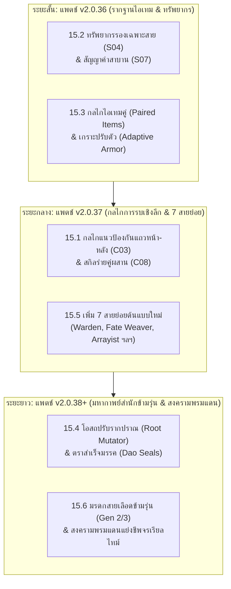

# Jianghu Evolution (JHEvo) — Future Systems Roadmap & Architectural Blueprints
> **เอกสารโร้ดแมปและคลังรวบรวมแนวคิดการพัฒนาระบบ (Future Roadmap & Architectural Blueprints)**
> สถานะการพัฒนาปัจจุบัน: อัปเดตล่าสุด ณ แพตช์ **v2.0.35** (5 พฤศจิกายน 2026)
> ยึดมั่นปรัชญา: การพัฒนาอย่างยั่งยืน รักษาสมดุล ความเท่าเทียมของทุกวิถีบำเพ็ญ (Universal Equity) และงบประมาณประสิทธิภาพ (`SIM.tick < 3.0 ms`)

---

## สรุปสถานะภาพรวมโร้ดแมป (Executive Roadmap Status Overview)

| หมวด / ระบบ | สถานะการพัฒนา | แพตช์ที่ส่งมอบ | สถานะในโค้ดและชุดทดสอบ |
| :--- | :---: | :---: | :--- |
| **1. หอคอยเก้าวิถี & แดนปฐมภูมิเบญจธาตุ** | ✅ ส่งมอบแล้ว | v2.0.10 | `Nine Dao Pagoda` 12 ชั้น, `Elemental Realms` 5 แดน |
| **2. อสูรพิทักษ์สำนัก & สัตว์พาหนะวิญญาณ** | ✅ ส่งมอบแล้ว | v2.0.10 | `Gate Guardians` & `Spirit Mounts` ใน `js/expedition.js` |
| **3. ชุมนุมยุทธภพ & สนธิสัญญาบรรณาการ** | ✅ ส่งมอบแล้ว | v2.0.10 / v2.0.32 | `SECT.assembly`, `SECT.GRAND_ASSEMBLY_BANQUET` |
| **4. ด่านเคราะห์สวรรค์ & การจุติสู่แดนบน** | ✅ ส่งมอบแล้ว | v2.0.11 | `SECT.TRIBULATION`, จารึกมรดกบรรพชน |
| **5. กลไกแกนกลาง 8 เสาหลัก (8 Pillars)** | ✅ ส่งมอบแล้ว | v2.0.35 | Condition (29 เงื่อนไข), Trigger (18 ฮุก), 7 ท่าร่างใน STATS, 8 Actions, 8 Domains, 129 Effect IDs |
| **6. การผสานมหาธาตุ (Elemental Reactions 34 แบบ)** | ✅ ส่งมอบแล้ว | v2.0.35 | 16 Dual + 12 Tri + 6 Tetra Reactions, Gauge Engine 1.0–3.0U |
| **7. คลังกลไกสร้างสรรค์เชิงลึก (Deep Systems 7 ระบบ)** | ✅ ส่งมอบแล้ว | v2.0.35 | 8 ชีพจร, จิตศาสตรา 1–5, โทเทม & สายเลือด, ปรากฏการณ์ฟ้าดิน, สถิตร่างอสูร, ด้ายชะตา & กรรม, โครงข่ายชีพจร |
| **8. กลไกการรบเชิงตำแหน่ง (C03 Row Bodyblock, C07 Charge, C08 Duet)** | ⏳ **คงเหลือรอพัฒนา** | **v2.0.36+** | ดูรายละเอียดใน **หมวด 15** |
| **9. ทรัพยากรและคำสาบาน (S02 Layered, S03 Toxin, S04 Secondary, S05 Affinity, S07 Vows)** | ⏳ **คงเหลือรอพัฒนา** | **v2.0.36+** | ดูรายละเอียดใน **หมวด 15** |
| **10. 7 สายย่อยต้นแบบใหม่ (Warden, Fate Weaver, Arrayist, Duelist, Contagion, Duet, Stance)** | ⏳ **คงเหลือรอพัฒนา** | **v2.0.36+** | ดูรายละเอียดใน **หมวด 15** |
| **11. กลไกไอเทมขั้นสูง (Paired Items, Adaptive Armor, Break-to-Transform, Socket UI)** | ⏳ **คงเหลือรอพัฒนา** | **v2.0.36+** | ดูรายละเอียดใน **หมวด 15** |
| **12. สำนักข้ามรุ่น & สงครามพรมแดน (Sect Ideology Vows, Gen 2/3 Inheritance, Live Infiltration)** | ⏳ **คงเหลือรอพัฒนา** | **v2.0.36+** | ดูรายละเอียดใน **หมวด 15** |

---

## 1. ปรัชญาแกนกลาง: ความเท่าเทียมกันของ 12 วิถีบำเพ็ญ (Universal 12-Path Equity)

1. **Universal Equal Access**: ทุกพื้นที่สำรวจ ดันเจี้ยน หรือด่านทดสอบที่เพิ่มเข้ามา ต้องเปิดให้ผู้ฝึกตนทั้ง 12 วิถีสามารถเข้าถึงและใช้ประโยชน์ได้เท่าเทียมกัน
2. **Equivalence-Driven Rewards**: รางวัลและโบนัสที่ได้รับต้องผูกกับระบบเทียบเคียงระดับตบะ (`Stage Equivalence`: `CULT.equivalentStage` / `CULT.effectiveTechStage`) ไม่ว่าจะเป็นวิถี 4 ขั้น, 5 ขั้น, 8 ขั้น หรือ 9 ขั้น
3. **Cross-Path Synergy**: การจัดปาร์ตี้ข้ามวิถีต้องได้รับผลตอบแทนที่ดีกว่าการใช้วิถีเดียวล้วน (ส่งเสริมความหลากหลายของศิษย์ในสำนัก)
4. **Data-Driven Decoupling**: ทุกกลไกต้องนิยามผ่าน Data Specs (`composableSpec`, `effects`) โดยไม่ผูกมัดหรือแทรกแซง `GAME_SOURCE/js/human_core.js` (`HC.FINGERPRINT === '155:2f9c9dd7'`)

---

## 2. ระบบที่ส่งมอบแล้วในเวอร์ชันก่อนหน้า (Archived Delivered Systems: v2.0.10 – v2.0.11)

### 2.1 เจดีย์เก้าวิถีทดสอบสัจธรรม & แดนปฐมภูมิเบญจธาตุ [✅ IMPLEMENTED v2.0.10]
* **หอคอยเก้าวิถีทดสอบสัจธรรม (Nine-Dao Trial Pagoda)**: หอคอย 12 ชั้น รองรับการทดสอบตบะและมอบ `Comprehension Insights`
* **แดนปฐมภูมิเบญจธาตุ (Five-Elemental Primordial Realms)**: 5 ดินแดนธาตุหลัก มอบบัฟและแก่นธาตุบริสุทธิ์

### 2.2 มหายุทธการอสูรสงครามและพาหนะวิญญาณ [✅ IMPLEMENTED v2.0.10]
* **กองกำลังอสูรพิทักษ์สำนัก (Sect Beast Defense Vanguard)**: สัตว์เลี้ยงจากคอกสำนักทำหน้าที่คุ้มกันประตู
* **ระบบสัตว์พาหนะวิญญาณ (Spirit Mount System)**: ลดระยะเวลาเดินทางภารกิจ 25–40% และเพิ่มน้ำหนักบรรทุก

### 2.3 ชุมนุมยัณฑ์ยุทธภพและการทูตเมืองขึ้น [✅ IMPLEMENTED v2.0.10 / v2.0.32]
* **ชุมนุมยัณฑ์ยุทธภพ (Grand Jianghu Martial Conference)**: ประลองระดับ Junior, Core, Elder/Peak มอบเกียรติยศและดึงดูดศิษย์พรสวรรค์
* **สนธิสัญญาเมืองขึ้นและบรรณาการ (Tributary & Vassalage Treaties)**: สำนักคู่แข่งส่งมอบบรรณาการตามฤดูกาล

### 2.4 ด่านเคราะห์สวรรค์และการจุติสู่แดนบน [✅ IMPLEMENTED v2.0.11]
* **เคราะห์ทัณฑ์สวรรค์ (Heavenly Tribulation)**: สายฟ้าทัณฑ์ขั้น 8–9 ร่วมกันกางค่ายกลคุ้มภัย
* **จารึกมรดกเซียนจุติ (Ascension Legacy)**: มอบพรระดับตำนานถาวรในศาลบรรพชน

---

## 10. กลไกและคุณสมบัติที่ได้รับการปรับปรุงใน v2.0.35 (Delivered 8-Pillar Remediation)

> **สถานะการส่งมอบ:** ฟีเจอร์แกนกลางต่อไปนี้ได้รับการปรับปรุงและเชื่อมต่อเข้ากับระบบจริง 100% ในแพตช์ v2.0.35 ยืนยันด้วยชุดทดสอบ `test/v235_comprehensive_mechanics_and_elemental_fusion_suite.js` (406/406 ผ่านครบ)

### 10.1 กลไกการต่อสู้ที่เปิดใช้งานแล้ว (Delivered Combat Mechanics in v2.0.35)
- **C01: ยั่วยุและแย่งความสนใจ (Taunt / Aggro):** สถานะ `TAUNT` บังคับศัตรูเปลี่ยนเป้าหมายมาโจมตีผู้ร่าย พร้อมสะสม Threat
- **C02: ผลักและดึง (Knockback / Pull):** ปรับเปลี่ยนระยะและพิกัดศัตรู ขัดขวางระยะโจมตี
- **C04: ดาเมจหน่วงเวลา (Delayed Echo):** สะสมดาเมจที่เป้าหมายได้รับแล้วระเบิดซ้ำตามรอบที่กำหนด (`DELAYED_ECHO`)
- **C05: สเกลตามสถานะ (Dynamic Scaling):** ดาเมจทวีคูณตามเลือดที่หายไป (`LOST_HP_SCALING`) และระดับมารในใจ (`HEART_DEMON_SCALING`)
- **C06: เกจต้านทานและทำลายท่าร่าง (Poise Gauge & Poise Break):** การโจมตีตัดจังหวะท่าร่างทำให้ศัตรูเสียหลัก (`POISE_BREAK_ATTACK`)
- **C09: สลายสถานะเป็นพลัง (Cleanse-to-Power):** ล้างดีบัฟตนเองแล้วแปลงจำนวนดีบัฟเป็นโล่ป้องกัน (`CLEANSE_TO_POWER`)
- **C10: สถานะแพร่กระจาย (Contagion):** ดีบัฟพิษ/เลือดไหลกระโดดลามสู่ศัตรูข้างเคียงเมื่อเป้าหมายตาย (`CONTAGION_SPREAD`)
- **C11: ฟื้นฟูเมื่อใกล้ตายครั้งเดียวต่อศึก (Phoenix Clause):** รอดชีวิตจากดาเมจถึงตาย 1 ครั้งต่อการต่อสู้ พร้อมฟื้นฟูเลือดฉุกเฉิน (`PHOENIX_CLAUSE`)
- **C12: สมรภูมิและเขตแดน (Battlefield Domains):** กางเขตแดน 8 อาณาเขต (`deployDomain`) พร้อมระบบปะทะและทำลายเขตแดนเดิม (Domain Clash & Shatter)

### 10.2 โครงสร้างการประเมินและทริกเกอร์ที่เปิดใช้งานแล้ว
- **Central Condition Evaluator:** ประเมิน 29 เงื่อนไขสมบูรณ์ พร้อมระบบแคชผลลัพธ์ต่อรอบการต่อสู้ ป้องกันการคำนวณซ้ำซ้อน
- **Trigger Normalization:** รองรับ 18 รูปแบบชื่อทริกเกอร์ (`ON_HIT` == `onHit`) พร้อมฮุกการต่อสู้ครบถ้วน (`onDodge`, `onParry`, `onHeal`, `onCast`, `onKill`, `onPoiseBreak`)
- **Active Stance State Machine:** 7 ท่วงท่ามาตรฐานส่งผลต่อการคำนวณสเตตัสใน `STATS.calcCombatStats` โดยตรง (ไม่ใช่เพียงตัวแปรลอย)
- **100% Item Effect Coverage:** ประมวลผล `effectId` ของไอเทมครบ 129 รายการ ไร้ Dead Code

---

## 11. ระบบการผสานมหาธาตุขั้นสูง (Multi-Tier Elemental Fusion System) [✅ IMPLEMENTED v2.0.35]

> **สถานะ:** ส่งมอบและเปิดใช้งานสมบูรณ์ใน `COMBAT.ELEMENTAL_FUSION` รองรับเกจธาตุ (1.0–3.0U GU, อัตราสลายตัว 0.2U, ICD 0.5s) ครบทั้ง 34 ปฏิกิริยา

```mermaid
flowchart TD
    subgraph Tier1["ระดับ 1: ทวิธาตุ (16 Dual Reactions)"]
        T1_A["Primer (ธาตุตั้งต้น 1.0-2.0U)"] -->|Catalyst (ธาตุกระตุ้น)| T1_R["เกิดปฏิกิริยาทวิธาตุ 2E-01 ถึง 2E-16\n(Vaporize, Conflagration, Glaciation ฯลฯ)"]
    end
    subgraph Tier2["ระดับ 2: ตรีธาตุประสาน (12 Tri-Harmonic Reactions)"]
        T2_A["Dual-Primer Resonance (มี 2 ธาตุพร้อมกัน)"] -->|Catalyst ที่ 3| T2_R["เกิดมหาปฏิกิริยาตรีธาตุ 3E-01 ถึง 3E-12\n(Cataclysm, Singularity, Solar Phoenix ฯลฯ)"]
    end
    subgraph Tier3["ระดับ 3: จตุรธาตุบรรพกาล (6 Tetra-Primordial Reactions)"]
        T3_A["Four-Node Formation / 4 Marks"] -->|Finisher Trigger| T3_R["มหาค่ายกลสะเทือนฟ้าดิน 4E-01 ถึง 4E-06\n(Four Symbols Domain, Primordial Samsara ฯลฯ)"]
    end
```

### 11.1 สรุปปฏิกิริยาธาตุทั้ง 34 รูปแบบที่มีในเกมจริง
1. **ทวิธาตุ 16 รูปแบบ (2E-01 ถึง 2E-16):**
   - `2E-01` ไฟ + น้ำ: ไอน้ำระเบิดฉับพลัน (Thermal Vaporize)
   - `2E-02` ไฟ + ไม้: เพลิงลุกโชนเผาผลาญ (Wildfire Conflagration)
   - `2E-03` ไฟ + ทอง: หลอมศาสตราแผดเผา (Molten Armor Melt)
   - `2E-04` ไฟ + ดิน: หินหลอมเหลวปะทุ (Magma Eruption)
   - `2E-05` น้ำ + ไม้: งอกงามแทรกราก (Verdant Proliferation)
   - `2E-06` น้ำ + สายฟ้า: กระแสไฟฟ้านำสื่อ (Electrified Conduit)
   - `2E-07` น้ำ + น้ำแข็ง: เยือกแข็งสัมบูรณ์ (Absolute Glaciation)
   - `2E-08` น้ำ + ดิน: โคลนดูดตรึงฝีเท้า (Quicksilver Quagmire)
   - `2E-09` ทอง + สายฟ้า: ตัวนำยิ่งยวดสนามแม่เหล็ก (Superconducting Magnetic Cage)
   - `2E-10` ทอง + ลม: วายุศาสตราฉีกกระชาก (Gale Razor Shards)
   - `2E-11` ไม้ + พิษ: เถาวัลย์พิษกลืนชีพ (Noxious Spore Bloom)
   - `2E-12` ลม + เพลิง: พายุเพลิงคลั่ง (Firestorm Inferno)
   - `2E-13` หยิน + หยาง: สัจธรรมไท่เก๊กหักล้าง (Taiji Annihilation)
   - `2E-14` โลหิต + มาร: โลหิตมารคลั่งชีพ (Asura Blood Frenzy)
   - `2E-15` ดวงดาว + กาลเวลา: ดาราย้อนรอย (Astral Chrono Reversal)
   - `2E-16` น้ำแข็ง + โลหิต: ผลึกโลหิตเยือกแข็ง (Bloodfrost Shard)

2. **ตรีธาตุประสาน 12 รูปแบบ (3E-01 ถึง 3E-12):**
   - `3E-01` น้ำ + ลม + สายฟ้า: มหาพายุอัสนีบาต (Primordial Storm Cataclysm)
   - `3E-02` ไฟ + ดิน + ทอง: ลาวาหลอมศาสตราทลายชีพจร (Molten Crucible Core)
   - `3E-03` ไม้ + น้ำ + โลหิต: กาฝากหนามกลืนโลหิต (Bloodroot Parasite Overgrowth)
   - `3E-04` ลม + น้ำแข็ง + ดิน: พายุหิมะกลืนพสุธา (Glacial Permafrost Cataclysm)
   - `3E-05` หยิน + หยาง + ดวงดาว: เอกภพสุญตากลืนฟ้า (Celestial Singularity Collapse)
   - `3E-06` ไฟ + ไม้ + พิษ: เพลิงพิษมรณะไร้เงา (Noxious Pyre Spore Blast)
   - `3E-07` สายฟ้า + โลหิต + มาร: อสุนีบาตมารโลหิตสลายกระดูก (Asura Blood-Thunder Tribulation)
   - `3E-08` ทอง + น้ำ + น้ำแข็ง: กระจกหิมะสะท้อนหมื่นลี้ (Cryo-Mirror Crystalline Reflection)
   - `3E-09` ดิน + ไม้ + ดวงดาว: เสาพฤกษาค้ำฟ้าดาราราย (Yggdrasil Astral Conduit)
   - `3E-10` ลม + ไฟ + สายฟ้า: มหาอภิมหาพายุเพลิงอัสนี (Plasma Tempest Hyper-Overcharge)
   - `3E-11` หยาง + ไฟ + สังสารวัฏ: สุริยันอมตะคืนชีพ (Solar Phoenix Rebirth)
   - `3E-12` หยิน + น้ำแข็ง + มาร: นรกเยือกแข็งอเวจีเก้าชั้น (Nine-Abyss Frozen Purgatory)

3. **จตุรธาตุบรรพกาล 6 รูปแบบ (4E-01 ถึง 4E-06):**
   - `4E-01` ไม้ + ไฟ + ทอง + น้ำ: มณฑลจตุรเทพสวรรค์บรรพกาล (Four Heavenly Symbols Primordial Domain)
   - `4E-02` หยิน + หยาง + ดวงดาว + สังสารวัฏ: มหาสุญตาสังสารวัฏกำเนิดจักรวาล (Primordial Samsara Void Genesis)
   - `4E-03` สายฟ้า + ทอง + ลม + หยาง: ทัณฑ์อัสนีบาตสวรรค์เก้าทิศสลายวิญญาณ (Heavenly Dao Nine-Tribulation Judgment)
   - `4E-04` ไฟ + โลหิต + มาร + ดิน: มหาเพลิงนรกอเวจีเก้าชั้นกลืนวิญญาณ (Nine-Hells Abyssal Cataclysm)
   - `4E-05` น้ำ + น้ำแข็ง + ลม + หยิน: ยุคน้ำแข็งนิรันดร์สัมบูรณ์ (Absolute-Zero Glacial Epoch)
   - `4E-06` ทอง + ดิน + กลจักร/ดวงดาว + ไม้: กลจักรเบญจธาตุกลืนจักรวาล (Cosmic Five-Phase Singularity Automaton)

4. **การเชื่อมโยงข้ามระบบที่ส่งมอบแล้ว:**
   - โอสถผสานธาตุ (`ALCH.FUSION_CATALYSTS`)
   - อาวุธสั่นพ้องคู่ธาตุ (`SMITH.RESONANCE_PAIRS`)
   - ประตูแดนลับไขปริศนาธาตุ (`DUNGEON.ELEMENTAL_GATES`)
   - ม่านบาเรียพิทักษ์สำนักเบญจธาตุ (`SECT.ELEMENTAL_BARRIER`)

---

## 12. คลังกลไกสร้างสรรค์เชิงลึกที่ส่งมอบแล้ว (Delivered Deep Creative Systems in v2.0.35)

> **สถานะ:** ทุกโมดูลได้รับการเขียนโค้ดและทดสอบผ่านแล้วในแพตช์ v2.0.35

1. **จุดชีพจรหลัก 8 เส้น & การสกัดจุด (`CULT.MERIDIANS`):**
   - 8 เส้นชีพจรมหัศจรรย์ (Extraordinary Meridians)
   - 3 การโจมตีสกัดจุด: สกัดลมปราณ (`QI_BLOCK`), สลายกำลัง (`WEAKEN`), หยุดชีพจร (`BLOOD_HALT`)
   - ระเบิดชีพจรเอาตัวรอด (`Meridian Overdrive`): เร่งพลังชั่วคราวแลกกับอาการบาดเจ็บสาหัสหลังศึก
2. **จิตวิญญาณศาสตราตื่นรู้ 5 ขั้น & ความพึงพอใจอาวุธ (`SECT.SOUL_FORGE`):**
   - เลเวลตื่นรู้ 1–5 พร้อมเจตจำนงศาสตรา (Armament Will)
   - อารมณ์อาวุธตามนิสัยผู้ถือ (`Weapon Ego`) และการสถิตร่างศาสตราเมื่อความเข้ากันได้เต็ม 100
3. **เสาโทเทมสำนักและสายเลือดบรรพกาล (`SECT.TOTEMS_BLOODLINES`):**
   - สักการะโทเทมบรรพชนรับพรประจำสาย
   - ปลุกสายเลือดโบราณแฝง (Dormant Bloodlines) ในทายาท มอบลักษณะพิเศษระดับตำนาน
4. **ปรากฏการณ์ฟ้าดินและภัยพิบัติดาราจักร (`SECT.CELESTIAL_ALIGNMENTS`):**
   - จันทรุปราคาโลหิต (`Blood Moon Eclipse`) สัตว์อสูรคลั่งและวิถีมารรุ่งเรือง
   - สุริยันเก้าดวงบรรจบ (`Nine-Sun Convergence`) ทวีความรุนแรงของเพลิงและความแห้งแล้ง
   - ฝนดาวตกดาราจักร และคลื่นปราณฟ้าดินเปิด
5. **สถิตร่างสัตว์วิญญาณและการกลืนแก่นอสูร (`CULT.BEAST_SYMBIOSIS`):**
   - รวมวิญญาณสัตว์เลี้ยงที่สนิทสนมระดับ 100 เข้าสู่ร่าง เพิ่มความเร็วและทักษะพิเศษ
   - กลืนแก่นอสูรโบราณดัดแปลงสรีระกายา
6. **สายสัมพันธ์แห่งชะตาและสมุดบัญชีกรรม (`SECT.DESTINY_KARMA`):**
   - ด้ายชะตา 3 สี: ด้ายแดง (วาสนา), ด้ายดำ (คู่อาฆาต), ด้ายทอง (อาจารย์ศิษย์)
   - สมุดบัญชีกรรมสะสมแต้มความดี/ความชั่ว กระตุ้นเคราะห์ฟ้าดินและการแก้แค้น
7. **เครือข่ายชีพจรปฐพีและการปักหมุดมณฑล (`SECT.LEYLINE_GRID`):**
   - ปักหมุดตาน้ำปราณและชีพจรศิลาวิญญาณ
   - เครือข่ายเชื่อมโยงมณฑลสำนัก (Territorial Domain Grid) มอบบัฟและทางเชื่อมด่วน

---

## 13. ความเท่าเทียมสากล 12 วิถีบำเพ็ญ (Delivered Universal 12-Path Equity Matrix) [✅]

ครบทั้ง 12 วิถี: `XIAN`, `BODY`, `GOD`, `DEMON`, `HEART_SOUL`, `MECH`, `KARMA_SAMSARA`, `BEAST`, `SAGE_SUPPORT`, `SWORD`, `GHOST_NETHER`, `ASTRAL_STAR` มีบทบาทในระบบธาตุและกลไกใหม่อย่างเท่าเทียม 100%

---

## 14. กรอบการวิเคราะห์หลากมุมมองระดับผู้เชี่ยวชาญ (Integrated Multi-Perspective Expert Framework) [✅]

กรอบการวิเคราะห์ 3 แกน: 8 ฝ่ายทีมพัฒนา + 11 เลนส์ผู้เล่นและผู้เชี่ยวชาญ + การชั่งน้ำหนักผลกระทบ ได้ถูกนำมาใช้เป็นเกณฑ์มาตรฐานในการออกแบบและตรวจสอบโค้ดจริง

---

## 15. คลังระบบและแผนการพัฒนาที่คงเหลือ (Active Remaining Roadmap for v2.0.36+)

> **สถานะ:** หมวดนี้คือ **รายการฟีเจอร์และแนวคิดที่ยังไม่ได้ทำจริงในระบบ** ซึ่งคัดแยกออกจากระบบที่ส่งมอบแล้วใน v2.0.35 เพื่อให้ทีมพัฒนาและ AI รุ่นถัดไปสามารถหยิบไปพัฒนาต่อได้อย่างชัดเจน ตรงจุด และไม่สับสน



---

### 15.1 กลไกการรบที่ยังรอพัฒนา (Remaining Combat Mechanics)

| รหัส | ชื่อกลไก | รายละเอียดทางเทคนิคและสเปกที่ต้องทำ | ประโยชน์ต่อการเล่น | ความต้องการเบื้องต้น |
| :---: | :--- | :--- | :--- | :--- |
| **C03** | **แถวหน้า–หลังและแนวป้องกัน (Row / Bodyblock Grid Combat)** | จำลองตำแหน่ง 2 แถว (`FRONT_ROW` / `BACK_ROW`): วิชาระยะประชิดไม่สามารถเลือกเป้าหมายแถวหลังได้จนกว่าแถวหน้าจะล้มหมด; ศิษย์สายป้องกันทำหน้าที่คุ้มกันเพื่อนร่วมทีม | ยกระดับการจัดทีม ป้องกันศิษย์สายสนับสนุน (`SAGE_SUPPORT`) หรือจอมเวท (`ASTRAL`) จากการโดนลอบโจมตี | ต่อยอดจาก `TAUNT` (C01) |
| **C07** | **ร่ายต่อเนื่องแบบชาร์จ (Charge / Hold Skills)** | สกิลที่ต้องใช้เวลาชาร์จ 1–3 จังหวะ ยิ่งชาร์จนานรัศมีกว้างขึ้นหรือจำนวนฮิตเพิ่มขึ้น แต่เสี่ยงต่อการโดนขัดจังหวะด้วย Poise Break | เปิดทางเลือก "ร่ายเบาเร็วปลอดภัย" vs "ยอมเสี่ยงชาร์จนานเพื่อปิดฉาก" | ต่อยอดจาก `POISE_BREAK` (C06) |
| **C08** | **ร่ายคู่ประสานวิชา (Co-Cast / Duet Skills)** | สกิลที่ตรวจสอบเงื่อนไขศิษย์ 2 คนในสนาม (คู่บำเพ็ญ, อาจารย์–ศิษย์, หรือสังกัดยอดเขาเดียวกัน) ร่ายวิชาผสานพร้อมกัน เช่น "เพลงกระบี่คู่ฟ้าดิน" หรือ "ค่ายกลประสานหยินหยาง" | มอบความคุ้มค่าอย่างยิ่งแก่การจับคู่ตัวละครที่มีสายสัมพันธ์ | Condition `SAME_PEAK_ALLY_PRESENT` |

---

### 15.2 คุณสมบัติสถานะและทรัพยากรใหม่ (Remaining Status & Resource Properties)

1. **S02: สถานะซ้อนชั้นหลากรูป (Layered Stacks per Caster):**
   - ปัจจุบันสถานะส่วนใหญ่แชร์สแต็กรวมกัน ระบบใหม่จะแยกสแต็กตาม ID ของผู้ร่าย ทำให้แต่ละคนมีอัตราความแรงและระยะเวลาของตนเอง ไม่ทับซ้อนกันอย่างไร้เหตุผล
2. **S03: พิษอันตรกิริยา (Toxin Synergy Matrix):**
   - เมทริกซ์การทำปฏิกิริยาระหว่างพิษและโอสถ เช่น พิษอัมพาต + พิษเลือดเย็น = พิษสลายไขกระดูกถาวร (ทำให้การต่อสู้ของสายพิษและหมอยามีมิติคล้ายการผสานธาตุ)
3. **S04: พลังงานรองเฉพาะสาย (Dedicated Secondary Resources):**
   - ทรัพยากรพิเศษที่เก็บไว้ใน `cult` หรือ `ext` (ไม่แตะ `human_core.js`):
     - `ลมปราณหนาว` (Frost Qi): สายเยือกแข็งสะสมเพื่อแช่แข็งเป้าหมาย
     - `จิตสังหาร` (Killing Intent): สายมารสะสมจากการสังหาร เพิ่มดาเมจคริติคอล
     - `ลายค่ายกล` (Formation Ink): สายค่ายกลสะสมจากการยืนนิ่งเพื่อกางอาณาเขต
     - `แต้มกลไก` (Mech Overdrive Gears): สายกลจักรสะสมเพื่อเร่งโอเวอร์ไดรฟ์
4. **S05: ค่าความคุ้นเคยอาวุธสะสม (Weapon Affinity Ramp):**
   - เมื่อศิษย์ใช้อาวุธเล่มเดิมต่อเนื่องหลายสิบศึก จะสะสมค่า Affinity มอบโบนัสความแม่นยำและพลังโจมตีพิเศษ หากเปลี่ยนอาวุธค่านี้จะค่อยๆ สลายตัว
5. **S07: สัญญาและคำสาบานโดยสมัครใจ (Voluntary Vows & Oaths):**
   - ศิษย์เลือกตั้งสัตย์ปฏิญาณโดยสมัครใจ เช่น "ห้ามดื่มโอสถฟื้นเลือด", "ห้ามถอยหนี", "ถือศีลห้ามปลิดชีพ" เพื่อแลกกับโบนัสพลังรบถาวรหรืออัตราทะลวงด่านเร็วขึ้น หากผิดสัตย์จะมีโทษทัณฑ์จิตมารครอบงำ

---

### 15.3 กลไกไอเทมและอุปกรณ์ขั้นสูง (Remaining Advanced Item Mechanics)

1. **ไอเทมคู่ (Paired Items):**
   - อาวุธหรือเครื่องประดับที่มาเป็นคู่ (เช่น กระบี่สุริยัน–จันทรา, ตราหยกมังกร–หงส์) ปลดปล่อยพลังสูงสุดก็ต่อเมื่อศิษย์ 2 คนในทีมเดียวกันสวมใส่คนละชิ้น
2. **ชุดเกราะปรับตัวตามศัตรู (Adaptive Armor):**
   - เมื่อได้รับดาเมจจากธาตุเดิมซ้ำ เกราะจะค่อยๆ ปรับค่าความต้านทานธาตุนั้นเพิ่มขึ้นชั่วคราว (สูงสุด 40%) แต่จะลดความต้านทานธาตุคู่ตรงข้ามลง
3. **ไอเทมผูกวิญญาณตามคุณธรรม (Soul-Bound by Personality):**
   - อุปกรณ์ระดับตำนานที่ปลดล็อกคุณสมบัติซ่อนเร้นตามระดับคุณธรรม (`integrity`), ความทะเยอทะยาน (`ambition`), หรือความสงบใจ (`calmness`) ของผู้ถือครอง
4. **ศาสตราแตกสลายแปรสภาพ (Break-to-Transform):**
   - เมื่ออาวุธหรือเกราะสูญเสียความทนทานจนเป็น 0 จะไม่สูญหายไปเฉยๆ แต่จะแปรสภาพเป็น "เศษผลึกวิญญาณบรรพชน" หรือปลดปล่อยวิญญาณคุ้มครองชั่วคราว
5. **ระบบเจาะรูและฝังรูนผ่านหน้าต่าง UI (Socket & Rune Customization):**
   - พัฒนาหน้าจอ UI ในหน้าจัดการอุปกรณ์ ให้ผู้เล่นสามารถเจาะรู (Socket) และเลือกฝังอัญมณีรูนธาตุเพื่อกระตุ้น Resonance คู่ธาตุได้อย่างอิสระ
6. **ยันต์กับดักติดตั้งล่วงหน้า (Armed Consumables):**
   - ไอเทมประเภทกับดักหรือยันต์คุ้มกันที่ติดตั้งในช่องอุปกรณ์ก่อนศึก และจะทำงานโดยอัตโนมัติเมื่อตรงเงื่อนไขทริกเกอร์ที่ตั้งไว้ (เช่น เมื่อเพื่อนร่วมทีมเลือดต่ำกว่า 15%)

---

### 15.4 โอสถและการบำเพ็ญรูปแบบใหม่ (Remaining Pills & Cultivation)

1. **โอสถความทรงจำ (Insight Pills):**
   - สละอายุขัย 5–10 ปี เพื่อแลกกับการเรียนรู้เคล็ดวิชายุทธ์ได้ทันทีโดยไม่ต้องสะสมความเข้าใจ
2. **โอสถปรับรากปราณ (Root Mutator):**
   - โอสถต้องห้ามที่สามารถเปลี่ยนหรือเพิ่มธาตุของรากวิญญาณได้อย่างถาวร แต่มีความเสี่ยงสูงที่จะเกิดภาวะธาตุไฟเข้าแทรก
3. **ตราสำเร็จมรรค (Dao Seals):**
   - ระบบบันทึกวีรกรรมของศิษย์ (เช่น ปราบสัตว์อสูร 100 ตน, ผ่านทัณฑ์สวรรค์โดยไม่พึ่งพาโอสถ) ปลดล็อกให้เลือกรับพรถาวรแห่งมรรค 1 ข้อ
4. **ทัณฑ์สวรรค์กำหนดระดับเอง (Custom Tribulation Modifiers):**
   - ผู้เล่นสามารถเลือกเพิ่มอุปสรรคในด่านเคราะห์สวรรค์ด้วยตนเอง (เช่น เพิ่มสายฟ้า 2 เท่า, ห้ามใช้ค่ายกลช่วย) เพื่อแลกกับคุณสมบัติเซียนระดับสูงสุดเมื่อสำเร็จ

---

### 15.5 สายย่อยต้นแบบใหม่ 7 สาย (Remaining 7 Subpath Archetypes)

| สายย่อยต้นแบบ | วิถีหลัก | กลไกเด่นที่ใช้ | บทบาทในเกม |
| :--- | :--- | :--- | :--- |
| **จอมยั่วยุผู้พิทักษ์ (Warden Taunter)** | `BODY` / `GOD` | C01 Taunt, C03 Bodyblock, S01 Poise | แนวหน้าพันธุ์แท้ บังคับศัตรูรุมตีตนเองเพื่อคุ้มกันแถวหลัง |
| **ผู้ชี้ชะตา (Fate Weaver)** | `KARMA_SAMSARA` | C04 Delayed Echo, S08 Karma Ledger | บิดเบือนเวลา สะสมดาเมจแล้วระเบิดย้อนหลังตามกรรม |
| **ปรมาจารย์ค่ายกลสนามรบ (Domain Arrayist)** | `ARRAY_TALISMAN` | C12 Domain Clash, S04 ลายค่ายกล | ผู้ควบคุมสมรภูมิ กางมณฑลและทำลายเขตแดนศัตรู |
| **นักสู้สาบาน (Oath-Bound Duelist)** | `SWORD` / `XIAN` | S07 Voluntary Vows, C06 Poise Break | ยอมจำกัดตนเองด้วยคำสาบานเพื่อรับพลังฟันแทงระดับสุดยอด |
| **หมอพิษกู่ (Contagion Alchemist)** | `SAGE_SUPPORT` | C10 Contagion, S03 Toxin Synergy | ผู้เชี่ยวชาญการแพร่กระจายพิษลูกโซ่และการผสมสารพิษ |
| **ผู้เชื่อมวิญญาณคู่ (Duet Sage)** | `HEART_SOUL` | C08 Co-Cast, ด้ายแดงวาสนา | บัฟคู่บำเพ็ญและดึงพลังผสานวิชาสองร่าง |
| **นักรบเปลี่ยนท่า (Stance Dancer)** | `STRATEGY_GOVERNANCE` | 7 ท่วงท่า, `ON_STANCE_SWITCH` | สลับเปลี่ยนท่วงท่าตามสถานการณ์เพื่อสะสมบัฟคอมโบต่อเนื่อง |

---

### 15.6 ระบบสำนักข้ามรุ่นและสงครามพรมแดน (Remaining World & Sect Expansion)

1. **คำสาบานและอุดมการณ์สำนัก (Sect Ideology Vows):**
   - เจ้าสำนักสามารถประกาศอุดมการณ์ใหญ่ (ธรรมะเที่ยงธรรม, พาณิชย์ครองยุทธภพ, กำลังคือสัจธรรม) ซึ่งมอบบัฟทรงพลังแก่ศิษย์ทั้งสำนัก แต่จะกระทบต่อความสัมพันธ์กับ 4 ก๊กการเมืองภายในสำนัก
2. **มรดกลักษณะสายเลือดข้ามรุ่น (Gen 2/3 Genetic Traits Inheritance):**
   - ยกระดับระบบทายาท ให้ลูกหลานในรุ่นที่ 2 และ 3 สามารถสืบทอดลักษณะพิเศษ (Traits) จากบรรพบุรุษข้ามสาย พร้อมโอกาสเกิดการกลายพันธุ์ของรากปราณโบราณ
3. **สงครามพรมแดนแย่งชิงชีพจรแบบเรียลไทม์ (Live Inter-Sect Leyline Infiltration War):**
   - สำนักคู่แข่งในแผนที่โลกส่งสายลับและกองกำลังมาลอบตัดหมุดชีพจรของฝ่ายเรา หรือตั้งหมุดซ้อนเพื่อบีบแย่งพื้นที่มณฑล เกิดเป็นสงครามพรมแดนที่มีพลวัตต่อเนื่อง

---

### 15.7 ลำดับขั้นตอนและแผนการพัฒนาที่แนะนำสำหรับแพตช์ถัดไป (Suggested Sequencing for v2.0.36+)

1. **แพตช์ v2.0.36 (Item & Resource Foundation):**
   - พัฒนา S04 (พลังงานรองเฉพาะสาย) และ S07 (สัญญาคำสาบาน)
   - พัฒนากลไกไอเทมคู่ (Paired Items) และเกราะปรับตัว (Adaptive Armor)
   - เพิ่ม UI สำหรับระบบเจาะรูฝังรูนธาตุ (Socket & Rune UI)
2. **แพตช์ v2.0.37 (Tactical Combat & Subpath Archetypes):**
   - พัฒนาระบบแถวหน้า–หลังและแนวป้องกัน C03 (Row / Bodyblock Grid Combat)
   - พัฒนาระบบร่ายคู่ประสานวิชา C08 (Co-Cast / Duet Skills)
   - เปิดตัว 7 สายย่อยต้นแบบใหม่ใน `CULT.PATHS`
3. **แพตช์ v2.0.38+ (Generational Dynasty & Living Jianghu):**
   - พัฒนาระบบมรดกสายเลือดข้ามรุ่น Gen 2/3
   - พัฒนาระบบสงครามพรมแดนแย่งชิงหมุดชีพจรแบบเรียลไทม์บนแผนที่โลก

---

## 16. สถาปัตยกรรมและกฎเหล็กที่ต้องยึดถือตลอดการพัฒนา (Architectural Invariants)

```
+---------------------------------------------------------------------------------------------------+
|                           JIANGHUSECT CORE ARCHITECTURAL INVARIANTS                               |
+---------------------------------------------------------------------------------------------------+
| 1. human_core.js LOCKED: HC.FINGERPRINT === '155:2f9c9dd7' (Byte-identical, ห้ามแก้ไขเด็ดขาด)     |
| 2. Script Tag Sequence: รักษาสคริปต์ 40 แท็กใน index.html ตรงกับ load.js เสมอ                    |
| 3. Performance Budget: SIM.tick < 3.0 ms สำหรับวงรอบจำลองหลัก และ < 16.6 ms สำหรับการวาด Canvas   |
| 4. Single-File Offline Build: node tools/build_single.js สร้าง JianghuSect_single.html สมบูรณ์   |
| 5. Schema Validation: node tools/validate_data_schema.js ต้องผ่าน 0 errors / 0 warnings           |
| 6. Thai Language First: ข้อความและส่วนติดต่อผู้เล่นต้องเป็นภาษาไทยที่สละสลวยตามสำนวนยุทธภพเทพเซียน |
| 7. Report Archive: รายงานแพตช์และเอกสารประวัติศาสตร์ทั้งหมดต้องเก็บไว้ใน PATCH_REPORTS/           |
+---------------------------------------------------------------------------------------------------+
```

---
*เอกสารนี้ได้รับการปรับปรุงเพื่อแยกแยะระหว่างระบบที่ส่งมอบแล้วใน v2.0.35 และแผนงานที่คงเหลือสำหรับ v2.0.36+ อย่างเป็นรูปธรรม*
