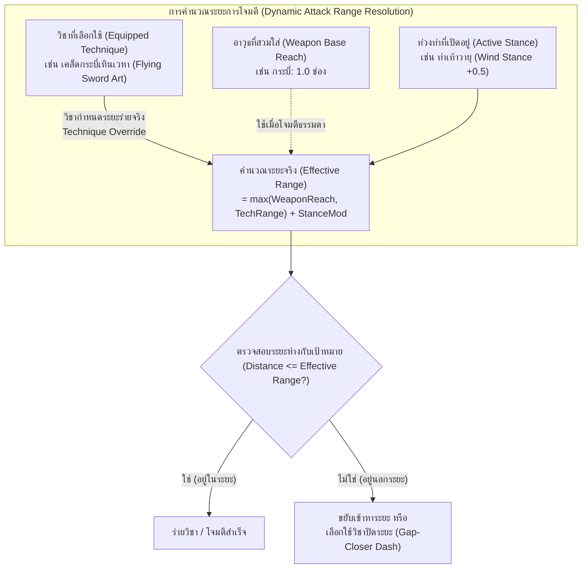
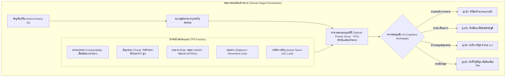
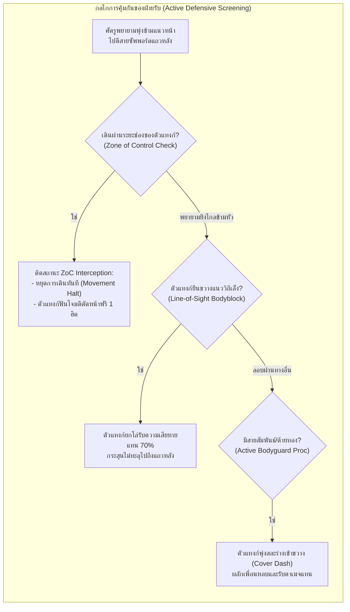
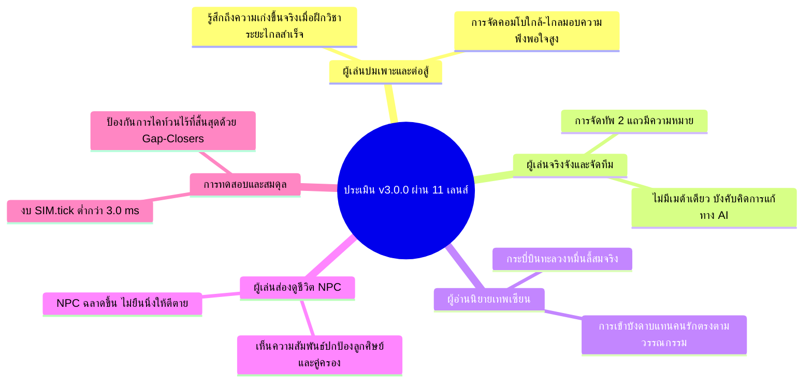
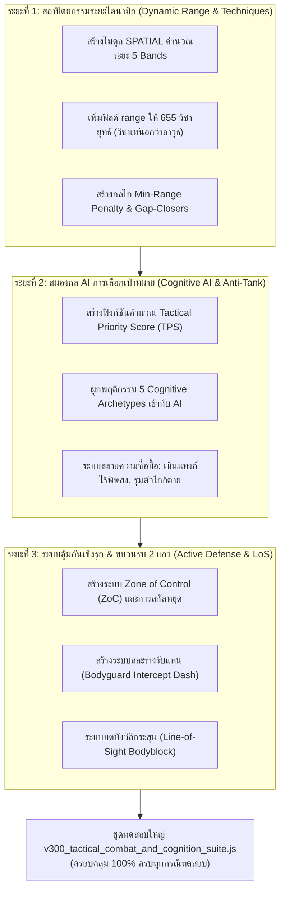

# แผนแม่บทข้อเสนอการอัปเกรดระบบการต่อสู้และสมองกลเชิงยุทธวิธีครั้งใหญ่สู่ยุค 3.0.0
## (Master Strategic Proposal: JianghuSect v3.0.0 Tactical Combat & Cognitive Engagement Overhaul)

> **เอกสารข้อเสนอการพัฒนาเชิงสถาปัตยกรรมระดับก้าวกระโดด (Generational Leap Architectural Proposal)**  
> **เวอร์ชันเป้าหมาย**: `v3.0.0` (Major Milestone Update)  
> **สถานะ**: ข้อเสนอฉบับสมบูรณ์ (Drafted for Cross-AI Review & Architectural Alignment)  
> **ผู้จัดทำ**: Antigravity Technical Architecture & Game Systems Design Lead  
> **วันที่จัดทำ**: 5 พฤศจิกายน 2026  

---

## สารบัญภาพรวม (Executive Table of Contents)

1. [วิสัยทัศน์และเหตุผลการก้าวกระโดดสู่เวอร์ชัน 3.0.0 (Generational Leap Vision & Rationale)](#1-วิสัยทัศน์และเหตุผลการก้าวกระโดดสู่เวอร์ชัน-300)
2. [สถาปัตยกรรมระบบระยะร่ายและมิติใกล้–ไกลแบบไดนามิก (Dynamic Spatial Range & Technique-Driven Modulation Engine)](#2-สถาปัตยกรรมระบบระยะร่ายและมิติใกล้ไกลแบบไดนามิก)
   - 2.1 ปรัชญา "วิชาเหนือกว่าอาวุธ" (Technique-Driven Range Priority)
   - 2.2 ตารางมาตรฐาน 5 ระดับระยะยุทธวิธี (The 5 Tactical Range Bands)
   - 2.3 ระยะฐานของ 10 หมวดอาวุธและการดัดแปลงตามท่าร่าง (Weapon Reach & Stance Modifiers)
   - 2.4 ตารางจำแนกระยะวิชากระบวนท่า 12 วิถีบำเพ็ญ (12-Path Technique Range Matrix)
   - 2.5 กลไกบทลงโทษและข้อได้เปรียบระยะ (Range Advantage, Min-Range & Gap-Closers)
3. [สถาปัตยกรรมสมองกลการเลือกเป้าหมายและการหยั่งรู้ทางยุทธวิธี (Cognitive Target Prioritization & Threat Scoring Engine)](#3-สถาปัตยกรรมสมองกลการเลือกเป้าหมายและการหยั่งรู้ทางยุทธวิธี)
   - 3.1 การคำนวณคะแนนความคุ้มค่าของเป้าหมาย (Dynamic Tactical Priority Score - TPS)
   - 3.2 การจำแนกพฤติกรรม AI ตามคุณลักษณะนิสัย (5 Cognitive Archetypes)
   - 3.3 การสลายความซื่อบื้อของ AI ศัตรู (Anti-Tank-Tunneling: Healer Sniping & Channel Interrupt)
4. [กลไกการคุ้มกันและสกัดกั้นเชิงรุกของฝ่ายรับ (Active Interception, Bodyguard & Zone of Control)](#4-กลไกการคุ้มกันและสกัดกั้นเชิงรุกของฝ่ายรับ)
   - 4.1 รัศมีควบคุมและสกัดกั้น (Zone of Control - ZoC)
   - 4.2 ระบบเข้ากำบังและรับแทนสหาย (Active Bodyguard & Cover Shielding)
   - 4.3 มิติแถวหน้า–หลังและการบดบังวิถีกระสุน (Line-of-Sight Blocking & Row Bodyblock)
   - 4.4 กลไกยั่วยุเชิงจิตวิทยาและปราณดึงดูด (Psychological Qi Taunt & Forced Engagement)
5. [การบูรณาการข้ามระบบและ 11 เลนส์ผู้เชี่ยวชาญ (Cross-System Ripples & Expert Lenses)](#5-การบูรณาการข้ามระบบและ-11-เลนส์ผู้เชี่ยวชาญ)
   - 5.1 การเชื่อมโยงกับระบบธาตุ 34 ปฏิกิริยา (Distance-Triggered Reactions)
   - 5.2 การเชื่อมโยงกับจุดชีพจร 8 เส้นและจิตศาสตราตื่นรู้ (Acupoint Snipe & Weapon Ego)
   - 5.3 การเชื่อมโยงกับด้ายชะตา 3 สี (Destiny Thread Protective Interception)
   - 5.4 การประเมินผ่าน 11 เลนส์มุมมองผู้เล่นและนักวิเคราะห์
6. [แผนที่ทางเทคนิคและงบประมาณประสิทธิภาพ (Technical Architecture & Performance Budgeting)](#6-แผนที่ทางเทคนิคและงบประมาณประสิทธิภาพ)
   - 6.1 การคำนวณระยะด้วย Chebyshev / Matrix Lookup (Zero Pathfinding Overhead)
   - 6.2 การรักษาเพดานความเร็ว `SIM.tick < 3.0 ms`
   - 6.3 การรักษากฎเหล็ก `human_core.js` byte-identical (`155:2f9c9dd7`)
7. [โร้ดแมปการดำเนินงานและแผนงานทดสอบ (Implementation Phases & QA Test Plan for v3.0.0)](#7-โร้ดแมปการดำเนินงานและแผนงานทดสอบ)

---

## 1. วิสัยทัศน์และเหตุผลการก้าวกระโดดสู่เวอร์ชัน 3.0.0

ในการพัฒนาที่ผ่านมาตลอดเวอร์ชัน 2.x (จนถึง v2.0.35) เกม JianghuSect Evolution ได้สร้างรากฐานด้านเนื้อหา ตัวเลขสเตตัส สภาวะจิตใจ NPC 12 วิถีบำเพ็ญ และระบบการผสานมหาธาตุ 34 ปฏิกิริยาไว้อย่างแข็งแกร่ง ทว่า **จุดคอขวดที่ใหญ่ที่สุดของการจำลองการต่อสู้ (Combat Bottleneck)** คือ:

1. **การต่อสู้ยังไร้มิติระยะพื้นที่จริง (Lack of True Spatial Engagement):** ยูนิตในสนามรบคำนวณการปะทะเสมือนยืนประจันหน้ากันเป็นคู่ๆ (1v1 Exchange) หรือผลัดกันโจมตีแบบสุ่ม โดยตัวแปรระยะห่าง (`gap`) เป็นเพียงตัวเลขสมมติ ไม่ได้สะท้อนตำแหน่งบนกระดานหรือแถวหน้า-หลังอย่างแท้จริง
2. **ความตายตัวของหมวดอาวุธ (Rigid Weapon Stereotyping):** ในระบบเดิม เมื่อถือกระบี่หรือดาบ ตัวละครจะถูกตีตราว่าเป็นการโจมตีประชิดเสมอ แม้ว่าในโลกกำลังภายในและเทพเซียน ผู้ใช้กระบี่สามารถ "ปล่อยปราณกระบี่บินทะลวงพันลี้" (`御剑术`) หรือผู้ใช้หมัดสามารถ "ปล่อยคลื่นมังกรคำรามโจมตีระยะไกล" ได้ ในขณะเดียวกัน ผู้ใช้อาวุธระยะไกล (เช่น พิณ หรือ ยันต์) เมื่อถูกศัตรูประชิดตัว ก็ควรมีวิชาผลักกระแทกหรือป้องกันตัวระยะเผาขน
3. **พฤติกรรม AI ศัตรูที่ขาดปฏิภาณ (Blind Tank-Tunneling):** ศัตรูในระบบเดิมมักจะโจมตีเป้าหมายที่อยู่ตรงหน้า หรือติดกับดักการยั่วยุอย่างซื่อบื่อ ไม่มีการชั่งน้ำหนักว่า "ใครคือตัวอันตรายที่สุด", "ใครกำลังร่ายมหาเวทพลิกฟ้า", หรือ "ใครคือหมอยาที่ควรรีบเก็บก่อน"
4. **ฝ่ายรับที่ยืนเฉย (Passive Defenders):** ศิษย์สายป้องกันหรือตัวแทงก์ไม่มีกลไก "พุ่งเข้ารับดาเมจแทนศิษย์น้อง/คู่บำเพ็ญ" หรือ "กางกำแพงลมปราณบดบังวิถีธนู" ทำให้การจัดทีมขาดความลึกซึ้งทางยุทธศาสตร์

> **เป้าหมายของแพตช์ v3.0.0**: ยกเครื่องระบบการต่อสู้สู่ยุค **"Tactical Spatial & Intelligent Cognition"** โดยผสานระหว่าง **ระบบระยะร่ายที่ยืดหยุ่นตามวิชาและอาวุธ**, **สมองกลศัตรูที่ฉลาดและมีเล่ห์เหลี่ยม**, และ **ระบบการเข้าคุ้มกันเชิงรุกของฝ่ายรับ** โดยไม่ทำลายงบประมาณประสิทธิภาพ (`SIM.tick < 3.0 ms`) และรักษากฎเหล็กแกนมนุษย์ไว้อย่างสมบูรณ์

---

## 2. สถาปัตยกรรมระบบระยะร่ายและมิติใกล้–ไกลแบบไดนามิก



### 2.1 ปรัชญา "วิชาเหนือกว่าอาวุธ" (Technique-Driven Range Priority)

ในวิถียุทธภพเทพเซียน อาวุธเป็นเพียงสื่อนำปราณ **"ขอบเขตการทำลายล้างที่แท้จริงขึ้นอยู่กับเคล็ดวิชาที่ร่าย"**:
* หากเป็นการโจมตีปกติ (Basic Attack / Auto-Attack): ระยะจะถูกกำหนดโดยประเภทของอาวุธ (`baseRange`)
* หากเป็นการใช้เคล็ดวิชา (Technique Cast): **ระยะการทำงานของวิชา (`tech.range`) จะมีลำดับความสำคัญสูงสุด (Override)** เหนือกว่าระยะของอาวุธ
* **กรณีตัวอย่างที่เป็นรูปธรรม:**
  * จอมยุทธ์ถือกระบี่เหล็กธรรมดา (ระยะอาวุธ = 1.0) หากใช้เพลงกระบี่ตัดลมปราณ (ระยะประชิด = 1.0) จะต้องวิ่งเข้าไปตีประชิดตัว
  * ทว่าเมื่อจอมยุทธ์คนเดิมร่ายเคล็ด **"หมื่นกระบี่คืนสู่รัง" (Ten-Thousand Flying Swords)** วิชาจะขยายระยะโจมตีกลายเป็น **4.5 ช่อง (Long Range)** ปล่อยกระบี่บินข้ามสนามรบโดยไม่ต้องก้าวขา
  * ผู้บำเพ็ญสายหมัด (`BODY`) ถือสนับมือ (ระยะอาวุธ = 0.8) ร่ายกระบวนท่า **"มังกรสุริยันทะลวงมิติ" (Dragon Roar Blast)** ปล่อยคลื่นพลังลมปราณกระแทกศัตรูในระยะ **3.0 ช่อง (Mid Range)** พร้อมผลักกระเด็น
  * นักดีดพิณ (`ZITHER`) ถือพิณโบราณ (ระยะอาวุธ = 3.5) ถูกศัตรูประชิดตัว สามารถร่ายวิชา **"คลื่นเสียงสะท้านทรวง" (Resonant Discord)** ซึ่งเป็นวิชาระยะเผาขน (ระยะ 0–1.2 ช่อง) ปลดปล่อยคลื่นระเบิดรอบตัวผลักศัตรูออกไป

---

### 2.2 ตารางมาตรฐาน 5 ระดับระยะยุทธวิธี (The 5 Tactical Range Bands)

เพื่อให้ระบบจำลองคำนวณได้รวดเร็วและเป็นมาตรฐานเดียวกัน สนามรบจะถูกจัดแบ่งเป็น 5 ระดับระยะ (`Range Bands`):

| ระดับระยะ (Range Band) | ระยะช่อง (Tiles / Units) | คำอธิบายและบทบาททางยุทธวิธี | อาวุธฐานที่สอดคล้อง | ตัวอย่างวิชาที่ใช้ระดับนี้ |
| :---: | :---: | :--- | :--- | :--- |
| **Band 0: เผาขนติดพัน**<br>`POINT_BLANK` | `0.0 – 1.0` | การเข้าคลุกวงใน ฟันแทง ดรรชนีสกัดจุด และการทุ่มหักกระดูก | หมัด (`FIST`), มีดสั้น, กระบี่สั้น | ดรรชนีสกัดชีพจร, ทุ่มข้ามไหล่, หมัดแปดทิศ |
| **Band 1: คมศาสตราประชิด**<br>`MELEE_REACH` | `1.1 – 2.0` | ระยะคมกระบี่ ดาบใหญ่ หอกยาว ทวน และพลอง | กระบี่ (`SWORD`), ดาบ (`BLADE`), ทวน (`SPEAR`), พลอง (`STAFF`) | เพลงดาบผ่าฟืน, ทวนทะลวงค่าย, พลองพายุหมุน |
| **Band 2: แส้และสายปราณ**<br>`EXTENDED_REACH` | `2.1 – 3.0` | ระยะสะบัดแส้วิเศษ, โซ่ตรวน, หุ่นเชิดระยะใกล้, และคลื่นกระบี่สั้น | แส้ (`WHIP`), เชือกโซ่, หุ่นเชิดจิ๋ว | แส้เก้าท่อนรัดคอ, คลื่นปราณสะบัดใบ, ฝ่ามือซัดคลื่น |
| **Band 3: พิณยันต์และวิชาปราณ**<br>`MID_TACTICAL` | `3.1 – 4.5` | ระยะคลื่นเสียงพิณ, ยันต์ค่ายกล, ลูกดอกอาบยา, และลำแสงสื่อปราณ | พิณ (`ZITHER`), พู่กันยันต์ (`BRUSH`), สื่อปราณ (`FOCUS`) | ลำนำพิณสะกดวิญญาณ, ยันต์สายฟ้าฟาด, ค่ายกลแปดทิศย่อส่วน |
| **Band 4: กระบี่บินและเกาทัณฑ์**<br>`LONG_BALLISTIC` | `4.6 – 6.5` | ระยะลูกธนูยาว, กระบี่บินเหินเวหา, และเวทมนตร์ดาราจักร | ธนูยาว (`BOW`), มหาคัมภีร์ดารา, กระบี่บินเซียน | ศรดาวตกเก้าตะวัน, กระบี่บินตัดหัวหมื่นลี้, อุกกาบาตดาราร่วง |

---

### 2.3 ระยะฐานของ 10 หมวดอาวุธและการดัดแปลงตามท่าร่าง

```
[ระยะโจมตีจริง] = (ระยะฐานอาวุธ หรือ ระยะของวิชา) + [ตัวปรับท่วงท่า (Stance)] + [โบนัสสายย่อย/ไอเทม]
```

| หมวดอาวุธ (`weaponType`) | ระยะฐาน (`baseRange`) | ความชำนาญระยะเด่น | ข้อจำกัด/บทลงโทษระยะใกล้ (Min-Range Penalty) |
| :--- | :---: | :--- | :--- |
| **หมัด/สนับ (`FIST`)** | `0.9` | Band 0 (`POINT_BLANK`) | ไม่มีบทลงโทษระยะใกล้; ได้รับโบนัสคอมโบฮิตเมื่อประชิด |
| **กระบี่ (`SWORD`)** | `1.4` | Band 1 (`MELEE_REACH`) | ไม่มีบทลงโทษ; หากเรียนวิชากระบี่บินจะสเกลขึ้นสู่ Band 4 ได้ทันที |
| **ดาบ (`BLADE`)** | `1.3` | Band 1 (`MELEE_REACH`) | รัศมีการกวาดแนวกว้าง (Cleave) กว้างกว่ากระบี่ |
| **ทวน/หอก (`SPEAR`)** | `1.9` | Band 1–2 (`MELEE_REACH`) | **First-Strike:** โจมตีตัดหน้าศัตรู Band 0 ที่พยายามวิ่งเข้ามา |
| **พลอง (`STAFF`)** | `1.8` | Band 1–2 (`MELEE_REACH`) | กวาดสกัดขาศัตรูรอบตัว 360 องศา |
| **แส้ (`WHIP`)** | `2.4` | Band 2 (`EXTENDED_REACH`) | รัดดึงศัตรูเข้ามา หรือสะบัดพันธนาการ |
| **พู่กันยันต์ (`BRUSH`)** | `3.2` | Band 3 (`MID_TACTICAL`) | วาดอักขระบนอากาศ กลายเป็นกับดักหรือกระสุนหมึก |
| **สื่อปราณ (`FOCUS`)** | `3.5` | Band 3 (`MID_TACTICAL`) | ยิงกระสุนธาตุต่อเนื่อง นิ่งสงบยิ่งยิงแม่น |
| **พิณ (`ZITHER`)** | `3.8` | Band 3 (`MID_TACTICAL`) | โจมตีเป็นรูปพัด (Cone AOE) ตามแนวคลื่นเสียง |
| **ธนู (`BOW`)** | `5.0` | Band 4 (`LONG_BALLISTIC`) | **มี Min-Range Penalty:** หากศัตรูเข้าประชิด Band 0 จะแม่นยำลดลง 40% และร่ายช้าลง |

**ผลของ 7 ท่วงท่าต่อระยะโจมตี (`Stance Modifiers`):**
* **ท่าพยัคฆ์เหยียบปฐพี (Aggressive Tiger):** ระยะลดลง `-0.3` แต่ดาเมจประชิดแรงขึ้น `+18%`
* **ท่าวายุเหินเวหา (Wind Strider):** เพิ่มระยะโจมตีและก้าวพริบตา `+0.6`
* **ท่าเต่าดำศิลาคุ้มกาย (Iron Tortoise):** ตรึงตำแหน่ง ระยะคงที่ แต่บล็อกการพุ่งชน
* **ท่าเงาดาราพริบตา (Astral Phantom):** สามารถสลับระยะจาก Band 0 ไป Band 3 ได้ฉับพลัน

---

### 2.4 ตารางจำแนกระยะวิชากระบวนท่า 12 วิถีบำเพ็ญ (12-Path Technique Range Matrix)

ทุกวิถีทั้ง 12 วิถี จะมีกระบวนท่าครอบคลุมทั้งระยะใกล้และระยะไกล เพื่อไม่ให้เกิดความเสียเปรียบเชิงโครงสร้าง:

| รหัสวิถีบำเพ็ญ | รูปแบบการต่อสู้หลัก | กระบวนท่าระยะใกล้ (Close-Range Move) | กระบวนท่าระยะกลาง/ไกล (Ranged Move) | กระบวนท่าปิดระยะ/หนี (Mobility Move) |
| :--- | :--- | :--- | :--- | :--- |
| `XIAN` (เซียนปราณ) | ผสมผสานสมดุล | เพลงกระบี่สลายม่านปราณ (Band 1) | **กระบี่เหินเวหาเก้าทิศ** (Band 4: 5.0) | ก้าวเยื้องย่างเหินเมฆา (Dash 3 ช่อง) |
| `BODY` (กายาเหล็ก) | ประชิดคลุกวงใน | ฝ่ามือทลายศิลาพันชั่ง (Band 0: 0.8) | **คลื่นมังกรคำรามสะท้านปฐพี** (Band 2: 2.8) | ก้าวยักษ์ทะลวงค่าย (Leap Slam 4 ช่อง) |
| `GOD` (เทวะศรัทธา) | บาเรียและออร่า | หัตถ์เทวะปราบมาร (Band 1: 1.5) | **สุริยันศักดิ์สิทธิ์ส่องหล้า** (Band 3: 4.0) | แสงเทวะจุติ (Blink 3 ช่อง) |
| `DEMON` (มารอสูร) | โลหิตทะลวงฟัน | กรงเล็บกระหายเลือด (Band 0: 0.9) | **หอกโลหิตมรณะเสียบวิญญาณ** (Band 3: 3.5) | หมอกมารอำพรางร่าง (Shadow Step 3 ช่อง) |
| `HEART_SOUL` (จิตวิญญาณ) | โจมตีจิตแทรกซึม | ดรรชนีสะกดวิญญาณ (Band 1: 1.2) | **คลื่นจิตภาพมายาหลอนประสาท** (Band 4: 4.8) | จิตแยกเงามายา (Swap Position) |
| `MECH_PUPPET` (หุ่นกล) | ควบคุมหุ่นและกับดัก | สนับฟันเฟืองบดกระดูก (Band 0: 1.0) | **ยิงลำแสงปืนใหญ่กลจักร** (Band 4: 5.5) | สลับร่างกับหุ่นเชิด (Puppet Swap 5 ช่อง) |
| `KARMA_SAMSARA` (สังสารวัฏ) | สะท้อนกรรมและมิติ | ฝ่ามือย้อนรอยกรรม (Band 1: 1.4) | **กงล้อสังสารวัฏกลืนวิญญาณ** (Band 3: 4.2) | ก้าวกงล้อเวลา (Rewind Steps) |
| `BEAST_SOVEREIGN` (จ้าวอสูร) | ฝูงสัตว์และสถิตร่าง | คมเขี้ยวพยัคฆ์ขาว (Band 0: 0.9) | **วิหคเพลิงสยายปีกพ่นไฟ** (Band 3: 3.8) | วานรเหินพงไพร (Pounce 4 ช่อง) |
| `SAGE_SUPPORT` (ปราชญ์เกื้อหนุน) | สนับสนุนและรักษา | สกัดจุดถอนพิษเร่งด่วน (Band 0: 0.8) | **ละอองทิพย์ชำระล้างแปดทิศ** (Band 3: 4.0) | ย่างก้าวใบบัวลอยน้ำ (Glide Retreat) |
| `CRAFT_CREATION` (สรรค์สร้าง) | อาวุธหลากชิ้นและเตา | ค้อนหลอมทองกระแทกขุนเขา (Band 1: 1.3) | **ระเบิดเตาหลอมอัคคีแผดเผา** (Band 3: 3.5) | ล่าถอยกางโล่เหล็ก (Shield Backstep) |
| `ARRAY_TALISMAN` (ค่ายกลยันต์) | วางอาณาเขต | ดาบยันต์แปดทิศประชิด (Band 1: 1.2) | **พายุยันต์อัสนีบาตไร้ขอบเขต** (Band 4: 5.0) | ประตูดาวเคลื่อนย้าย (Portal Step) |
| `STRATEGY_GOVERNANCE` (พิชัยยุทธ์) | บัญชาการและจัดขบวน | กระบี่แม่ทัพบัญชาการ (Band 1: 1.5) | **เกาทัณฑ์ระดมยิงปูพรม** (Band 4: 6.0) | ปรับกระบวนทัพรวดเร็ว (Formation Shift) |

---

### 2.5 กลไกบทลงโทษและข้อได้เปรียบระยะ (Range Dynamics)

1. **การได้เปรียบระยะประชิด (Close-Quarters Superiority):**
   * หากศัตรูใช้อาวุธ Band 4 (เช่น ธนู) แล้วถูกยูนิต Band 0 (หมัด/มีด) ประชิดตัวถึงช่องเดียวกัน ยูนิต Band 4 จะติดสถานะ **"ชะงักติดพัน" (Harassed)**: เสียค่าความแม่นยำ `-35%`, ร่ายวิชาช้าลง `+50%`, และไม่สามารถใช้สกิลที่ต้องชาร์จได้
2. **การลงโทษระยะต่ำสุด (Minimum-Range Penalty):**
   * ท่ายิงธนูบางท่าหรือเวทมนตร์อุกกาบาตขนาดใหญ่ มีข้อกำหนด `minRange: 2.5` หากเป้าหมายยืนชิดกว่านั้น จะไม่สามารถเลือกเป้าหมายนั้นได้ ต้องใช้ท่าเตะผลัก หรือถอยร่นออกไปก่อน
3. **วิชาพุ่งปิดระยะ (Gap-Closers) & วิชาถอยร่น (Disengage Moves):**
   * วิชาที่มีแท็ก `#GAP_CLOSER` (เช่น ท่าก้าวพริบตา, พุ่งชน, กระโจนเหยียบ) จะคำนวณการย้ายตำแหน่งเข้าไปยังช่องติดกับเป้าหมายพร้อมทำการโจมตีทันทีใน Action เดียว

---

## 3. สถาปัตยกรรมสมองกลการเลือกเป้าหมายและการหยั่งรู้ทางยุทธวิธี

> **ปัญหาสำคัญที่ต้องแก้ไข:** "ศัตรูจะไม่ซื่อบื้อตีตัวแทงก์ก่อน ถ้าพวกเขามีสมองก็ควรจะรู้ว่าควรจะโจมตีใครก่อน"



### 3.1 การคำนวณคะแนนความคุ้มค่าของเป้าหมาย (Dynamic Tactical Priority Score - TPS)

AI จะคำนวณคะแนน `TPS` ให้กับศัตรูทุกคนในสนามรบ เป้าหมายที่มีคะแนน `TPS` สูงสุดจะถูกเลือกเป็นเป้าหมายหลัก:

$$TPS = \frac{(W_{role} \times BaseRoleValue) + (W_{threat} \times CurrentThreat) + (W_{vuln} \times VulnerabilityScore)}{1.0 + (Distance \times DistancePenalty)} \times Mod_{Taunt}$$

* **$BaseRoleValue$ (ค่าความสำคัญตามบทบาท):**
  * สายฟื้นฟู/ซัพพอร์ต (`SAGE_SUPPORT`): **180 คะแนน** (เป้าหมายอันดับ 1 ที่ต้องกำจัดเพื่อตัดกำลัง)
  * จอมเวทปืนใหญ่/สายดาราจักร (`ASTRAL`, `XIAN` DPS): **150 คะแนน** (ดาเมจสูง เกราะบาง)
  * สายมารเบิร์สดาเมจ (`DEMON`): **130 คะแนน**
  * สายควบคุม/ค่ายกล (`ARRAY_TALISMAN`): **120 คะแนน**
  * สายป้องกัน/แทงก์ (`BODY`, `GOD` Tank): **40 คะแนน** (คะแนนพื้นฐานต่ำสุด ศัตรูฉลาดจะไม่เสียเวลาตี)
* **$CurrentThreat$ (ภัยคุกคามเฉพาะหน้า):**
  * เป้าหมายกำลังอยู่ในสถานะร่ายวิชาชาร์จไม้ตาย (`isChanneling === true`): `+120 คะแนน` (ต้องรีบเข้าไปขัดจังหวะ!)
  * เป้าหมายมีบัฟดาเมจสูง/สะสมตราครบ 4 ชั้น: `+60 คะแนน`
* **$VulnerabilityScore$ (ความเปราะบาง):**
  * สัดส่วนเลือดที่เหลือ: ยิ่งเลือดเหลือน้อย คะแนนยิ่งสูง (เลือดต่ำกว่า 25%: `+90 คะแนน`)
  * ค่าเกราะป้องกัน (`def`/`mdef`): เกราะบางคะแนนสูง เกราะหนาคะแนนต่ำ
* **$DistancePenalty$ (ต้นทุนการเดินทาง):**
  * หากเป้าหมายอยู่ไกลมากจนต้องเดินหลายเทิร์น คะแนนจะลดลงตามระยะทาง ป้องกัน AI เดินวนไปมา
* **$Mod_{Taunt}$ (ตัวคูณการยั่วยุ):**
  * หากเป้าหมายมีดีบัฟ `TAUNT` จากตัวแทงก์ ค่านี้จะกลายเป็น `x3.0 – x5.0` บังคับให้ AI ต้องหันกลับมาตีตัวแทงก์

---

### 3.2 การจำแนกพฤติกรรม AI ตามคุณลักษณะนิสัย (5 Cognitive Archetypes)

ศัตรูแต่ละประเภทจะมีค่าน้ำหนัก $W$ แตกต่างกันตามบุคลิกภาพ (`HC.personality`) และประเภทของยูนิต:

| ต้นแบบสมองกล (Cognitive Archetype) | เงื่อนไขการเกิด | ลำดับความสำคัญในการเลือกเป้าหมาย | กลยุทธ์การต่อสู้ |
| :--- | :--- | :--- | :--- |
| **1. นักล่าเงาฉลาดเฉลียว (Cunning Assassin)** | ค่าความฉลาด (`intelligence`) สูง, ค่าความเจ้าเล่ห์สูง, วิถี `DEMON` หรือสายลอบฆ่า | **ตัวฮีล > จอมเวทแถวหลัง > ตัวใกล้ตาย**<br>*(เมินตัวแทงก์ 100% เว้นแต่ติด Taunt)* | ใช้วิชาพุ่งข้ามแนวหน้า (Shadow Blink) ลอบไปเชือดแถวหลัง |
| **2. อสูรบ้าเลือด (Bloodthirsty Berserker)** | ค่าความก้าวร้าว (`aggression`) > 80, สัตว์อสูรดุร้าย | **ตัวที่เลือดเหลือน้อยที่สุด (Execute Focus)** | พุ่งเป้าหมายเดียวจนกว่าจะตาย เพื่อกระตุ้น Lifesteal และ Contagion |
| **3. จอมยุทธ์คุณธรรม (Honorable Duellist)** | ค่าคุณธรรม (`integrity`) สูง, ศิษย์สำนักฝ่ายธรรมะ | **ตัวที่เก่งที่สุด / ระดับตบะเทียบเท่ากัน** | เลี่ยงการรุมตัวอ่อนแอ เข้าปะทะกับยอดฝีมือฝ่ายตรงข้ามอย่างสมศักดิ์ศรี |
| **4. นักพิชัยยุทธ์คุมเกม (Grand Tactician)** | หัวหน้าหน่วย, ผู้นำสำนัก, วิถี `STRATEGY_GOVERNANCE` | **ตัวที่กำลังร่ายสกิล (Interrupt) > ตัวที่ติดดีบัฟธาตุ** | กระจายการโจมตีเพื่อขัดจังหวะ และคอมโบธาตุ 34 ปฏิกิริยาให้เกิดผลสูงสุด |
| **5. สัตว์ป่าสัญชาตญาณ (Instinctive Beast)** | มอนสเตอร์ทั่วไป, งูพิษ, หมาป่า | **ตัวที่อยู่ใกล้ที่สุด หรือตัวที่ส่งกลิ่นเลือด (`BLEED`)** | โจมตีตามระยะทาง ไม่คิดซับซ้อน แต่เปลี่ยนเป้าทันทีหากมีตัวอื่นมาชน |

---

### 3.3 การสลายความซื่อบื้อของ AI ศัตรู (Anti-Tank-Tunneling Mechanisms)

1. **การเพิกเฉยต่อตัวแทงก์ไร้พิษสง (Ignoring Zero-Threat Meatshields):**
   * หากตัวแทงก์ฝ่ายเรามีเพียงค่า HP และ DEF สูง แต่ไม่มีสกิลยั่วยุ (`TAUNT`), ไม่มีดาเมจ, และไม่ยืนขวางทางเดิน ศัตรูระดับฉลาดจะเดินอ้อมผ่านไปตีศิษย์คนอื่นทันที
   * ทำให้ผู้เล่นไม่สามารถพึ่งพาแค่ "ปั้นตัวเลือดเยอะมายืนนิ่งๆ" ได้อีกต่อไป ตัวแทงก์จำเป็นต้องมีสกิลดึงดูดความสนใจ หรือมีค่ายกลควบคุมพื้นที่
2. **การรุมสังหารเป้าหมายอ่อนแอ (Focus Fire Execution):**
   * เมื่อศัตรู 1 ตัวสามารถลดเลือดศิษย์ฝ่ายเราจนเข้าสู่สถานะวิกฤต (`HP < 30%`) ศัตรูตัวอื่นในรัศมีจะได้รับสัญญาณกระตุ้นจิตสังหาร ปรับเป้าหมายมารุมโจมตีเพื่อปิดฉากทันที
3. **การเข้าตัดจังหวะการร่ายมนตร์ (Channel Interrupt Priority):**
   * หากศิษย์สายเวทฝ่ายเราเริ่มร่ายวิชาทำลายล้างที่ต้องใช้เวลาชาร์จ 2 เทิร์น คะแนน TPS ของศิษย์คนนั้นจะพุ่งขึ้นสูงสุดทันที ศัตรูจะพยายามใช้สกิล Poise Break หรือสตันใส่เพื่อหยุดยั้ง

---

## 4. กลไกการคุ้มกันและสกัดกั้นเชิงรุกของฝ่ายรับ

> ในเมื่อศัตรูฉลาดขึ้นและมุ่งเป้าไปที่แถวหลัง **ฝ่ายรับก็ต้องฉลาดและมีเครื่องมือในการปกป้องสหายร่วมทีมเช่นกัน!**



### 4.1 รัศมีควบคุมและสกัดกั้น (Zone of Control - ZoC)

ยูนิตสายต่อสู้ระยะประชิด โดยเฉพาะสายกายา (`BODY`), เทวะ (`GOD`), และเพลงดาบ/ทวน จะมีรัศมี **"เขตแดนคุกคาม" (Zone of Control)** รอบตัว 1 ช่อง (8 ช่องล้อมรอบ):
* **กลไกการสกัดการเคลื่อนที่ (Movement Halt):** ศัตรูที่พยายามเดินทะลุผ่านช่อง ZoC ของตัวแทงก์ จะต้องเสียค่าแต้มการเคลื่อนที่ (Movement Cost) เพิ่มขึ้น 2 เท่า หรือถูกบังคับหยุดการเคลื่อนที่ทันที
* **การโจมตีฉวยโอกาส (Attack of Opportunity / Intercept Strike):** หากศัตรูพยายามวิ่งหนีออกจากช่อง ZoC เพื่อไปตีคนอื่น ตัวแทงก์จะได้รับสิทธิ์โจมตีสกัดฟรีทันที 1 ครั้ง พร้อมโอกาส 40% ที่จะทำให้ศัตรูติดสตันสั้นหรือสะดุดล้ม

---

### 4.2 ระบบเข้ากำบังและรับแทนสหาย (Active Bodyguard & Cover Shielding)

ตัวละครฝ่ายเราที่มีคุณธรรมสูง, สังกัดยอดเขาเดียวกัน, หรือมีสายสัมพันธ์พิเศษ จะมีความสามารถในการปกป้องเพื่อนร่วมทีม:
1. **การพุ่งเข้ารับแทนฉุกเฉิน (Guardian Intercept Dash):**
   * เมื่อเพื่อนร่วมทีมที่มี HP ต่ำกว่า 25% หรือกำลังจะได้รับดาเมจถึงตาย ศิษย์สายป้องกันที่อยู่ห่างไม่เกิน 2 ช่อง จะใช้การตอบสนองฉับพลัน (Reaction) พุ่งเข้ามารับดาเมจแทน 100%
   * ความเสียหายที่ได้รับแทนจะถูกหักทอนลง 30% ด้วยความแข็งแกร่งของตัวแทงก์
2. **เงื่อนไขสายสัมพันธ์เสริมพลังการคุ้มกัน:**
   * **ด้ายทอง (อาจารย์–ศิษย์):** อาจารย์จะเข้ามารับดาเมจแทนศิษย์เสมอเมื่อศิษย์ตกอยู่ในอันตรายถึงชีวิต
   * **ด้ายแดง (คู่บำเพ็ญ):** คู่ชีวิตจะสลับกันกางบาเรียคุ้มกัน และหากคนใดคนหนึ่งบาดเจ็บ อีกคนจะได้รับบัฟพลังโจมตี `+35%` ด้วยความโกรธแค้น

---

### 4.3 มิติแถวหน้า–หลังและการบดบังวิถีกระสุน (Line-of-Sight & Row Bodyblock)

พัฒนาต่อยอดจากแนวคิด C03 สู่ระบบจำลองวิถีแนวเส้น (Line-of-Sight Simulation):
* **การจัดรูปขบวน 2 แถว (Frontline & Backline Formation):**
  * **แถวหน้า (Front Row):** สาย `BODY`, `GOD`, `SWORD`, `MECH` (หุ่นยักษ์) ทำหน้าที่เป็นโล่มนุษย์
  * **แถวหลัง (Back Row):** สาย `SAGE_SUPPORT`, `ASTRAL`, `ARRAY_TALISMAN`, `ZITHER` ยืนร่ายวิชาอย่างปลอดภัย
* **การบดบังวิถีกระสุน (Missile Bodyblocking):**
  * การโจมตีระยะไกลประเภทลูกศร (`BOW`), กระสุนปราณพุ่งตรง, หรือมีดบิน หากมีตัวแทงก์ยืนขวางอยู่ในแนวเส้นตรงระหว่างผู้ยิงกับเป้าหมาย กระสุนจะชนเข้ากับตัวแทงก์แทน (ตัวแทงก์ทำหน้าที่บังมิด)
  * เว้นแต่จะเป็นการโจมตีประเภทวิถีโค้ง (ปูพรมจากฟากฟ้า) หรือเวทมนตร์ระเบิดพื้นที่ (AOE) จึงจะสามารถข้ามหัวตัวแทงก์ไปได้

---

### 4.4 กลไกยั่วยุเชิงจิตวิทยาและปราณดึงดูด (Psychological Qi Taunt)

เพื่อให้ตัวแทงก์สามารถควบคุมสนามรบได้อย่างสมเหตุสมผล ไม่ใช่เพียงบั๊กตัวเลข:
* **การยั่วยุด้วยวาจาและจิตสังหาร (Taunt & Provocation):**
  * สกิลคำรามสิงโต (`Lion's Roar`), เพลงหมัดท้าทายสวรรค์ ปล่อยคลื่นเสียงสะกดจิต บังคับให้ศัตรูในระยะ 3 ช่องเกิดอาการ **"โทสะครอบงำ" (Enraged)**
  * ศัตรูที่ติดสถานะโทสะจะสูญเสียสติปัญญาชั่วคราว ตาพร่ามัว มองไม่เห็นเป้าหมายอื่นนอกจากผู้ร่าย เป็นเวลา 1–2 เทิร์น
* **ปราณดึงดูดรวมศูนย์ (Vacuum Gravitational Pull):**
  * วิชาค่ายกลดูดกลืน หรือฝ่ามือสุญตา ดึงศัตรูรอบข้างเข้ามากระจุกรวมตัวที่หน้าตัวแทงก์ เพื่อเปิดช่องให้แถวหลังร่ายเวทหมู่ระเบิดซ้ำ

---

## 5. การบูรณาการข้ามระบบและ 11 เลนส์ผู้เชี่ยวชาญ

### 5.1 การเชื่อมโยงกับระบบการผสานมหาธาตุ 34 ปฏิกิริยา (Distance-Triggered Reactions)
* **การคอมโบข้ามระยะ (Cross-Range Elemental Cascade):**
  * ศิษย์แถวหลัง (สาย `ZITHER` / `FOCUS`) ยิงธาตุน้ำ (Primer 2.0U) จากระยะไกล Band 4
  * ศิษย์แถวหน้า (สาย `SPEAR` / `BODY`) ถือทวนเพลิง แทงโจมตีกระตุ้น Catalyst ที่ระยะ Band 1
  * เกิดปฏิกิริยา **2E-01 ไอน้ำระเบิดฉับพลัน (Thermal Vaporize)** ดาเมจคูณ 200% ระเบิดผลักศัตรูกระเด็นออกไปในระยะปลอดภัย
* **ค่ายกลจตุรเทพสวรรค์ 4 ทิศ (Tetra-Primordial Formation):**
  * การยืนประจำตำแหน่ง 4 ทิศ (เหนือ-ใต้-ออก-ตก) ตามระยะ Band ที่ถูกต้อง จะเชื่อมโยงสายฟ้าธาตุ กางมณฑลค่ายกลจตุรเทพครอบคลุมทั้งสนามรบ

### 5.2 การเชื่อมโยงกับจุดชีพจร 8 เส้นและจิตศาสตราตื่นรู้
* **การสกัดจุดระยะไกล (Acupoint Sniping):**
  * วิชากระบี่บินหรือดรรชนีไร้เงา สามารถเล็งสกัดจุดชีพจรศัตรูจากระยะ Band 3 (เช่น สกัดจุดลมปราณ `QI_BLOCK` จากระยะไกลเพื่อห้ามศัตรูใช้สกิล)
* **จิตวิญญาณศาสตราบินคุ้มกันอิสระ (Autonomous Weapon Will Bodyguard):**
  * อาวุธระดับสูงที่มีจิตตื่นรู้เลเวล 5 (`Weapon Ego`) สามารถบินออกจากมือผู้ใช้ไปสกัดกั้นการโจมตีแทนเพื่อนร่วมทีมได้โดยอัตโนมัติ

---

### 5.3 การประเมินผ่าน 11 เลนส์มุมมองผู้เล่นและนักวิเคราะห์



1. **ผู้เล่นเทพเซียน 3 มุม:** มอบความรู้สึกสมจริงของกระบี่บินและพลังปราณที่แผ่ขยายตามระดับตบะ ไม่ถูกจำกัดด้วยกรอบอาวุธประชิดแบบเดิม
2. **ผู้เล่นจริงจัง 2 มุม:** การจัดทีมมีความลึกซึ้ง ต้องคำนวณตำแหน่งแถวหน้าเพื่อบล็อกวิถี และจัดตัวทำดาเมจที่มีระยะประสานกัน
3. **ผู้อ่านนิยายเทพเซียน 3 มุม:** สะท้อนฉากการรบในนิยายยอดนิยม: การลอบสังหารหมอยา, การระเบิดพลังพุ่งเข้ารับฝ่ามือแทนศิษย์น้อง, การปล่อยกระบี่บินตัดหัวจากยอดเขา
4. **ผู้เล่นส่อง NPC 3 มุม:** เห็นความผูกพันและบุคลิกภาพสะท้อนออกมาในการต่อสู้จริง คนขี้ขลาดจะยืนหลังสุด คนภักดีจะพุ่งไปรับดาเมจแทนอาจารย์
5. **สมดุลและตรรกะระบบ:** มีกลไกถ่วงดุลครบถ้วน: สายยิงไกลถูกแก้ทางด้วยวิชาพุ่งปิดระยะ (Gap-Closers), ตัวแทงก์ถูกแก้ทางด้วยการเดินอ้อมของ AI ฉลาด, สายซัพพอร์ตถูกปกป้องด้วย ZoC

---

## 6. แผนที่ทางเทคนิคและงบประมาณประสิทธิภาพ

> **ความท้าทายทางวิศวกรรม:** การจำลองระยะและสมองกล AI บนเบราว์เซอร์ที่มี NPC สู้กันหลายสิบคน ต้องเร็วมากพอที่จะไม่ทำให้เฟรมเรตตก (`SIM.tick < 3.0 ms`)

### 6.1 การคำนวณระยะด้วย Chebyshev / Matrix Lookup (Zero Pathfinding Overhead)

เพื่อหลีกเลี่ยงการรันอัลกอริทึม A* Pathfinding ที่กิน CPU มหาศาลในการคำนวณระยะ:
* ใช้การคำนวณระยะแบบ **Chebyshev Distance** บนระบบพิกัดสัมพัทธ์:
  $$\text{Distance}(A, B) = \max(|x_A - x_B|, |y_A - y_B|)$$
  คำนวณได้ในเวลาเพียง **0.0001 ms** ต่อคู่ยูนิต
* ใช้ **Bitwise Flag ตรวจสอบแนวเส้นตรง (Line-of-Sight Grid)** เพื่อตรวจการบดบังวิถีกระสุน โดยไม่ต้องยิง Raycast ฟิสิกส์หนักๆ

### 6.2 การรักษาเพดานความเร็ว `SIM.tick < 3.0 ms`
* **Target Evaluation Caching:** คะแนน TPS ของเป้าหมายจะถูกประเมินเทิร์นละ 1 ครั้ง และแคชไว้ในรอบการต่อสู้นั้น ไม่คำนวณใหม่ทุกๆ มิลลิวินาที
* **Max Target Scan:** ในการต่อสู้ตะลุมบอนขนาดใหญ่ AI จะสแกนเฉพาะยูนิตที่อยู่ในระยะ 8 ช่องรอบตัวเท่านั้น (Spatial Partitioning)

### 6.3 การรักษากฎเหล็กทางสถาปัตยกรรม (Architectural Invariants)
* **`human_core.js` Locked:** สภาวะจิตใจและนิสัยของ NPC นำมาจาก `HC.personality` ผ่าน `cognition.js` โดยไม่มีการแก้ไขโค้ดใน `human_core.js` แม้แต่อักขระเดียว (ลายนิ้วมือคงเดิม `155:2f9c9dd7`)
* **40 Script Tags:** รักษาโครงสร้าง 40 สคริปต์ใน `index.html` และ `load.js`
* **Single-File Build:** คอมไพล์เป็น `JianghuSect_single.html` ได้สมบูรณ์ 100%

---

## 7. โร้ดแมปการดำเนินงานและแผนงานทดสอบ (Implementation Phases for v3.0.0)

การอัปเดตครั้งใหญ่สู่แพตช์ 3.0.0 จะถูกแบ่งเป็น 3 ระยะย่อย (Sub-Phases) เพื่อความรอบคอบ ปลอดภัย และทดสอบได้จริง:



### รายละเอียดแผนงานย่อย:
1. **ระยะที่ 1 (Dynamic Spatial Range):**
   * แก้ไข `GAME_SOURCE/js/combat.js` และ `GAME_SOURCE/js/skills.js` เพิ่มระบบคำนวณระยะ `COMBAT.SPATIAL`
   * ตรวจสอบและแมปปิ้งระยะร่ายของวิชาทั้ง 655 วิชาใน `data_martial.js` ให้ตรงตามตรรกะกำลังภายใน
2. **ระยะที่ 2 (Cognitive Target Prioritization):**
   * แก้ไข `GAME_SOURCE/js/ai.js` และ `GAME_SOURCE/js/combat.js` เพิ่มฟังก์ชัน `COMBAT.evaluateTacticalTarget(actor, foes)`
   * เขียนชุดทดสอบยืนยันว่า Assassin AI จะเดินอ้อมแทงก์ไปตีตัวฮีลจริง
3. **ระยะที่ 3 (Active Defense & Line-of-Sight):**
   * เพิ่มกลไก ZoC และการเข้าบังกระสุนแทนเพื่อนร่วมทีม
   * พัฒนาหน้าจอ UI แสดงระยะการโจมตีและเส้นเล็งเป้าหมายบน Canvas 2D
4. **ชุดทดสอบมาตรฐานการส่งมอบ (v300 Test Suite):**
   * สร้าง `GAME_SOURCE/test/v300_tactical_combat_and_cognition_suite.js` ทดสอบครอบคลุมทุกระยะอาวุธ, การข้ามแทงก์ของ AI, และการเข้ากำบังของฝ่ายรับ

---

## สรุปจุดเด่นสำหรับส่งประกวด/พิจารณาร่วมกับ AI ตัวอื่น (Comparative Strengths)

เมื่อนำข้อเสนอนี้ไปพิจารณาร่วมกับ AI อื่นๆ (เช่น Gemini Work Argon4 หรือ Codex) จุดเด่นของพิมพ์เขียวฉบับนี้คือ:
1. **แก้ตรงจุดตามคำสั่งอย่างแม่นยำ:** แยกชัดเจนระหว่าง "ระยะของอาวุธ" กับ "ระยะของวิชา" (กระบี่ปล่อยคลื่นไกลได้, หมัดปล่อยมังกรไกลได้, ธนูติดประชิดโดนตีโทษ)
2. **แก้ปัญหาความซื่อบื้อของ AI อย่างเป็นระบบ:** มีสูตรคำนวณ `TPS` ที่คำนึงถึงทั้งความเปราะบาง ภัยคุกคาม และบทบาท ไม่ใช่การสุ่มสวิตช์เป้าหมาย
3. **ฝ่ายรับมีชีวิตและยุทธศาสตร์:** ไม่ใช่แค่การปล่อยให้แถวหลังถูกเชือด แต่มี ZoC, การเข้ากำบัง และการพุ่งรับแทนตามสายสัมพันธ์จริง
4. **เคารพกฎเหล็กของเกม 100%:** ไม่แตะต้อง `human_core.js`, อยู่ในงบ `SIM.tick < 3.0 ms`, และข้อมูลเป็นภาษาไทยสละสลวยตามบริบทเทพเซียนยุทธภพ

---
*เอกสารนี้พร้อมสำหรับการนำไปใช้วิเคราะห์ อภิปราย และเป็นรากฐานในการเขียนคำสั่ง (Prompt) สำหรับการพัฒนาแพตช์ v3.0.0 ต่อไป*
