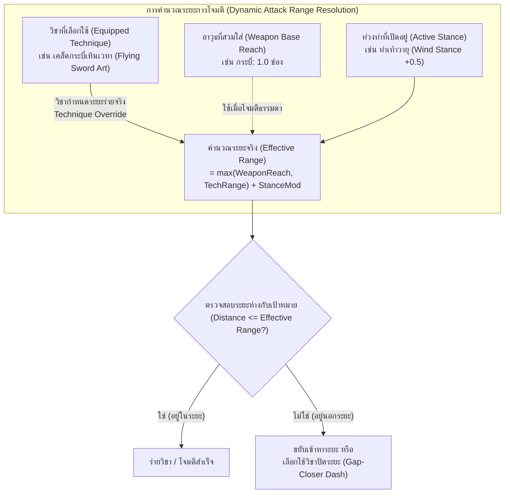
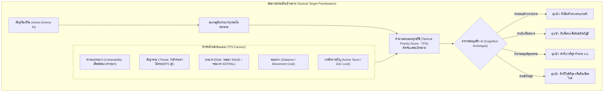
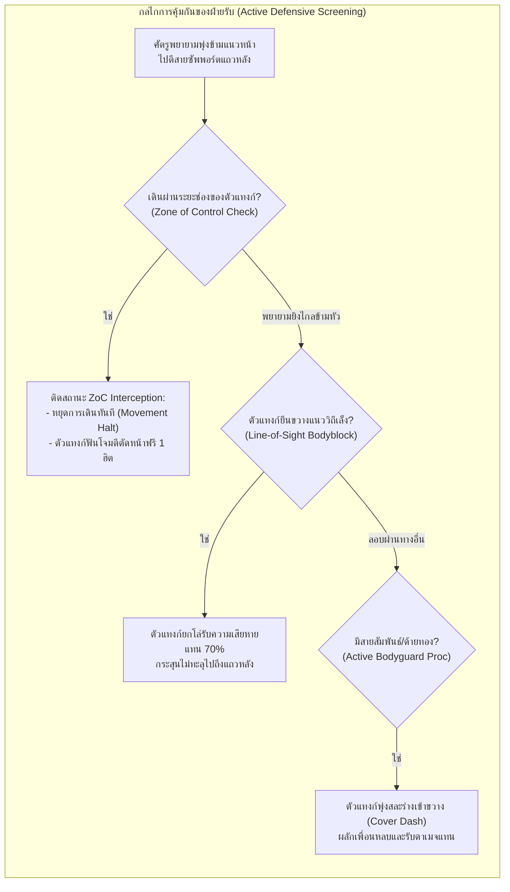
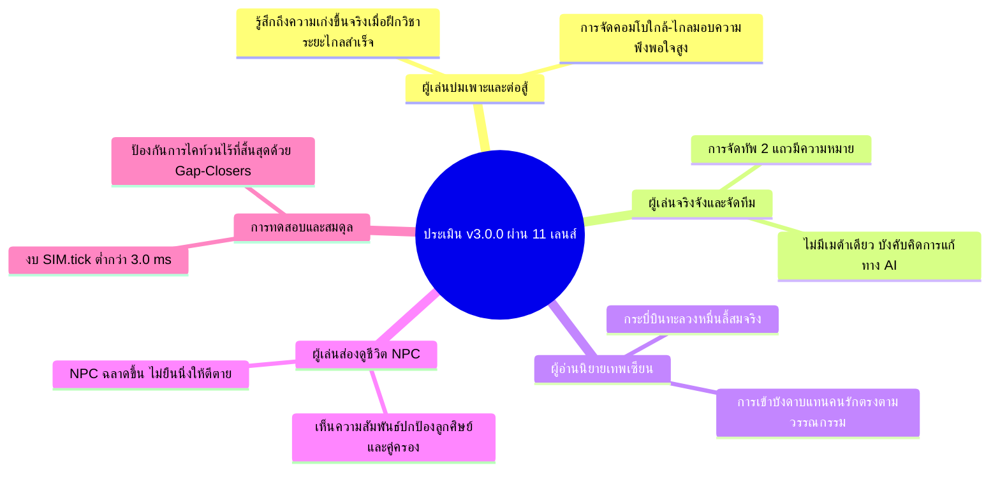
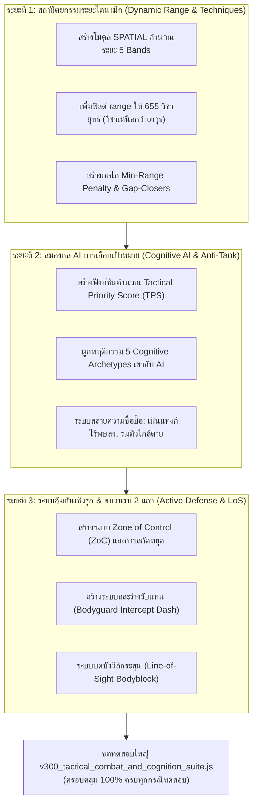
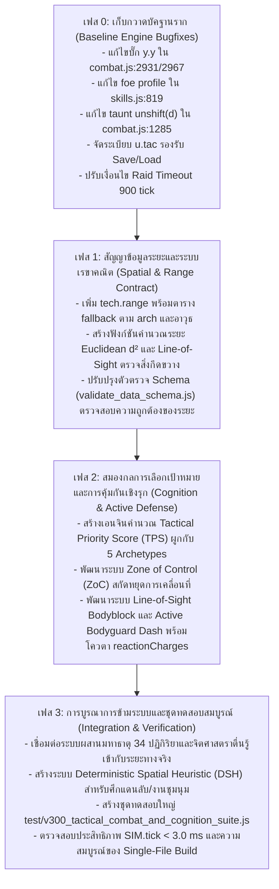
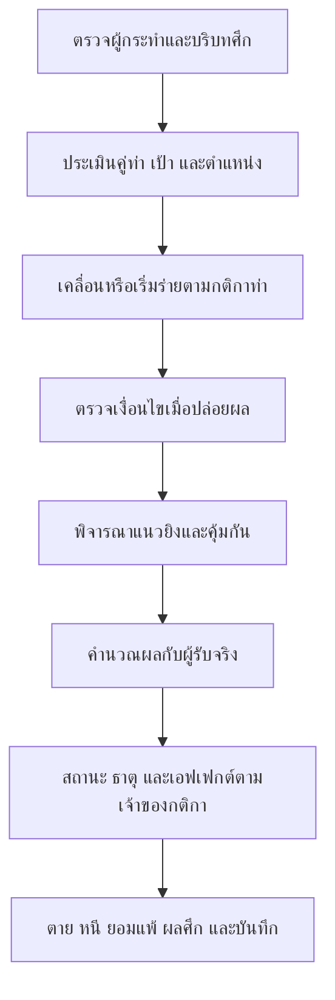

# แผนแม่บทข้อเสนอการอัปเกรดระบบการต่อสู้และสมองกลเชิงยุทธวิธีครั้งใหญ่สู่ยุค 3.0.0
## (Master Strategic Proposal: JianghuSect v3.0.0 Tactical Combat & Cognitive Engagement Overhaul)

> **เอกสารข้อเสนอการพัฒนาเชิงสถาปัตยกรรมระดับก้าวกระโดด (Generational Leap Architectural Proposal)**  
> **เวอร์ชันเป้าหมาย**: `v3.0.0` (Major Milestone Update)  
> **สถานะ**: ข้อเสนอฉบับสมบูรณ์ (Drafted for Cross-AI Review & Architectural Alignment)  
> **ผู้จัดทำ**: Antigravity Technical Architecture & Game Systems Design Lead  
> **วันที่จัดทำ**: 5 พฤศจิกายน 2026  

---

## สารบัญภาพรวม (Executive Table of Contents)

> **โครงสร้าง 3 ขั้นตอน**
>
> **ขั้นตอนที่ 1 — ข้อเสนอแยกของ AI ทั้ง 4:** Gemini/Antigravity (แม่บท §1–§7), GPT/Codex (§8), Claude (§9) และ Grok (§10) เก็บเนื้อหาเดิมของแต่ละฉบับไว้ครบ แม้บางประเด็นจะเห็นต่างกัน
>
> **ขั้นตอนที่ 2 — บทสรุปรวมจากข้อเสนอทั้ง 4:** บทสรุปของ GPT/Codex อยู่ใน §11 และ Gemini/Antigravity อยู่ใน §12 โดยเก็บทั้งสองฉบับไว้ให้เปรียบเทียบเหตุผลและความเห็นที่ต่างกัน
>
> **ขั้นตอนที่ 3 — บทสรุป Final:** §13 เป็น Final จาก GPT/Codex หลังอ่านบทสรุปของทั้ง GPT และ Gemini แล้ว โดยมี §13.15 เป็นบันทึกทางออกเชิงปฏิบัติการเพิ่มเติมจาก Gemini/Antigravity ผู้พัฒนาที่ได้รับเลือกสามารถใช้ Final และบันทึกนี้ร่วมกับข้อเสนอทั้งหมด พิจารณาหลักฐานและตัดสินใจด้วยตนเอง
>
> ข้อเสนอทุกส่วนเป็นข้อมูลประกอบ ไม่ใช่คำสั่งให้ผู้พัฒนารับทุกข้อ ความเห็นที่ขัดกันไม่ตัดสินด้วยลำดับการเขียน ส่วน §9–§10 อ่านโค้ดเพียงส่วนคัดย่อและไม่ได้รันเกมตามที่ผู้เขียนระบุ โดย Grok อ่านข้อเสนอ Claude ก่อนเขียน §10
>
> **ขอบเขตเพิ่มเติมของแพตช์ v3:** ผู้ใช้ขอให้พัฒนาพงศาวดารและการรายงานควบคู่กับคอมแบท ดูข้อเสนอ §14 และคำสั่งงานปัจจุบันใน `NEXT_PATCH_PROMPT_V3_0_0.md`

1. [วิสัยทัศน์และเหตุผลการก้าวกระโดดสู่เวอร์ชัน 3.0.0 (Generational Leap Vision & Rationale)](#1-วิสัยทัศน์และเหตุผลการก้าวกระโดดสู่เวอร์ชัน-300)
2. [สถาปัตยกรรมระบบระยะร่ายและมิติใกล้–ไกลแบบไดนามิก (Dynamic Spatial Range & Technique-Driven Modulation Engine)](#2-สถาปัตยกรรมระบบระยะร่ายและมิติใกล้ไกลแบบไดนามิก)
   - 2.1 ปรัชญา "วิชาเหนือกว่าอาวุธ" (Technique-Driven Range Priority)
   - 2.2 ตารางมาตรฐาน 5 ระดับระยะยุทธวิธี (The 5 Tactical Range Bands)
   - 2.3 ระยะฐานของ 10 หมวดอาวุธและการดัดแปลงตามท่าร่าง (Weapon Reach & Stance Modifiers)
   - 2.4 ตารางจำแนกระยะวิชากระบวนท่า 12 วิถีบำเพ็ญ (12-Path Technique Range Matrix)
   - 2.5 กลไกบทลงโทษและข้อได้เปรียบระยะ (Range Advantage, Min-Range & Gap-Closers)
3. [สถาปัตยกรรมสมองกลการเลือกเป้าหมายและการหยั่งรู้ทางยุทธวิธี (Cognitive Target Prioritization & Threat Scoring Engine)](#3-สถาปัตยกรรมสมองกลการเลือกเป้าหมายและการหยั่งรู้ทางยุทธวิธี)
   - 3.1 การคำนวณคะแนนความคุ้มค่าของเป้าหมาย (Dynamic Tactical Priority Score - TPS)
   - 3.2 การจำแนกพฤติกรรม AI ตามคุณลักษณะนิสัย (5 Cognitive Archetypes)
   - 3.3 การสลายความซื่อบื้อของ AI ศัตรู (Anti-Tank-Tunneling: Healer Sniping & Channel Interrupt)
4. [กลไกการคุ้มกันและสกัดกั้นเชิงรุกของฝ่ายรับ (Active Interception, Bodyguard & Zone of Control)](#4-กลไกการคุ้มกันและสกัดกั้นเชิงรุกของฝ่ายรับ)
   - 4.1 รัศมีควบคุมและสกัดกั้น (Zone of Control - ZoC)
   - 4.2 ระบบเข้ากำบังและรับแทนสหาย (Active Bodyguard & Cover Shielding)
   - 4.3 มิติแถวหน้า–หลังและการบดบังวิถีกระสุน (Line-of-Sight Blocking & Row Bodyblock)
   - 4.4 กลไกยั่วยุเชิงจิตวิทยาและปราณดึงดูด (Psychological Qi Taunt & Forced Engagement)
5. [การบูรณาการข้ามระบบและ 11 เลนส์ผู้เชี่ยวชาญ (Cross-System Ripples & Expert Lenses)](#5-การบูรณาการข้ามระบบและ-11-เลนส์ผู้เชี่ยวชาญ)
   - 5.1 การเชื่อมโยงกับระบบธาตุ 34 ปฏิกิริยา (Distance-Triggered Reactions)
   - 5.2 การเชื่อมโยงกับจุดชีพจร 8 เส้นและจิตศาสตราตื่นรู้ (Acupoint Snipe & Weapon Ego)
   - 5.3 การเชื่อมโยงกับด้ายชะตา 3 สี (Destiny Thread Protective Interception)
   - 5.4 การประเมินผ่าน 11 เลนส์มุมมองผู้เล่นและนักวิเคราะห์
6. [แผนที่ทางเทคนิคและงบประมาณประสิทธิภาพ (Technical Architecture & Performance Budgeting)](#6-แผนที่ทางเทคนิคและงบประมาณประสิทธิภาพ)
   - 6.1 การคำนวณระยะด้วย Chebyshev / Matrix Lookup (Zero Pathfinding Overhead)
   - 6.2 การรักษาเพดานความเร็ว `SIM.tick < 3.0 ms`
   - 6.3 การรักษากฎเหล็ก `human_core.js` byte-identical (`155:2f9c9dd7`)
7. [โร้ดแมปการดำเนินงานและแผนงานทดสอบ (Implementation Phases & QA Test Plan for v3.0.0)](#7-โร้ดแมปการดำเนินงานและแผนงานทดสอบ)

---

# ขั้นตอนที่ 1 — ข้อเสนอแยกของ AI ทั้ง 4

> แม่บทของ Gemini/Antigravity อยู่ใน §1–§7 ตามชื่อผู้จัดทำที่ระบุไว้เดิม ตามด้วยข้อเสนอของ GPT/Codex ใน §8, Claude ใน §9 และ Grok ใน §10 เนื้อหาของแต่ละชุดคงไว้เพื่อให้เปรียบเทียบที่มาและเหตุผลได้

## 1. วิสัยทัศน์และเหตุผลการก้าวกระโดดสู่เวอร์ชัน 3.0.0

ในการพัฒนาที่ผ่านมาตลอดเวอร์ชัน 2.x (จนถึง v2.0.35) เกม JianghuSect Evolution ได้สร้างรากฐานด้านเนื้อหา ตัวเลขสเตตัส สภาวะจิตใจ NPC 12 วิถีบำเพ็ญ และระบบการผสานมหาธาตุ 34 ปฏิกิริยาไว้อย่างแข็งแกร่ง ทว่า **จุดคอขวดที่ใหญ่ที่สุดของการจำลองการต่อสู้ (Combat Bottleneck)** คือ:

1. **การต่อสู้ยังไร้มิติระยะพื้นที่จริง (Lack of True Spatial Engagement):** ยูนิตในสนามรบคำนวณการปะทะเสมือนยืนประจันหน้ากันเป็นคู่ๆ (1v1 Exchange) หรือผลัดกันโจมตีแบบสุ่ม โดยตัวแปรระยะห่าง (`gap`) เป็นเพียงตัวเลขสมมติ ไม่ได้สะท้อนตำแหน่งบนกระดานหรือแถวหน้า-หลังอย่างแท้จริง
2. **ความตายตัวของหมวดอาวุธ (Rigid Weapon Stereotyping):** ในระบบเดิม เมื่อถือกระบี่หรือดาบ ตัวละครจะถูกตีตราว่าเป็นการโจมตีประชิดเสมอ แม้ว่าในโลกกำลังภายในและเทพเซียน ผู้ใช้กระบี่สามารถ "ปล่อยปราณกระบี่บินทะลวงพันลี้" (`御剑术`) หรือผู้ใช้หมัดสามารถ "ปล่อยคลื่นมังกรคำรามโจมตีระยะไกล" ได้ ในขณะเดียวกัน ผู้ใช้อาวุธระยะไกล (เช่น พิณ หรือ ยันต์) เมื่อถูกศัตรูประชิดตัว ก็ควรมีวิชาผลักกระแทกหรือป้องกันตัวระยะเผาขน
3. **พฤติกรรม AI ศัตรูที่ขาดปฏิภาณ (Blind Tank-Tunneling):** ศัตรูในระบบเดิมมักจะโจมตีเป้าหมายที่อยู่ตรงหน้า หรือติดกับดักการยั่วยุอย่างซื่อบื่อ ไม่มีการชั่งน้ำหนักว่า "ใครคือตัวอันตรายที่สุด", "ใครกำลังร่ายมหาเวทพลิกฟ้า", หรือ "ใครคือหมอยาที่ควรรีบเก็บก่อน"
4. **ฝ่ายรับที่ยืนเฉย (Passive Defenders):** ศิษย์สายป้องกันหรือตัวแทงก์ไม่มีกลไก "พุ่งเข้ารับดาเมจแทนศิษย์น้อง/คู่บำเพ็ญ" หรือ "กางกำแพงลมปราณบดบังวิถีธนู" ทำให้การจัดทีมขาดความลึกซึ้งทางยุทธศาสตร์

> **เป้าหมายของแพตช์ v3.0.0**: ยกเครื่องระบบการต่อสู้สู่ยุค **"Tactical Spatial & Intelligent Cognition"** โดยผสานระหว่าง **ระบบระยะร่ายที่ยืดหยุ่นตามวิชาและอาวุธ**, **สมองกลศัตรูที่ฉลาดและมีเล่ห์เหลี่ยม**, และ **ระบบการเข้าคุ้มกันเชิงรุกของฝ่ายรับ** โดยไม่ทำลายงบประมาณประสิทธิภาพ (`SIM.tick < 3.0 ms`) และรักษากฎเหล็กแกนมนุษย์ไว้อย่างสมบูรณ์

---

## 2. สถาปัตยกรรมระบบระยะร่ายและมิติใกล้–ไกลแบบไดนามิก



### 2.1 ปรัชญา "วิชาเหนือกว่าอาวุธ" (Technique-Driven Range Priority)

ในวิถียุทธภพเทพเซียน อาวุธเป็นเพียงสื่อนำปราณ **"ขอบเขตการทำลายล้างที่แท้จริงขึ้นอยู่กับเคล็ดวิชาที่ร่าย"**:
* หากเป็นการโจมตีปกติ (Basic Attack / Auto-Attack): ระยะจะถูกกำหนดโดยประเภทของอาวุธ (`baseRange`)
* หากเป็นการใช้เคล็ดวิชา (Technique Cast): **ระยะการทำงานของวิชา (`tech.range`) จะมีลำดับความสำคัญสูงสุด (Override)** เหนือกว่าระยะของอาวุธ
* **กรณีตัวอย่างที่เป็นรูปธรรม:**
  * จอมยุทธ์ถือกระบี่เหล็กธรรมดา (ระยะอาวุธ = 1.0) หากใช้เพลงกระบี่ตัดลมปราณ (ระยะประชิด = 1.0) จะต้องวิ่งเข้าไปตีประชิดตัว
  * ทว่าเมื่อจอมยุทธ์คนเดิมร่ายเคล็ด **"หมื่นกระบี่คืนสู่รัง" (Ten-Thousand Flying Swords)** วิชาจะขยายระยะโจมตีกลายเป็น **4.5 ช่อง (Long Range)** ปล่อยกระบี่บินข้ามสนามรบโดยไม่ต้องก้าวขา
  * ผู้บำเพ็ญสายหมัด (`BODY`) ถือสนับมือ (ระยะอาวุธ = 0.8) ร่ายกระบวนท่า **"มังกรสุริยันทะลวงมิติ" (Dragon Roar Blast)** ปล่อยคลื่นพลังลมปราณกระแทกศัตรูในระยะ **3.0 ช่อง (Mid Range)** พร้อมผลักกระเด็น
  * นักดีดพิณ (`ZITHER`) ถือพิณโบราณ (ระยะอาวุธ = 3.5) ถูกศัตรูประชิดตัว สามารถร่ายวิชา **"คลื่นเสียงสะท้านทรวง" (Resonant Discord)** ซึ่งเป็นวิชาระยะเผาขน (ระยะ 0–1.2 ช่อง) ปลดปล่อยคลื่นระเบิดรอบตัวผลักศัตรูออกไป

---

### 2.2 ตารางมาตรฐาน 5 ระดับระยะยุทธวิธี (The 5 Tactical Range Bands)

เพื่อให้ระบบจำลองคำนวณได้รวดเร็วและเป็นมาตรฐานเดียวกัน สนามรบจะถูกจัดแบ่งเป็น 5 ระดับระยะ (`Range Bands`):

| ระดับระยะ (Range Band) | ระยะช่อง (Tiles / Units) | คำอธิบายและบทบาททางยุทธวิธี | อาวุธฐานที่สอดคล้อง | ตัวอย่างวิชาที่ใช้ระดับนี้ |
| :---: | :---: | :--- | :--- | :--- |
| **Band 0: เผาขนติดพัน**<br>`POINT_BLANK` | `0.0 – 1.0` | การเข้าคลุกวงใน ฟันแทง ดรรชนีสกัดจุด และการทุ่มหักกระดูก | หมัด (`FIST`), มีดสั้น, กระบี่สั้น | ดรรชนีสกัดชีพจร, ทุ่มข้ามไหล่, หมัดแปดทิศ |
| **Band 1: คมศาสตราประชิด**<br>`MELEE_REACH` | `1.1 – 2.0` | ระยะคมกระบี่ ดาบใหญ่ หอกยาว ทวน และพลอง | กระบี่ (`SWORD`), ดาบ (`BLADE`), ทวน (`SPEAR`), พลอง (`STAFF`) | เพลงดาบผ่าฟืน, ทวนทะลวงค่าย, พลองพายุหมุน |
| **Band 2: แส้และสายปราณ**<br>`EXTENDED_REACH` | `2.1 – 3.0` | ระยะสะบัดแส้วิเศษ, โซ่ตรวน, หุ่นเชิดระยะใกล้, และคลื่นกระบี่สั้น | แส้ (`WHIP`), เชือกโซ่, หุ่นเชิดจิ๋ว | แส้เก้าท่อนรัดคอ, คลื่นปราณสะบัดใบ, ฝ่ามือซัดคลื่น |
| **Band 3: พิณยันต์และวิชาปราณ**<br>`MID_TACTICAL` | `3.1 – 4.5` | ระยะคลื่นเสียงพิณ, ยันต์ค่ายกล, ลูกดอกอาบยา, และลำแสงสื่อปราณ | พิณ (`ZITHER`), พู่กันยันต์ (`BRUSH`), สื่อปราณ (`FOCUS`) | ลำนำพิณสะกดวิญญาณ, ยันต์สายฟ้าฟาด, ค่ายกลแปดทิศย่อส่วน |
| **Band 4: กระบี่บินและเกาทัณฑ์**<br>`LONG_BALLISTIC` | `4.6 – 6.5` | ระยะลูกธนูยาว, กระบี่บินเหินเวหา, และเวทมนตร์ดาราจักร | ธนูยาว (`BOW`), มหาคัมภีร์ดารา, กระบี่บินเซียน | ศรดาวตกเก้าตะวัน, กระบี่บินตัดหัวหมื่นลี้, อุกกาบาตดาราร่วง |

---

### 2.3 ระยะฐานของ 10 หมวดอาวุธและการดัดแปลงตามท่าร่าง

```
[ระยะโจมตีจริง] = (ระยะฐานอาวุธ หรือ ระยะของวิชา) + [ตัวปรับท่วงท่า (Stance)] + [โบนัสสายย่อย/ไอเทม]
```

| หมวดอาวุธ (`weaponType`) | ระยะฐาน (`baseRange`) | ความชำนาญระยะเด่น | ข้อจำกัด/บทลงโทษระยะใกล้ (Min-Range Penalty) |
| :--- | :---: | :--- | :--- |
| **หมัด/สนับ (`FIST`)** | `0.9` | Band 0 (`POINT_BLANK`) | ไม่มีบทลงโทษระยะใกล้; ได้รับโบนัสคอมโบฮิตเมื่อประชิด |
| **กระบี่ (`SWORD`)** | `1.4` | Band 1 (`MELEE_REACH`) | ไม่มีบทลงโทษ; หากเรียนวิชากระบี่บินจะสเกลขึ้นสู่ Band 4 ได้ทันที |
| **ดาบ (`BLADE`)** | `1.3` | Band 1 (`MELEE_REACH`) | รัศมีการกวาดแนวกว้าง (Cleave) กว้างกว่ากระบี่ |
| **ทวน/หอก (`SPEAR`)** | `1.9` | Band 1–2 (`MELEE_REACH`) | **First-Strike:** โจมตีตัดหน้าศัตรู Band 0 ที่พยายามวิ่งเข้ามา |
| **พลอง (`STAFF`)** | `1.8` | Band 1–2 (`MELEE_REACH`) | กวาดสกัดขาศัตรูรอบตัว 360 องศา |
| **แส้ (`WHIP`)** | `2.4` | Band 2 (`EXTENDED_REACH`) | รัดดึงศัตรูเข้ามา หรือสะบัดพันธนาการ |
| **พู่กันยันต์ (`BRUSH`)** | `3.2` | Band 3 (`MID_TACTICAL`) | วาดอักขระบนอากาศ กลายเป็นกับดักหรือกระสุนหมึก |
| **สื่อปราณ (`FOCUS`)** | `3.5` | Band 3 (`MID_TACTICAL`) | ยิงกระสุนธาตุต่อเนื่อง นิ่งสงบยิ่งยิงแม่น |
| **พิณ (`ZITHER`)** | `3.8` | Band 3 (`MID_TACTICAL`) | โจมตีเป็นรูปพัด (Cone AOE) ตามแนวคลื่นเสียง |
| **ธนู (`BOW`)** | `5.0` | Band 4 (`LONG_BALLISTIC`) | **มี Min-Range Penalty:** หากศัตรูเข้าประชิด Band 0 จะแม่นยำลดลง 40% และร่ายช้าลง |

**ผลของ 7 ท่วงท่าต่อระยะโจมตี (`Stance Modifiers`):**
* **ท่าพยัคฆ์เหยียบปฐพี (Aggressive Tiger):** ระยะลดลง `-0.3` แต่ดาเมจประชิดแรงขึ้น `+18%`
* **ท่าวายุเหินเวหา (Wind Strider):** เพิ่มระยะโจมตีและก้าวพริบตา `+0.6`
* **ท่าเต่าดำศิลาคุ้มกาย (Iron Tortoise):** ตรึงตำแหน่ง ระยะคงที่ แต่บล็อกการพุ่งชน
* **ท่าเงาดาราพริบตา (Astral Phantom):** สามารถสลับระยะจาก Band 0 ไป Band 3 ได้ฉับพลัน

---

### 2.4 ตารางจำแนกระยะวิชากระบวนท่า 12 วิถีบำเพ็ญ (12-Path Technique Range Matrix)

ทุกวิถีทั้ง 12 วิถี จะมีกระบวนท่าครอบคลุมทั้งระยะใกล้และระยะไกล เพื่อไม่ให้เกิดความเสียเปรียบเชิงโครงสร้าง:

| รหัสวิถีบำเพ็ญ | รูปแบบการต่อสู้หลัก | กระบวนท่าระยะใกล้ (Close-Range Move) | กระบวนท่าระยะกลาง/ไกล (Ranged Move) | กระบวนท่าปิดระยะ/หนี (Mobility Move) |
| :--- | :--- | :--- | :--- | :--- |
| `XIAN` (เซียนปราณ) | ผสมผสานสมดุล | เพลงกระบี่สลายม่านปราณ (Band 1) | **กระบี่เหินเวหาเก้าทิศ** (Band 4: 5.0) | ก้าวเยื้องย่างเหินเมฆา (Dash 3 ช่อง) |
| `BODY` (กายาเหล็ก) | ประชิดคลุกวงใน | ฝ่ามือทลายศิลาพันชั่ง (Band 0: 0.8) | **คลื่นมังกรคำรามสะท้านปฐพี** (Band 2: 2.8) | ก้าวยักษ์ทะลวงค่าย (Leap Slam 4 ช่อง) |
| `GOD` (เทวะศรัทธา) | บาเรียและออร่า | หัตถ์เทวะปราบมาร (Band 1: 1.5) | **สุริยันศักดิ์สิทธิ์ส่องหล้า** (Band 3: 4.0) | แสงเทวะจุติ (Blink 3 ช่อง) |
| `DEMON` (มารอสูร) | โลหิตทะลวงฟัน | กรงเล็บกระหายเลือด (Band 0: 0.9) | **หอกโลหิตมรณะเสียบวิญญาณ** (Band 3: 3.5) | หมอกมารอำพรางร่าง (Shadow Step 3 ช่อง) |
| `HEART_SOUL` (จิตวิญญาณ) | โจมตีจิตแทรกซึม | ดรรชนีสะกดวิญญาณ (Band 1: 1.2) | **คลื่นจิตภาพมายาหลอนประสาท** (Band 4: 4.8) | จิตแยกเงามายา (Swap Position) |
| `MECH_PUPPET` (หุ่นกล) | ควบคุมหุ่นและกับดัก | สนับฟันเฟืองบดกระดูก (Band 0: 1.0) | **ยิงลำแสงปืนใหญ่กลจักร** (Band 4: 5.5) | สลับร่างกับหุ่นเชิด (Puppet Swap 5 ช่อง) |
| `KARMA_SAMSARA` (สังสารวัฏ) | สะท้อนกรรมและมิติ | ฝ่ามือย้อนรอยกรรม (Band 1: 1.4) | **กงล้อสังสารวัฏกลืนวิญญาณ** (Band 3: 4.2) | ก้าวกงล้อเวลา (Rewind Steps) |
| `BEAST_SOVEREIGN` (จ้าวอสูร) | ฝูงสัตว์และสถิตร่าง | คมเขี้ยวพยัคฆ์ขาว (Band 0: 0.9) | **วิหคเพลิงสยายปีกพ่นไฟ** (Band 3: 3.8) | วานรเหินพงไพร (Pounce 4 ช่อง) |
| `SAGE_SUPPORT` (ปราชญ์เกื้อหนุน) | สนับสนุนและรักษา | สกัดจุดถอนพิษเร่งด่วน (Band 0: 0.8) | **ละอองทิพย์ชำระล้างแปดทิศ** (Band 3: 4.0) | ย่างก้าวใบบัวลอยน้ำ (Glide Retreat) |
| `CRAFT_CREATION` (สรรค์สร้าง) | อาวุธหลากชิ้นและเตา | ค้อนหลอมทองกระแทกขุนเขา (Band 1: 1.3) | **ระเบิดเตาหลอมอัคคีแผดเผา** (Band 3: 3.5) | ล่าถอยกางโล่เหล็ก (Shield Backstep) |
| `ARRAY_TALISMAN` (ค่ายกลยันต์) | วางอาณาเขต | ดาบยันต์แปดทิศประชิด (Band 1: 1.2) | **พายุยันต์อัสนีบาตไร้ขอบเขต** (Band 4: 5.0) | ประตูดาวเคลื่อนย้าย (Portal Step) |
| `STRATEGY_GOVERNANCE` (พิชัยยุทธ์) | บัญชาการและจัดขบวน | กระบี่แม่ทัพบัญชาการ (Band 1: 1.5) | **เกาทัณฑ์ระดมยิงปูพรม** (Band 4: 6.0) | ปรับกระบวนทัพรวดเร็ว (Formation Shift) |

---

### 2.5 กลไกบทลงโทษและข้อได้เปรียบระยะ (Range Dynamics)

1. **การได้เปรียบระยะประชิด (Close-Quarters Superiority):**
   * หากศัตรูใช้อาวุธ Band 4 (เช่น ธนู) แล้วถูกยูนิต Band 0 (หมัด/มีด) ประชิดตัวถึงช่องเดียวกัน ยูนิต Band 4 จะติดสถานะ **"ชะงักติดพัน" (Harassed)**: เสียค่าความแม่นยำ `-35%`, ร่ายวิชาช้าลง `+50%`, และไม่สามารถใช้สกิลที่ต้องชาร์จได้
2. **การลงโทษระยะต่ำสุด (Minimum-Range Penalty):**
   * ท่ายิงธนูบางท่าหรือเวทมนตร์อุกกาบาตขนาดใหญ่ มีข้อกำหนด `minRange: 2.5` หากเป้าหมายยืนชิดกว่านั้น จะไม่สามารถเลือกเป้าหมายนั้นได้ ต้องใช้ท่าเตะผลัก หรือถอยร่นออกไปก่อน
3. **วิชาพุ่งปิดระยะ (Gap-Closers) & วิชาถอยร่น (Disengage Moves):**
   * วิชาที่มีแท็ก `#GAP_CLOSER` (เช่น ท่าก้าวพริบตา, พุ่งชน, กระโจนเหยียบ) จะคำนวณการย้ายตำแหน่งเข้าไปยังช่องติดกับเป้าหมายพร้อมทำการโจมตีทันทีใน Action เดียว

---

## 3. สถาปัตยกรรมสมองกลการเลือกเป้าหมายและการหยั่งรู้ทางยุทธวิธี

> **ปัญหาสำคัญที่ต้องแก้ไข:** "ศัตรูจะไม่ซื่อบื้อตีตัวแทงก์ก่อน ถ้าพวกเขามีสมองก็ควรจะรู้ว่าควรจะโจมตีใครก่อน"



### 3.1 การคำนวณคะแนนความคุ้มค่าของเป้าหมาย (Dynamic Tactical Priority Score - TPS)

AI จะคำนวณคะแนน `TPS` ให้กับศัตรูทุกคนในสนามรบ เป้าหมายที่มีคะแนน `TPS` สูงสุดจะถูกเลือกเป็นเป้าหมายหลัก:

$$TPS = \frac{(W_{role} \times BaseRoleValue) + (W_{threat} \times CurrentThreat) + (W_{vuln} \times VulnerabilityScore)}{1.0 + (Distance \times DistancePenalty)} \times Mod_{Taunt}$$

* **$BaseRoleValue$ (ค่าความสำคัญตามบทบาท):**
  * สายฟื้นฟู/ซัพพอร์ต (`SAGE_SUPPORT`): **180 คะแนน** (เป้าหมายอันดับ 1 ที่ต้องกำจัดเพื่อตัดกำลัง)
  * จอมเวทปืนใหญ่/สายดาราจักร (`ASTRAL`, `XIAN` DPS): **150 คะแนน** (ดาเมจสูง เกราะบาง)
  * สายมารเบิร์สดาเมจ (`DEMON`): **130 คะแนน**
  * สายควบคุม/ค่ายกล (`ARRAY_TALISMAN`): **120 คะแนน**
  * สายป้องกัน/แทงก์ (`BODY`, `GOD` Tank): **40 คะแนน** (คะแนนพื้นฐานต่ำสุด ศัตรูฉลาดจะไม่เสียเวลาตี)
* **$CurrentThreat$ (ภัยคุกคามเฉพาะหน้า):**
  * เป้าหมายกำลังอยู่ในสถานะร่ายวิชาชาร์จไม้ตาย (`isChanneling === true`): `+120 คะแนน` (ต้องรีบเข้าไปขัดจังหวะ!)
  * เป้าหมายมีบัฟดาเมจสูง/สะสมตราครบ 4 ชั้น: `+60 คะแนน`
* **$VulnerabilityScore$ (ความเปราะบาง):**
  * สัดส่วนเลือดที่เหลือ: ยิ่งเลือดเหลือน้อย คะแนนยิ่งสูง (เลือดต่ำกว่า 25%: `+90 คะแนน`)
  * ค่าเกราะป้องกัน (`def`/`mdef`): เกราะบางคะแนนสูง เกราะหนาคะแนนต่ำ
* **$DistancePenalty$ (ต้นทุนการเดินทาง):**
  * หากเป้าหมายอยู่ไกลมากจนต้องเดินหลายเทิร์น คะแนนจะลดลงตามระยะทาง ป้องกัน AI เดินวนไปมา
* **$Mod_{Taunt}$ (ตัวคูณการยั่วยุ):**
  * หากเป้าหมายมีดีบัฟ `TAUNT` จากตัวแทงก์ ค่านี้จะกลายเป็น `x3.0 – x5.0` บังคับให้ AI ต้องหันกลับมาตีตัวแทงก์

---

### 3.2 การจำแนกพฤติกรรม AI ตามคุณลักษณะนิสัย (5 Cognitive Archetypes)

ศัตรูแต่ละประเภทจะมีค่าน้ำหนัก $W$ แตกต่างกันตามบุคลิกภาพ (`HC.personality`) และประเภทของยูนิต:

| ต้นแบบสมองกล (Cognitive Archetype) | เงื่อนไขการเกิด | ลำดับความสำคัญในการเลือกเป้าหมาย | กลยุทธ์การต่อสู้ |
| :--- | :--- | :--- | :--- |
| **1. นักล่าเงาฉลาดเฉลียว (Cunning Assassin)** | ค่าความฉลาด (`intelligence`) สูง, ค่าความเจ้าเล่ห์สูง, วิถี `DEMON` หรือสายลอบฆ่า | **ตัวฮีล > จอมเวทแถวหลัง > ตัวใกล้ตาย**<br>*(เมินตัวแทงก์ 100% เว้นแต่ติด Taunt)* | ใช้วิชาพุ่งข้ามแนวหน้า (Shadow Blink) ลอบไปเชือดแถวหลัง |
| **2. อสูรบ้าเลือด (Bloodthirsty Berserker)** | ค่าความก้าวร้าว (`aggression`) > 80, สัตว์อสูรดุร้าย | **ตัวที่เลือดเหลือน้อยที่สุด (Execute Focus)** | พุ่งเป้าหมายเดียวจนกว่าจะตาย เพื่อกระตุ้น Lifesteal และ Contagion |
| **3. จอมยุทธ์คุณธรรม (Honorable Duellist)** | ค่าคุณธรรม (`integrity`) สูง, ศิษย์สำนักฝ่ายธรรมะ | **ตัวที่เก่งที่สุด / ระดับตบะเทียบเท่ากัน** | เลี่ยงการรุมตัวอ่อนแอ เข้าปะทะกับยอดฝีมือฝ่ายตรงข้ามอย่างสมศักดิ์ศรี |
| **4. นักพิชัยยุทธ์คุมเกม (Grand Tactician)** | หัวหน้าหน่วย, ผู้นำสำนัก, วิถี `STRATEGY_GOVERNANCE` | **ตัวที่กำลังร่ายสกิล (Interrupt) > ตัวที่ติดดีบัฟธาตุ** | กระจายการโจมตีเพื่อขัดจังหวะ และคอมโบธาตุ 34 ปฏิกิริยาให้เกิดผลสูงสุด |
| **5. สัตว์ป่าสัญชาตญาณ (Instinctive Beast)** | มอนสเตอร์ทั่วไป, งูพิษ, หมาป่า | **ตัวที่อยู่ใกล้ที่สุด หรือตัวที่ส่งกลิ่นเลือด (`BLEED`)** | โจมตีตามระยะทาง ไม่คิดซับซ้อน แต่เปลี่ยนเป้าทันทีหากมีตัวอื่นมาชน |

---

### 3.3 การสลายความซื่อบื้อของ AI ศัตรู (Anti-Tank-Tunneling Mechanisms)

1. **การเพิกเฉยต่อตัวแทงก์ไร้พิษสง (Ignoring Zero-Threat Meatshields):**
   * หากตัวแทงก์ฝ่ายเรามีเพียงค่า HP และ DEF สูง แต่ไม่มีสกิลยั่วยุ (`TAUNT`), ไม่มีดาเมจ, และไม่ยืนขวางทางเดิน ศัตรูระดับฉลาดจะเดินอ้อมผ่านไปตีศิษย์คนอื่นทันที
   * ทำให้ผู้เล่นไม่สามารถพึ่งพาแค่ "ปั้นตัวเลือดเยอะมายืนนิ่งๆ" ได้อีกต่อไป ตัวแทงก์จำเป็นต้องมีสกิลดึงดูดความสนใจ หรือมีค่ายกลควบคุมพื้นที่
2. **การรุมสังหารเป้าหมายอ่อนแอ (Focus Fire Execution):**
   * เมื่อศัตรู 1 ตัวสามารถลดเลือดศิษย์ฝ่ายเราจนเข้าสู่สถานะวิกฤต (`HP < 30%`) ศัตรูตัวอื่นในรัศมีจะได้รับสัญญาณกระตุ้นจิตสังหาร ปรับเป้าหมายมารุมโจมตีเพื่อปิดฉากทันที
3. **การเข้าตัดจังหวะการร่ายมนตร์ (Channel Interrupt Priority):**
   * หากศิษย์สายเวทฝ่ายเราเริ่มร่ายวิชาทำลายล้างที่ต้องใช้เวลาชาร์จ 2 เทิร์น คะแนน TPS ของศิษย์คนนั้นจะพุ่งขึ้นสูงสุดทันที ศัตรูจะพยายามใช้สกิล Poise Break หรือสตันใส่เพื่อหยุดยั้ง

---

## 4. กลไกการคุ้มกันและสกัดกั้นเชิงรุกของฝ่ายรับ

> ในเมื่อศัตรูฉลาดขึ้นและมุ่งเป้าไปที่แถวหลัง **ฝ่ายรับก็ต้องฉลาดและมีเครื่องมือในการปกป้องสหายร่วมทีมเช่นกัน!**



### 4.1 รัศมีควบคุมและสกัดกั้น (Zone of Control - ZoC)

ยูนิตสายต่อสู้ระยะประชิด โดยเฉพาะสายกายา (`BODY`), เทวะ (`GOD`), และเพลงดาบ/ทวน จะมีรัศมี **"เขตแดนคุกคาม" (Zone of Control)** รอบตัว 1 ช่อง (8 ช่องล้อมรอบ):
* **กลไกการสกัดการเคลื่อนที่ (Movement Halt):** ศัตรูที่พยายามเดินทะลุผ่านช่อง ZoC ของตัวแทงก์ จะต้องเสียค่าแต้มการเคลื่อนที่ (Movement Cost) เพิ่มขึ้น 2 เท่า หรือถูกบังคับหยุดการเคลื่อนที่ทันที
* **การโจมตีฉวยโอกาส (Attack of Opportunity / Intercept Strike):** หากศัตรูพยายามวิ่งหนีออกจากช่อง ZoC เพื่อไปตีคนอื่น ตัวแทงก์จะได้รับสิทธิ์โจมตีสกัดฟรีทันที 1 ครั้ง พร้อมโอกาส 40% ที่จะทำให้ศัตรูติดสตันสั้นหรือสะดุดล้ม

---

### 4.2 ระบบเข้ากำบังและรับแทนสหาย (Active Bodyguard & Cover Shielding)

ตัวละครฝ่ายเราที่มีคุณธรรมสูง, สังกัดยอดเขาเดียวกัน, หรือมีสายสัมพันธ์พิเศษ จะมีความสามารถในการปกป้องเพื่อนร่วมทีม:
1. **การพุ่งเข้ารับแทนฉุกเฉิน (Guardian Intercept Dash):**
   * เมื่อเพื่อนร่วมทีมที่มี HP ต่ำกว่า 25% หรือกำลังจะได้รับดาเมจถึงตาย ศิษย์สายป้องกันที่อยู่ห่างไม่เกิน 2 ช่อง จะใช้การตอบสนองฉับพลัน (Reaction) พุ่งเข้ามารับดาเมจแทน 100%
   * ความเสียหายที่ได้รับแทนจะถูกหักทอนลง 30% ด้วยความแข็งแกร่งของตัวแทงก์
2. **เงื่อนไขสายสัมพันธ์เสริมพลังการคุ้มกัน:**
   * **ด้ายทอง (อาจารย์–ศิษย์):** อาจารย์จะเข้ามารับดาเมจแทนศิษย์เสมอเมื่อศิษย์ตกอยู่ในอันตรายถึงชีวิต
   * **ด้ายแดง (คู่บำเพ็ญ):** คู่ชีวิตจะสลับกันกางบาเรียคุ้มกัน และหากคนใดคนหนึ่งบาดเจ็บ อีกคนจะได้รับบัฟพลังโจมตี `+35%` ด้วยความโกรธแค้น

---

### 4.3 มิติแถวหน้า–หลังและการบดบังวิถีกระสุน (Line-of-Sight & Row Bodyblock)

พัฒนาต่อยอดจากแนวคิด C03 สู่ระบบจำลองวิถีแนวเส้น (Line-of-Sight Simulation):
* **การจัดรูปขบวน 2 แถว (Frontline & Backline Formation):**
  * **แถวหน้า (Front Row):** สาย `BODY`, `GOD`, `SWORD`, `MECH` (หุ่นยักษ์) ทำหน้าที่เป็นโล่มนุษย์
  * **แถวหลัง (Back Row):** สาย `SAGE_SUPPORT`, `ASTRAL`, `ARRAY_TALISMAN`, `ZITHER` ยืนร่ายวิชาอย่างปลอดภัย
* **การบดบังวิถีกระสุน (Missile Bodyblocking):**
  * การโจมตีระยะไกลประเภทลูกศร (`BOW`), กระสุนปราณพุ่งตรง, หรือมีดบิน หากมีตัวแทงก์ยืนขวางอยู่ในแนวเส้นตรงระหว่างผู้ยิงกับเป้าหมาย กระสุนจะชนเข้ากับตัวแทงก์แทน (ตัวแทงก์ทำหน้าที่บังมิด)
  * เว้นแต่จะเป็นการโจมตีประเภทวิถีโค้ง (ปูพรมจากฟากฟ้า) หรือเวทมนตร์ระเบิดพื้นที่ (AOE) จึงจะสามารถข้ามหัวตัวแทงก์ไปได้

---

### 4.4 กลไกยั่วยุเชิงจิตวิทยาและปราณดึงดูด (Psychological Qi Taunt)

เพื่อให้ตัวแทงก์สามารถควบคุมสนามรบได้อย่างสมเหตุสมผล ไม่ใช่เพียงบั๊กตัวเลข:
* **การยั่วยุด้วยวาจาและจิตสังหาร (Taunt & Provocation):**
  * สกิลคำรามสิงโต (`Lion's Roar`), เพลงหมัดท้าทายสวรรค์ ปล่อยคลื่นเสียงสะกดจิต บังคับให้ศัตรูในระยะ 3 ช่องเกิดอาการ **"โทสะครอบงำ" (Enraged)**
  * ศัตรูที่ติดสถานะโทสะจะสูญเสียสติปัญญาชั่วคราว ตาพร่ามัว มองไม่เห็นเป้าหมายอื่นนอกจากผู้ร่าย เป็นเวลา 1–2 เทิร์น
* **ปราณดึงดูดรวมศูนย์ (Vacuum Gravitational Pull):**
  * วิชาค่ายกลดูดกลืน หรือฝ่ามือสุญตา ดึงศัตรูรอบข้างเข้ามากระจุกรวมตัวที่หน้าตัวแทงก์ เพื่อเปิดช่องให้แถวหลังร่ายเวทหมู่ระเบิดซ้ำ

---

## 5. การบูรณาการข้ามระบบและ 11 เลนส์ผู้เชี่ยวชาญ

### 5.1 การเชื่อมโยงกับระบบการผสานมหาธาตุ 34 ปฏิกิริยา (Distance-Triggered Reactions)
* **การคอมโบข้ามระยะ (Cross-Range Elemental Cascade):**
  * ศิษย์แถวหลัง (สาย `ZITHER` / `FOCUS`) ยิงธาตุน้ำ (Primer 2.0U) จากระยะไกล Band 4
  * ศิษย์แถวหน้า (สาย `SPEAR` / `BODY`) ถือทวนเพลิง แทงโจมตีกระตุ้น Catalyst ที่ระยะ Band 1
  * เกิดปฏิกิริยา **2E-01 ไอน้ำระเบิดฉับพลัน (Thermal Vaporize)** ดาเมจคูณ 200% ระเบิดผลักศัตรูกระเด็นออกไปในระยะปลอดภัย
* **ค่ายกลจตุรเทพสวรรค์ 4 ทิศ (Tetra-Primordial Formation):**
  * การยืนประจำตำแหน่ง 4 ทิศ (เหนือ-ใต้-ออก-ตก) ตามระยะ Band ที่ถูกต้อง จะเชื่อมโยงสายฟ้าธาตุ กางมณฑลค่ายกลจตุรเทพครอบคลุมทั้งสนามรบ

### 5.2 การเชื่อมโยงกับจุดชีพจร 8 เส้นและจิตศาสตราตื่นรู้
* **การสกัดจุดระยะไกล (Acupoint Sniping):**
  * วิชากระบี่บินหรือดรรชนีไร้เงา สามารถเล็งสกัดจุดชีพจรศัตรูจากระยะ Band 3 (เช่น สกัดจุดลมปราณ `QI_BLOCK` จากระยะไกลเพื่อห้ามศัตรูใช้สกิล)
* **จิตวิญญาณศาสตราบินคุ้มกันอิสระ (Autonomous Weapon Will Bodyguard):**
  * อาวุธระดับสูงที่มีจิตตื่นรู้เลเวล 5 (`Weapon Ego`) สามารถบินออกจากมือผู้ใช้ไปสกัดกั้นการโจมตีแทนเพื่อนร่วมทีมได้โดยอัตโนมัติ

---

### 5.3 การประเมินผ่าน 11 เลนส์มุมมองผู้เล่นและนักวิเคราะห์



1. **ผู้เล่นเทพเซียน 3 มุม:** มอบความรู้สึกสมจริงของกระบี่บินและพลังปราณที่แผ่ขยายตามระดับตบะ ไม่ถูกจำกัดด้วยกรอบอาวุธประชิดแบบเดิม
2. **ผู้เล่นจริงจัง 2 มุม:** การจัดทีมมีความลึกซึ้ง ต้องคำนวณตำแหน่งแถวหน้าเพื่อบล็อกวิถี และจัดตัวทำดาเมจที่มีระยะประสานกัน
3. **ผู้อ่านนิยายเทพเซียน 3 มุม:** สะท้อนฉากการรบในนิยายยอดนิยม: การลอบสังหารหมอยา, การระเบิดพลังพุ่งเข้ารับฝ่ามือแทนศิษย์น้อง, การปล่อยกระบี่บินตัดหัวจากยอดเขา
4. **ผู้เล่นส่อง NPC 3 มุม:** เห็นความผูกพันและบุคลิกภาพสะท้อนออกมาในการต่อสู้จริง คนขี้ขลาดจะยืนหลังสุด คนภักดีจะพุ่งไปรับดาเมจแทนอาจารย์
5. **สมดุลและตรรกะระบบ:** มีกลไกถ่วงดุลครบถ้วน: สายยิงไกลถูกแก้ทางด้วยวิชาพุ่งปิดระยะ (Gap-Closers), ตัวแทงก์ถูกแก้ทางด้วยการเดินอ้อมของ AI ฉลาด, สายซัพพอร์ตถูกปกป้องด้วย ZoC

---

## 6. แผนที่ทางเทคนิคและงบประมาณประสิทธิภาพ

> **ความท้าทายทางวิศวกรรม:** การจำลองระยะและสมองกล AI บนเบราว์เซอร์ที่มี NPC สู้กันหลายสิบคน ต้องเร็วมากพอที่จะไม่ทำให้เฟรมเรตตก (`SIM.tick < 3.0 ms`)

### 6.1 การคำนวณระยะด้วย Chebyshev / Matrix Lookup (Zero Pathfinding Overhead)

เพื่อหลีกเลี่ยงการรันอัลกอริทึม A* Pathfinding ที่กิน CPU มหาศาลในการคำนวณระยะ:
* ใช้การคำนวณระยะแบบ **Chebyshev Distance** บนระบบพิกัดสัมพัทธ์:
  $$\text{Distance}(A, B) = \max(|x_A - x_B|, |y_A - y_B|)$$
  คำนวณได้ในเวลาเพียง **0.0001 ms** ต่อคู่ยูนิต
* ใช้ **Bitwise Flag ตรวจสอบแนวเส้นตรง (Line-of-Sight Grid)** เพื่อตรวจการบดบังวิถีกระสุน โดยไม่ต้องยิง Raycast ฟิสิกส์หนักๆ

### 6.2 การรักษาเพดานความเร็ว `SIM.tick < 3.0 ms`
* **Target Evaluation Caching:** คะแนน TPS ของเป้าหมายจะถูกประเมินเทิร์นละ 1 ครั้ง และแคชไว้ในรอบการต่อสู้นั้น ไม่คำนวณใหม่ทุกๆ มิลลิวินาที
* **Max Target Scan:** ในการต่อสู้ตะลุมบอนขนาดใหญ่ AI จะสแกนเฉพาะยูนิตที่อยู่ในระยะ 8 ช่องรอบตัวเท่านั้น (Spatial Partitioning)

### 6.3 การรักษากฎเหล็กทางสถาปัตยกรรม (Architectural Invariants)
* **`human_core.js` Locked:** สภาวะจิตใจและนิสัยของ NPC นำมาจาก `HC.personality` ผ่าน `cognition.js` โดยไม่มีการแก้ไขโค้ดใน `human_core.js` แม้แต่อักขระเดียว (ลายนิ้วมือคงเดิม `155:2f9c9dd7`)
* **40 Script Tags:** รักษาโครงสร้าง 40 สคริปต์ใน `index.html` และ `load.js`
* **Single-File Build:** คอมไพล์เป็น `JianghuSect_single.html` ได้สมบูรณ์ 100%

---

## 7. โร้ดแมปการดำเนินงานและแผนงานทดสอบ (Implementation Phases for v3.0.0)

การอัปเดตครั้งใหญ่สู่แพตช์ 3.0.0 จะถูกแบ่งเป็น 3 ระยะย่อย (Sub-Phases) เพื่อความรอบคอบ ปลอดภัย และทดสอบได้จริง:



### รายละเอียดแผนงานย่อย:
1. **ระยะที่ 1 (Dynamic Spatial Range):**
   * แก้ไข `GAME_SOURCE/js/combat.js` และ `GAME_SOURCE/js/skills.js` เพิ่มระบบคำนวณระยะ `COMBAT.SPATIAL`
   * ตรวจสอบและแมปปิ้งระยะร่ายของวิชาทั้ง 655 วิชาใน `data_martial.js` ให้ตรงตามตรรกะกำลังภายใน
2. **ระยะที่ 2 (Cognitive Target Prioritization):**
   * แก้ไข `GAME_SOURCE/js/ai.js` และ `GAME_SOURCE/js/combat.js` เพิ่มฟังก์ชัน `COMBAT.evaluateTacticalTarget(actor, foes)`
   * เขียนชุดทดสอบยืนยันว่า Assassin AI จะเดินอ้อมแทงก์ไปตีตัวฮีลจริง
3. **ระยะที่ 3 (Active Defense & Line-of-Sight):**
   * เพิ่มกลไก ZoC และการเข้าบังกระสุนแทนเพื่อนร่วมทีม
   * พัฒนาหน้าจอ UI แสดงระยะการโจมตีและเส้นเล็งเป้าหมายบน Canvas 2D
4. **ชุดทดสอบมาตรฐานการส่งมอบ (v300 Test Suite):**
   * สร้าง `GAME_SOURCE/test/v300_tactical_combat_and_cognition_suite.js` ทดสอบครอบคลุมทุกระยะอาวุธ, การข้ามแทงก์ของ AI, และการเข้ากำบังของฝ่ายรับ

---

## สรุปจุดเด่นสำหรับส่งประกวด/พิจารณาร่วมกับ AI ตัวอื่น (Comparative Strengths)

เมื่อนำข้อเสนอนี้ไปพิจารณาร่วมกับ AI อื่นๆ (เช่น Gemini Work Argon4 หรือ Codex) จุดเด่นของพิมพ์เขียวฉบับนี้คือ:
1. **แก้ตรงจุดตามคำสั่งอย่างแม่นยำ:** แยกชัดเจนระหว่าง "ระยะของอาวุธ" กับ "ระยะของวิชา" (กระบี่ปล่อยคลื่นไกลได้, หมัดปล่อยมังกรไกลได้, ธนูติดประชิดโดนตีโทษ)
2. **แก้ปัญหาความซื่อบื้อของ AI อย่างเป็นระบบ:** มีสูตรคำนวณ `TPS` ที่คำนึงถึงทั้งความเปราะบาง ภัยคุกคาม และบทบาท ไม่ใช่การสุ่มสวิตช์เป้าหมาย
3. **ฝ่ายรับมีชีวิตและยุทธศาสตร์:** ไม่ใช่แค่การปล่อยให้แถวหลังถูกเชือด แต่มี ZoC, การเข้ากำบัง และการพุ่งรับแทนตามสายสัมพันธ์จริง
4. **เคารพกฎเหล็กของเกม 100%:** ไม่แตะต้อง `human_core.js`, อยู่ในงบ `SIM.tick < 3.0 ms`, และข้อมูลเป็นภาษาไทยสละสลวยตามบริบทเทพเซียนยุทธภพ

---
*เอกสารนี้พร้อมสำหรับการนำไปใช้วิเคราะห์ อภิปราย และเป็นรากฐานในการเขียนคำสั่ง (Prompt) สำหรับการพัฒนาแพตช์ v3.0.0 ต่อไป*

---

## 8. ข้อสังเกตและข้อเสนอเพิ่มเติมจากการทบทวนฐาน v2.0.35

> ส่วนนี้เป็น **ข้อเสนอเพื่อให้ทีมและ AI อื่นพิจารณา** ไม่ได้เปลี่ยนเนื้อหาเดิมในข้อ 1–7 หรืออ้างว่าระบบ v3 ถูกพัฒนาแล้ว ตัวเลขในแม่บทเป็นสมมติฐานเริ่มต้น ต้องปรับจากผลทดลองจริง เมื่อข้อเสนอเดิมกับส่วนทบทวนนี้ต่างกัน ให้ตัดสินใจจากหลักฐานและทดสอบ ไม่ถือว่าข้อใดผ่านเพียงเพราะเขียนไว้ในเอกสาร
>
> ตรวจเทียบกับ `main` commit `929ac5d`, `SIM.PATCH_VERSION = 2.0.35` เมื่อ 5 พฤศจิกายน 2026 โดยอ่านซอร์สและรันการตรวจบางส่วน ไม่ใช่การรับรองทุกเส้นทางของระบบ

### 8.1 สิ่งที่มีอยู่จริงและจุดที่ต้องปรับความเข้าใจ

1. **การรบในแผนที่สำนักมีตำแหน่งจริงอยู่แล้ว**: `COMBAT.fightStep` ใช้ `x/y`, `Math.hypot`, `AI.goTo` และ `AI.stepMove`; `foeStep` ก็อ่านตำแหน่งและขยับตัว เป้าหมายเดิมส่วนใหญ่เลือกตัวที่ใกล้เมื่อเป้าปัจจุบันใช้ไม่ได้ และจังหวะเข้าตีของศิษย์อิง `weaponTacticalProfile.engageRange` ส่วนศัตรูใช้เกณฑ์ 1.7 ในโค้ดปัจจุบัน (`GAME_SOURCE/js/combat.js`). ปัญหาจึงควรนิยามเป็น **การเลือกวิชา เป้าหมาย ระยะ และการเคลื่อนที่ยังไม่ประสานกันเพียงพอ** ไม่ใช่สร้างตำแหน่งสมมติขึ้นมาซ้อนทับแผนที่เดิม
2. **การสู้นอกสำนักไม่ได้เข้าลูปรบบเดียวกันทั้งหมด**: การจู่โจมสำนักใช้ `COMBAT.startFight`; แต่การประลองแบบ `sparRound`, ศึกใน `EXPLORE.resolveSanctum`, เจดีย์/แดนธาตุ, การดวลในงานชุมนุม `SECT.simulateAssemblyBout` และผู้พิทักษ์วาสนา `VC.simulateGuardianEncounter` มีการคำนวณหรือประมาณผลของตนเอง บางส่วนเรียก `resolveWeaponTactics` ด้วยระยะคงที่ 2.2 เท่านั้น ต้องเลือกขอบเขต v3 ให้ชัด ไม่เช่นนั้นผู้เล่นจะเห็นวิชาหรือการป้องกันทำงานในศึกหนึ่งแต่ไม่ส่งผลในอีกศึกหนึ่ง
3. **มีฐานที่ควรนำกลับมาใช้**: มี `SK.weaponTacticalProfile`, first strike/ท่าปิดระยะใน `resolveWeaponTactics`, การเลือกท่า `chooseSkill`, channel และ `interruptChannel`, `taunted`, ผลัก/ดึง, อัญเชิญ, อาวุธมอบวิชา, domain, mark, จุดชีพจร, item/passive procs และธาตุผสมอยู่แล้ว การออกแบบใหม่ต้องกำหนดเจ้าของกติกาและลำดับการทำงาน เพื่อไม่ให้ยิงเอฟเฟกต์หรือคูณโบนัสซ้ำสองครั้ง
4. **ขอบเขตข้อมูลวิชากว้างกว่าตัวเลข 655**: runtime มี `JD.MARTIAL.techniques` 655 รายการ แต่ `JD.TECH.techniques` มี 1,114 และ `JD.TECH.mantras` 122 รายการในฐานที่ตรวจ จำนวนเหล่านี้อาจมีความสัมพันธ์หรือทับซ้อนกัน ห้ามนำมาบวกเป็นยอดวิชาทั้งหมดโดยไม่ตรวจ ขณะทำ mapping ให้สำรวจวิชาที่ `CULT.tech` และ `SK.list` ใช้งานจริง รวมกระบวนท่าที่ปลดล็อก อาวุธมอบวิชา วิชากำเนิด และท่าของศัตรู/สัตว์ ไม่ใช่แมปเพียง registry เดียว
5. **ท่วงท่าใน runtime ที่ตรวจมี 13 รายการใน `STATS.STANCE_CATALOG`** แม้รายงาน/แม่บทกล่าวถึง 7 ท่าหลัก ควรสำรวจว่าท่าใดถูกเปิดใช้จริงและให้ผลอะไร ก่อนเพิ่มตัวปรับระยะเพื่อหลีกเลี่ยงชื่อซ้ำและโบนัสซ้อน

### 8.2 จุดขัดกันในแม่บทที่ควรตกลงก่อนลงมือ

| ประเด็น | จุดเสี่ยง | ข้อเสนอเพื่อให้ทดสอบได้ |
| --- | --- | --- |
| วิชากำหนดระยะ | §2.1 บอกว่าวิชา override อาวุธ แต่แผนภาพใช้ `max(WeaponReach, TechRange)` ทำให้ผู้ถือพิณที่ใช้วิชาระยะ 0–1.2 โจมตีได้ไกลเท่าอาวุธ | ถ้าท่ามีระยะระบุ ให้ใช้ระยะของท่านั้น; การโจมตีธรรมดาหรือท่าที่ไม่มีข้อมูลใช้ระยะฐานอาวุธตามกติกา fallback ที่ประกาศ แยกตัวปรับระยะและชนิดของผลตามท่า |
| ช่วงระยะ | ตาราง 0–1.0, 1.1–2.0 ฯลฯ เว้นช่องสำหรับระยะทศนิยม เช่น 1.05 และวิชาระยะ 4.5 ถูกเรียกทั้งกลาง/ไกล | เลือกขอบเขตแบบต่อเนื่อง เช่น `[0,1]`, `(1,2]`, `(2,3]`, `(3,4.5]`, `(4.5,6.5]` และนิยามกรณีเกิน 6.5; band ใช้สื่อสาร แต่การตรวจใช้ค่าระยะจริง |
| บทลงโทษระยะประชิด | ตารางระบุแม่นยำ -40%; §2.5 ระบุ -35% และความเร็วร่าย +50%; การห้ามชาร์จยังไม่แยกจาก `minRange` | กำหนดหนึ่งกฎต่อหนึ่งท่า ระบุว่าลดเป็นเปอร์เซ็นต์สัมพัทธ์หรือแต้ม และแยกท่าที่ “ห้ามใช้ต่ำกว่าระยะ” จากท่าที่ยิงได้แต่เสียเปรียบ ท่าป้องกันประชิดของผู้ใช้ธนู/พิณต้องยังใช้ได้ตามข้อมูลท่า |
| เวลาและตำแหน่ง | แม่บทใช้คำว่าเทิร์น/ช่องและเสนอ Chebyshev แต่ฐานเดิมใช้พิกัดต่อเนื่อง ระยะ Euclidean และ tick หนึ่งนาทีในเกม | เลือกหน่วยเดียวร่วมกับแผนที่เดิม ระบุการเคลื่อนที่แนวทแยง ความหน่วยระยะ และความสัมพันธ์ tick/คูลดาวน์/ชาร์จ หากเลือก grid ต้องมีวิธีแปลงและทดสอบการชนกับแผนที่จริง ไม่สลับสูตรโดยไม่ปรับสมดุล |
| การยั่วยุ | บางส่วนระบุคูณคะแนน 3–5 เท่า แต่บางส่วนบอกบังคับ 100% | แยก **ยั่วยุแบบเพิ่มความสนใจ** กับ **บังคับเป้าหมาย**; กำหนดระยะ เวลา การต้านทาน และทางออกเมื่อผู้ยั่วยุตาย หนี ซ่อน หรือไปอยู่หลังสิ่งกีดขวาง |
| การรับแทน | มีทั้งรับแทน 70%, รับแทน 100% ลดเสียหาย 30% และอาจารย์ช่วยศิษย์เสมอ | ให้ข้อมูลท่า/ความสามารถกำหนดรูปแบบหนึ่งครั้งต่อเหตุการณ์; ตรวจระยะ เส้นทาง การมองเห็น ความพร้อม และ reaction ที่เหลือ ห้ามบังคับ 100% จนเกิดวาร์ปหรือวนรับแทน |
| สายสัมพันธ์ในสารบัญ | สารบัญระบุ §5.3 เป็นด้ายชะตา แต่เนื้อหา §5.3 เป็นการประเมินมุมมองผู้เล่น | สำรวจการเชื่อมด้ายทั้งสามสีที่มีจริง แล้วเพิ่มหรือแก้สารบัญ/เนื้อหาให้ตรงกันก่อนสรุปขอบเขต |
| ประสิทธิภาพ/จำนวนทดสอบ | `0.0001 ms`, `< 3 ms/tick` และ “ครอบคลุม 100%” ในแม่บทยังไม่ใช่ผล benchmark ของ v3 | ถือเป็นเป้าหมาย ไม่ใช่ผลที่พิสูจน์แล้ว วัดบนสถานการณ์และอุปกรณ์ที่ระบุ พร้อมรายงานค่าเฉลี่ยและช่วงที่แย่ รวมทั้ง backlog ที่ความเร็วสูง |

### 8.3 แบบจำลองสนามและสัญญาระยะที่เสนอ

**แนวทางที่แนะนำ:** ใช้พิกัดจริงของแผนที่สำนักเป็นแหล่งจริงสำหรับศึกบนแผนที่ และสร้างกติกากลางที่รับบริบทสนามเพื่อใช้ร่วมกับศึกนอกสำนักได้ ไม่สร้างกระดาน 2 แถวอีกชุดที่ทำให้ภาพกับตำแหน่งจำลองขัดกัน แถวหน้า–หลังเป็น **ตำแหน่งตั้งต้น/หน้าที่** ที่เปลี่ยนตามสถานการณ์ ไม่ใช่บังคับให้แต่ละวิถียืนแถวใดเสมอ ผู้ถือหมัดอาจโจมตีไกล ผู้ใช้พิณอาจมีท่าระยะประชิดได้ตามวิชาจริง

- กำหนด `minRange`, `maxRange`, ประเภทเป้าหมาย (`self/ally/enemy/point/area`), รูปร่างพื้นที่ และเงื่อนไขการมองเห็น **ต่อกระบวนท่า** พร้อมความหมายของขอบเขตอย่างชัดเจน คำนึงถึงท่าหลายขั้น วิชากำเนิด และท่าจากอุปกรณ์; ท่ารักษาตนเองไม่ควรถูกบังคับให้เดินเข้าไปอยู่ในระยะโจมตีศัตรูก่อน
- ตัวอย่างทดสอบ: อาวุธระยะ 3.8 + ท่าระยะ 0–1.2 ต้องใช้ท่าไม่ได้เมื่อเป้าห่าง 2.0; กระบี่ระยะ 1.4 + ท่ากระบี่บินระยะ 5 ต้องใช้ได้ที่ 4.8 เมื่อเงื่อนไขและแนวยิงผ่าน; การโจมตีธรรมดาของกระบี่เดิมยังใช้ฐาน 1.4 ตัวเลขเป็นตัวอย่างสำหรับตกลง ไม่ใช่สมดุลที่พิสูจน์แล้ว
- หากท่าไม่มีข้อมูล ให้มีกติกา fallback แยกตามชนิดท่าและอาวุธ พร้อมรายงานรายการที่ใช้ค่า fallback ห้ามตีความวิชาที่ไม่มีข้อมูลทั้งหมดว่าเป็นระยะไกลหรือประชิดเหมือนกัน ตรวจด้วย validator ว่าระยะเป็นจำนวนจำกัด `0 <= min <= max` และใช้หน่วยเดียวกัน
- การเคลื่อนที่ธรรมดา dash, blink, swap, knockback และ pull ต้องตรวจจุดเริ่ม–ปลาย ขอบแผนที่ สิ่งกีดขวาง และตำแหน่งที่อนุญาต; เมื่อไม่มีทางหรือจุดหมายใช้ไม่ได้ ให้เลือกเป้าหมาย/ท่าอื่น ถอย หรือจบตามกติกา พร้อมเหตุผล ไม่ค้างเดินชนกำแพง
- ตกลงว่าเป้าที่เคลื่อนระหว่างเริ่มร่ายกับจังหวะโดนถูกล็อกตัว ล็อกจุด หลุด หรือหลบได้อย่างไร แยกท่าตนเอง พันธมิตร กระสุนตรง พื้นที่ เสียง/จิต และท่าข้ามสิ่งกีดขวาง ข้อมูลต้องสะท้อนใน UI และผลจริง

### 8.4 สัญญาลำดับการกระทำและเอฟเฟกต์

เพื่อให้แก้บั๊กและทดสอบได้ เสนอให้แต่ละ action มีลำดับที่อธิบายได้: **ตรวจผู้กระทำ/ต้นทุนและคูลดาวน์ → เลือกท่ากับเป้าที่ใช้ได้ → เคลื่อนที่หรือเริ่มร่าย → ตรวจซ้ำเมื่อถึงจังหวะปล่อย → ประเมินแนวยิง/การคุ้มกัน → คำนวณโดน หลบ โล่ ความเสียหาย และผลรอง → อัปเดตสถานะ/ทริกเกอร์ → ตรวจตาย หนี ยอมแพ้ และจบศึก → บันทึกเหตุการณ์**

- แยก `onCast`, `onHit`, `onStruck`, `onDodge`, `onHeal`, `onKill` และทริกเกอร์ธาตุ: เมื่อถูกบังหรือรับแทน ให้กำหนดว่า **ผู้รับผลจริง** คือใคร ผลต่อเป้าหมายเดิมติดหรือไม่ การพลาดและความเสียหายเป็นศูนย์ก่อ proc หรือไม่ รวมทั้งโล่/สะท้อน/ดูดชีวิต/ปลิดชีพเกิดตามลำดับใด
- ห้ามเรียก `strike`, `applyDamage`, item proc และ wrapper ศาสตราตำนานใน `visitors_clues.js` ซ้ำเพื่อแสดงแอนิเมชันหนึ่งครั้ง; ใช้ event ID หรือกติกาเทียบเท่าในการกันผลซ้ำ รวมเพดานความลึกของปฏิกิริยา, ICD และวงจรสะท้อน/รับแทน/ฮีล/ชุบชีวิต
- นิยามการหักปราณและ cooldown เมื่อเริ่มร่าย เมื่อถูกขัดจังหวะ เป้าตาย หลบพ้นระยะ หรือใช้ท่าไม่สำเร็จ; `wind` ในฐานเดิมเกี่ยวข้องกับจังหวะ cooldown หลังใช้ จึงต้องออกแบบการชาร์จใหม่อย่างชัดเจน แทนการสมมติว่าทุกท่ามี cast bar อยู่แล้ว
- สถานะต้าน/คุ้มกัน ปิดวิชา ติดมึน ติดราก การทะลุโล่ วิชารักษาพวกพ้อง summons และมิติใน `COMPOSABLE_ENGINE` ต้องตรวจร่วมกัน รวม 16 ทวิธาตุ 12 ตรีธาตุ 6 จตุรธาตุที่ตรวจพบ ไม่สมมติว่าทุก skill จะแสดงผลธาตุหรือมี `isChanneling` เหมือนกัน

### 8.5 การเลือกเป้าหมายให้ฉลาดและมีข้อจำกัด

- ตัดสินจาก **สิ่งที่ผู้ต่อสู้รับรู้ได้**: ผู้ที่อยู่ในระยะเห็น การกระทำที่สังเกตได้ ความเสียหาย/การรักษาที่เพิ่งเกิด เป้าหมายที่เข้าถึงได้ และประสบการณ์/บทบาท แทนการอ่านค่าสเตตัสซ่อนทั้งหมดหรือถือว่าทุก `SAGE_SUPPORT` เป็นหมอและทุก `BODY` เป็นแทงก์
- ก่อนจัดลำดับเป้าหมาย ให้กรองตาย ยอมแพ้ หนี อยู่คนละฝ่าย อยู่หลังพื้นที่ไปไม่ถึง หรืออยู่ไกลเกินท่าที่มี แล้วประเมิน **คู่ท่า–เป้าหมาย–ตำแหน่ง** ทั้งความคุ้มค่า ต้นทุนและเวลาที่ต้องเดิน ไม่ใช่เลือกเป้าแล้วใช้ท่าที่ไปไม่ถึง ควรมี fallback เช่นโจมตีใกล้ตัว ตั้งรับ เคลื่อนเข้าระยะ หรือช่วยพวกพ้อง
- ใช้บทบาท/บุคลิกเป็นน้ำหนักต่อเนื่องจากข้อมูลที่มีจริงใน `HC`/`COG`, ทักษะ อุปกรณ์ และชนิดศัตรู; ศัตรูบางประเภทไม่มี Human Core ต้องมีข้อมูล fallback ที่ปลอดภัย ความเก่งหรือฝ่ายคุณธรรมไม่ควรบังคับให้ทุกคนทำแบบเดียวกัน
- เป้าหมายเดิมควรมี hysteresis หรือระยะทบทวนเพื่อไม่ให้สลับทุก tick; แต่เปลี่ยนได้ทันทีเมื่อไม่ถูกต้อง มีอันตรายใหม่ชัดเจน หรือถูกยั่วยุจริง กำหนดการสื่อสารภายในกลุ่มตามระยะ/ความสามารถ ไม่ให้ทุกศัตรูรู้เลือดต่ำทันทีทั้งแผนที่
- ไม่ตัดแทงก์ทิ้งจากคะแนนโดยอัตโนมัติ: แทงก์ที่กันทาง คุมพื้นที่ ปกป้องเพื่อน หรือทำความเสียหายยังเป็นภัยจริง และตัวรักษาที่เอาตัวรอดเก่งอาจไม่ใช่เป้าที่คุ้มที่สุด กำหนดคำอธิบายสั้นจากปัจจัยที่ตัดสินใจ เช่น “เข้าถึงผู้รักษาไม่ได้ จึงสกัดผู้คุมทาง”

### 8.6 กติกาการคุ้มกันและแนวยิงที่เสนอตรวจร่วมกัน

1. **ZoC:** ระบุว่าใครสร้างเขต เงื่อนไขเข้า/ออก เขตที่ทับกัน และต้นทุนการสกัด ให้ reaction มีโควตา/คูลดาวน์ แก้ทางได้ และไม่เกิดการโจมตีฟรีไม่จำกัดต่อการเคลื่อนไหวหนึ่งครั้ง
2. **Bodyblock:** ใช้แนวกระสุนและรูปร่าง/รัศมีของยูนิตหรือกฎ grid ที่ตกลงร่วมกับตำแหน่งจริง; กำหนดฝ่ายที่ขวางได้ การทะลุ พื้นที่ เสียง/จิต และสิ่งกีดขวาง อย่าคิดว่าแถวหน้าใด ๆ บังเพื่อนทั้งแถวได้โดยอัตโนมัติ
3. **Interception:** ตรวจฝ่ายเดียวกัน ระยะ/ทางเดิน ความพร้อม บุคลิก/ความสัมพันธ์ และ reaction ที่เหลือ ก่อนจองสิทธิ์ช่วย; ผู้คุ้มกันหลายคนใช้ลำดับตัดสินที่กำหนดได้ ห้ามรับแทนต่อกันไม่สิ้นสุด และต้องแสดงผู้รับผลจริง
4. **สายสัมพันธ์:** อาจารย์–ศิษย์ คู่บำเพ็ญ สหาย และสายสัมพันธ์อื่นเพิ่มแนวโน้มได้ แต่ไม่ควรรับประกันว่าจะช่วยเสมอเมื่อหมดสติ ถูกตรึง อยู่ไกล หรือเสี่ยงเกินเหตุ ให้มองเป็นข้อเสนอสำหรับการปรับสมดุลร่วมกัน ไม่บังคับบัฟ +35% กับทุกคู่
5. **ชนิดยูนิต:** ใน `EXPED.rally` สหายร่วมสาบานและสัตว์พิทักษ์อาจเป็นยูนิต `foe: true` แต่อยู่ `f.A` ดังนั้นกำหนดมิตร/ศัตรูจากฝั่งในสนาม ไม่ใช้ `foe` ตัดสินฝ่าย; ตรวจ summon, ผู้บุกรุก, สัตว์, ผู้มาเยือน, ผู้เข้าร่วมกลางศึก, ผู้หนีและผู้ยอมแพ้ด้วย

### 8.7 ขอบเขตศึกนอกสำนักและผลต่อโลก

ทำตารางชนิดการรบก่อนเริ่ม: ดวล/ประลอง, ป้องกันสำนัก, สัตว์ป่า, สำรวจ, แดนลับ/ผู้พิทักษ์, เจดีย์/แดนธาตุ, สงคราม/คณะเดินทาง และกิจกรรมที่ใช้คะแนนกำลัง พร้อมระบุ **ใช้ตัวจำลองเดียวกัน / ใช้แบบย่อ / ไม่ใช้**

ทางเลือกที่ควรประเมิน: (ก) ใช้แกนกติกากลางกับสนามนามธรรมสำหรับศึกนอกแผนที่ แล้วเร่งคำนวณจนได้ผล หรือ (ข) คงตัวจำลองแบบย่อที่สะท้อนคุณสมบัติสำคัญของ v3 และระบุความต่างให้ผู้เล่นทราบ ทั้งสองทางต้องทดสอบว่าศัตรู/รางวัล/ความเสียหาย/บาดเจ็บ/ตาย/โอสถ/อุปกรณ์/ความสัมพันธ์และบันทึกถูกนำกลับสู่โลก **ครั้งเดียว**; ไม่ควรอ้างว่าศึกใดใช้ตำแหน่งจริงหรือเอฟเฟกต์ครบหากยังไม่ได้เชื่อม

สำหรับศึกแบบไม่ถึงตาย ให้รักษากติกายอมแพ้ การหนี การบาดเจ็บ และบทสรุปเดิมตามชนิดเหตุการณ์ ส่วนศึกเสี่ยงตายต้องแสดงความเสี่ยงที่ตรวจได้จริงและไม่ให้การช่วยรับแทนทำให้เกิดการตายซ้ำหรือจ่ายรางวัลซ้ำ

### 8.8 เซฟ RNG และความเป็นธรรมของลำดับ

เซฟใหม่ของ v3 ต้องเปิดค้างกลางศึกได้ แม้ไม่จำเป็นต้องรองรับเซฟเวอร์ชันเก่า ระบุสถานะที่ต้องเก็บ: เวลา/พิกัด/เป้าหมาย/ท่าที่กำลังร่าย/ระยะพัก/สถานะ/เกจธาตุ/เขตแดน/โควตา reaction/ลำดับเหตุการณ์ และเหตุผลจบศึก รวมทั้ง RNG

**หลักฐานจากฐาน 2.0.35:** `SIM.serialize` ตัด property ที่ขึ้นต้น `_` และ `JSON.stringify` ไม่เก็บฟังก์ชัน ขณะที่การรบใช้ `_roundStartFired`, `_firstStrikeUsed` และ `f.cb`; ทดลองสร้าง fight แล้ว serialize พบว่าทั้งสามไม่มีใน snapshot (`GAME_SOURCE/js/sim.js`, `GAME_SOURCE/js/combat.js`). ยังไม่ได้ยืนยันผลปลายทางทุกชนิดศึก แต่เป็นความเสี่ยงที่ต้องทดสอบ: หลังโหลดอาจยิงเริ่มศึก/first strike ซ้ำ หรือไม่เรียก callback ของ raid/duel แนวทางที่ควรพิจารณาคือเก็บ **สถานะถาวรที่ไม่ใช่ cache** และรหัสชนิดบทสรุปที่นำมาผูก handler ใหม่ได้ พร้อมป้องกันการสรุป/รางวัลซ้ำ

สุ่มผ่าน `W.rng` หรือกลไกที่บันทึกสถานะได้; ผูกลำดับผู้กระทำและการแก้กรณีคะแนนเท่ากันอย่างกำหนดได้ อย่าให้การวาดภาพ การเปิดหน้าต่าง หรือจำนวนเฟรมไปกิน RNG ของผลรบ ทดสอบ seed เดียวกัน แบบเล่นต่อเนื่องเทียบกับเซฟกลางรบแล้วโหลด และแบบเร่งเวลา

### 8.9 ข้อมูล UI และประสบการณ์ผู้เล่น

- ผู้เล่นที่ชอบดูโลกควรเห็นว่า **ใครเลือกเป้าหมายใคร เพราะอะไร และใครป้องกันใคร** โดยมีเหตุผลสั้น ๆ และรายละเอียดเมื่อกดดู แสดงระยะ/แนวยิง/เป้าหมายจากสถานะต่อสู้จริง ไม่สร้างเส้นที่ดูเหมือนโดนแต่ผลคำนวณอีกแบบ
- จัดลำดับภาพตามความสำคัญ เช่น ท่าที่กำลังชาร์จ เป้าหมายที่ถูกคุ้มกัน และเหตุการณ์พลิกศึก ลดการบัง NPC/ปุ่มสำคัญบนมือถือ; ใช้ไอคอน/ข้อความช่วยนอกจากสี และมีตัวเลือกซ่อนเส้นหรือภาพเอฟเฟกต์เมื่อฉากรก
- ที่ 16×–48× ภาพต่อ frame อาจไม่ทันทุก action: แสดงสรุปเหตุการณ์สำคัญที่เกิดจริง/ตัวกรองย้อนหลังได้ ไม่บังคับให้ผู้เล่นต้องอ่านทุกฮิต การเร่งเวลาและการเปิดหน้าต่างต้องไม่เปลี่ยนผลต่อสู้

### 8.10 แผนตรวจและตัวชี้วัดที่เสนอ

**ก่อนพัฒนา:** วัดฐาน v2.0.35 ในสถานการณ์เดียวกันและบันทึก seed/จำนวนยูนิต/อุปกรณ์/ชนิดศึก/ขนาดแผนที่/ความเร็ว/เครื่องและเบราว์เซอร์; แยกผลการทดสอบเดิมที่ล้มเหลวจากผลใหม่ ห้ามนำผลรายงานเดิมมาอ้างเป็นผล v3

**กรณีจำเป็นสำหรับ v3:**

- ระยะที่ขอบแต่ละ band และระยะทศนิยม, min/max, ท่าประชิดบนอาวุธไกล, ท่าไกลบนอาวุธประชิด, ตัวเอง/รักษา/หมู่, ค่าไม่ระบุหรือไม่ถูกต้อง และวิชาจากอุปกรณ์
- ทั้งศิษย์และศัตรู: เป้าตาย/หนี/ซ่อน/ไปหลังสิ่งกีดขวาง, เดินไม่ถึง, ยูนิตไม่มี `HC`, เป้ารองที่คุ้มกว่า, สลับเป้าไม่ถี่เกิน และหยุดเมื่อศึกจบ
- projectile/bodyblock กับ AoE/เสียง/จิตที่ต่างกติกา, dash สองคนเข้าจุดเดียวกัน, สิ่งกีดขวาง, ผู้คุ้มกันหมด reaction, ตรึง/หมดสติ, ผู้ป้องกันหลายคน, taunt หลายแหล่งและผู้ยั่วยุตาย
- สายสัมพันธ์ ผู้คุ้มกันและ summon ฝ่ายเดียวกัน รวมสัตว์พิทักษ์/สหายที่ `foe: true`; ไม่มี friendly fire หรือความเสียหายซ้ำหากข้อมูลท่าไม่ได้อนุญาต
- โล่ สะท้อน ดูดชีวิต ตรา/ธาตุผสม จุดชีพจร เขตแดน อาวุธมอบวิชา item/passive proc, cooldown และการขัดจังหวะ ทำงานครั้งเดียวตามลำดับที่กำหนด; ตรวจไม่มี NaN, วงจรไม่สิ้นสุด หรือศึกค้าง
- ดวลไม่ถึงตาย เทียบกับศึกจริง, บาดเจ็บ/หนี/ยอมแพ้/ตาย, raid จบและคืนรางวัล/ทรัพยากร, ศึกนอกสำนักแต่ละประเภทตามขอบเขตที่เลือก รวมผู้เข้าร่วมกลางศึกและค่ายกลป้องกันสำนัก
- seed เดียวกันเทียบผลก่อน–หลังเซฟกลางรบ รวมขณะชาร์จ ถูกยั่วยุ รับแทน และกำลังรอผล delayed; เทียบความเร็ว 1×/48× และการเปิด UI โดยไม่มีการข้ามหรือจ่ายผลซ้ำ
- ทดสอบภาพบนมือถือ/เดสก์ท็อป: ปุ่มไม่ถูกทับ ตำแหน่งกับผลสอดคล้อง ปิด/ลดเอฟเฟกต์ได้ และอ่านเหตุผลการคุ้มกัน/สกัดได้

**ทดสอบสมดุลและประสิทธิภาพ:** ทดลองหลาย seed หลายระดับเทียบเคียง 12 วิถีและอาวุธ/บทบาทที่มีจริง ทั้ง 1v1, กลุ่มเล็ก และ raid ใกล้จำนวนสูงสุดจริง บันทึก win rate, ระยะเวลาสู้, จำนวนค้าง/timeout, การบาดเจ็บ/ตาย, ค่าเฉลี่ยและ p95/p99 ของ tick/frame ตลอดจน backlog ที่ 48× แยกเวลาต่อสู้จาก simulation ส่วนอื่น ใช้ผลเพื่อปรับค่าน้ำหนัก แทนการสรุปจากสูตรหรือผลชนะเพียงหนึ่ง seed

ตรวจ `node tools/validate_data_schema.js`, ชุด combat/elemental/weapon/skills, save/load, runtime timing และทดสอบเบราว์เซอร์ที่เกี่ยวข้อง ตลอดจนชุดภาพรวมเมื่อกระทบกว้าง; ห้ามลบหรือแก้ assertion เพื่อให้ผ่าน บันทึก baseline failure แยกต่างหาก ไม่อ้าง coverage 100% จากการมี suite เดียว

### 8.11 ประเด็นตรวจพบที่ควรจัดการพร้อมงานที่เกี่ยวข้อง

- **ลำดับเป้าหมายกระเด้ง:** ใน `COMPOSABLE_ENGINE.selectTargets` ของ `GAME_SOURCE/js/combat.js` ตัวเปรียบเทียบระยะสำหรับ `chainRicochet` และ selector `RICOCHET_CHAIN`/`SPLASH_NEIGHBORS`/`PIERCE_LINE` ใช้พิกัด `y.y` ในระยะของ `x` ด้วย ทดลองเป้าหมายที่ระยะประมาณ 100 และ 2 จากจุดศูนย์กลาง พบว่าตัวไกลถูกจัดก่อนตัวใกล้ ควรทดสอบและแก้ในงานเลือกเป้าหมาย ไม่สรุปว่าทุกท่าได้รับผลเหมือนกัน
- **การผูก range กับวิชาทุกแหล่ง:** `SK.moveProfile` และ `SK.profile` สร้าง profile หลายทาง รวมถึงอาวุธมอบวิชา หากเพิ่ม field ในข้อมูลอย่างเดียวแต่ไม่คัดลอกผ่านทุกเส้นทาง AI และ UI อาจเห็นค่าต่างกัน ต้องมีการตรวจครบทุก profile และ fallback
- **callbacks/flags หลังโหลด:** ดู §8.8; นอกจากผลดวล/บุก ให้ตรวจการกู้สถานะ reaction, domain และ cooldown ที่มีชื่อขึ้นต้น `_` ไม่ถือว่า fingerprint `155:2f9c9dd7` ยืนยัน byte identity ของไฟล์ Human Core
- **กติกาโครงสร้าง:** `AGENTS.md` ปัจจุบันให้รักษา `human_core.js` แบบ byte-identical และลำดับโหลดของ `index.html`/`test/load.js` เว้นแต่ผู้ใช้สั่งเปลี่ยนโดยตรง ดังนั้นหากต้องการแยก `SPATIAL` เป็นโมดูลใหม่ ต้องออกแบบให้สอดคล้องกับข้อกำหนดนี้; การใช้ namespace ภายในโมดูลเดิมเป็นทางเลือกหนึ่ง

### 8.12 ลำดับงานและเกณฑ์ส่งต่อที่เสนอ

1. **สำรวจและทำ baseline** — ทำตารางศึก/ข้อมูล/เอฟเฟกต์ที่ใช้จริง พร้อม reproduce ประเด็นใน §8.11 และรายงานความเสี่ยงที่ยังไม่ยืนยัน
2. **แกนระยะและการเลือก action** — ตกลงหน่วยระยะและ semantics, รองรับ fallback และวิชาจากทุกแหล่ง ทดสอบด้วยสถานการณ์จริงก่อนปรับ AI
3. **การเลือกเป้าหมายและการป้องกัน** — เพิ่มการรับรู้ ZoC, LoS และ reaction แบบมีเงื่อนไข เชื่อมลำดับ action/เอฟเฟกต์ โดยทดสอบทั้งสองฝ่ายและชนิดยูนิต
4. **เชื่อมประเภทศึกและสถานะเกม** — ตัดสินใจสนามนอกสำนัก กติกาตาย/ยอมแพ้ การคืนผล UI และเซฟกลางศึกให้ครบตามขอบเขตที่เลือก
5. **ปรับสมดุลและตรวจการเล่นจริง** — เปรียบเทียบหลาย seed, ติดตาม tick/frame/backlog, ทดสอบมือถือ/เร่งเวลา และอัปเดตสรุปเกม สกิล ชุดทดสอบ รายงาน และไฟล์ออฟไลน์

**เกณฑ์ส่งต่อ:** ระบุชัดว่าศึกประเภทใดใช้ระบบใด วิชา/ยูนิตใดยังใช้ fallback ผลทดสอบและข้อจำกัดที่เกิดขึ้นจริง รวมทั้งข้อเสียหรือประเด็นที่ยังต้องตัดสินใจ ผู้พัฒนาอาจเลือกแนวทางอื่นที่เหมาะกว่าได้หากแสดงเหตุผลและหลักฐานเปรียบเทียบ

### 8.13 ตัวอย่างเหตุการณ์ที่ผู้เล่นควรติดตามได้

**ตัวอย่างข้อเสนอ ไม่ใช่ผลที่ยืนยันแล้ว:** สำนักถูกบุก ผู้ใช้ธนูของฝ่ายบุกเห็นศิษย์รักษาที่กำลังช่วยสหาย แต่มีผู้ป้องกันยืนอยู่ระหว่างทั้งสอง ถ้าธนูของผู้บุกรุกเป็นกระสุนเส้นตรงและผู้ป้องกันอยู่บนแนววิถีจริง ให้ผู้บุกรุกประเมินทางเลือก: ยิงโดยเสี่ยงถูกบัง เคลื่อนหามุม หรือเปลี่ยนเป้า หากเดินอ้อมและผ่านเขตควบคุม ผู้ป้องกันอาจใช้ reaction สกัดได้ถ้ายังพร้อม หากธนูใช้ท่ายิงโค้งที่ข้ามแนวได้ ให้ตรวจเงื่อนไขของท่านั้นแทน

ถ้าศิษย์รักษาเริ่มใช้ท่าที่มีเวลาร่าย ผู้บุกรุกที่มองเห็นอาจพยายามขัดจังหวะ ขณะเดียวกันผู้ป้องกันซึ่งอยู่ใกล้และยังมี reaction อาจเลือกเข้าคุ้มกัน หากการสกัดสำเร็จให้เหตุการณ์บันทึกผู้กระทำ ผู้ถูกเล็ง ผู้รับผลจริง ต้นทุน และผลชัดเจน แล้วผลบาดเจ็บ/สถานะที่เกิดต้องตรงกับภาพ บันทึก และผลลัพธ์ศึก เมื่อผู้เล่นกดดูย้อนหลังควรอ่านเหตุผลได้ เช่น “ยิงถูกบังโดยผู้อาวุโส” หรือ “เปลี่ยนเป้าเพราะทางไปผู้รักษาถูกสกัด”

**กรณีกลับด้านที่ต้องลอง:** ถ้าผู้ป้องกันถูกตรึง หมด reaction หรือยืนเยื้องจากแนวยิง เขาไม่ควรบังได้เอง; ถ้าท่าของผู้รักษาเป็นการรักษาตนเองระยะศูนย์ ไม่ควรถูกบังคับให้เดินเข้าหาศัตรู; ถ้าเป้าหนีหลังเริ่มร่าย ต้องใช้กฎล็อกเป้าหมาย/ล็อกพื้นที่ที่ประกาศไว้ กรณีเหล่านี้ช่วยพิสูจน์ว่ากลไกเกิดจากสถานะจริง ไม่ได้เขียนผลให้ตรงกับตัวอย่างเท่านั้น

### 8.14 ข้อเสียและการตัดสินใจที่ควรชั่งน้ำหนัก

| ทางเลือก | ผลดี | ต้นทุนหรือความเสี่ยงที่ต้องยอมรับและตรวจ |
| --- | --- | --- |
| พิกัดต่อเนื่องบนแผนที่เดิม | ภาพการเดินและการต่อสู้สอดคล้องกับสำนักที่เล่นอยู่ | แนวยิง/รัศมียูนิตและการชนซับซ้อน ต้องกำหนดหน่วยกับขอบเขตอย่างชัดเจน |
| กระดานช่อง/สองแถว | อธิบายตำแหน่งและวางกติกาได้ง่าย | ต้องแปลงตำแหน่งให้ตรงภาพ และกระทบทางเดิน สิ่งปลูกสร้าง สัตว์ และการเข้าร่วมศึก ไม่ควรสมมติว่าเปลี่ยนได้โดยไม่มีต้นทุน |
| จำลองศึกนอกสำนักด้วยแกนเดียวกัน | ผลจากวิชาและอุปกรณ์สอดคล้องกับศึกในสำนักมากขึ้น | ต้องออกแบบสนาม เวลา และผลหลังรบใหม่ และวัดต้นทุนเมื่อมีหลายคณะเดินทางพร้อมกัน |
| คงตัวจำลองนอกสำนักแบบย่อ | รวดเร็วและใช้ระบบเหตุการณ์เดิมได้ | กลไกตำแหน่งอาจไม่ส่งผลเหมือนศึกบนแผนที่ ต้องระบุขอบเขตและทดสอบผลที่นำกลับโลกให้ตรงจริง |
| AI เล็งเป้าและคุ้มกันละเอียดขึ้น | ศึกดูมีเหตุผลและมีทางแก้มากขึ้น | อาจเกิดการรุมผู้เล่น เกิดการคำนวณซ้ำ หรือสื่อสารไม่ทันที่ความเร็วสูง ต้องจำกัดด้วยการรับรู้ ทรัพยากร และวัดผลจริง |

**ลำดับความเสี่ยงที่แนะนำ:** P0 คือผลรบผิดหรือหาย เช่น เซฟ/โหลดกลางศึก ผลและรางวัลซ้ำ การตายผิดฝ่าย หรือวิชาหลักใช้ไม่ได้; P1 คือศึกค้าง AI ติดสิ่งกีดขวาง ระบบคุ้มกันไม่สมดุล หรือเกมช้าจนสะสม backlog; P2 คือรายละเอียดภาพและความชัดเจนของคำอธิบายที่ไม่ทำให้ผลคำนวณผิด ลำดับนี้เป็นเครื่องมือวางแผน ไม่ใช่เหตุผลให้ละเลยความอ่านง่ายบนมือถือ


---

## 9. ข้อเสนอเพิ่มเติมจากการทบทวนรอบที่ 2 (ภาคผนวกท้ายเอกสาร)

> **สถานะ: ข้อเสนอเพื่ออภิปราย ไม่ใช่ผลการพัฒนาหรือการทดสอบ** ส่วนนี้ **ต่อท้าย** ข้อ 1–8 โดยไม่แก้ไขเนื้อหาเดิมแม้แต่ตัวอักษรเดียว (สารบัญด้านบนจึงยังไม่มี §8 และ §9 โดยตั้งใจ)
> **ผู้ทบทวน:** Claude (เซสชันตั้งค่า `claude-sonnet-5-5`) · **วันที่:** 5 พฤศจิกายน 2026
> **สิ่งที่อ่านจริง:** `README_START.md`, `AGENTS.md`, Proposal ทั้งฉบับ (§1–§8) และ `SOURCE_EXCERPTS.md` ทั้งไฟล์ (885 บรรทัด)
> **สิ่งที่ไม่ได้ทำ:** ไม่ได้รันเกม ไม่ได้รันชุดทดสอบ ไม่ได้อ่านซอร์สเต็ม และไม่ได้ยืนยันสิ่งใดกับเบราว์เซอร์ สิ่งเดียวที่คำนวณคือตัวอย่างตัวเลขในภาคผนวก 9.A
> **ป้ายหลักฐานที่ใช้ในส่วนนี้:**
> `[หลักฐาน]` = อ่านพบตรง ๆ ใน excerpt (อ้างไฟล์:บรรทัดตาม commit `76a4756` ที่ระบุใน README) แต่ excerpt ไม่ใช่ซอร์สเต็ม
> `[สงสัย]` = อนุมานจาก excerpt ที่ไม่ครบ ต้องรันหรืออ่านซอร์สเต็มเพื่อยืนยัน
> `[ข้อเสนอ]` = ความเห็นหรือทางเลือกที่ยังไม่ได้พิสูจน์ ตัวเลขทุกตัวเป็นค่าตั้งต้นสำหรับตกลงร่วมกัน ไม่ใช่สมดุลที่ทดสอบแล้ว
>
> **ข้อสังเกตเรื่องเวอร์ชันอ้างอิง:** `README_START.md` และ `SOURCE_EXCERPTS.md` ระบุ commit `76a4756…` แต่หัว §8 ระบุว่าตรวจกับ `929ac5d` ทั้งสองมี `PATCH_VERSION 2.0.35` เหมือนกัน แต่ไม่ทราบว่าซอร์สตรงกันหรือไม่ ควรให้ผู้พัฒนาที่ถือซอร์สเต็มยืนยันก่อนใช้ข้อสรุปของ §8 และ §9 ร่วมกัน นอกจากนี้ `AGENTS.md` ระบุสถานะชุดทดสอบ "ณ ฐาน 2.0.28" จึงต้องรันใหม่เป็น baseline ของ 2.0.35 อย่าอ้างตัวเลขเก่า

### 9.1 สรุปสำหรับผู้ตัดสินใจ (อ่านส่วนนี้ส่วนเดียวก็พอ)

**ความเห็นรวม:** ทิศทางของแม่บท (วิชากำหนดระยะ, AI เลือกเป้าอย่างมีเหตุผล, ฝ่ายรับมีเครื่องมือคุ้มกัน) สมเหตุสมผลและตรงกับสิ่งที่ผู้เล่นอยากเห็น แต่จาก excerpt พบว่า **ฐานปัจจุบันมีจุดที่ v3 จะขยายผลให้แย่ลงถ้าไม่แก้ก่อน** และแม่บทยังไม่ได้ตอบคำถามสำคัญ 3 ข้อ คือ (1) ศึกแบบย่อ (ด่านแดนลับ/ประลองในงานชุมนุม) จะสอดคล้องกับศึกจริงอย่างไร (2) ผู้เล่นควบคุมอะไรได้บ้างเมื่อ AI ฉลาดขึ้น (3) ถ้าศึกยาวขึ้น ใครได้เปรียบจากกติกา timeout

**ข้อค้นพบสำคัญที่ §8 ยังไม่ได้ระบุ (รายละเอียดใน 9.2):**

1. ยูนิตที่ติดธง `foe:true` ถูกมองเป็น "หมัด/ประชิด" เสมอ ทั้งผู้พิทักษ์แดนลับ สหายร่วมสาบาน และอสูรพิทักษ์ จึงไม่มีทางได้ระยะหรือท่าตามอาวุธที่ข้อมูลระบุไว้ (F1)
2. ศึกแบบย่อเรียกกติกาอาวุธโดยไม่ส่งข้อมูลศึกและใช้ระยะตายตัว ทำให้ผู้ถือทวน/พลอง **ได้โบนัสโจมตีก่อนตลอดเวลา** (เมื่อคู่ต่อสู้เป็นอาวุธสั้น/หมัดหนัก ซึ่งผู้พิทักษ์แดนลับถูกนับเป็นประเภทนี้เสมอ) ในด่านแดนลับและการประลองงานชุมนุม (F2)
3. ระบบยั่วยุปัจจุบันอาจไม่ได้บังคับเป้าจริง เพราะบรรทัด 1285 ดึงเป้าเดิมกลับเข้ามาตีควบ (F3)
4. ศึกบุกสำนักที่ **หมดเวลา = ฝ่ายบุกชนะ** และ **ตายพร้อมกันหมด = ฝ่าย B ชนะ** ดังนั้นทุกกลไกที่ทำให้ศึกยาวขึ้น (ถอยยิง, ZoC, ยั่วยุ, รับแทน) จะเอียงเข้าข้างผู้บุกรุกโดยไม่ตั้งใจ (F8)
5. สถานะยุทธวิธีที่ขึ้นต้นด้วย `_` (เช่น `_closedOnBy`, `_gapClosedOn`, `_procCds`) หายตอนเซฟ นอกจาก 3 ตัวที่ §8.8 พบแล้ว และ v3 จะเพิ่มสถานะแบบนี้อีกมาก (F7)
6. มีระบบ `evaluateFormationSynergy` อยู่แล้ว (ใช้ในศึกแบบย่อ) ขบวน 2 แถว/จตุรเทพใน §4.3, §5.1 ต้องต่อยอดจากตัวนี้ ไม่สร้างซ้ำ (F10)

**ค่าที่แนะนำให้ตัดสินเลย (รายละเอียดและตัวเลือกอื่นใน 9.9):** ใช้พิกัดต่อเนื่องและระยะ Euclid เหมือนเดิม ไม่ใช้ Chebyshev/กริด · ใช้ตัวจัดการ "การตอบสนองฉับพลัน" กลางตัวเดียว ไม่ผูกกับระบบ passive proc · ยั่วยุเป็นการบังคับเป้าระยะสั้นที่ต้านทานได้ ไม่ใช่ตัวคูณคะแนน · ศึกแบบย่อใช้ "ตัวสรุปยุทธวิธี" ที่ไม่ใช้ RNG ก่อน แล้วค่อยจำลองเต็มเฉพาะที่คุ้ม · ทุกระบบย่อยของ v3 ต้องมีสวิตช์เปิด–ปิดและเทียบ seed เดียวกันได้ · เลื่อนกลไกใหญ่ที่ไม่จำเป็นต่อภาพรวม (ค่ายกลจตุรเทพ, อาวุธมีจิตบินคุ้มกัน, ดูดรวมศูนย์) ไปเป็น v3.1

---

### 9.2 ข้อค้นพบจากซอร์สที่คัดมา (ใหม่ นอกเหนือจาก §8)

**F1 · ยูนิต `foe:true` ถูกประเมินเป็นหมัดประชิดเสมอ** `[หลักฐาน]`
* `SK.weaponTacticalProfile` คืนค่า `FIST / SHORT_SWIFT / engageRange 1.7` ทันทีเมื่อ `u.foe` เป็นจริง (`skills.js:819–821`)
* แต่ข้อมูลศัตรูและฝ่ายพันธมิตรจำนวนหนึ่งมีอาวุธระบุไว้ เช่น ผู้พิทักษ์แดนลับมี `equip.WEAPON.gearType` (`explore.js:7648–7655`), สหายร่วมสาบานมี `weaponType` และ `path` (`expedition.js:964–968`) แต่โปรไฟล์ไม่เคยอ่านค่าเหล่านี้ นอกจากนี้ศัตรูที่สร้างตอนบุกสำนักไม่มีฟิลด์อาวุธหรือระยะเลย (`expedition.js:888, 893`)
* **ผลต่อ v3:** ศัตรูไม่มีทางเป็นนักธนู ผู้ถือทวน หรือสายพิณได้ ถ้าไม่เพิ่มข้อมูล ความหลากหลายของระยะจะเกิดเฉพาะฝั่งศิษย์ และ "ธนูติดประชิดโดนลงโทษ" จะใช้ได้เฉพาะศิษย์
* **ข้อเสนอ:** กำหนด "โปรไฟล์ระยะของยูนิตที่ไม่ใช่ศิษย์" เป็นข้อมูลต่อชนิด (สัตว์/โจร/ศิษย์สำนักคู่แข่ง/ผู้พิทักษ์) และให้ฟังก์ชันโปรไฟล์อ่านจากข้อมูลนั้นก่อน fallback ที่ FIST ตรวจโดย validator ว่ายูนิตทุกชนิดที่มีใน `JD.BEASTS` และ foe ที่ spawn มีโปรไฟล์หรือถูกรายงานว่าใช้ fallback
* **ตรวจเพิ่ม:** ตาราง `SK.WEAPON_TACTICS`, `SK.foeSkills` และข้อมูล `JD.BEASTS` (ไม่อยู่ใน ZIP)

**F2 · ศึกแบบย่อได้โบนัสโจมตีก่อน/ยิงเหนือระยะแบบถาวร** `[หลักฐาน] ส่วนกลไก · [สงสัย] ส่วนขนาดผล`
* `resolveWeaponTactics` ตัดสินว่าอยู่ในช่องโจมตีก่อนด้วย `!f || …` (`combat.js:127`) เมื่อไม่ส่ง `f` (ศึกจริง) เงื่อนไขนี้เป็นจริงเสมอ และผู้เรียกแบบย่อส่ง `dist: 2.2` ตายตัว (`explore.js:7657`, `sect.js:1263–1264`) ซึ่งเกินเกณฑ์ 1.85 และ 1.65 ที่ใช้ตัดสินโจมตีก่อนและยิงเหนือระยะ (`combat.js:132, 144`)
* เมื่อบวกกับ F1 (ผู้พิทักษ์ทุกตัวถูกมองเป็น `SHORT_SWIFT`) ผู้ถือทวน/พลองที่เป็น "ผู้นำ" ในด่านแดนลับจะได้ตัวคูณโจมตีก่อน (ค่าเริ่มต้นในโค้ดคือ 1.12) ในทุกชั้น และคู่ประลองงานชุมนุมที่ฝั่งหนึ่งถือทวนจะได้ประมาณ +12% ของคะแนนเทียบฝั่งหมัด/ดาบ โดยไม่ขึ้นกับตำแหน่งจริง ฝั่งธนู/สื่อปราณก็ได้ `RANGED_KITING_ADVANTAGE` ในลักษณะเดียวกัน (ไม่เห็นค่าตัวคูณใน excerpt)
* **ผลต่อ v3:** ถ้า v3 ทำให้ระยะมีความหมายในศึกจริงแต่ศึกแบบย่อยังได้โบนัสถาวรแบบนี้ ผู้เล่นจะเห็นผลสองมาตรฐานทันที และสมดุลของการจัดทีมไปแดนลับจะเอียงตามอาวุธ
* **ข้อเสนอ:** แก้ในเฟส 0 (ดู 9.8) ให้การเรียกแบบย่อไม่ได้โบนัสโจมตีก่อนถาวร (เช่น ได้ครั้งเดียวเป็น "โบนัสเปิดศึก" หรือไม่ได้เลย) และให้ใช้โปรไฟล์อาวุธจริงของผู้พิทักษ์ ก่อนต่อยอดเป็นตัวสรุปยุทธวิธีใน D5

**F3 · การยั่วยุปัจจุบันอาจไม่บังคับเป้า** `[สงสัย]`
* ตัวเลือกเป้า `selectTargets` คืน `[taunter]` เมื่อผู้โจมตีติดสถานะ `taunted` (`combat.js:2922–2927`) แต่ `useSkill` ตามหลังด้วย `if (d && !targets.includes(d) && C.alive(d)) targets.unshift(d)` (`combat.js:1285`) จึงดึงเป้าที่ AI เลือกไว้เดิมกลับเข้ามาเป็นเป้าแรก และ `targets.slice(0,6).forEach(...)` ยิง `C.strike` ใส่ทุกเป้า ท่าเดี่ยวที่ไม่ใช่ AoE ได้ตัวคูณ 1 ต่อเป้า (`combat.js:1292`)
* นอกจากนี้ `fightStep` และ `foeStep` เลือกเป้าเอง (`combat.js:1502–1503, 1535–1538`) โดย excerpt ไม่แสดงการอ่านสถานะ `taunted` และการโจมตีธรรมดาใช้ `d` โดยตรง (`combat.js:1445`) แปลว่ายั่วยุมีผลเฉพาะตอนใช้ท่าผ่าน `selectTargets` ถ้าอ่านถูกต้อง ผลคือเป้าเดิมโดนตีเหมือนไม่ถูกยั่วยุ และผู้ยั่วยุโดนเพิ่มอีกหนึ่งเป้า (ดาเมจรวมสูงขึ้นกว่าตั้งใจ)
* ข้อจำกัด: excerpt ไม่แสดงโค้ดก่อนบรรทัด 1272 ของ `useSkill` ซึ่งอาจแทน `d` ด้วยผู้ยั่วยุไว้ก่อนแล้ว
* **ตรวจ:** สร้างฉากศิษย์ติด `taunted` ที่ใช้ท่าเดี่ยว นับจำนวน `C.strike` ต่อครั้งและเป้าที่โดน
* **ผลต่อ v3:** §3.1/§4.4 ตั้งใจให้ยั่วยุเป็นแกนของการป้องกัน จึงต้องแก้และตกลงความหมายก่อน (ดู DR3)

**F4 · โปรไฟล์ท่าในช่วงที่คัดไม่มีฟิลด์ระยะต่อท่า** `[หลักฐาน] ในช่วงที่คัด · [สงสัย] ภาพรวม`
* ใน `SK.moveProfile` ช่วงบรรทัด 261–280 และ 300–342 มี `cd, wind, hits, M, aoe, knockback, taunt, tags, targetSelector, acupointStrike, domain` ฯลฯ แต่ไม่พบ range/minRange/maxRange (บรรทัด 281–299 ไม่ได้คัดมา)
* การเข้าตีใช้เกณฑ์เดียวต่อคน คือ `engageRange` ของอาวุธเทียบกับเป้า (`combat.js:1506–1507`) และรัศมี AoE เป็นค่าคงที่ต่างกันหลายแห่ง (F9) แปลว่าปัจจุบัน "ระยะ" ผูกกับอาวุธมากกว่าวิชา ซึ่งสอดคล้องกับการที่ v3 §2.1 เป็นแกนใหม่ ไม่ใช่การปรับค่าเดิม (ต้องยืนยันกับบรรทัด 281–299 และ `SK.profile`)
* **ผลต่อ v3:** งานเติมระยะให้วิชาจำนวนมาก (655 + 1,114 รายการที่ §8.1 ข้อ 4 ระบุ) ไม่ควรทำด้วยมือทีละท่า ดู D1

**F5 · ตัวเดินมี 2 ชุดและพฤติกรรมต่างกัน** `[หลักฐาน] ส่วนโค้ด · [สงสัย] ส่วนผล`
* ศัตรู (`foe`) เดินด้วยเวกเตอร์ตรง ตรวจ `MAP.blocked` แล้วเลี่ยงแบบสุ่มเมื่อชน (`combat.js:93`) และบางกรณีกิน `W.rng.gauss` ระหว่างเดิน ส่วนศิษย์ใช้ `AI.goTo` + `AI.stepMove` คำนวณเส้นทางใหม่ทุก 6 tick (`combat.js:94–95`)
* ลำดับใน `fightStep` ขยับก่อนแล้วจึงตรวจมึน (การตรวจมึนอยู่ใน `C.attack` `combat.js:1429`) ขณะที่ `foeStep` ตรวจมึนก่อนขยับ (`combat.js:1534`) ถ้า `statusTick` ไม่ได้ห้ามเดินไว้ที่อื่น ศิษย์ที่ติดมึนจะยังเดินเข้าระยะได้ ส่วนศัตรูทำไม่ได้
* **ผลต่อ v3:** ZoC "หยุดการเคลื่อนที่", ตรึง, ผลัก/ดึง และถอยยิง ต้องทำงานเหมือนกันทั้ง 2 ชุด ถ้าเพิ่มกติกาลงตัวเดินทีละชุดจะเกิดพฤติกรรมไม่เท่ากันระหว่างศิษย์กับศัตรู และการเดินที่ใช้ `W.rng` ทำให้ลำดับสุ่มเปลี่ยนเมื่อกติกาเดินเปลี่ยน
* **ข้อเสนอ:** ดู D4 (ตัวคำนวณต้นทุนก้าวกลาง ไม่ต้องเขียนระบบเดินใหม่ทั้งหมด)

**F6 · จุดผูกการตอบสนองฉับพลัน (reaction) ที่ไม่ควรใช้** `[หลักฐาน]`
* `runPassiveProcs` ข้ามยูนิตที่ `actor.foe` ทั้งหมด (`combat.js:223`) และกัน proc ซ้อนด้วย `f._inProc` (`combat.js:222`) ถ้านำ "คุ้มกัน/สกัดตัด" ไปผูกที่นี่ ยูนิตฝั่งเราที่ติดธง `foe:true` (สหาย, อสูรพิทักษ์, สิ่งอัญเชิญ) จะคุ้มกันไม่ได้ และการตอบสนองที่เกิดระหว่าง proc อื่นจะถูกกลืนเงียบ ๆ
* `applyDamage` คำนวณดาเมจเสร็จแล้วจึงรับค่า (`combat.js:291–301`) ถ้าย้ายผู้รับที่จุดนี้ การหลบ/ป้องกัน/คริติคอลถูกคิดจากสเตตัสของเป้าเดิม ทำให้ผู้รับแทนไม่ได้ใช้เกราะของตนจริง (ขัดกับหลัก "ผู้รับผลจริง" ใน §8.4) ไม่เห็นโค้ด `C.strike` ใน excerpt จึงยังตัดสินตำแหน่งที่ดีที่สุดไม่ได้
* `applyDamage` มีทางเรียกแบบเก่า 2 อาร์กิวเมนต์ที่สร้าง `W` และ `f` ปลอม (`id: 0`, `rng` ที่ไม่สุ่มจริง `combat.js:292–297`) ถ้ากลไกใหม่อ่าน `W.byId`, `f.A/B` หรือสุ่ม ใน `applyDamage` จะทำงานบนสนามปลอม
* **ข้อเสนอ:** ดู D3

**F7 · สถานะยุทธวิธีที่ขึ้นต้น `_` หายตอนเซฟ (เพิ่มจาก §8.8)** `[หลักฐาน]`
* `SIM.serialize` ตัดทุก key ที่ขึ้นต้น `_` (ยกเว้น `_ver`) (`sim.js:661`) §8.8 พบ `_roundStartFired`, `_firstStrikeUsed` และ `f.cb` แล้ว จาก excerpt พบเพิ่ม: `_closedOnBy` (ใช้คำนวณระยะเข้าตีและความได้เปรียบสายยิง `combat.js:143, 1506`), `_gapClosedOn` (`combat.js:128`) และ `_procCds` (ช่วงพัก proc ต่อวิชา `combat.js:231, 235`)
* **ผลที่คาดจากการอ่านโค้ด `[สงสัย]`:** หลังโหลดกลางศึก นักธนูที่ถูกประชิดแล้วจะกลับไปได้ความได้เปรียบสายยิง และ proc ที่เพิ่งยิงจะพร้อมใช้ทันทีพร้อมกัน
* **กฎที่เสนอสำหรับ v3:** สถานะ v3 ทุกตัวที่ "ต้องคงอยู่" (เช่น "ถูกรุกประชิด", งบ reaction, ตัวจับเวลาทบทวนเป้า, เป้าที่ล็อก, ผู้ยั่วยุ) ห้ามขึ้นต้น `_` ให้เก็บใต้ `u.tac` / `f.tac` และกำหนดว่าฟิลด์ `_` ใช้ได้เฉพาะ cache ที่คำนวณใหม่ได้ทั้งหมด (เช่น `_skListCache`) โดยมีเทสต์ว่าคำนวณใหม่หลังโหลดได้ค่าเดียวกัน

**F8 · กติกาจบศึกที่เอียงเมื่อศึกยาวขึ้น** `[หลักฐาน] ส่วนโค้ด · [สงสัย] ข้อ (ค)`
* (ก) หมดเวลา: ศึกบุกสำนักนับเป็น **ฝ่าย B (ผู้บุก) ชนะ** (`combat.js:1570`) ศึกชนิดอื่นผลเสมอ (`null`)
* (ข) ถ้าทั้งสองฝ่ายไม่เหลือยูนิตที่ยังสู้ได้ในรอบเดียวกัน `a.length` เป็น 0 จึงตกเป็น `'B'` ชนะ (`combat.js:1568–1570`) เหตุการณ์ตายพร้อมกันจะมากขึ้นเมื่อมีสะท้อนดาเมจ รับแทน และปฏิกิริยาธาตุ
* (ค) เวลาหมดนับจาก `f.t0` (ตอนสร้างศึก) ไม่ใช่ตอนเริ่มสู้ ขณะที่ช่วงรวมพล (`gather`) รอได้สูงสุด 400 tick (`combat.js:1554, 1567`) ถ้าศึกชนิดที่มีช่วงรวมพลนานเกิน 300 tick อาจหมดเวลาทันทีที่เริ่มสู้ ต้องตรวจว่าชนิดศึกใดใช้ `gather` และนานแค่ไหน (excerpt ไม่ครอบคลุม)
* **ผลต่อ v3:** กลไกที่ทำให้ศึกยืด (ถอยยิง, ZoC, ยั่วยุ, รับแทน, ช่วงเดินเข้าระยะ) จะดัน "ผู้บุกรุกชนะเพราะหมดเวลา" ให้บ่อยขึ้นโดยไม่ได้ตั้งใจ ต้องวัดการกระจายของระยะเวลาศึกเทียบฐานก่อนแก้ (ดู DR9)

**F9 · ค่าคงที่เรขาคณิตกระจัดกระจาย และบางตัวเลือกเป้าไม่ใช่เรขาคณิตจริง** `[หลักฐาน]`
* ระยะเข้าตี 1.7 (`combat.js:1506, 1540`), เกณฑ์สายยิง/ปิดระยะ 1.45, 1.65, 1.85 (`combat.js:132, 143–144`), รัศมี AoE 2.6 (`combat.js:776, 1284`) และ 2.8 (`combat.js:2934`)
* `PIERCE_LINE` และ `SPLASH_NEIGHBORS` ใช้ "ใกล้ที่สุด 3 ตัว" ไม่ได้ตรวจเส้นหรือพื้นที่จริง (`combat.js:2965–2968`) ซึ่งสำคัญเพราะ §4.3 ต้องการวิถีกระสุนและ bodyblock
* **ข้อเสนอ:** รวมฟังก์ชันเรขาคณิตไว้ที่เดียว (วงกลม, ส่วนโค้ง/พัด, เส้น/ส่วนของเส้น, ระยะ min/max) และให้ AoE, ZoC, bodyblock และ UI เรียกใช้ตัวเดียวกัน เพื่อให้ภาพตรงกับผลคำนวณ (หลักเดียวกับ §8.9)

**F10 · มีระบบ `evaluateFormationSynergy` อยู่แล้ว** `[หลักฐาน] การมี · [สงสัย] ขอบเขตการใช้`
* ถูกเรียกในด่านแดนลับและการประลองงานชุมนุม และให้ `powerMultiplier`, `damageMitigation`, `auraNamesTh` (`explore.js:7626–7630`, `sect.js:1267–1268`) ยังไม่เห็นว่าศึกในลูป `fightStep` ใช้หรือไม่
* **ผลต่อ v3:** ขบวน 2 แถว (§4.3) และค่ายกลจตุรเทพ (§5.1) ควรต่อยอดจากโครงนี้ ไม่ใช่กติกาขนานอีกชุด ไม่เช่นนั้นผู้เล่นจะเจอ "ค่ายกลสองชนิดที่ไม่คุยกัน"
* **ตรวจเพิ่ม:** นิยามฟังก์ชันและข้อมูลค่ายกลที่มีอยู่จริง

**F11 · การให้คะแนนท่ากินตัวสุ่มของโลก** `[หลักฐาน]`
* `chooseSkill` คูณคะแนนท่าทุกท่าด้วย `0.88 + W.rng.next() * 0.24` (`combat.js:901`)
* **ผลต่อ v3:** ถ้า AI ประเมินเป้าหมายหลายตัวและแต่ละตัวเรียก `chooseSkill` สุ่มจะถูกกินตามจำนวนผู้สมัคร และถ้ามี cache การประเมิน (ตามแนวคิด §6.2) ลำดับสุ่มจะต่างกันระหว่างความเร็ว 1× และ 48× ทำให้เทียบ seed เดียวกันไม่ได้ (§8.8 ยกเรื่อง UI กินสุ่ม แต่ยังไม่ครอบคลุม "จำนวนครั้งที่ประเมิน")
* **ข้อเสนอ:** การประเมินเชิงยุทธวิธีไม่ควรเรียก `W.rng`; ถ้าต้องการสัญญาณรบกวนให้ใช้ค่าสุ่มที่ได้จาก hash ของ (seed, fight id, unit id, ช่วงเวลา) แล้วเก็บ `W.rng` ไว้สำหรับผลลัพธ์จริงของการโจมตี

**F12 · พฤติกรรมเลือกเป้าปัจจุบันคือ "ใกล้ที่สุดแล้วล็อก"** `[หลักฐาน]`
* ทั้งศิษย์และศัตรูเลือกเป้าที่ใกล้ที่สุดเฉพาะเมื่อเป้าเดิมตายหรือหาย (ศัตรู: ตรวจซ้ำเมื่อเป้าซ่อนทุก 10 tick) แล้วล็อกต่อไป (`combat.js:1502–1503, 1535–1538`) ศึกบุกสำนักที่ไม่มีผู้ป้องกันในสนามจะเดินเข้าห้องโถงหลัก (`combat.js:1536–1538`)
* **ผลต่อ v3:** "ซื่อบื้อ" ที่ §3 ต้องการแก้จริง ๆ คือการล็อกเป้า ไม่ใช่การเลือกเป้าที่ใกล้ เพราะฉะนั้นการเพิ่มคะแนนอย่างเดียวไม่พอ ต้องกำหนดจังหวะทบทวนและการหน่วง (ดู D2) ไม่เช่นนั้นจะเปลี่ยนจาก "ล็อกเกินไป" เป็น "สลับเป้าไม่หยุด"

---

### 9.3 ช่องว่างและความไม่สอดคล้องใน §1–7 ที่ §8 ยังไม่ได้ครอบคลุม

| รหัส | ประเด็น | หลักฐานจากเอกสาร/ซอร์ส | ข้อเสนอ |
| --- | --- | --- | --- |
| G1 | ปะปนรหัสวิถีกับรหัสอาวุธ/บทบาท | §3.1, §4.3 ใช้ `ASTRAL`, `SWORD` (เป็นหมวดอาวุธ), `MECH` (ย่อ) ซึ่งไม่ใช่ 1 ใน 12 วิถีของ §2.4 ซอร์สมีสัญญาณบทบาทที่ข้อมูลระบุเองอยู่แล้ว เช่น `aiRole` (`sustain`, `finisher`, `opener`, `anti_armor`) และ `targetSelector` เช่น `LOWEST_HP_ALLY` (`combat.js:889–892`, `skills.js:301, 304`) | หาบทบาทจาก "ท่าที่มีจริงและใช้ได้ตอนนั้น" (ท่ารักษาพวกพ้อง, ท่าสะสมพลัง, ระยะ) ไม่ใช่ชื่อวิถี แล้ว cache ที่จุดเข้าศึก เพราะ ผู้ใช้ `SAGE_SUPPORT` ที่ไม่มีท่ารักษาไม่ใช่หมอ (ตรงกับ §8.5 ข้อ 1) |
| G2 | ตัวเลขอาวุธ/ระยะของ §2.1, §2.2, §2.3, §2.4 ไม่ตรงกัน | กระบี่ 1.0 (§2.1) กับ 1.4 (§2.3); หมัด 0.8 กับ 0.9; พิณ 3.5 กับ 3.8; ตัวอย่างคลื่นมังกร 3.0 เรียก "Mid" แต่ตาราง Band ให้ 2.1–3.0 เป็น Band 2 (เมทริกซ์ §2.4 ใช้ 2.8 Band 2); "หมื่นกระบี่" 4.5 เรียก "Long" แต่ Band 3 คือ 3.1–4.5 (เมทริกซ์ §2.4 ให้กระบี่เหินเวหา XIAN 5.0 Band 4); ทวน 1.9 และพลอง 1.8 ระบุ "Band 1–2" ทั้งที่ทั้งคู่อยู่ใน Band 1 (1.1–2.0); §2.2 ยกอาวุธที่ไม่อยู่ใน 10 หมวด (มีดสั้น, กระบี่สั้น, เชือกโซ่, หุ่นเชิดจิ๋ว, มหาคัมภีร์ดารา) | ตกลงตารางเดียวเป็นแหล่งจริงของระยะ (ดู DR1) ที่เหลืออ้างอิงจากตารางนั้น และให้ validator ตรวจว่าชื่อ Band ตรงกับระยะ |
| G3 | ต้องแมประบบ `reachClass` เดิมให้ตรงกับ 5 Band | ซอร์สมี 4 ชั้น `LONG_POLEARM`, `SHORT_SWIFT`, `HEAVY_BREAKER`, `RANGED_KITE`; ข้อความโน้ตบ่งว่า `WHIP` อยู่ในกลุ่มทวน/พลอง (`combat.js:137`); คอมเมนต์ระบุ `FOCUS` อยู่กลุ่มสายยิงร่วมกับ `BOW` (`combat.js:141–142`) ขณะที่ §2.3 ให้ `WHIP` Band 2 `FOCUS` Band 3 และให้เฉพาะ `BOW` มีบทลงโทษระยะต่ำสุด | ทำตารางแปลง "reachClass → Band" ก่อน และตรวจว่าโบนัส/ข้อเสียเดิมไม่ซ้อนกับของใหม่ (เช่น โบนัสทวน 1.12 กับ First-Strike ใน §2.3) ไม่ควรมีตารางอาวุธ 2 ชุด |
| G4 | แม่บทพูดเรื่อง "เทิร์น" แต่เกมเป็น tick ต่อเนื่อง | หนึ่ง tick คือ 1 นาทีในเกม (`W.t/1440` = วัน `sim.js:374`); ความเร็วศัตรูตั้งต้น `0.55 + tier*0.02` ช่อง/tick ปรับด้วย ×0.8 ตอนไม่วิ่ง และ ×`move/100` (`expedition.js:900`, `combat.js:93, 1540`); จังหวะโจมตีธรรมดาเท่ากับ `400/cast` tick ในช่วง 2–9 (`combat.js:1446`) | ที่ `move ≈ 100` ศัตรูเดินประมาณ 0.45–0.6 ช่อง/tick จึงใช้ ~10–14 tick เพื่อเข้าหาธนูระยะ 5–6.5 ช่อง ซึ่งนักธนูยิงได้ราว 2–4 ครั้งก่อนถูกประชิด (ถ้า `cast ≈ 100` ค่าฐานจริงยังไม่ทราบ) ตัวเลขนี้คือปุ่มสมดุลหลักของระบบสายยิง ต้องเขียนเป็นพารามิเตอร์เดียวในตาราง ไม่ซ่อนอยู่ในหลายสูตร |
| G5 | ขัดกันระหว่าง Chebyshev กับระยะทศนิยม | §6.1 ใช้ระยะจำนวนเต็มบนกริด แต่ระยะอาวุธเป็นทศนิยม (1.4, 0.9, 3.8) และเกมใช้ `Math.hypot` ทั่วไป ในกริด Chebyshev ช่องทแยงห่าง 1 เท่ากับช่องข้าง ๆ ขณะที่ Euclid ห่าง ≈1.41 และเกณฑ์ปัจจุบัน 1.7 รวมช่องทแยงอยู่แล้ว | ใช้ Euclid ต่อไป และเปรียบเทียบด้วยระยะยกกำลังสอง (ไม่ต้องถอดราก) เพื่อลดต้นทุน ตัวเลข "0.0001 ms" ใน §6.1 ยังไม่ได้วัด |
| G6 | ค่าบุคลิกใน §3.2 ต้องตรงกับพาธสถานะจริงของ HC | §3.2 อ้าง `integrity`, `intelligence`, "ความเจ้าเล่ห์", `aggression > 80`; excerpt ยืนยันเพียง `personality.pride / courage / loyalty / caution / aggression` (`combat.js:78–85, 777`) และ `human_core.js` ต้อง byte-identical (`AGENTS.md:75`) จึงเพิ่มพาธใหม่ไม่ได้ | ให้ผู้ที่ถือซอร์สเต็มอ่านรายการพาธของ HC (อ่านอย่างเดียว) แล้วทำตาราง "ต้นแบบ → ผลรวมค่าจากพาธที่มีจริง" ถ้าพาธใดไม่มี ให้ตัดเงื่อนไขหรือใช้ตัวแทนที่ใกล้ที่สุดแล้วระบุในเอกสาร |
| G7 | รหัสและข้อมูลอ้างอิงภายนอกใน §5 ยังไม่ได้ตรวจ | `2E-01`, "Primer 2.0U", `QI_BLOCK`, จุดชีพจร 8 เส้น, `Weapon Ego` เลเวล 5, "ด้ายชะตา 3 สี" ไม่อยู่ใน ZIP (ฟิลด์ `elementalFusion`, `acupointStrike`, `domain`, `tetherLink` มีใน `moveProfile` แต่ไม่เห็นรหัสหรือค่า) | ตรวจกับข้อมูลจริงก่อนใช้เป็นตัวอย่างหรือเป้าหมายส่งมอบ |
| G8 | ไม่ได้กำหนดว่ากระสุนมีเวลาบินหรือโดนทันที | §4.3 มี "วิถีกระสุน" และ "บดบัง" แต่ไม่ระบุ | **เสนอ:** โดนทันที (hit-scan) ตรวจเส้นตอนปล่อยครั้งเดียว ส่วนเวลาบินใช้เป็นภาพเท่านั้น เหตุผลคือกำหนดผลได้ง่าย ตรงกับเซฟกลางศึกและเร่งเวลา ลดสถานะค้างระหว่างเฟรม |
| G9 | LoS กับสิ่งก่อสร้างและภูมิประเทศ | แม่บทพิจารณาเฉพาะยูนิตที่ขวาง แต่แผนที่สำนักมีอาคาร (`W.map.byId.main_hall`, `infirmary`) และ `MAP.blocked` | ตกลงว่าผนัง/อาคารบังกระสุนหรือไม่ (ถ้าไม่บัง ต้องไม่ให้ธนูยิงทะลุอาคารจนดูผิด) และเลือกใช้ตัวตรวจเดียวกับ `MAP.blocked` |
| G10 | ศึกไม่ถึงตายและผู้ยอมแพ้/หนี | มี `f.serious`, `yieldThreshold`, `fleeThreshold` อยู่แล้ว (`combat.js:78–85`) แต่แม่บทไม่ระบุว่าการสกัดตัด/รับแทน/ยั่วยุทำงานอย่างไรในศึกประลอง | ทุกกลไกที่เสี่ยงทำให้ตายหรือบาดเจ็บหนักต้องอ่าน `f.serious` ก่อน และไม่ควรเล็งยูนิตที่ยอมแพ้/หนีแล้ว |
| G11 | ผู้เล่นควบคุมอะไรได้ | ไม่พบกลไกสั่งการรายตัวในเอกสารที่ได้รับ (`AGENTS.md` พูดถึงผู้เล่นติดตาม/ตั้งนโยบาย/Idle) | ถ้าผู้เล่นไม่คุมรบโดยตรง "คำตอบ" ต่อ AI ที่ฉลาดขึ้นมาจากการจัดคนและอุปกรณ์เท่านั้น ต้องมีตัวชี้วัดว่าผู้เล่นมองเห็นและตอบสนองได้ (ดู DR11) |
| G12 | แรงงานเนื้อหา | วิชา 655 + 1,114 + 122 รายการ (§8.1 ข้อ 4) และท่าของศัตรู/สัตว์ | ใช้ระยะตั้งต้นจากชนิดท่า (`arch`) แล้วกำหนดเฉพาะท่าเด่นเอง ดู D1 |
| G13 | คำศัพท์ภาษาไทยสำหรับผู้เล่น | แม่บทใช้ศัพท์อังกฤษ (ZoC, Taunt, Harassed, Bodyguard, Reaction) ขณะที่ `AGENTS.md:76` กำหนดให้ข้อความที่ผู้เล่นเห็นเป็นภาษาไทย | ใช้ชุดคำใน 9.B |

---

### 9.4 ข้อเสนอเชิงออกแบบ (ตัดสินแล้ว พร้อมตัวเลือกอื่น)

#### D1 · ระยะต่อท่า: ค่าตั้งต้นจากชนิดท่า + กำหนดเองเฉพาะท่าเด่น `[ข้อเสนอ]`

* เพิ่มฟิลด์ `range: { min, max, shape }` ในข้อมูลท่า แต่ให้ **ค่าตั้งต้นมาจาก `arch` และอาวุธ** แล้วค่อยแทนที่เฉพาะท่าที่ผู้ออกแบบกำหนด วิธีนี้ครอบคลุมวิชาทั้งหมดโดยไม่ต้องแก้ทีละท่า และ validator รายงานจำนวนท่าที่ใช้ค่าตั้งต้นเทียบกับท่าที่กำหนดเอง
* ใช้ "ชั้นระยะ" แทนตัวเลขตรง ๆ เพื่อเลี่ยงความแม่นยำปลอม (ตัวอย่างเริ่มต้นเพื่อตกลง **ต้องตรวจกับ `SK.ARCH` จริงที่ไม่อยู่ใน ZIP**):

| ชั้นระยะ | ความหมาย | `arch` ที่น่าจะอยู่ชั้นนี้ (ตัวอย่าง) |
| --- | --- | --- |
| `SELF` | ไม่ต้องมีเป้าศัตรู | ท่ารักษาตน, ท่าตั้งรับ, `evade` ตั้งหลัก |
| `WEAPON` | ใช้ระยะอาวุธ | `strike`, `flurry`, `forbid`, `sweep` |
| `WEAPON_PLUS` | ระยะอาวุธ + ค่าเพิ่ม | `pierce`, `control` แบบแส้/ด้าย |
| `MID` | ระยะกลาง (ค่าเดียวทั้งเกม) | `blast`, `chainRicochet`, `barrage` สายพิณ/ยันต์ |
| `LONG` | ระยะไกล | `snipe`, ท่าธนู/กระบี่บิน |
| `GAP_CLOSER` | พุ่งเข้าแล้วโจมตีใน action เดียว | `charge`, `blink` ใช้รายการท่าปิดระยะเดิมใน `combat.js:118` แทนการสร้างแท็กใหม่ซ้ำ (รายการเดิมกว้างกว่านี้ เพราะรวม `evade`, `flurry`, `pierce` ด้วย ต้องตกลงว่าจะคงนิยามกว้างหรือแคบลง) |

* ตัวเลขของแต่ละชั้นเก็บที่เดียว (ค่าเดียวต่อชั้น) ตามผลตกลง DR1 เมื่อ `range` ไม่ระบุ: ท่าโจมตีธรรมดาใช้ระยะอาวุธ ท่าที่ไม่มีข้อมูลใช้ชั้นจาก `arch` และถ้า `arch` ก็ไม่ทราบ ให้ใช้ `WEAPON` พร้อมรายงานว่าใช้ fallback (ไม่ตีความว่าไกลหรือใกล้ทั้งหมด ตรงกับ §8.3)
* **ท่าจากอุปกรณ์, ท่ากำเนิดและของศัตรู** ต้องผ่านการสร้างโปรไฟล์เดียวกันหมด (`SK.moveProfile` และเส้นทาง `SK.profile` ใน §8.11) และ `SK.foeSkills` ต้องได้ฟิลด์ระยะเหมือนกัน
* **การเข้าระยะแบบรู้ท่า:** ใน `fightStep` ปัจจุบันศิษย์ขยับเพื่อให้ `d ≤ engageRange` ก่อนเลือกท่า ซึ่งทำให้ระยะของท่าไม่มีผล (F4) **ข้อเสนอ** ลำดับใหม่คือ เลือกคู่ท่า–เป้าที่ใช้ได้จาก "ช่วงระยะที่ใช้ได้ของยูนิต" (ต่ำสุด–สูงสุดของท่าที่พร้อมใช้ คำนวณครั้งเดียวและ cache คู่กับ `_skListCache` ที่ผูกกับคีย์เดียวกันซึ่งทำให้หมดอายุเมื่อเปลี่ยนอุปกรณ์) แล้วจึงเดินเข้าระยะที่ท่านั้นต้องการ ไม่ใช่เดินเข้าระยะอาวุธเสมอ

#### D2 · การเลือกเป้าหมายแบบ "TPS เบา" `[ข้อเสนอ]`

ขั้นตอนที่เสนอ (ต่อยอด §3 และ §8.5 โดยลดต้นทุนและความเสี่ยงสลับเป้า):

1. **กรอง:** ตาย/หนี/ยอมแพ้ ซ่อน/ไม่อยู่ (`hidden`, `away`) ฝ่ายเดียวกัน (ตัดสินจาก `sideOf` ไม่ใช่ `foe`) และที่มองไม่เห็นตามรัศมีรับรู้
2. **คัดผู้สมัครไม่เกิน K ตัว (เสนอ K=4)** เรียงความสำคัญ: ผู้ยั่วยุ > ผู้กำลังชาร์จ > ตัวที่ใกล้ที่สุด > ตัวเลือดต่ำสุดที่เข้าถึงได้ แล้วเรียก `chooseSkill` เฉพาะตัวที่ผ่านด่านแรก ไม่เรียกกับทุกเป้า (ต้นทุนหลักน่าจะอยู่ที่ `chooseSkill` × จำนวนผู้สมัคร มากกว่าการคำนวณระยะ `[สงสัย]` ต้องวัด)
3. **ให้คะแนนด้วยปัจจัย 0–1:** ภัยคุกคาม ความเปราะบาง (ฟังก์ชันต่อเนื่อง ไม่ใช่ขั้นบันได 25%) บทบาทตามข้อ G1 ความเข้าถึงได้ (แปลงเป็นเวลาที่ต้องเดิน + ต้นทุน ZoC) และโบนัสคงเป้าเดิม
4. **จังหวะ:** ทบทวนทุก 6–10 tick หรือเมื่อมีเหตุการณ์ (เป้าตาย, มีผู้ยั่วยุ, พวกพ้องตายหรือเลือดวิกฤต, ถูกตีหนัก) ไม่คำนวณใหม่ทุก tick และใช้ค่าสุ่มที่ไม่กิน `W.rng` ตาม F11
5. **ช่องว่างล้อมรอบ (slot):** ยูนิตประชิดโจมตีเป้าเดียวกันพร้อมกันได้ไม่เกิน 3 ตัว (เสนอ) ส่วนที่เกินเปลี่ยนไปเป้ารองหรือเดินหามุม ช่วยกัน "รุมศิษย์คนเดียวภายใน 1–2 tick" โดยไม่ต้องสร้างกติกาพิเศษ และสมเหตุสมผลทางกายภาพ
6. **อธิบายเหตุผล:** ผู้ต่อสู้มีโครง `why` เป็นรายการ `[ข้อความ, น้ำหนัก]` อยู่แล้ว (`combat.js:69`) ใช้เก็บ 1–2 ปัจจัยหลักที่ตัดสินเพื่อแสดง "เลือกเป้านี้เพราะ…" ใน UI โดยไม่ต้องสร้างโครงใหม่ (ตรงกับ §8.9)
7. **ความผิดพลาดที่มีเหตุผล:** AI ที่เหมาะที่สุดทุกครั้งทำให้ศึกดูเป็นสูตรและฆ่าสายซัพพอร์ตเร็วเกินไป ให้บุคลิกกำหนดความคลาดเคลื่อนได้ (เช่น ผู้ใจร้อนตามเป้าเลือดน้อยแม้มีเป้าดีกว่า) ซึ่งเข้ากับกลุ่มผู้เล่นที่ชอบดู NPC และรักษาให้ศึกบุกยังมีทางชนะโดยไม่ต้องฮีลเก่งสุดขีด

**ตัวอย่างความไวของสูตร §3.1** (ภาคผนวก 9.A): ตั้ง `DistancePenalty` = 0.15 ตัวแทงก์ยั่วยุ ×3 ที่ห่าง 1.5 ช่องได้ 98.0 มากกว่าหมอห่าง 6 ช่องที่ได้ 94.7 เล็กน้อย แต่ถ้า 0.12 หมอชนะ (104.7 ต่อ 101.7) การคูณ 3 เท่ากับ "บังคับ" จึงเปราะบางมาก เป็นหลักฐานประกอบข้อเสนอ DR3 (ยั่วยุเป็นการบังคับเป้าที่ตั้งเวลาและต้านทานได้ ไม่ใช่ตัวคูณคะแนน)

#### D3 · ตัวจัดการ "การตอบสนองฉับพลัน" กลางตัวเดียว `[ข้อเสนอ]`

* รวม ZoC สกัดตัด, คุ้มกัน/รับแทน และ bodyblock เป็นประเภทของตัวจัดการเดียว ไม่ผูกกับ `runPassiveProcs` (F6)
* **ตำแหน่ง:** ตัดสินก่อนคิดการโดน/ป้องกัน (ขั้น "เลือกเป้า–ตรวจแนวยิง" ของ §8.4) เพื่อให้ผู้รับผลจริงใช้สเตตัสของตนเองครบ ไม่ย้ายผลหลังคิดดาเมจเสร็จ ต้องอ่าน `C.strike` เต็มก่อนเลือกจุดแทรก (ไม่มีใน excerpt)
* **สิทธิ์ตอบสนอง:** ทุกยูนิตมีงบ (เสนอ 1 ครั้งต่อช่วง ≈ หนึ่งรอบโจมตี) เหตุการณ์หนึ่งรับแทนได้ 1 คน เลือกผู้รับแทนด้วยลำดับที่กำหนดได้ (เช่น ใกล้แนวยิงที่สุด แล้วตามด้วย `id`) ตรวจฝ่ายจาก `sideOf` ไม่ใช่ธง `foe` เพื่อให้สหาย/อสูรพิทักษ์/สิ่งอัญเชิญทำหน้าที่ได้ และกันวนรับแทนด้วยตัวนับความลึกแยกของตัวเอง
* **การโจมตีฉวยโอกาส:** ใช้ `C.strike` ตัวคูณจำกัด (เสนอไม่เกิน 0.6) พร้อมธง "ไม่เรียก proc/ปฏิกิริยาซ้ำ" เพื่อกันห่วงโซ่ ผลสตัน 40% ใน §4.1 ต้องใช้ตัวนับและความต้านทานแบบเดียวกับสถานะสตันที่มีอยู่
* **ศึกที่ไม่เสี่ยงตาย:** อ่าน `f.serious` ก่อน (G10) และไม่ใช้ยูนิตที่ `yield`/`fled` เป็นเป้า
* **ป้องกันสนามปลอม:** ต้องข้ามเมื่อ `f.id === 0` หรือเมื่อเป็นทางเรียกแบบเก่าของ `applyDamage` (F6)
* **ตัวเลขการรับแทน:** เลือกรูปแบบเดียวต่อเหตุการณ์ ข้อเสนอ: ผู้รับแทนรับ **ทั้งหมด** แต่คำนวณด้วยสเตตัสของตน แล้วลดตามค่าคงที่ของความสามารถ (ใช้ 30% ตาม §4.2 เป็นค่าตั้งต้น) ไม่ใช้ 70% และ 100% ปนกัน (§8.2 พบความขัดแย้งแล้ว)

#### D4 · ตัวคำนวณต้นทุนก้าวกลาง (แก้ F5 โดยไม่เขียนระบบเดินใหม่) `[ข้อเสนอ]`

* ให้ทั้ง `moveToward` ของศัตรูและ `AI.stepMove` ของศิษย์เรียก `COMBAT.stepCost(W, f, u, x, y)` ก่อนก้าว ซึ่งคืน "ผ่านได้/ราคา/ถูกสกัดหรือไม่" รวม ZoC ตำแหน่งชน และสถานะตรึง/มึนห้ามเดิน แล้วย้ายการตรวจมึนให้อยู่ที่เดียวกันทั้งสองชุดตัวเดิน
* **การถอยยิง (kiting):** ต้องมีช่วงหน่วง (เช่น เริ่มถอยเมื่อระยะ < ต่ำสุดที่ท่าต้องการ + 0.3 และหยุดเมื่อถึงระยะอุดมคติ) มีงบจำนวนก้าวถอยต่อศึก และมีทางออกเมื่อถูกต้อนมุม (เปลี่ยนเป็นท่าประชิดป้องกันตัวหรือยืนสู้) เพราะการเรียก `AI.goTo` ทุก tick ทำให้คำนวณเส้นทางซ้ำและกระตุก และการถอยไม่รู้จบทำให้ศึกชนเพดาน timeout (F8)
* ผลัก/ดึง/พุ่ง/สลับตำแหน่ง ต้องตรวจจุดปลายและเส้นทางกับ `MAP.blocked` เหมือนกัน (ตรงกับ §8.3 ข้อ 4)

#### D5 · ศึกแบบย่อสอดคล้องกับศึกจริง ด้วย "ตัวสรุปยุทธวิธี" `[ข้อเสนอ]`

* เฟส 0: แก้ F1/F2 ให้การเรียกแบบย่อไม่ได้โบนัสถาวรและใช้อาวุธจริงของผู้พิทักษ์
* เฟสหลัง: เพิ่ม `COMBAT.tacticalSummary(partyA, partyB, ctx)` ที่ **ไม่ใช้ RNG** คืนตัวคูณกำลังและข้อความไทยสั้น ๆ ต่อฝั่ง โดยอ่านจาก (1) ส่วนผสมระยะ (2) มีผู้รักษาและมีผู้คุ้มกันหรือไม่ (3) ความจุการรับแทน (4) ผลจาก `evaluateFormationSynergy` ที่มีอยู่ (F10) แล้วหนีบค่าไว้ในช่วงแคบ (เสนอ ±15%) เพื่อไม่ให้กลบกำลังรบจริง
* `resolveSanctum`, `simulateAssemblyBout` และตัวจำลองอื่นที่ไม่ใช้ลูป `fightStep` เรียกตัวเดียวกัน บันทึกข้อความไว้ในบันทึกศึก ผู้เล่นจะเห็น "ผู้รักษาถูกคุ้มกัน" ทั้งในศึกจริงและศึกย่อ ทำให้การจัดทีมสะเทือนผลเหมือนกัน
* **ตารางชนิดศึกเบื้องต้น** (เติมจากหลักฐานที่มี; "ไม่ทราบ" คือ excerpt ไม่ครอบคลุม ต้องตรวจก่อนใช้):

| ชนิดศึก | หลักฐาน | ตัวจำลองปัจจุบัน | ข้อเสนอสำหรับ v3 |
| --- | --- | --- | --- |
| บุกสำนัก (raid) | `expedition.js:879–900`, `combat.js:1567` | ลูป `fightStep`/`foeStep` | ใช้ระบบเต็ม |
| สัตว์ป่า (wild) | `combat.js:1601`, `sim.js:391–394` | ไม่ทราบรายละเอียด (ใช้ `WILD.finish`, `WILD.clampCombat`) | ตรวจก่อน แล้วใช้ระบบเต็มถ้าผ่านลูปเดียวกัน |
| ประตู/สหายร่วมสาบาน (rally) | `expedition.js:940–972` | ลูปเดียวกัน ยูนิตฝั่งเรามี `foe:true` | ใช้ระบบเต็ม และเป็นกรณีทดสอบของ F1/F6 |
| ด่านแดนลับ | `explore.js:7617–7668` | คำนวณความน่าจะเป็น `winProb` + สุ่มครั้งเดียว | ใช้ตัวสรุปยุทธวิธี (D5) |
| ประลองงานชุมนุม | `sect.js:1261–1274` | คำนวณคะแนน × สุ่ม | ใช้ตัวสรุปยุทธวิธี (D5) |
| ประลองเบา/ดวล/ท้าชิง/ประลองยุทธ์ | หัว `combat.js` กล่าวถึง; `C.tournamentTick`, `C.processQueue` | ไม่ทราบรายละเอียด | ตรวจก่อน (ใช้ `C.startFight` หรือไม่) |
| เจดีย์/แดนธาตุ/ผู้พิทักษ์วาสนา | §8.1 ข้อ 2 | คำนวณเอง (ไม่เห็นโค้ด) | ตรวจก่อนตัดสิน |

#### D6 · สถานะและเซฟของ v3 `[ข้อเสนอ]`

* เก็บสถานะที่ต้องคงอยู่ใต้ `u.tac` / `f.tac` (ไม่ขึ้นต้น `_`) เช่น: เป้าและเวลาทบทวนล่าสุด, ผู้ยั่วยุและเวลาหมดอายุ, งบ reaction และเวลาพัก, สถานะ "ถูกรุกประชิด" พร้อมผู้ประชิด, งบถอยยิง, ตัวนับเหตุการณ์ที่กันผลซ้ำ ตามกฎใน F7
* เพิ่ม `SIM.SAVE_SCHEMA_VERSION` และฟังก์ชัน `normalizeFight` ที่เติมค่าตั้งต้นให้ศึกที่โหลดมาไม่มีฟิลด์ v3 (หรือปฏิเสธเซฟ 2.x ที่ค้างกลางศึกพร้อมข้อความไทยชัดเจน) `AGENTS.md:77` ไม่ต้องการความเข้ากันได้กับเซฟเก่า แต่ต้องไม่ล่มหรือเกิดผลรางวัลซ้ำ
* callback ปลายศึกที่ `f.cb` เป็นฟังก์ชันและหายตอนเซฟ (§8.8) ข้อเสนอคือเก็บ "รหัสชนิดบทสรุป + ข้อมูลที่จำเป็น" แล้วผูก handler ใหม่หลังโหลด และให้การสรุปศึกเป็นแบบ idempotent (มีธง "สรุปแล้ว" ที่เก็บในเซฟ)
* ฟิลด์ cache ที่ขึ้นต้น `_` เช่น บทบาท/ช่วงระยะที่ใช้ได้ ใช้ได้ถ้า "ไม่มีค่า → คำนวณใหม่" และมีเทสต์ว่าผลหลังโหลดเท่าก่อนเซฟ

#### D7 · สวิตช์เปิด–ปิดและวัดเทียบ seed เดียวกัน `[ข้อเสนอ]`

* ให้มี `W.combatV3 = { range, targeting, reactions, abstractSummary }` ที่ **เก็บในเซฟ** ค่าตั้งต้นปิดจนกว่าจะผ่านเกณฑ์ของเฟสนั้น เพื่อรันซ้ำ seed เดียวกันทั้งแบบเปิดและปิด เทียบผลชนะ ความยาวศึก จำนวนตาย และเวลา tick และถอยกลับได้เมื่อพบปัญหาโดยไม่ย้อนทั้งแพตช์ ก่อนส่งมอบ 3.0.0 ให้ตัดสวิตช์ที่ไม่จำเป็นออก
* เครื่องมือวัดแยก (เช่น `tools/combat_bench.js`) ที่รันฉากมาตรฐานด้วย seed ที่ระบุและพิมพ์ตัวชี้วัดใน 9.10 โดยไม่ต้องเปิดเบราว์เซอร์ (เสนอเท่านั้น ยังไม่ได้สร้าง)

---

### 9.5 ความเสี่ยงและข้อเสียเพิ่มเติม (ต่อจากตารางใน §8.14)

| รหัส | ความเสี่ยง | ระดับ | เหตุผล/หลักฐาน | มาตรการที่เสนอ |
| --- | --- | :---: | --- | --- |
| R1 | ผู้บุกรุกได้เปรียบจากกติกาหมดเวลา | P0–P1 | F8: raid หมดเวลา = B ชนะ; กลไก v3 ทำให้ศึกยืด | วัดการกระจายระยะเวลาศึก baseline vs v3; ตัดสิน DR9 ก่อนเปิดสวิตช์ reaction |
| R2 | การตายของสายซัพพอร์ตเพิ่มและกระทบเศรษฐกิจ/การรักษาของสำนัก | P1 | AI ลอบหมอโดยเจตนา (§3.2) ขณะที่ผลต่อ NPC ถาวร (ตาย/สุสาน `sim.js:659` มี `graveyard`) ผลต่อเศรษฐกิจยังไม่ทราบ | วัด "ตายต่อวิถีต่อ 100 ศึก" และผลต่อโอสถ/ศูนย์รักษา; ให้หมอหนี/ถอยตามบุคลิกก่อนตาย |
| R3 | รุมเป้าเดียว (dogpile) | P1 | ทุกตัวใช้สูตรเดียวกัน จึงเลือกเป้าเดียวกันพร้อมกัน | slot ล้อมรอบ + ความคลาดเคลื่อนตามบุคลิก (D2) |
| R4 | ศึกจริงกับศึกย่อไม่ตรงกัน | P1 | F2, F10 | D5 และเฟส 0 |
| R5 | ภาระเนื้อหามหาศาล | P1 | G12 | ค่าตั้งต้นจาก `arch` + รายงาน fallback |
| R6 | reaction วนลูป/ซ้ำผล | P1 | F6, §8.4 | ตัวนับความลึกแยก งบต่อยูนิต กันซ้ำด้วย event id |
| R7 | งบเวลาวัดบนเครื่องแรงไม่แทนผู้เล่นทั่วไป | P1 | เป้าหมาย `SIM.tick < 3.0 ms` ยังไม่ระบุอุปกรณ์ เครื่อง Android รุ่นเรือธงไม่แทนเครื่องกลางหรือเก่า | วัด p95/p99 บนเครื่องกลาง/ต่ำที่ 1× และ 48× กับศึกใกล้จำนวนสูงสุด |
| R8 | ผู้เล่นเห็นข้อมูลมากขึ้นแต่ทำอะไรไม่ได้ | P2 | G11 | ระบุว่าอะไรที่ผู้เล่นปรับได้ (จัดคน/อุปกรณ์/วิชา) และเชื่อมคำอธิบายให้ชี้ทางแก้ |
| R9 | AI "ฉลาดเกิน" ทำให้เสน่ห์ NPC หาย | P2 | D2 ข้อ 7 | บุคลิกกำหนดความคลาดเคลื่อนและค่านิยม |
| R10 | ขอบเขตงานใหญ่เกินไปในแพตช์เดียว | P1 | §7 รวม 3 ระบบ + UI + ชุดทดสอบ | ปรับลำดับและเกณฑ์ผ่านรายเฟส (9.8) และเลื่อนฟีเจอร์ย่อย (DR7) |
| R11 | เซฟ/โหลดกลางศึก | P0 | F7, §8.8 | D6 |

---

### 9.6 สิ่งที่อาจยังขาดจากแม่บท (สรุปรวม)

1. เกณฑ์ผ่านวัดผลได้ต่อเฟส (ปัจจุบันใช้คำว่า "ครอบคลุม 100%" ซึ่ง §8.2 ระบุว่าไม่ใช่ผลที่พิสูจน์)
2. ตารางชนิดศึกฉบับเต็มและวิธีเชื่อม (D5 เริ่มให้แล้ว ต้องเติมส่วนที่ "ไม่ทราบ")
3. ข้อตกลงเรื่อง hit-scan กับเวลาบินกระสุน (G8) และผนัง/ภูมิประเทศ (G9)
4. กติกาศึกไม่ถึงตายและผู้ยอมแพ้/หนีสำหรับกลไกใหม่ (G10)
5. ทางแก้และข้อมูลที่ผู้เล่นปรับได้ (G11) และการเรียนรู้ของผู้เล่นใหม่
6. แผนแปลง `reachClass` เดิมเป็น Band ใหม่ (G3) และแผนถอยกลับ (D7)
7. ตัวชี้วัดการตายต่อวิถี/ต่อชนิดศึก ความยาวศึก จำนวน retarget และ reaction ต่อศึก (9.10)
8. แผนอัปเดตเอกสารตาม `AGENTS.md:94–100`: `project_status_and_ai_onboarding.md`, สกิล `combat-design` และอื่นที่ได้รับผลกระทบ, `.agents/skills/README.md` (ไม่อยู่ใน ZIP จึงตรวจไม่ได้)
9. ชุดคำศัพท์ไทยของกลไกใหม่ (9.B)

---

### 9.7 รายการไฟล์/ข้อมูลที่ขอเพิ่มเพื่อยืนยัน (ตามที่ README ให้ระบุชื่อและเหตุผล)

| ไฟล์/ข้อมูล | เหตุผล |
| --- | --- |
| `GAME_SOURCE/js/combat.js` ฉบับเต็ม (โดยเฉพาะ `C.strike`, `useSkill` ก่อนบรรทัด 1272, `statusTick`, `C.conclude`, `C.tick`, ส่วน `gather`) | ยืนยัน F3, F5, F6, F8(ค) และเลือกจุดแทรก reaction (D3) |
| `GAME_SOURCE/js/skills.js` ส่วน `WEAPON_TACTICS`, `ARCH`, `foeSkills`, `hasLightnessOrGapCloser`, `SK.profile` | ตารางระยะ/ชั้นเดิม (G3), ค่าตัวคูณโจมตีก่อน (F2), ฟิลด์ระยะที่ยังไม่ได้คัดบรรทัด 281–299 (F4) |
| `GAME_SOURCE/js/stats.js` (`STANCE_CATALOG`, `STs().get(u).move/cast`) | ท่วงท่า 13 รายการ (§8.1 ข้อ 5) และค่าฐานความเร็ว (G4) |
| `GAME_SOURCE/js/ai.js` (`goTo`, `stepMove`, `interruptFor`) และ `map.js` (`blocked`) | ยืนยันพฤติกรรมเดินของศิษย์ (F5, D4) และ LoS กับผนัง (G9) |
| รายการพาธของ `human_core.js` (อ่านอย่างเดียว) | ยืนยัน G6 |
| ข้อมูลศัตรู/สัตว์ (`JD.BEASTS`, spawn ใน `expedition.js`) | แผนโปรไฟล์ระยะของยูนิตที่ไม่ใช่ศิษย์ (F1) |
| ฟังก์ชัน `evaluateFormationSynergy` และข้อมูลค่ายกล | ยืนยัน F10 |
| `project_status_and_ai_onboarding.md` และ `.agents/skills/combat-design/SKILL.md` | ตรวจว่าระบบใดมีแล้ว (`AGENTS.md:9`) และตรวจว่ากลไกสั่งการผู้เล่นมีอะไร (G11) |
| รายการเทสต์ `GAME_SOURCE/test/*` และผลรันล่าสุด | baseline ของ 2.0.35 (`AGENTS.md:79` อ้าง 2.0.28) |
| `PATCH_REPORTS/PATCH_IMPLEMENTATION_REPORT_V2_0_24.md` | `AGENTS.md:3` อ้างถึงแต่ไม่อยู่ใน ZIP |

---

### 9.8 ลำดับงานแนะนำ (ปรับจาก §7 และ §8.12)

| เฟส | ขอบเขต | ผ่านเมื่อ (เสนอ) |
| --- | --- | --- |
| **0 · ฐานและแก้ที่เป็นพื้นฐาน** | วัด baseline 2.0.35 (seed/ชนิดศึก/ความเร็ว/อุปกรณ์); reproduce F2, F3, F5, F7, F8; แก้ F2 (ศึกย่อ), เรียงต้นแบบ F1 (โปรไฟล์ foe), แก้ comparator ตาม §8.11, แก้ F3 ถ้ายืนยัน; ตกลง DR1–DR3, DR9 | มีรายงาน baseline และเทสต์ที่ล้มก่อนแก้/ผ่านหลังแก้ |
| **1 · แกนระยะ** | D1 + D4 บางส่วน (stepCost) ภายใต้สวิตช์ `range` | เทียบ seed เดียวกัน: ศึกจริงเดิมไม่แย่ลงเกินเกณฑ์; ท่าไกลใช้ได้ตามระยะ; ไม่มี NaN/ศึกค้าง |
| **2 · เลือกเป้า** | D2 (TPS เบา, slot, `why`) ภายใต้สวิตช์ `targeting` | จำนวนสลับเป้าต่อศึกในเกณฑ์; ไม่เกิน dogpile; ผู้ใช้เห็นเหตุผล |
| **3 · ตอบสนองฉับพลัน** | D3 (ZoC, คุ้มกัน, bodyblock แบบพื้นฐาน) ภายใต้สวิตช์ `reactions` | ไม่ซ้ำผล/วนลูป; ศึกบุกไม่เอียงจาก timeout; ตายต่อวิถีอยู่ในช่วงที่ตกลง |
| **4 · ศึกย่อและ UI** | D5, เซฟกลางศึกเต็ม (D6), UI อธิบายเหตุผลและตัวกรอง, ปรับสมดุลหลาย seed, อัปเดตสรุปเกม/สกิล | ผ่าน 9.10 และเทียบ 1×/48×/เซฟ–โหลดได้ผลเท่ากัน |

หมายเหตุ: ย้ายงานเซฟและความอธิบายได้ (`why`) ขึ้นมาเร็วกว่า §7 เพราะเป็นเงื่อนไขของการเทียบ seed และของการตรวจกลไกที่เหลือ

---

### 9.9 ทะเบียนการตัดสินใจ (ค่าแนะนำสำหรับผู้ที่ต้องการให้ตัดสินแทน)

| รหัส | คำถาม | **ค่าแนะนำ** | เหตุผลสั้น | ถ้าเลือกอย่างอื่น |
| --- | --- | --- | --- | --- |
| DR1 | หน่วยระยะและตารางหลัก | พิกัดต่อเนื่อง ระยะ Euclid เปรียบเทียบกำลังสอง; ตารางระยะเดียวต่อชั้น/อาวุธ | ตรงกับซอร์ส (`Math.hypot`) และเลี่ยงการแปลงภาพ–กริด | กริด Chebyshev: ต้องแปลงตำแหน่ง/ปรับสมดุลทั้งเกม |
| DR2 | ตัวผูก reaction | ตัวจัดการกลางตัวเดียว (D3) | F6 | ผูก passive proc: ยูนิต `foe:true` ฝั่งเราใช้ไม่ได้ |
| DR3 | ความหมายของยั่วยุ | บังคับเป้าระยะสั้น มีเวลาและต้านทานได้ | ตัวคูณคะแนนเปราะบางมาก (9.A) | ตัวคูณ: ต้องปรับค่าทุกครั้งที่เปลี่ยนสูตรระยะ |
| DR4 | ศึกนอกแผนที่ | ใช้ตัวสรุปยุทธวิธีก่อน (D5) จำลองเต็มภายหลังเฉพาะที่คุ้ม | ถูกกว่าและสอดคล้องได้เร็ว | จำลองเต็มทุกชนิด: งานและต้นทุน tick สูง |
| DR5 | บทบาท | อนุมานจากท่าและสถานะจริง (G1) | ไม่ตัดสินจากชื่อวิถี | ใช้ชื่อวิถี: ผิดกับผู้ถือหลายบทบาท |
| DR6 | การรับแทน | ครั้งเดียวต่อเหตุการณ์ มีงบ ไม่ 100% บังคับ | กันวนและวาร์ป | บังคับ 100%: เสี่ยงการตายซ้ำ/รางวัลซ้ำ |
| DR7 | ขอบเขต v3.0.0 | เลื่อนค่ายกลจตุรเทพ, อาวุธมีจิตบินคุ้มกัน, ดูดรวมศูนย์, สกัดจุดระยะไกลไป v3.1 | ลดความเสี่ยงของแพตช์ใหญ่ | ทำทั้งหมด: ทดสอบข้ามระบบมากเกินควร |
| DR8 | สวิตช์ | มี (D7) และเก็บในเซฟ | เทียบ seed และถอยกลับง่าย | ไม่มี: ย้อนยากเมื่อสมดุลเสีย |
| DR9 | หมดเวลาของ raid | **ต้องตัดสินโดยทีมออกแบบ** ค่าแนะนำเบื้องต้นคือไม่ให้หมดเวลา = ผู้บุกชนะอัตโนมัติ (ใช้ผลที่ขึ้นกับสภาพจริง เช่น ผู้บุกถอย/ผลเสมอที่มีบทลงโทษเบา) | F8 เปลี่ยนกติกาโลกจึงไม่ควรเปลี่ยนเงียบ ๆ | คงเดิม: ปรับ reaction/ถอยยิงไม่ให้ยืดศึก และวัดให้เห็น |
| DR10 | เซฟ 2.x ที่ค้างกลางศึก | bump schema + ปฏิเสธพร้อมข้อความไทย (หรือ `normalizeFight`) | `AGENTS.md:77` | โหลดต่อโดยไม่ตรวจ: เสี่ยงล่ม/รางวัลซ้ำ |
| DR11 | ผู้เล่นควบคุมอะไร | ถ้ายังไม่มีกลไกสั่งรบ ให้ v3.0.0 เน้นผลจากการจัดคน/อุปกรณ์และ "คำอธิบายที่ชี้ทางแก้" ส่วนนโยบายรบของสำนักเป็นข้อเสนอ v3.1 | ไม่ขยายขอบเขต | เพิ่มนโยบายรบตอนนี้: ต้องออกแบบ UI และสมดุลเพิ่ม |

---

### 9.10 กรณีทดสอบและตัวชี้วัดเพิ่มเติม (เฉพาะที่ไม่ซ้ำกับ §8.10)

**กรณีทดสอบ (T)**

* T1: ศิษย์ติด `taunted` ใช้ท่าเดี่ยว → นับ `C.strike` และเป้าที่โดน (F3)
* T2: ศิษย์/ศัตรูติดมึนหรือตรึง → ไม่ขยับเข้าระยะเหมือนกันทั้งสองชุดตัวเดิน (F5)
* T3: ศึกย่อ ผู้นำถือทวน/ธนู เทียบผู้พิทักษ์ → ไม่ได้ `POLEARM_FIRST_STRIKE`/`RANGED_KITING_ADVANTAGE` ถาวร; ผู้พิทักษ์ใช้ `gearType` จริง (F1, F2)
* T4: ยูนิต `foe:true` ฝั่ง `f.A` (สหาย/อสูรพิทักษ์/อัญเชิญ) คุ้มกันและถูกคุ้มกันได้ (F6)
* T5: ผู้บุกรุกตายพร้อมผู้ป้องกันคนสุดท้ายในรอบเดียว → ผลตามที่ตกลงใน DR9 ไม่ใช่ B ชนะโดยบังเอิญ (F8 ข้อ ข)
* T6: ศึกที่มี `gather` นานเกิน 300 tick → ไม่หมดเวลาทันทีหลังเริ่มสู้ (F8 ข้อ ค)
* T7: เซฟ–โหลดกลางศึก → งบ reaction, สถานะประชิด, ช่วงพัก proc และเป้าล็อก เท่ากับก่อนเซฟ (F7)
* T8: เรียก `applyDamage` แบบ 2 อาร์กิวเมนต์ (เก่า) → ไม่มี reaction เกิดขึ้น (F6)
* T9: ศึกประลอง (`serious:false`) → ไม่มีการตอบสนองที่ทำให้ตายหรือบาดเจ็บหนัก และไม่เล็งยูนิตที่ยอมแพ้/หนี (G10)
* T10: จำนวนครั้งสลับเป้าต่อ 100 tick ต่ำกว่าเกณฑ์ตกลง และไม่มีการสลับเมื่อเป้าเดิมยังถูกต้อง (F12, D2)
* T11: seed เดียวกัน, K=1 เทียบ K=4 ผู้สมัคร และ 1× เทียบ 48× → `W.rng` เหลือสถานะเดียวกันหลัง N tick (F11)
* T12: ยูนิตประชิดโจมตีเป้าเดียวกันพร้อมกันไม่เกินจำนวน slot (D2 ข้อ 5)
* T13: ธนูถูกต้อนมุมตัน → ศึกจบภายในเพดาน ไม่ค้างถึง timeout เพราะถอยยิงไม่รู้จบ (D4)
* T14: ระยะที่ขอบ Band และช่องทแยง (ระยะ ≈1.41) ถูกจัดประเภทตามตารางตกลง (G5)

**ฉากยอมรับ (S)** — ใช้ seed ที่ระบุและตรวจ "ลำดับเหตุการณ์ในบันทึก" ไม่ตรวจตัวเลขดาเมจตรง ๆ
* S1 หมอถูกลอบ: ผู้ลอบมีทางอ้อมและแนวหน้าสกัดได้ถ้ายังมีงบ reaction
* S2 ธนูถูกประชิด: ได้ท่าป้องกันตัวหรือเสียเปรียบตามกติกา ไม่ค้าง
* S3 รับแทนอาจารย์/ศิษย์: ผู้รับผลจริงถูกบันทึก และผลตายไม่ซ้ำ
* S4 ผู้ยั่วยุตายระหว่างยั่วยุ: สถานะหมด ผู้ถูกยั่วยุเลือกเป้าใหม่ได้ทันที

**ตัวชี้วัดเพิ่ม:** ตายต่อวิถีต่อ 100 ศึก, อัตราหมดเวลาของ raid และผู้ชนะที่ถูกกำหนดจาก timeout, ระยะเวลาศึก (ค่ากลาง/p95), จำนวนสลับเป้า, จำนวน reaction ที่เกิด/ถูกปฏิเสธเพราะไม่มีงบ, จำนวนท่าที่ใช้ระยะ fallback, จำนวนครั้งที่ `W.rng` ถูกเรียกต่อศึก

---

### 9.11 ข้อจำกัดของการทบทวนนี้

* ข้อสรุปทั้งหมดอ้างจากเอกสารและโค้ดบางช่วงที่คัดมาเท่านั้น ไม่ได้รันเกม ไม่ได้ทดสอบ และไม่ได้ยืนยันบนเบราว์เซอร์ ข้อที่ติดป้าย `[สงสัย]` อาจไม่เป็นจริงเมื่ออ่านโค้ดส่วนที่ไม่ได้คัด และข้อที่ติดป้าย `[หลักฐาน]` ยืนยันเฉพาะข้อความในช่วงบรรทัดที่คัด
* ตัวเลขทั้งหมดใน D1–D7 และ 9.9 (K=4, slot=3, ±15%, งบ reaction, ตัวคูณ 0.6 ฯลฯ) เป็นค่าตั้งต้นเพื่อให้ตกลงได้ ไม่ใช่ผลของการทดลอง
* ไม่ได้ตรวจกฎหมาย ลิขสิทธิ์ หรือความเป็นไปได้ด้านศิลป์ของ UI ที่ §8.9 กล่าวถึง และไม่ได้อ้างว่ามีผู้เล่นจริง/ผู้เชี่ยวชาญภายนอกตรวจเอกสารนี้
* ข้อ 9.1–9.11 ไม่ได้ทำให้ข้อเสนอเดิมใน §1–8 เป็นโมฆะ ผู้พัฒนาควรเลือกจากหลักฐานและผลทดสอบจริงเมื่อข้อเสนอต่างกัน

---

### 9.A ภาคผนวก: ตัวอย่างความไวของสูตร TPS ใน §3.1

คำนวณด้วยสคริปต์ตัวเลขอย่างง่ายเพื่อแสดงความไวเท่านั้น **ไม่ใช่ค่าสมดุลหรือผลจากเกม** กำหนดน้ำหนักทุกตัว = 1, ไม่มีภัยคุกคามหรือความเปราะบางเพิ่ม ยกเว้นบรรทัด "หมอกำลังชาร์จ" ที่เพิ่มภัยคุกคาม +120 ตาม §3.1

| `DistancePenalty` | แทงก์ (1.5 ช่อง) | แทงก์ยั่วยุ ×3 | หมอ (6 ช่อง) | หมอกำลังชาร์จ | นักทำดาเมจ (8 ช่อง, ฐาน 150) |
| :---: | :---: | :---: | :---: | :---: | :---: |
| 0.10 | 34.8 | 104.3 | 112.5 | 187.5 | 83.3 |
| 0.12 | 33.9 | 101.7 | 104.7 | 174.4 | 76.5 |
| 0.15 | 32.7 | 98.0 | 94.7 | 157.9 | 68.2 |
| 0.18 | 31.5 | 94.5 | 86.5 | 144.2 | 61.5 |
| 0.20 | 30.8 | 92.3 | 81.8 | 136.4 | 57.7 |

* แทงก์ยั่วยุ ×3 เหนือกว่าหมอที่ 0.15 ขึ้นไป แต่แพ้ที่ 0.12 ลงไป การเปลี่ยนเพียง 0.03 พลิกผลได้ ซึ่งแปลว่าการคูณ 3–5 เท่าไม่ได้ "บังคับ" ตามที่ §4.4 ตั้งใจ
* ที่ทุกค่า หมอที่กำลังชาร์จ (ฐาน 180 + 120) ชนะแทงก์ยั่วยุ ซึ่งอาจเป็นผลที่ต้องการหรือไม่ก็ได้ แต่ควรตัดสินอย่างตั้งใจเพราะขัดกับความหมาย "ยั่วยุแล้วต้องหันมาตี"
* หน่วยของคะแนนต่าง ๆ (ฐานบทบาท 40–180, ภัยคุกคาม +120, ความเปราะบาง +90) ไม่ได้ปรับเป็นสเกลเดียว จึงควรทำให้เป็น 0–1 และกำหนดน้ำหนักในตารางเดียว (D2)

### 9.B ภาคผนวก: ชุดคำศัพท์ไทยที่เสนอสำหรับข้อความที่ผู้เล่นเห็น

| ศัพท์ในเอกสาร | คำไทยที่เสนอ |
| --- | --- |
| Zone of Control / ZoC | เขตคุกคาม |
| Attack of Opportunity / Intercept Strike | ฟันสกัด |
| Bodyguard / Cover | คุ้มกัน / รับแทน |
| Reaction | การตอบสนองฉับพลัน |
| Taunt | ยั่วยุ |
| Harassed | ถูกรุกประชิด |
| Gap-Closer | ท่าปิดระยะ |
| Kiting | ถอยยิง |
| Line-of-Sight / Bodyblock | แนวยิง / ถูกบังแนวยิง |
| Range band | ชั้นระยะ |

*จบภาคผนวก 9 — ผู้พัฒนาและ AI ทีมอื่นสามารถต่อยอด แย้ง หรือยกเลิกข้อเสนอเหล่านี้ได้ตามหลักฐานที่ตรวจจริง*


---

## 10. ข้อเสนอเพิ่มเติมจากการทบทวนรอบที่ 3 (ภาคผนวกท้ายเอกสาร)

> **สถานะ: ข้อเสนอเพื่ออภิปราย ไม่ใช่ผลการพัฒนาหรือการทดสอบของ v3** ส่วนนี้ต่อท้าย §1–§9 โดยไม่แก้ตัวอักษรก่อนหน้า สารบัญต้นเอกสารจึงยังไม่ชี้มาที่ §8–§10
> **ผู้ทบทวน:** Grok · **วันที่:** 5 พฤศจิกายน 2026
> **สิ่งที่อ่านจริง:** `README_START.md`, `AGENTS.md` ในชุดตรวจ, Proposal §1–§9 ทั้งฉบับ (รวมข้อทบทวนรอบที่ 2 ของ Claude) และ `SOURCE_EXCERPTS.md` ทั้งไฟล์
> **สิ่งที่ไม่ได้ทำ:** ไม่ได้รันเกม ไม่ได้เปิดซอร์สเต็ม ไม่ได้รันชุดทดสอบ ไม่ได้วัด `SIM.tick` บนเครื่องจริง ตัวเลขใน §10.A มาจากสคริปต์ตรวจสูตรที่คัดมาเท่านั้น
> **ป้าย:** `[หลักฐาน]` = ข้อความอยู่ใน excerpt ตามเลขบรรทัดของ commit `76a4756` ที่ README อ้าง · `[สงสัย]` = ยังขาดช่วงโค้ด ห้ามถือว่าสรุปแล้ว · `[ข้อเสนอ]` = ทางเลือกที่ยังไม่พิสูจน์
> **เวอร์ชันอ้างอิง:** ยังขัดกันเหมือนที่ §9 ระบุ — excerpt ผูก `76a4756` แต่หัว §8 อ้าง `929ac5d` ทั้งคู่เขียนว่าแพตช์ 2.0.35 ข้อใน §10 ใช้ได้ก็ต่อเมื่อสองฐานนี้ตรงกันในจุดที่อ้าง ถ้าไม่ตรงให้ผู้ถือซอร์สเต็มตัดข้อที่ย้ายบรรทัดออก

### 10.1 สรุปสำหรับผู้ตัดสินใจ

ทิศทางแม่บทถูกแล้วในสามข้อ: ระยะควรผูกกับท่าที่ใช้ ไม่ใช่ตีตราจากอาวุธทั้งตัว; การเลือกเป้าควรมีเหตุและมีจังหวะทบทวน; ฝ่ายรับต้องมีทางบัง ทางสกัด และทางรับแทนที่อธิบายได้ แต่ภาพใน §1–§7 ที่เป็นกระดานสองแถว, ระยะ Chebyshev, และ "ไม่ใช้ pathfinding" ไม่เข้ากับเกมที่ excerpt แสดง

เกมตอนนี้สู้บนพิกัดต่อเนื่องของแผนที่สำนัก ศัตรูเกิดที่ประตู (`MAP.EXIT`) แล้วเดินหาคนหรือเดินเข้าหาโถงกลาง ศิษย์อยู่ที่ตำแหน่งชีวิตจริงแล้วค่อยถูกดึงเข้าศึก การป้องกันที่มีความหมายคือ **ทางจากประตูถึงโถง** ไม่ใช่แถวหน้า–แถวหลังที่จัดบนกระดานว่าง

รอบนี้เห็นด้วยกับข้อที่ Claude ตรวจเจอและไม่แก้ข้อความ §9: ยูนิต `foe: true` ถูกมองเป็นหมัดเสมอ (F1), ศึกย่อได้เปรียบระยะแบบถาวร (F2), ยั่วยุอาจถูกดึงเป้าเดิมกลับมา (F3), ตัวเดินสองชุดและมึนไม่เท่ากัน (F5), สถานะขึ้นต้น `_` หายตอนเซฟ (F7), บุกหมดเวลาฝั่งบุกชนะ (F8), ควรใช้ Euclid (DR1), และ reaction ห้ามไปผูก `runPassiveProcs` (D3) เฟส 0 ใน §9.8 ยังเป็นลำดับที่ถูก

สิ่งที่ควรตัดสินก่อนลงมือเขียน Band ทั้งห้า มีหกข้อ

1. ศึกบุกคือการไล่จากประตู และนาฬิกา 900 tick นับตั้งแต่วินาทีที่สร้างศึก ซึ่งรวมเวลาระดมศิษย์จากจุดที่พวกเขายืนอยู่
2. รูปโจมตีที่มีอยู่คือวงรอบ **เป้าหลัก** ไม่ใช่วงรอบตัวผู้ร่าย และตัวเรียงระยะของโซ่/แทงทะลุใช้พิกัดผิด ห้ามเอาระบบวิถีใหม่ไปหุ้มฟังก์ชันนี้
3. ยั่วยุไม่ได้ผูกท่าหมู่ ท่าแทงเป็นเส้น หรือท่าโซ่ ถ้าทำให้ "มองไม่เห็นเป้าอื่น" ตาม §4.4 จริง แทงก์จะปิดท่าหมู่ทั้งลูก ซึ่งแรงกว่าที่สูตร TPS สื่อ
4. ศัตรูได้ปราณไม่จำกัดและท่าไม่กินปราณ ถ้าแจกท่าไกลให้ศัตรูโดยไม่ให้งบ ศัตรูจะยิงท่าแรงสุดตลอดการบุก
5. การสุ่มใน `chooseSkill` กว้างพอจะกลบโบนัสยุทธวิธีก้อนเล็ก และการเดินชนแล้วสุ่มทิศกิน `W.rng` ทำให้การเทียบ seed เปิด/ปิดระบบ v3 ไม่ยุติธรรมตั้งแต่ยังไม่เริ่มวัด
6. ในลูปรบมี domain, echo ค้างเวลา และออร่าธาตุอยู่แล้ว ZoC ไม่ควรเป็นระบบพื้นที่ชุดที่สาม

ข้อที่ไม่เห็นด้วยกับรอบที่ 2 แบบตรง ๆ มีสี่ข้อ รายละเอียดอยู่ใน §10.3: อย่าใช้จำนวนครั้งที่ธนูยิงได้ก่อนถูกประชิดเป็นตัวเลขจูน; อย่าให้ตัวสรุปศึกย่อคูณโบนัสเปิดศึกทั้งยก; อย่าใช้ hit-scan เดียวกับท่าชาร์จและ `delayedEcho`; อย่าตัด pathfinding ของศิษย์เพื่อแลกกับคำว่าเร็วใน §6.1

ข้อเสนอผลิตภัณฑ์ที่ควรอยู่เหนือวงกลมระยะบนแผนที่: เกมนี้ถูกดูตอนเร่งเวลาและระหว่างทำอย่างอื่น สิ่งที่ผู้เล่นใช้ตัดสินใจคือ **บันทึกสั้นว่าใครเปลี่ยนเป้า ใครบัง ใครรับแทน** ไม่ใช่เส้นเล็งครบทุกนัด เส้นบนแผนที่ทำทีหลังได้เมื่อบันทึกตรงกับผลแล้ว

### 10.2 ข้อค้นพบเพิ่มจาก excerpt

**H1 · ศึกบุกเริ่มที่ประตูและเดินเข้าโถง ไม่ได้เริ่มเป็นสองแถว** `[หลักฐาน]`

* ศัตรูบุกถูกวางที่ `MAP.EXIT` เป็นตารางห่างประมาณ 1.1 (`expedition.js:900`) ถ้าไม่มีเป้าจะเดินไปโถงกลาง `main_hall` (`combat.js:1536–1538`)
* อสูรพิทักษ์ฝั่งสำนักก็ถูกวางที่ `MAP.EXIT` (`expedition.js:945`) สหายร่วมสาบานเช่นกัน (`expedition.js:968`) จุดเกิดจึงทับแนวเดียวกับผู้บุก
* **ผลต่อ v3:** แถวหน้า–แถวหลังใน §4.3 ใช้เป็นภาพในนิยายได้ แต่ใช้เป็นกติกาเริ่มศึกไม่ได้ คนจริงกระจัดกระจายตามงานที่ทำ แล้วค่อยวิ่งมา ทางแคบจาก `MAP.blocked` จะสำคัญกว่า "แถว" ทันทีที่เพิ่มการบังวิถี
* **ข้อเสนอ:** เรียกสนามบุกว่าการป้องกันตามทางจากประตูถึงโถง หน้าที่แถวหน้าคือ "ใครยอมไปยืนในทาง" ไม่ใช่ "วิถีใดต้องยืนแถวหน้าเสมอ" สอดคล้องกับ §8.3 ที่บอกว่าแถวเป็นหน้าที่ ไม่ใช่กรง

**H2 · นาฬิกาบุกเดินตั้งแต่สร้างศึก และฝั่ง A อาจว่าง** `[หลักฐาน]` บางส่วน · `[สงสัย]` ว่าจบทันทีหรือไม่

* `startFight` ของการบุกใส่ `t0: W.t` และไม่ได้ขอ `gather` (`combat.js:60`, `expedition.js:898`) หมดเวลาที่ `W.t - f.t0 > 900` แล้วผู้ชนะเป็น `B` (`combat.js:1567–1570`)
* ลำดับในหนึ่ง tick คือเดิน NPC, `raidTick`, แล้วค่อย `COMBAT.tick` (`sim.js:385–395`) ใน `spawnRaid` ช่วงที่คัดมา มีแต่การใส่ศัตรูเข้า `f.B` ไม่เห็นการใส่ศิษย์เข้า `f.A`
* เงื่อนไขจบคือ `!a.length || !b.length || timeout` แล้ว `a.length` ว่างจะให้ `'B'` (`combat.js:1568–1570`) ถ้า `C.tick` ไม่มีข้อยกเว้นสำหรับศึกที่เพิ่งเกิด และไม่มีใครถูก `join` ก่อนถึงบรรทัดนี้ บุกจะจบใน tick แรกโดยศิษย์ยังไม่ได้สู้
* เป็นไปได้ที่การ join อยู่ใน `raidTick` ช่วงที่ไม่ได้คัดมา ถ้าเป็นแบบนั้นข้อ "จบทันที" ตกไป แต่ข้อ "นาฬิการวมเวลาวิ่งจากโรงฝึกมาประตู" ยังอยู่ เพราะศิษย์ไม่ได้รับการวาร์ปมาสนาม
* **ข้อเสนอ:** ดู DR12 ก่อนเปิด ZoC หรือการถอยยิง เพราะกลไกที่ทำให้คนไปถึงช้าลงจะไปเพิ่มชัยชนะของผู้บุกโดยที่กำลังรบไม่ได้สูงขึ้น

**H3 · ตัวเรียงระยะของโซ่และเส้นแทง ใช้แกน y ของตัวหลังทั้งสองข้าง** `[หลักฐาน]`

* ทั้ง `chainRicochet` และ `RICOCHET_CHAIN` / `SPLASH_NEIGHBORS` / `PIERCE_LINE` เรียงด้วย `Math.hypot(x.x - ox, y.y - oy) - Math.hypot(y.x - ox, y.y - oy)` (`combat.js:2931`, `2967`) พิกัด y ในรากทั้งสองก้อนเป็น `y.y` ของตัวที่อยู่ฝั่งขวาของตัวเปรียบเทียบ ไม่มี `x.y`
* §8.11 บอกถูกว่าคู่ทดสอบหนึ่งคู่จัดตัวไกลไว้ก่อน แต่ผลกว้างกว่านั้น ตัวอย่างใน §10.A: เป้าอ้างอิงที่ (0,0), หน่วย X ที่ (0,50) ระยะจริง 50, หน่วย Y ที่ (10,0) ระยะจริง 10 ตัวเปรียบเทียบได้ −10 จึงจัด X ก่อน Y ทั้งที่ X ไกลกว่าห้าเท่า หน่วยที่อยู่แกนเดียวกันอาจยังเรียงถูกโดยบังเอิญ ดังนั้นเทสต์ "ใกล้กับไกลบนแกน x" อย่างเดียวรับรองไม่ได้
* **ผลต่อ v3:** วิถีตรงและ bodyblock ใน §4.3 ถ้าไปเรียก selector นี้แล้วค่อยลากเส้น จะเลือกคนผิดก่อนลากเส้น ความเสียหายโซ่ที่ลด 8% ต่อตัว (`combat.js:1292`) ก็ไล่คนผิด
* **ข้อเสนอ:** เขียนตัววัดระยะใหม่ที่ใช้ dx, dy ของแต่ละหน่วย และให้ selector เก่าเรียกตัวนี้ ห้ามซ้อนตัวกรองแนวบนลำดับที่ผิด

**H4 · ธงพื้นที่ที่มีอยู่หมายถึง "รอบเป้าหลัก" ไม่ใช่ "รอบตัวเรา"** `[หลักฐาน]`

* ตอนยิงจริง เป้าพื้นที่คือศัตรูที่ห่างจาก `d` ไม่เกิน 2.6 (`combat.js:1284`) ใน selector อีกค่าคือ 2.8 จาก `d` (`combat.js:2934`) ไม่ได้วัดจากผู้ร่าย
* §2.3 ต้องการพัดคลื่นพิณจากตัวผู้เล่น และ §2.1 ต้องการคลื่นผลักรอบตัวเมื่อถูกประชิด ถ้ายัดเข้าธง `aoe` เดิม คลื่นนั้นจะไประเบิดรอบคนที่ถูกล็อก ซึ่งอาจยืนอยู่อีกฝั่งของสำนัก
* `face` มีแค่ซ้าย/ขวา (`combat.js:96`, `1508`) ยังไม่มีทิศเป็นเวกเตอร์ จึงไม่ควรทำกรวยตาม "หน้าตัวละคร" ใน v3.0
* **ข้อเสนอ:** แยกอย่างน้อยสี่รูป คือ วงรอบตัว, วงรอบเป้า, เส้นไปหาเป้า, พัดจากตัวไปหาเป้า โดยพัดใช้ทิศไปหาเป้า ไม่ใช้ `face` และเลิกใช้รัศมี 2.6 กับ 2.8 คนละที่ (เรื่องเดียวกับ F9 แต่คนละมิติ: F9 พูดว่าค่ากระจัด F9 ไม่ได้บอกว่าจุดศูนย์ผิด)

**H5 · ยั่วยุไม่ครอบท่าหมู่ ท่าเส้น และท่าโซ่** `[หลักฐาน]` เสริม F3

* `selectTargets` คืนผู้ยั่วยุเฉพาะเมื่อไม่มี selector หรือเป็น `SINGLE_ENEMY` / `LOWEST_HP_ENEMY` / `HIGHEST_ATK_ENEMY` (`combat.js:2923–2927`)
* `ALL_ENEMIES`, `MARKED_ENEMIES`, `RICOCHET_CHAIN`, `SPLASH_NEIGHBORS`, `PIERCE_LINE` ไม่เข้าเงื่อนไขนี้ ท่าพื้นที่ที่ไม่มี selector ก็กระจายรอบ `d` ต่อไป
* การโจมตีธรรมดาเรียก `C.strike` ใส่ `d` ตรง (`combat.js:1445`) ไม่ผ่านตัวเลือกนี้ และ `fightStep` / `foeStep` เลือก `d` จากระยะโดยไม่ได้อ่าน `taunted` ในช่วงที่คัดมา
* บรรทัด 1285 ยังดึง `d` กลับเข้าลิสต์แม้ selector จะคืนแค่ผู้ยั่วยุ ซึ่งเป็น F3
* **ผลต่อ v3:** ประโยคใน §4.4 ที่ว่าผู้ถูกยั่วยุมองไม่เห็นเป้าอื่น ยังไม่ตรงกับโค้ด และไม่ควรทำให้ตรงแบบทื่อ ๆ เพราะท่าหมู่จะหายทั้งท่าเมื่อมีแทงก์หนึ่งคน
* **ข้อเสนอ:** ดู DR13

**H6 · ศัตรูไม่จ่ายปราณ ศิษย์ได้ปราณคืนระหว่างเดิน** `[หลักฐาน]`

* `chooseSkill` ให้ศัตรูมีปราณ `1e9` และราคาท่าเป็น 0 (`combat.js:775`, `787`) ศิษย์จ่ายตาม `SK.qiCost`
* `fightStep` เติมปราณทุกครั้งที่ฟังก์ชันถูกเรียก แม้ยังเดินเข้าหาเป้า ประมาณ 0.6% ของเพดานต่อครั้ง หรือ 0.75% ถ้าวิถี `XIAN` และคูณด้วยท่าที่ให้ `qiRegenBonus` (`combat.js:1490–1496`) ไม่เห็นการเติมแบบนี้ใน `foeStep`
* **ผลต่อ v3:** ถอยยิงยิ่งนาน ศิษย์ยิ่งได้ปราณคืน ขณะที่นาฬิกาบุกยิ่งเข้าข้างผู้บุก (H2) สองแรงนี้สวนกัน ห้ามจูนระยะอย่างเดียวแล้วสรุปว่าฝั่งไหนได้เปรียบ
* ถ้าแจกท่าไกลให้ศัตรูเพื่อแก้ F1 แต่ยังราคา 0 ศัตรูจะสแปมท่าที่ `chooseSkill` ให้คะแนนสูงสุด ไม่มีเหตุผลให้ใช้ท่าประชิดสำรอง
* **ข้อเสนอ:** ศัตรูใช้คูลดาวน์ที่มีอยู่แล้ว (`ctx.cds`) เป็นงบจริง และถ้ายกปราณมาใช้ ต้องเป็นหลอดที่หมดได้ ไม่ใช่ `1e9` การฟื้นปราณระหว่างเดินให้แยกเป็นค่าที่ตั้งใจ ไม่ใช่ผลพลอยได้ของการศึกษาถอย

**H7 · เสียงสุ่มกลบน้ำหนักท่า และการเดินกินตัวสุ่มของโลก** `[หลักฐาน]` โครงสร้าง · `[สงสัย]` ขนาดคะแนนจริง

* ทุกท่าใน `chooseSkill` ถูกคูณ `0.88 + W.rng.next() * 0.24` ภายในลูป (`combat.js:901`) น้ำหนักที่บวกก่อนหน้านั้นมีขนาด 0.28 ถึง 1.6 ในช่วงที่เห็น (`combat.js:889–900` และบรรทัดทวน/ธนู 882–886)
* ตัวอย่างใน §10.A: ถ้าฐานก่อนสุ่มเป็น 5 โบนัส +0.95 ยังทับช่วงของท่าที่ไม่มีโบนัสได้ โบนัส +0.28 และ +0.38 ทับได้ทั้งเมื่อฐานเป็น 2 และเป็น 5 ฐานจริงก่อนบรรทัด 790 ไม่ได้อยู่ใน excerpt จึงยังไม่รู้ว่าในเกมโบนัสเหล่านี้แพ้บ่อยแค่ไหน แต่ทิศทางชัดว่าการทำให้ TPS ละเอียดจะไม่มีความหมาย ถ้าขั้นเลือกท่ายังสุ่มแรงกว่าส่วนต่างที่ตั้งใจ
* ศัตรูที่เดินชนสิ่งกีดขวางเรียก `W.rng.gauss` (`combat.js:93`) จำนวนครั้งขึ้นกับว่าชนบ่อยแค่ไหน ZoC และทางแคบจะเปลี่ยนจำนวนนี้ แล้วไปขยับลูกเต๋าของดาเมจถัดไป ทั้งที่ §8.8 ต้องการให้ seed เดียวกันเทียบกันได้
* **ข้อเสนอ:** ดู DR14 สวิตช์ใน D7 ใช้เทียบสมดุลไม่ได้จนกว่าจะแยกเรื่องนี้

**H8 · ระบบชีวิตกับระบบรบแย่งการเดินใน tick เดียวกัน** `[สงสัย]` ต้องอ่าน `ai.js`

* `SIM.tick` เรียก `AI.step` ของศิษย์ที่ไม่ตายและไม่ได้ออกไปข้างนอก ก่อน `COMBAT.tick` (`sim.js:385–395`)
* ตอนเข้าศึก ศิษย์ถูก `AI.interruptFor` แล้วตั้ง `act` เป็นสู้ (`combat.js:69`) แต่ excerpt ไม่มีตัว `AI.step` จึงไม่รู้ว่ามันกลับออกทันทีเมื่อกำลังสู้ หรือยังสั่งเดินไปทำงานแล้วให้ `fightStep` เขียน `path` ทับ
* **ผลต่อ v3:** เขตห้ามเดินและการถอยยิงจะแกว่ง ถ้าหนึ่ง tick มีคนละปลายทาง สองระบบนี้ต้องมีเจ้าของ `path` คนเดียวระหว่าง `act.id === 'fight'`
* **ตรวจ:** `AI.step`, `AI.goTo`, `AI.interruptFor` ทั้งฟังก์ชัน

**H9 · แคชรายท่าไม่รู้ว่าท่วงท่าเปลี่ยน และท่าจากอาวุธถูกตัดสองท่า** `[หลักฐาน]`

* แคช `_skListCache` ดูวิถี สายย่อย ขั้น มันตรา ปลายรายวิชา และอาวุธที่สวม ไม่ดูท่วงท่า (`skills.js:559–560`)
* วิชาที่อุปกรณ์มอบให้ใส่ในลิสต์แค่สองท่าแรก (`skills.js:586`)
* **ผลต่อ v3:** ถ้าระยะถูกอบลงในวัตถุท่าตอนสร้างลิสต์ การเปลี่ยนท่วงท่าจะไม่เปลี่ยนระยะจนกว่าแคชจะหมดอายุ และท่ากระบี่บินที่อยู่อันดับสามของวิชาจากอาวุธจะไม่มีวันถูกเลือก ทั้งที่แม่บทตั้งใจให้ของระดับสูงยิงไกล
* **ข้อเสนอ:** คำนวณ `min/max` ตอนจะใช้ท่า จากข้อมูลท่าบวกตัวปรับท่วงท่า ณ เวลานั้น แคชได้เฉพาะสิ่งที่คีย์ครอบคลุม และให้รายงานวิชามอบให้ที่ถูกตัดท่า พร้อมตัดสินว่าสองท่าแรกเพียงพอหรือเป็นข้อจำกัดที่ต้องเลิก

**H10 · โบนัสชิงจังหวะในศึกจริงใช้ได้ครั้งเดียว แต่ตัวสรุปยกจะคูณทั้งยก** `[หลักฐาน]`

* ในศึกจริง หน้าต่างโจมตีก่อนของทวนผูกกับ `f._firstStrikeUsed[a.id]` ครั้งเดียวต่อคนต่อศึก (`combat.js:127–136`) ไม่ใช่ครั้งเดียวต่อคู่
* ศึกย่อไม่ส่ง `f` เงื่อนไข `!f` จริงเสมอ (F2)
* ถ้า `tacticalSummary` ใน D5 เอา `dmgMult` ก้อนนี้ไปคูณกำลังทั้งยก จะได้ทวนที่แรงทั้งด่าน ทั้งที่ของจริงเป็นแค่จังหวะเปิด
* **ข้อเสนอ:** ในศึกย่อให้โบนัสนี้เป็นก้อนคงที่ก้อนเล็กครั้งเดียว หรือตัดออกจนกว่าจะจำลองจังหวะจริง อย่าคูณทั้ง `winProb`

**H11 · พื้นที่มีเจ้าของอยู่แล้ว อย่าเพิ่มระบบชุดที่สาม** `[หลักฐาน]`

* ระหว่างสู้มีการเดิน domain, echo ที่หน่วงเวลา, และออร่าธาตุ (`combat.js:1561–1564`)
* ศึกย่อมี `evaluateFormationSynergy` อยู่แล้ว (F10) แต่ไม่เห็นว่าลูป `fightStep` เรียกมันหรือไม่ `[สงสัย]`
* **ผลต่อ v3:** ถ้า ZoC, ค่ายกลจตุรเทพ, ออร่าธาตุ, และค่ายกลประสานพลัง คนละระบบ ผู้เล่นจะได้บัฟคนละชุดในบุกกับในแดนลับ และของเก่า (`delayedEcho`) จะทะลุกำแพงทั้งที่ลูกธนูใหม่ถูกบัง
* **ข้อเสนอ:** ดู E3

**H12 · ท่าชาร์จไม่ตรวจระยะซ้ำ และยกเลิกคนละราคา** `[หลักฐาน]`

* `resolveChannelTick` ยิงใส่ `targetId` ต่อจนเป้าตายหรือครบ tick ไม่ดูระยะ เส้น หรือสิ่งกีดขวาง (`combat.js:1400–1424`)
* ถ้าเป้าตาย ลบท่าชาร์จโดยไม่ใส่คูลดาวน์ (`combat.js:1404–1407`) ถ้าผู้ร่ายติดมึน ใส่คูลดาวน์ประมาณ 70% (`combat.js:1395`)
* **ผลต่อ v3:** ข้อ "ตรวจซ้ำเมื่อถึงจังหวะปล่อย" ใน §8.4 ยังไม่เกิดกับท่าที่มีอยู่ และการขัดจังหวะที่ §3.3 อยากให้มีค่า จะด้อยกว่าการฆ่าเป้า ทั้งที่ตั้งใจให้การสตันมีค่าเชิงรับ
* แนว hit-scan ครั้งเดียวของ G8 ใช้ได้กับท่าทันที แต่ใช้กับท่าชาร์จและ `delayedEcho` ไม่ได้ เพราะสองอย่างนี้มีชีวิตหลาย tick
* **ข้อเสนอ:** ดู DR15

**H13 · คนหนีและคนยอมแพ้ยังเดิน และอาจถูกสกัด** `[หลักฐาน]`

* ศิษย์ที่หนีหรือยอมแพ้ยังอยู่ใน `fightStep` เพื่อเดินไปโรงพยาบาล (`combat.js:1484–1486`) ศัตรูเดินไป `MAP.EXIT` (`combat.js:1531`)
* `C.alive` ไม่นับคนเหล่านี้ (`combat.js:12`) ศึกจึงจบได้ทั้งที่ตัวพวกเขายังเดินอยู่
* โค้ดหนีอ่าน `W.map.byId.infirmary.door` โดยไม่เห็นการกันค่าว่างในช่วงนี้ ถ้าแผนที่ไม่มีโรงพยาบาลจะพัง `[สงสัย]` ว่าทุกแผนที่มีกุญแจนี้หรือไม่
* **ผลต่อ v3:** เขตห้ามเดินจะตรึงคนที่ตั้งใจออกจากศึกไว้ที่ประตู และฟันสกัดจะลงดาเมจใส่คนที่ยอมแพ้แล้ว ซึ่งพังกติกาประลอง
* **ข้อเสนอ:** คนที่ `yield` หรือ `fled` ไม่อยู่ในเขต ไม่อยู่ในแนวยิง และไม่เป็นเป้าฟันสกัด ให้เดินออกด้วยกติกาเดินปกติ

**H14 · คนที่ไม่อยู่ในรายชื่อฝั่ง ถูกนับเป็นฝั่ง B** `[หลักฐาน]`

* `sideOf` คืน `'A'` เฉพาะเมื่ออยู่ใน `f.A` นอกนั้นเป็น `'B'` (`combat.js:74`) ไม่มีสถานะ "ยังไม่ได้เข้าฝั่ง"
* อสูรพิทักษ์และสหายเป็น `foe: true` แต่ถูกใส่ `f.A` (F1, `expedition.js:947`, `970`) ถ้าระบบใหม่ใช้ธง `foe` ตัดสินศัตรู พวกเขาจะฟันสำนักตัวเองทั้งที่ `sideOf` บอกว่าเป็นพวก
* **ข้อเสนอ:** เป้าการโจมตี อัลลี่ และ reaction ใช้ `sideOf` เท่านั้น ถ้าไอดีไม่อยู่ทั้งสองรายชื่อ ห้ามใส่เป็นเป้าและให้มี log หนึ่งบรรทัด ไม่เงียบ

**H15 · ยิงได้ไม่เกินหกตัวโดยไม่มีคำอธิบาย** `[หลักฐาน]`

* `targets.slice(0, 6)` (`combat.js:1289`) ท่าทั้งปักเป้าและท่าพวกพ้องโดนเพดานเดียวกัน
* สำนักที่ยืนสู้เกินหกคนจะเห็นฮีลหรือกระสุนโซ่ไม่ครบ โดย UI ไม่มีเหตุผลให้กดดู
* **ข้อเสนอ:** คงเพดานได้เพื่อกันสแปม แต่บันทึกจำนวนที่ถูกตัด และอย่าให้ค่ายกลที่อ้างว่าครอบคลุมทั้งทีมอ่านคนละชุดกับเพดานนี้

**H16 · กำลังรบคนละฟังก์ชัน** `[หลักฐาน]`

* ในลูปสู้ `C.power` คือ `STATS.rating` (`combat.js:13`)
* แดนลับและประลองงานชุมนุมใช้ `CULT.power` (`explore.js:7658–7661`, `sect.js:1269–1270`)
* **ผลต่อ v3:** TPS ที่เรียงตาม rating กับตัวสรุปที่คูณ `CULT.power` จะจัดคนอันตรายไม่ตรงกัน ผู้เล่นจะเห็นคำอธิบายคนละแบบในบุกกับในด่าน
* **ข้อเสนอ:** ตารางชนิดศึกใน D5 ต้องมีคอลัมน์ "ใช้ฟังก์ชันกำลังใด" ห้ามผสมในสูตรเดียวโดยไม่เขียนตัวแปลง

**H17 · หมัดหนักที่มีอยู่จะหาย ถ้าใช้ตารางหมัดแถวเดียว** `[หลักฐาน]`

* `weaponTacticalProfile` แยก `HEAVY_BREAKER` เมื่อหมัดอยู่กับวิถี `BODY` หรือสายย่อยในรายการ (`skills.js:825–827`) คนละ `reachClass` กับหมัดทั่วไป
* §2.3 มีหมัดแถวเดียวที่ 0.9 และไม่มีบทลงโทษ
* **ข้อเสนอ:** เก็บตัวปรับหมัดหนักเป็นของเดิม (ระยะเข้าตีคนละค่า เจาะของกำบัง) แล้วค่อยแมปขึ้น Band อย่าทับด้วยแถวเดียว

**H18 · คนที่ซ่อนยังถูกถือเป็นเป้าได้เป็นช่วง** `[หลักฐาน]`

* เงื่อนไขเปลี่ยนเป้าของศัตรูคือ `!C.alive(t) || t.hidden && (W.t % 10 === 0)` (`combat.js:1536`) ตัว `&&` ทำงานก่อน `||` ดังนั้นเป้าที่ยังมีชีวิตแต่ซ่อน จะถูกทิ้งเฉพาะเมื่อเลข tick หารสิบลงตัว ระหว่างนั้นยังเดินเข้าไปตี
* ฝั่งศิษย์เปลี่ยนเป้าเมื่อเป้าไม่อยู่ใน `alive` เท่านั้น (`combat.js:1503`) ไม่กรอง `hidden` หรือ `away`
* **ผลต่อ v3:** ระบบรับรู้ใน §8.5 ใช้กับสองฝั่งไม่เท่ากันอยู่แล้ว ก่อนเพิ่มรัศมีมองเห็น ต้องให้ทั้ง `fightStep` และ `foeStep` เรียกตัวตรวจเป้าตัวเดียวกัน และนิยามว่าอะไรทำให้หลุดซ่อน (ระยะเผาขน, ดาเมจ, ยั่วยุ, หมดเวลา)

**H19 · มึนตัดคนละจังหวะ จึงไปชนกับยั่วยุ** `[หลักฐาน]`

* ศัตรูติดมึนแล้วจบ `foeStep` ทันที (`combat.js:1534`) จึงไม่เปลี่ยนเป้า
* ศิษย์เดินเข้าเป้าก่อน แล้วเพิ่งเจอ มึนใน `C.attack` (`combat.js:1429` หลัง `1507`)
* คนที่ควรหันไปหาผู้ยั่วยุ ถ้าติดมึนอยู่ จะยังล็อกเป้าเก่า และศิษย์ยังเดินเข้าเป้าเก่าระหว่างมึน
* ข้อนี้ต่อจาก F5: ไม่ใช่แค่ "มึนแล้วใครเดินได้" แต่เป็น "สถานะบังคับเป้าเกิดก่อนหรือหลังการเดิน"

**H20 · ฮีลฟรีระหว่างชั้นแดนลับดังกว่าตัวสรุป ±15%** `[หลักฐาน]` ขนาดเปรียบเทียบเป็น `[ข้อเสนอ]`

* ตั้งแต่ชั้นสองขึ้นไป ถ้าในปาร์ตี้มี `SAGE_SUPPORT` จะฮีลทุกคนที่ต่ำกว่า 90% ของเลือดสูงสุด ครั้งละ 35% โดยไม่เสียของ (`explore.js:7634–7640`) นอกตัวจำลองตำแหน่ง
* D5 เสนอให้ตัวสรุปยุทธวิธีขยับได้ประมาณ ±15% ซึ่งเล็กกว่าการมีหมอหนึ่งคนที่ฟื้นเลือดให้ทั้งทีมทุกชั้น
* **ผลต่อ v3:** ผู้เล่นจะยังจัดทีมแดนลับด้วย "มีหมอหรือไม่" เป็นหลัก แม้ระยะและค่ายกลจะถูกสรุปอย่างซื่อสัตย์ การเทียบก่อน–หลัง v3 ในแดนลับต้องรายงานช่องนี้แยก ไม่งั้นจะสรุปผิดว่าตัวสรุปไม่มีผลทั้งที่มันแค่ถูกกลบ

**H21 · เสมอแล้วฝั่งแรกชนะ ในประลองแบบคะแนน** `[หลักฐาน]`

* `simulateAssemblyBout` ให้ `scoreA >= scoreB` แล้ว `a` ชนะ (`sect.js:1273`) คะแนนเท่ากันฝั่งที่ถูกส่งเป็นอาร์กิวเมนต์แรกได้เปรียบ
* เป็นคนละเรื่องกับศึกจริงที่ตายพร้อมกันแล้วฝั่ง B ชนะ (F8) สองกติกา "เสมอ" ให้คนละฝ่าย
* **ข้อเสนอ:** เลือกกติกาเสมอต่อชนิดศึกแล้วเขียนในตาราง D5 ห้ามให้ฝั่งในโค้ดเป็นผู้ชนะโดยไม่ได้บันทึก

### 10.3 จุดที่ขอขยายหรือไม่เห็นด้วยกับ §9

| ข้อใน §9 | จุดที่ไม่เอาตามตรง ๆ | เหตุผล | ทางที่เสนอแทน |
| --- | --- | --- | --- |
| G4 ตัวเลขธนูยิงได้ราว 2–4 ครั้ง | ห้ามใช้จูน | นับจากความเร็วศัตรูตอนไม่วิ่งเท่านั้น (`0.55 * 0.8`) ไม่รู้ความยาวก้าวของ `AI.stepMove` และไม่รู้ว่า `fightStep` ถูกเรียกทุก tick หรือไม่ | วัดเวลาเข้าประชิดจริงของศิษย์กับศัตรูในฉากเดียวกัน แล้วค่อยตั้งจำนวนนัด |
| G8 hit-scan ทั้งเกม | ใช้ได้แค่ท่าทันที | H12: ท่าชาร์จกับ `delayedEcho` มีหลาย tick | DR15 แยกตามชนิดท่า |
| D5 ตัวคูณ ±15% และดึง `dmgMult` จากยุทธวิธีอาวุธ | โบนัสเปิดศึกจะถูกคูณทั้งยก และ ±15% แพ้ฮีลฟรี | H10, H20 | ตัวสรุปอ่าน "มีส่วนผสมระยะหรือไม่" เป็นข้อความและก้อนบวกครั้งเดียว ไม่คูณ `winProb` ด้วยโบนัสชิงจังหวะ |
| §6.1 ไม่ใช้ pathfinding | ขัดของที่มีอยู่ | ศิษย์เดินด้วย `AI.goTo` ทุก 6 tick (`combat.js:94–95`) ศัตรูพยายามเลี่ยง `MAP.blocked` แบบหยาบ (`combat.js:93`) ถ้าตัดทางหาเพื่อความเร็ว ศิษย์จะเดินทะลุอาคารหรือชนแล้วสั่น | E1 และ DR17: เก็บทางหาของศิษย์ แต่สั่งหาทางใหม่เมื่อช่องหมายเปลี่ยนเท่านั้น ไม่ใช่ทุก 6 tick เสมอ และไม่ใช้ Chebyshev |
| R7 งบ 3 ms เป็นความเสี่ยงอันดับต้น | ยังไม่รู้ว่าแพงสุดตรงไหน | บุกสูงสุดในช่วงที่คัดมาคือศัตรูไม่เกิน 9 (`expedition.js:887`, `892`) ต้นทุนที่เห็นชัดคือทางหาและ `chooseSkill` ต่อจำนวนผู้สมัคร ไม่ใช่ระยะแบบยูคลิด | วัดก่อนเพิ่ม spatial hash อย่าเพิ่มโครงสร้างข้อมูลเพราะประโยค 0.0001 ms |
| D2 ข้อ 5 จำกัดสามคนต่อเป้า | ใช้ได้เฉพาะที่โล่ง | ที่ประตูซึ่งเกิดซ้อนกัน (H1) เพดานสามคนจะทำให้คนที่เหลือเดินทะลุหรือยืนทับโดยไม่มีช่องให้ไป | ใช้เพดานนี้เฉพาะเมื่อมีช่องยืนอื่นที่เดินถึง ถ้าไม่มี ให้ยืนรอก่อน ไม่สุ่มทะลุ |

ไม่มีข้อใดในตารางนี้หมายความว่าให้ลบ §9 ข้อที่ไม่ได้เอ่ยยังใช้ได้

### 10.4 แนวทางที่เอาไปทำต่อได้

**E1 · เลือกคู่ท่ากับเป้าก่อน แล้วค่อยเดิน และกันการแกว่ง** `[ข้อเสนอ]`

ลำดับที่ใช้กับทั้ง `fightStep` และ `foeStep`

1. กรองคนที่ตาย หนี ยอมแพ้ ซ่อน และคนละฝั่งตาม `sideOf`
2. หาช่วงระยะที่ทำได้ตอนนี้ จากท่าที่พร้อมใช้และจ่ายไหว ช่วงนี้เป็นแค่ตัวเลขต่ำสุด–สูงสุด ไม่เรียก `chooseSkill` ทีละเป้า
3. เลือกเป้าในวงรับรู้ที่ไม่เกิน K คน (เห็นด้วยกับ K เล็กใน D2) โดยคะแนนหยาบ: ถูกยั่วยุ, กำลังชาร์จ, เดินถึงเร็ว, เลือดต่ำ อย่างใดอย่างหนึ่งต้องอธิบายเป็นข้อความใน `why` ได้
4. เลือกท่าที่ระยะครอบระยะจริงไปยังเป้านั้น ถ้าไม่มี ให้เลือกท่าที่ต้องเดินน้อยสุดแล้วเดิน ห้ามเดินเข้า `engageRange` ของอาวุธก่อนแล้วค่อยรู้ว่าท่าที่อยากใช้ยิงไกลกว่านั้น
5. ระหว่างถอยยิงกับพุ่งเข้า ให้เปลี่ยนโหมดได้ไม่ถี่กว่าช่วงที่ตกลง (ค่าตั้งต้น 8 tick) ยกเว้นถูกยั่วยุจริง ถูกต้อนจนไม่มีช่องถอย หรือเป้าเดิมใช้ไม่ได้

ท่าปิดระยะยังใช้รายการ `charge/blink` ที่ตกลงใน D1 ได้ แต่ต้องจบที่ช่องที่ `MAP.blocked` ไม่ปฏิเสธ ถ้าจุดหมายใช้ไม่ได้ ให้ถือว่าท่าใช้ไม่สำเร็จและไม่หักทรัพยากรซ้ำรอบสอง

**E2 · โปรไฟล์ยูนิตที่ไม่ได้เป็นศิษย์ โดยไม่ใช้ธง `foe` เป็นอาวุธ** `[ข้อเสนอ]`

ลำดับอ่านอาวุธ: `weaponType` บนตัว, แล้ว `equip.WEAPON.gearType`, แล้วข้อมูลชนิดสัตว์, สุดท้ายจึง fallback หมัด พร้อมรายงานจำนวนที่ fallback ศัตรูมนุษย์ที่เกิดใน `spawnRaid` ตอนนี้ไม่มีอาวุธเลย (`expedition.js:893`) ต้องใส่ชนิดอย่างน้อยหนึ่งค่าในข้อมูลผู้บุก ไม่ใช่ให้ทุกโจรเป็นหมัด

แยกคำว่า "เก็บใน `W.foes`" ออกจากคำว่า "อยู่ฝั่งศัตรู" สหายและอสูรพิทักษ์อยู่โครงสร้าง foes แต่ฝั่ง A

งบท่าของยูนิตเหล่านี้ใช้คูลดาวน์จริง ถ้าต้องมีหลอดปราณ ให้หมดได้ H6 ห้ามคง `1e9` เมื่อเขาเริ่มมีท่าไกล

**E3 · พื้นที่อันตราย พื้นที่กันกระสุน และค่ายกล อยู่ในลิสต์เดียวกับ domain** `[ข้อเสนอ]`

* ชนิด `threat` คือเขตคุกคาม: เพิ่มต้นทุนการก้าวหรือยิงฟันสกัดเมื่อก้าวออก ภายในงบ reaction ไม่ทำดาเมจเองทุก tick
* ชนิด `block` ไม่ใช่พื้นที่ดาเมจ เป็นคำถามตอนยิงว่าเส้นตัดตัวหรืออาคารหรือไม่ ใช้ฟังก์ชันเดียวกับที่ UI ถาม
* ออร่าธาตุและค่ายกลประสานพลังที่มีอยู่แล้วต้องถูกเรียกจากลิสต์นี้ หรือถูกระบุชัดว่าคนละชั้นและไม่ทับบัฟกัน
* `delayedEcho` ต้องผ่านตัวตรวจเส้นเดียวกับลูกธนูใหม่ ถ้ายังไม่ทำใน v3.0 ให้ปิดการบังแนวของลูกธนูใหม่ด้วย หรือระบุใน UI ว่าของเก่าไม่สนกำแพง ห้ามให้สองแบบเงียบ

อาคาร: เซฟเก็บ `buildings[].hp` (`sim.js:660`) แต่ excerpt ไม่มีจุดที่ลดค่านี้ `[สงสัย]` ถ้าไม่มีระบบทำดาเมจอาคารอยู่จริง อย่าเพิ่งให้ลูกธนูไปลด hp โถงเป็นทางชนะ จนกว่าจะอ่านเจอเจ้าของค่านี้

**E4 · ชัยชนะการบุกควรเป็นเป้าหมายในสำนัก ไม่ใช่แค่หมดนาฬิกา** `[ข้อเสนอ]`

ทางเลือกที่เข้ากับของที่มีอยู่ โดยยังไม่เลือกแทนทีม

| ทาง | ใช้อะไรที่มีอยู่ | ข้อเสีย |
| --- | --- | --- |
| เริ่มนาฬิกาเมื่อปะทะครั้งแรก หรือเมื่อมีคนฝั่ง A แล้ว | `f.t0` มีอยู่ แค่เลื่อนจุดตั้ง | บุกที่สำนักทิ้งร้างอาจไม่จบ ต้องมีเพดานสำรองว่าผู้บุกถึงโถงแล้วไม่มีคนป้องกัน |
| หมดเวลาแล้วเสมอ หรือผู้บุกล่าถอย โดยไม่แจกรางวัลชนะ | เงื่อนไข `timeout` ที่บรรทัด 1570 | เปลี่ยนความรู้สึก "ป้องกันไม่ทันแล้วสำนักแตก" ต้องเขียนในบันทึกให้ชัด |
| ยึดโถงครบ N tick หลัง `reachedCore` | มีธง `reachedCore` อยู่แล้ว (`combat.js:1537`) แต่ยังไม่เห็นว่าใครอ่านต่อ `[สงสัย]` | ต้องกันการยืนสั่นที่ขอบรัศมี 3 ช่องเพื่อรีเซ็ตตัวนับ |
| ลด hp โถง | ฟิลด์ hp ถูกเซฟ | ยังไม่รู้ว่ามีระบบอาคารพังหรือไม่ เสี่ยงไปชนระบบก่อสร้าง |

ข้อที่ห้ามเงียบ ๆ คือคง "หมดเวลา = ผู้บุกชนะ" ไว้แล้วเพิ่มการถอยยิงกับเขตสกัด เพราะนั่นคือการเปลี่ยนอัตราแพ้ของสำนักโดยไม่บอก (เดียวกับ F8 แต่ผูกกับ H1–H2)

**E5 · บันทึกเหตุผลมาก่อนเส้นบนแผนที่** `[ข้อเสนอ]`

`why` เป็นรายการข้อความกับน้ำหนักอยู่แล้ว (`combat.js:69`) ให้เก็บเฉพาะเหตุที่ผู้เล่นตัดสินใจต่อได้: เปลี่ยนเป้า, ยิงไม่ถึงจึงเดิน, ถูกบัง, รับแทน, ถูกยั่วยุ, ชาร์จถูกขัด, ถอยไม่ออกจึงใช้ท่าประชิด สำนักที่เปิดความเร็วสูงให้รวมไม่เกินสามเหตุต่อช่วงเวลา ไม่ต้องแสดงทุกนัด

เส้นระยะและแนวยิงบน canvas เป็นงานหลัง เมื่อข้อความกับตัวเลขดาเมจตรงกันแล้ว และต้องปิดได้ เพราะฉากบุกที่มีทั้งศิษย์ ศัตรู และอสูรจะทับปุ่มบนจอแคบ สอดคล้อง §8.9 แต่จัดลำดับคนละอย่างกับ §7 ที่วาง UI ไว้ในระยะที่ 3 คู่กับ bodyblock พร้อมกัน งานอธิบายควรมาพร้อมสวิตช์เลือกเป้าในเฟส 2 ไม่ใช่ท้ายสุด

**E6 · เฟส 0 เติมจาก §9.8 อีกห้าอย่าง ก่อนเปิดสวิตช์ระยะ** `[ข้อเสนอ]`

1. ยืนยันว่าบุกที่ยังไม่มีฝั่ง A ไม่ถูกตัดสินแพ้ และบันทึกว่าผู้ป้องกันถูก join ที่ไหน
2. หยุดให้การเดินไปกิน `W.rng` หรือแยกสายสุ่ม ก่อนจะเทียบ seed
3. เปลี่ยนตัวเรียงระยะบรรทัด 2931 และ 2967 ให้ใช้พิกัดของตัวเอง
4. อ่าน `AI.step` ว่าไม่สั่งงานชีวิตทับคนที่ `act` เป็นสู้
5. วัดความยาวก้าวจริงของศิษย์กับศัตรูในฉากประตูถึงโถงหนึ่งฉาก เป็นฐานของจำนวนนัดที่ธนูยิงได้

ที่เหลือตาม §9.8 ยังทำต่อได้

### 10.5 ความเสี่ยงและข้อเสียที่รอบก่อนยังไม่แยกไว้

| รหัส | ความเสี่ยง | ระดับ | ที่มา | ทางกัน |
| --- | --- | :---: | --- | --- |
| R12 | บุกจบเพราะฝั่งป้องกันยังว่าง หรือจบเพราะคนวิ่งไม่ทันนาฬิกา | P0 ถ้าเกิดจริง / P1 แม้ไม่จบทันที | H2 | DR12 ก่อนเปิดการถอยยิง |
| R13 | สหายหรืออสูรพิทักษ์ฟันพวก เพราะอ่านธง `foe` | P0 | H14, F1 | ใช้ `sideOf` อย่างเดียว และใส่เทสต์ฝั่ง A ที่เป็น `foe: true` |
| R14 | เทียบ seed ไม่ได้ ทั้งที่สวิตช์บอกว่าได้ | P0 ต่อการจูน | H7 | DR14 ก่อน D7 |
| R15 | ลูกธนูใหม่ชนกำแพง แต่ echo เก่าทะลุ หรือตรงกันข้าม | P1 | H11, H12 | ตัวตรวจเส้นตัวเดียว ไม่งั้นปิดการบังของของใหม่ |
| R16 | ยั่วยุแบบในนิยายปิดท่าหมู่ทั้งเกม | P1 | H5 | DR13 |
| R17 | ศัตรูท่าไกลยิงไม่หยุด | P1 | H6 | งบคูลดาวน์หรือปราณที่หมดได้ |
| R18 | ประตูเกิดทับกันบวกเขตห้ามเดิน ทำให้ทั้งกลุ่มขยับไม่ได้ | P1 | H1, E3 | เกิดคนละจุด และเขตไม่ทำงานกับคนที่ทับพิกัดตอนเริ่ม |
| R19 | สรุปว่า v3 ไม่เปลี่ยนแดนลับ ทั้งที่หมอฟรีระหว่างชั้นกลบตัวเลข | P1 ต่อการอ่านผล | H20 | รายงานอัตราผ่านแยกตาม "มีหมอ / ไม่มีหมอ" |
| R20 | ระบบชีวิตสั่งเดินสวนทางรบทุก tick | P1 `[สงสัย]` | H8 | เจ้าของ `path` คนเดียว |
| R21 | เพดานหกเป้าทำให้ค่ายกลหลอกผู้เล่น | P2 | H15 | บันทึกจำนวนที่ถูกตัด |
| R22 | ตารางระยะใน §2 ขัดเอง แล้วถูกก็อปเข้าข้อมูล | P1 ถ้าลงดาต้า | G2 ใน §9 | ตารางเดียวเป็นแหล่งจริง ที่เหลือลบหรืออ้างถึงอย่างเดียว |
| R23 | เรียกเวลาเป็นเทิร์นแล้วไปตั้งคูลดาวน์ผิดหน่วย | P2 | tick คือนาทีเกม `W.t/1440` (`sim.js:374`) แต่จังหวะโจมตีเป็นไม่กี่ tick (`combat.js:1444–1446`) | ในสเปก v3 ใช้คำว่า tick และเขียนว่าผู้เล่นเห็นเป็นช่วงสั้นในหนึ่งวัน ไม่ใช้คำว่าเทิร์นมั่ว |

ข้อเสียของการทำ E1–E6 ที่ต้องยอมรับ: ศิษย์จะดู "ลังเล" ถ้า hysteresis ยาวเกิน, ข้อความเหตุผลจะรบกวนถ้าไม่จำกัดสามบรรทัด, และเกมจะเดินช้าลงถ้ายังสั่งหาทางทุก 6 tick พร้อมกับคิดเขตทุกก้าว ทั้งหมดนี้ตรวจได้ด้วยการวัด ไม่ต้องเดาจากสูตร

### 10.6 สิ่งที่แม่บทยังขาด แม้รวม §8 และ §9 แล้ว

1. กติกาตอนสองยูนิตอยู่พิกัดเดียวกันตอนเริ่มศึก และตอนถูกผลักมาทับกัน
2. เจ้าของ `path` ระหว่าง AI ชีวิตกับ AI สู้ (H8)
3. งบทรัพยากรของศัตรูเมื่อมีท่าไกล (H6)
4. กติกาเสมอที่ตรงกันระหว่างบุก จบพร้อมกัน และประลองแบบคะแนน (H21, F8)
5. ชะตาของ `delayedEcho` กับกำแพง (H11)
6. ผลต่ออาคารที่มี hp ในเซฟ แต่ยังไม่รู้ว่าใครทำให้ลด
7. ท่าจากอุปกรณ์ที่ถูกตัดเหลือสอง และการเปลี่ยนท่วงท่าที่แคชไม่เห็น (H9)
8. การรับรู้ของคนซ่อนที่ทำงานคนละแบบสองฝั่ง (H18)
9. ข้อความเมื่อระบบตัดเป้าเกินเพดานหรือปฏิเสธ reaction เพราะไม่มีงบ ผู้เล่นต้องแยก "ไม่ได้ตั้งใจช่วย" ออกจาก "ช่วยไม่สำเร็จ"
10. งานชีวิตที่ถูก `interruptFor` แล้วจะค้าง ล้ม หรือทำต่อเมื่อศึกจบ ไม่มีในชุดนี้ ต้องอ่าน `ai.js` ก่อนสัญญาว่าการสู้ไม่ทำลายกิจวัตรทั้งวัน
11. แผนอัปเดต `project_status_and_ai_onboarding.md` กับสกิล `combat-design` ตาม `AGENTS.md` เมื่อลงมือจริง ไฟล์เหล่านั้นไม่อยู่ในชุดตรวจ

### 10.7 ไฟล์ที่ยังต้องเปิด อ่านเพิ่มจาก §9.7

| ไฟล์หรือช่วง | เหตุผลที่รอบนี้ยังขาด |
| --- | --- |
| `GAME_SOURCE/js/ai.js` ทั้ง `step`, `goTo`, `stepMove`, `interruptFor` | H8, ความยาวก้าวศิษย์, งานชีวิตหลังถูกดึงไปสู้ |
| `expedition.js` ฟังก์ชัน `raidTick` และจุดที่เรียก `C.join` / อ่าน `reachedCore` | ยืนยัน H2 และความเป็นไปได้ของ E4 |
| `combat.js` ฟังก์ชัน `C.tick` รอบบรรทัด 1553 ทั้งก้อน, `C.strike`, ทางฮีล, `statusTick` | ว่าศึก A ว่างจบหรือไม่, จุดแทรก reaction, ฮีลมีการตรวจระยะหรือไม่ |
| `C.hp` / `hpFrac` / `lowestAlly` กับยูนิต `foe` | ฮีลและรับแทนจะพังถ้าไปอ่าน `h.state` ของอสูร |
| จุดที่เขียน `buildings[].hp` นอกการเซฟ | ว่าเอามาเป็นเงื่อนไขชนะบุกได้หรือไม่ |
| `SK.ARCH` ทั้งตาราง และ `SK.foeSkills` | เลิกเดาว่า arch ใดอยู่ชั้นระยะใด และท่าศัตรูมีช่องระยะหรือยัง |
| จุดที่เรียก `techMove` (`combat.js:87`) | ว่าเป็นตัวเลือกท่าที่สองที่ยังทำงาน หรือเป็นโค้ดค้าง |
| แผนที่สำนักจริงช่วงประตูถึงโถง | ว่าทางแคบมีกี่จุด ก่อนออกแบบเขตคุกคาม |

### 10.8 การตัดสินใจเพิ่มจาก DR1–DR11

| รหัส | คำถาม | ค่าที่แนะนำ | เหตุผล | ถ้าเลือกอีกแบบ |
| --- | --- | --- | --- | --- |
| DR12 | นาฬิกาและการจบของการบุก | อย่าตัดสินแพ้ขณะฝั่ง A ยังว่าง และอย่าให้หมดเวลาเท่ากับผู้บุกชนะโดยอัตโนมัติ ใช้การยึดโถงหรือการถอยของผู้บุกเมื่อไม่มีคนป้องกัน | H1, H2, F8 | คงนาฬิกาเดิม: ห้ามเพิ่มการถอยยิงจนกว่าจะวัดอัตราหมดเวลา |
| DR13 | ยั่วยุกับท่าที่ไม่ใช่ท่าเดี่ยว | บังคับเฉพาะเป้าหลักของท่าเดี่ยว ท่าหมู่และท่าเส้นยังทำงาน แต่ต้องรวมผู้ยั่วยุถ้าเขาอยู่ในรูป และห้าม `unshift` เป้าเก่าเพิ่มนัด | H5, F3 ถ้ายืนยัน | บังคับทุกท่าตาม §4.4: แทงก์ปิดอาวุธหมู่ทั้งเกม ต้องจูนใหม่ทั้งชุด |
| DR14 | ตัวสุ่ม | สายสุ่มของการเดินแยกจากสายสุ่มของผลรบ หรือเลิก `gauss` ตอนเลี่ยงกำแพง และสุ่มเลือกท่าครั้งเดียวต่อรอบตัดสินใจ ไม่ใช่ทุกท่า | H7 | ไม่แยก: เลิกอ้างว่าเปิดสวิตช์แล้วเทียบ seed ได้ |
| DR15 | ท่าทันทีกับท่าที่ค้างเวลา | ท่าทันทีตรวจเส้นตอนปล่อยครั้งเดียว ท่าชาร์จและ echo ระบุในข้อมูลท่าว่าล็อกเป้า ล็อกจุด หรือหลุดเมื่อพ้นระยะ | H12 | hit-scan ทุกอย่าง: ของที่หน่วงเวลาจะโดนทั้งที่ภาพหลบแล้ว หรือต้องลบ echo |
| DR16 | ที่อยู่ของเขต | อยู่ในลิสต์ domain ที่มีชนิด ห้ามสร้างโมดูลพื้นที่ชุดใหม่ใน v3.0 | H11 | โมดูลใหม่: ได้ของซ้ำกับออร่าและค่ายกล |
| DR17 | การเดินของศิษย์ | เก็บ `AI.goTo` แต่หาทางใหม่เมื่อช่องหมายเปลี่ยน ช่วงสู้ระยะประชิดใช้การก้าวสั้นที่ถาม `MAP.blocked` | ขัด §6.1 อย่างจงใจ | เลิก pathfinding: ต้องพิสูจน์ว่าไม่ทะลุอาคารและไม่แพ้แบบเดิมที่ชนมุม |
| DR18 | อะไรถึงมือผู้เล่นก่อน | บันทึกเหตุผลที่จำกัดจำนวน มาก่อนเส้นเล็งบนแผนที่ | เกมถูกดูตอนเร่งเวลา §8.9 | ทำวงกลมระยะก่อน: เสี่ยงทับ UI โดยที่กติกายังไม่นิ่ง |
| DR19 | งบของศัตรู | มีคูลดาวน์จริงต่อท่า และไม่มีปราณอนันต์เมื่อมีท่าไกล | H6 | คง `1e9`: ความหลากหลายอาวุธศัตรูจะเหลือท่าที่ดีที่สุดท่าเดียว |

DR1 ถึง DR11 ของ §9 ยังเป็นคำถามคนละข้อ ไม่ถูกแทนที่ด้วยตารางนี้

### 10.9 กรณีตรวจเพิ่ม ที่ไม่ซ้ำ T1–T14

* T15: สร้างบุกแล้วอย่าใส่ฝั่ง A จนครบหนึ่ง tick ของ `COMBAT.tick` ผลต้องไม่ใช่ผู้บุกชนะทันที ถ้าของเดิมเป็นแบบนั้น ให้บันทึกเป็นบั๊กฐานก่อนแก้ v3
* T16: หน่วยที่ (0,50) กับ (10,0) เทียบจุด (0,0) ต้องเรียงตัวระยะ 10 ก่อนตัวระยะ 50 ทั้งในโซ่และใน `PIERCE_LINE`
* T17: ท่าวงรอบตัวที่ศัตรูประชิด ต้องไม่ไปโดนคนที่อยู่ติดเป้าหลักซึ่งยืนไกล
* T18: ยั่วยุแล้วยิงท่าเดี่ยว ได้หนึ่งเป้าและเป็นผู้ยั่วยุ ไม่เพิ่มนัดใส่เป้าเก่า ท่าหมู่ทำตาม DR13 ที่เลือก
* T19: ศัตรูที่มีท่าไกลสองท่า ใช้ท่าที่คูลดาวน์ยังไม่พร้อมไม่ได้ และไม่ฟื้นทรัพยากรเองระหว่างเดินถ้าศิษย์ทำแบบนั้นไม่ได้โดยตั้งใจ
* T20: สองยูนิตเกิดพิกัดเดียวกันที่ประตู ต้องขยับออกได้ภายในจำนวน tick ที่กำหนด โดยไม่กิน `W.rng` คนละจำนวนถ้าระบบสุ่มถูกแยกแล้ว
* T21: คนที่ยอมแพ้แล้วเดินไปโรงพยาบาล ไม่เสียเลือดจากฟันสกัดหรือเขต
* T22: เป้าที่ซ่อนตัวไม่ถูกตีในเก้า tick ที่อยู่ระหว่างจุดหารสิบลงตัว
* T23: ระหว่างสู้ `AI.step` ไม่เปลี่ยนปลายทางเดินไปทำงานชีวิต ในหนึ่ง tick ที่มีทั้งสองระบบ
* T24: วิชาที่อาวุธมอบให้ มีท่าไกลอยู่ลำดับที่สาม ต้องใช้ได้หรือมีข้อความว่าระบบตั้งใจให้ใช้ได้สองท่า
* T25: `delayedEcho` กับลูกธนูใหม่ ชนอาคารตัวเดียวกันแล้วได้ผลเดียวกัน หรือเกมบอกชัดว่าไม่เหมือน
* T26: seed เดียวกัน ฉากหนึ่งชนกำแพงบ่อยกว่าอีกฉาก ผลการโดนของการโจมตีลำดับเดียวกันต้องเท่ากัน หลังแยกสายสุ่ม
* T27: ปาร์ตี้เจ็ดคนที่ใช้ท่าฮีลทั้งกลุ่ม ได้ผลเจ็ดหรือเห็นว่าใครถูกตัด
* T28: ช่วง `gather` ไม่มีฟันสกัดและไม่มีการรับแทน
* T29: หมัดหนักสายกายายังเข้าประชิดสั้นกว่าหรือเจาะต่างจากหมัดทั่วไป หลังมีตาราง Band
* T30: รายงานแดนลับแยกมีหมอกับไม่มีหมอ เพื่อไม่ตัดสิน D5 จากอัตรารวมอย่างเดียว

ฉากรับที่ควรเพิ่มจาก S1–S4: ผู้บุกสองคนเกิดทับอสูรพิทักษ์ที่ประตู แล้วผู้ป้องกันวิ่งมาจากคนละมุมของสำนัก บันทึกต้องอ่านออกว่าใครทันใครไม่ทัน และผลชนะต้องไม่มาจากนาฬิกาอย่างเดียวถ้าเลือก DR12 ตามค่าแนะนำ

### 10.10 ข้อจำกัดของรอบนี้

* อ่านเฉพาะไฟล์ในชุดตรวจ ไม่ได้รันเกม และไม่ได้เห็น `C.strike`, `AI.step`, `raidTick` เต็ม ข้อที่ป้าย `[สงสัย]` โดยเฉพาะการจบทันทีของการบุกและการแย่ง `path` อาจตกไปเมื่อเปิดไฟล์ที่ขอใน §10.7
* ตัวเลขใน §10.A เป็นการเดินสูตรที่คัดมาด้วยสคริปต์สั้น ไม่ใช่ดาเมจจากเกม และตั้งฐานคะแนนก่อนสุ่มเองเพราะช่วงก่อนบรรทัด 790 ไม่ได้อยู่ใน excerpt
* ไม่ได้แก้ข้อสรุปของ Claude ใน §9 การเห็นด้วยหรือไม่เห็นด้วยเขียนไว้ใน §10.1 และ §10.3 เท่านั้น
* ไม่ได้อ้างผู้เล่นจริง ผู้เชี่ยวชาญภายนอก หรือผลวัดความเร็ว และไม่ได้ถือว่า fingerprint `155:2f9c9dd7` พิสูจน์ว่าไฟล์ `human_core.js` ทั้งไฟล์ไม่เปลี่ยน

---

### 10.A ตัวอย่างตัวเลขที่ใช้ตรวจสูตร ไม่ใช่ผลจากเกม

**ตัวเรียงระยะที่บรรทัด 2931** จุดอ้างอิง (0,0)

| หน่วย | พิกัด | ระยะจริง | ค่าที่ตัวเปรียบเทียบใช้เมื่อจับคู่กับอีกหน่วย | ลำดับที่สูตรเก่าให้เมื่อจับ X กับ Y |
| --- | --- | ---: | --- | --- |
| X | (0, 50) | 50 | ใช้ y ของ Y ซึ่งเป็น 0 ได้ระยะ 0 | มาก่อน ทั้งที่ไกลกว่า |
| Y | (10, 0) | 10 | ใช้ y ของ Y ซึ่งเป็น 0 ได้ระยะ 10 | มาทีหลัง |

ผลต่างคือ 0 − 10 = −10 จึงสลับที่ กรณีหน่วยอยู่บนแกนเดียวกันอาจยังถูก อย่าใช้เทสต์เดียวบนแกน x แล้วสรุปว่าแก้แล้ว

**เสียงสุ่ม 0.88–1.12 คูณทับโบนัส** สมมติฐานฐานคะแนน เพราะยังไม่เห็นคะแนนก่อนบรรทัด 790

| ฐานก่อนบวกโบนัส | โบนัส | ช่วงหลังสุ่มของท่าที่มีโบนัส | ช่วงหลังสุ่มของท่าที่ไม่มีโบนัส | ทับกันหรือไม่ |
| ---: | ---: | --- | --- | --- |
| 2 | 0.28 | 2.01–2.55 | 1.76–2.24 | ทับ |
| 2 | 0.38 | 2.09–2.67 | 1.76–2.24 | ทับ |
| 2 | 0.95 | 2.60–3.30 | 1.76–2.24 | ไม่ทับ |
| 5 | 0.28 | 4.65–5.91 | 4.40–5.60 | ทับ |
| 5 | 0.95 | 5.24–6.66 | 4.40–5.60 | ทับ |
| 5 | 1.60 | 5.81–7.39 | 4.40–5.60 | ไม่ทับ |

อ่านอย่างนี้: โบนัสก้อนเล็กที่เขียนไว้ใน `chooseSkill` ไม่ได้รับประกันว่าท่าที่ "ควรใช้" จะถูกเลือก โบนัสก้อนใหญ่ยังแพ้ได้เมื่อฐานคะแนนสูง เพราะสุ่มเป็นตัวคูณ ไม่ใช่บวกคงที่ ถ้าวัดฐานจริงได้แล้วให้ทิ้งตารางสมมติฐานนี้

**เวลาเดินของศัตรูอย่างเดียว** ที่ความเร็วฐาน 0.55 คูณ 0.8 เพราะ `foeStep` สั่ง `moveToward` แบบไม่วิ่ง

| ระยะ | tick โดยประมาณ | สิ่งที่ยังห้ามสรุป |
| ---: | ---: | --- |
| 5.0 | 11.4 | ไม่รู้ว่าศิษย์ขยับหนีได้กี่ช่องต่อ tick |
| 6.5 | 14.8 | ไม่รู้ว่าหนึ่ง tick ของโลกเรียก `fightStep` ของทุกคนหรือไม่ |

ตัวเลขนี้ไม่ใช่จำนวนนัดของธนู

*จบภาคผนวก 10 — อ่านคู่กับ §8 และ §9 เมื่อขัดกันให้ใช้ผลทดสอบจากซอร์สเต็ม ไม่ใช้ลำดับการเขียนเป็นตัวตัดสิน*


---

# ขั้นตอนที่ 2 — บทสรุปรวมของ GPT และ Gemini

> แต่ละบทสรุปอ่านและพิจารณาข้อเสนอทั้ง 4 ชุดด้วยมุมของตนเอง ให้เก็บความเห็นที่ต่างกันไว้เพื่อนำไปพิจารณาในขั้น Final

## 11. บทสรุปและข้อเสนอรวมของ GPT (Codex)

> ส่วนนี้เพิ่มแยกจากข้อเสนอเดิมเพื่อช่วยผู้พัฒนาอ่านข้อสังเกตที่อาจขัดกัน โดยไม่แก้หรือลบเนื้อหาของผู้เสนอ การตรวจด้านล่างเป็นการตรวจเฉพาะจุดบนฐาน `76a4756` ไม่ใช่การรับรองข้อเสนอทั้งหมด และยังไม่มีการพัฒนาระบบ v3

### 11.1 ที่มาและขอบเขต

- **Antigravity — §1–§7:** แม่บทและแนวทางคอมแบทตั้งต้นตามชื่อผู้จัดทำในเอกสารเดิม
- **Codex — §8:** ข้อสังเกตทางเลือกและความเสี่ยงจากการทบทวนฐาน v2.0.35 เดิม
- **Claude — §9:** ข้อเสนอรอบที่ 2 ตามไฟล์ที่ผู้ใช้ส่งมา อ่านโค้ดจากส่วนคัดย่อและไม่ได้รันเกมตามที่ระบุใน §9.11
- **Grok — §10:** ข้อเสนอรอบที่ 3 ตามไฟล์ที่ผู้ใช้ส่งมา อ่าน §9 ก่อนให้ความเห็น จึงไม่ใช่การตรวจที่เป็นอิสระจาก Claude และไม่ได้รันเกมตามที่ระบุใน §10.10
- **Codex — §11:** ตรวจเทียบเอกสารทั้งสองกับต้นฉบับและตรวจซอร์สบางประเด็นเพิ่มเติม รวมตัวอย่างทดลองเฉพาะกรณีที่ระบุด้านล่าง

เอกสารทั้ง §1–§10 มีข้อสรุป ข้อสงสัย และตัวเลขเสนอปะปนกัน ตัวเลขเพื่อออกแบบหรือประเมินต้นทุนไม่ใช่ผลวัดสมดุลจริง ผู้พัฒนาพิจารณาทางเลือกหรือออกแบบใหม่ได้ โดยตรวจพฤติกรรมของเกมและผลกระทบกับระบบที่เกี่ยวข้องก่อนตัดสินใจ

### 11.2 ข้อสังเกตเพิ่มเติมจากซอร์สเต็มและการทดลองเฉพาะจุด

1. **ฐานที่อ้างต่างกัน (§9 และ §10):** `git diff 929ac5d 76a4756` แสดงว่าระหว่างสอง commit นี้เปลี่ยนเฉพาะไฟล์ Proposal ฉบับนี้ จึงไม่มีไฟล์ซอร์สเกมเปลี่ยนระหว่างสอง commit ดังกล่าว ทั้งนี้ไม่ยืนยันสถานะของ commit หลังจากนั้น
2. **การรวมพลเมื่อถูกบุก (H2):** `EXPED.spawnRaid` เรียก `X.rally` ทันทีหลังสร้างผู้บุก (`GAME_SOURCE/js/expedition.js:898–903`) ซึ่งอาจเพิ่มศิษย์ อสูรพิทักษ์ หรือสหายเข้าฝั่งป้องกันแล้ว ดังนั้นไม่ใช่ว่าทุกการบุกเริ่ม tick แรกโดยไม่มีฝ่าย A แต่ถ้ายังไม่มีผู้ป้องกันจริง `COMBAT.tick` จะจบศึกให้ฝ่าย B ชนะ (`GAME_SOURCE/js/combat.js:1566–1570`) ทดลองจำลองหนึ่งกรณีที่ศิษย์อยู่นอกสำนัก ไม่มีอสูรเฝ้าประตูหรือสหาย พบว่าผู้บุกชนะใน tick แรก ผลนี้ยืนยันกรณีที่จัดขึ้น ไม่ได้บอกความถี่ที่เกิดจริง
3. **โบนัสทวนและพลอง (H10):** ข้อความใน §10 ที่ว่าโบนัสใช้ครั้งเดียวต่อคนต่อศึกยังไม่ครอบคลุมทุกเงื่อนไข `resolveWeaponTactics` ให้โบนัสเมื่อ `firstStrikeWindow || dist >= 1.85` (`GAME_SOURCE/js/combat.js:125–136`) จึงเกิดซ้ำได้เมื่อระยะยังถึงเกณฑ์ ทดลองเรียกฟังก์ชันด้วยระยะ 2.2 สองครั้งพบโบนัสทั้งสองครั้ง แต่เมื่อเรียกครั้งถัดไปที่ระยะ 1.0 ไม่ได้โบนัสนั้น ข้อพิจารณาเรื่องศึกย่อยังคงมีประโยชน์ แต่ควรอิงพฤติกรรมจริงทุกเงื่อนไข
4. **เพดานหกเป้ากับการรักษา (H15):** `targets.slice(0, 6)` อยู่ในเส้นทางโจมตี (`GAME_SOURCE/js/combat.js:1281–1293`) แต่ `arch === 'heal'` แบบกลุ่มวนผ่าน `C.alliesOf` แล้ว `return` ก่อนถึงส่วนนี้ (`combat.js:1086–1108`); `support` และ `buff` ก็มีทางแยกเช่นกัน จึงยังสรุปไม่ได้ว่าเพดานนี้จำกัดการฮีลทุกแบบ ทดลองเรียกท่าฮีลกลุ่มโดยจำลองพันธมิตรเจ็ดคน พบว่าทั้งเจ็ดได้รับการรักษาในการทดลองนั้น โดยปิดตัวคำนวณธาตุชั่วคราวเพื่อแยกพฤติกรรมการเลือกเป้า
5. **การเดินระหว่างกิจวัตรกับการรบ (H8):** `AI.step` เรียก `AI.needs` ก่อน แล้วเมื่อ `act.id === 'fight'` จะเรียก `COMBAT.fightStep` และ `return` (`GAME_SOURCE/js/ai.js:1659–1667`) ส่วนตัดสินใจกิจวัตรและการเดินตามกิจวัตรซึ่งอยู่ถัดไปจึงไม่ทำงานในเส้นทางปกติของ tick นั้น ยังอาจตรวจผลข้างเคียงจาก `AI.needs` และกรณีพิเศษอื่นเพิ่มได้
6. **พลังชีวิตอาคาร:** อาคารมีเส้นทางลด `hp` จากความเสียหายเมื่อแพ้การบุก (`GAME_SOURCE/js/expedition.js:1010–1014`) และจากเหตุการณ์รายวัน (`expedition.js:1079`) การมีฟิลด์นี้จึงไม่ได้แปลว่ามีการโจมตีอาคารระหว่างศึกโดยตรง ผู้พัฒนาพิจารณาเพิ่มเติมได้หากต้องการใช้เป็นเป้าหมายการบุก
7. **ยั่วยุและเป้าเดิม (F3/H5):** ในทางโจมตีที่ผ่าน `selectTargets` มีการเติม `d` กลับเมื่อยังมีชีวิตและยังไม่อยู่ในรายการ (`GAME_SOURCE/js/combat.js:1281–1287`); ตัว selector เองอาจคืนผู้ยั่วยุเป็นเป้าเดี่ยว (`combat.js:2921–2927`) ประเด็นนี้มีมูลจากโค้ด แต่ผลต่อแต่ละชนิดท่าขึ้นกับทางแยกก่อนหน้าและควรทดลองกรณีจริงก่อนสรุปครอบคลุมทุกท่า

ผลทดลองข้างต้นทำเพื่อแยกข้อเท็จจริงบางจุดเท่านั้น ไม่ได้รันชุดทดสอบเกมทั้งหมดหรือยืนยันข้อเสนอด้านสมดุล ประสิทธิภาพ และ UI ของ v3 ผู้พัฒนาสามารถใช้หรือไม่ใช้คำแนะนำจากแต่ละ AI และเลือกแนวทางที่เหมาะกับเกมได้เอง


### 11.3 บทสรุปของ GPT หลังอ่านข้อเสนอทั้งสี่ชุด

**ทิศทางที่ผมแนะนำ:** ทำให้การต่อสู้เกิดจากวิชาที่ตัวละครมี ตำแหน่งที่ยืนและสิ่งที่แต่ละคนรับรู้ได้จริง พร้อมเปิดโอกาสให้ฝ่ายรับปกป้องกัน ผู้เล่นควรอ่านเรื่องราวและปรับการจัดคน วิชา หรืออุปกรณ์ได้จากผลที่เกิดขึ้น โดยยังคงความเป็นเกมสำนักที่ผู้เล่นดู NPC ดำเนินชีวิตและต่อสู้เอง

แม่บทของ **Gemini/Antigravity** ให้ภาพเป้าหมายที่น่าสนใจ: กระบี่บิน โจมตีต่างระยะ ศัตรูเลือกเป้าอย่างมีเหตุผล และการเข้าปกป้องเพื่อน ข้อเสนอ **GPT เดิม** เน้นให้ภาพนั้นต่อกับสนาม ระบบเอฟเฟกต์ เซฟและโลกที่มีอยู่ **Claude** เติมปัญหาเฉพาะทาง ความหมายของยั่วยุ ศึกแบบย่อ และการทดสอบ ส่วน **Grok** ขยายภาพศึกจากประตูถึงโถง ความต่างของท่าหมู่/ท่าร่ายค้าง และตั้งข้อโต้แย้งต่อค่าประมาณบางข้อของ Claude สี่ชุดช่วยกันมองคนละด้าน แต่ Grok อ่าน Claude มาก่อนจึงไม่ใช่การยืนยันอิสระ

ผมเห็นด้วยกับเป้าหมายหลักเรื่อง **วิชากำหนดระยะ + การตัดสินใจ + การคุ้มกัน** แต่ไม่แนะนำให้นำสูตร ตัวเลข หรือความเห็นว่ามีระบบใดอยู่แล้วจากฉบับใดฉบับหนึ่งไปใช้โดยไม่ตรวจ เพราะแม่บทเดิมและข้อทบทวนมีบางข้อขัดกัน และ AI ภายนอกเห็นซอร์สเพียงบางช่วง รายละเอียดการตรวจเพิ่มเติมอยู่ใน §11.2

### 11.4 ข้อเสนอหลักที่ผมแนะนำ

1. **ใช้ตำแหน่งจริงของเกมเป็นสนาม:** ศึกในสำนักใช้ตำแหน่ง แผนที่ ทางเดิน และสิ่งกีดขวางที่ตัวละครอยู่จริง มองแนวหน้า–หลังเป็นบทบาทและตำแหน่งที่เปลี่ยนได้ ไม่ล็อกตามวิถีตลอดศึก ผมเอนเอียงให้คงระยะ Euclidean ตามฐานเดิม ส่วนชื่อชั้นระยะมีไว้ช่วยสื่อสาร ไม่ใช่บังคับเปลี่ยนทั้งเกมเป็นกระดานสองแถว หากผู้พัฒนาเลือกกริดจริง ควรมีเหตุผลและเทียบผลกระทบกับการเดิน/แนวยิง
2. **ระยะต้องเป็นคุณสมบัติของท่าที่ใช้:** ท่าที่กำหนดระยะไว้ใช้ระยะของท่านั้น ส่วนโจมตีธรรมดาและท่าที่ไม่กำหนดใช้ค่าตั้งต้นที่สอดคล้องกับชนิดท่าและอาวุธ ตัวอย่าง: กระบี่ปล่อยปราณไกลได้ และผู้ถือพิณใช้ท่าผลักประชิดได้ โดยไม่เอาระยะอาวุธที่ไกลกว่ามาขยายทุกท่าโดยอัตโนมัติ ตัวเลขระยะในแม่บทเป็นตัวอย่างที่ยังขัดกัน ต้องตกลงตารางจริงหลังวัด
3. **เลือกท่า เป้าหมาย และการเคลื่อนที่ร่วมกัน:** พิจารณาว่ามีท่าใดพร้อมใช้ จ่ายไหว ใช้กับเป้าชนิดใด อยู่ในระยะหรือเดินไปถึงได้ จากนั้นเลือกทางที่เหมาะกับสถานการณ์ หากไม่มีทางยิงหรือเข้าใกล้ได้ ให้เลือกท่าอื่น เป้าอื่น ป้องกัน หรือถอยตามเหตุผล รวมท่ารักษาตน/พวกพ้องซึ่งไม่ควรถูกบังคับให้เดินเข้าใกล้ศัตรูก่อน
4. **AI ฉลาดตามสิ่งที่รู้และนิสัย:** ใช้ภัยคุกคามที่สังเกตได้ ระยะ การเข้าถึง ความสัมพันธ์ และประสบการณ์ร่วมกับท่าที่มีจริง ให้มีจังหวะทบทวนเป้าและความลังเลตามบุคลิก ป้องกันทั้งล็อกเป้าจนไม่สนสถานการณ์และสลับทุก tick ตัวป้องกันที่คุมทางยังมีความสำคัญ ไม่ควรถูกเมินเพียงเพราะวิถีหรือคะแนนพื้นฐานต่ำ
5. **ป้องกันให้มีทั้งประโยชน์และทางแก้:** ยั่วยุ เขตคุกคาม บังวิถี และเข้ารับแทนเป็นคนละกลไกที่มีกติกาชัด ใช้ได้เมื่อผู้ป้องกันพร้อมและอยู่ในตำแหน่งที่เหมาะสม ไม่รับแทนซ้อนวนและไม่ป้องกันได้ทั้งสนามโดยไม่มีต้นทุน ความสัมพันธ์อาจเพิ่มแนวโน้มช่วย แต่ไม่รับประกันการวาร์ปช่วยเสมอ
6. **ผลรบต้องเชื่อมโลกและอ่านย้อนหลังได้:** ผลบาดเจ็บ ตาย หนี ยอมแพ้ ทรัพยากร รางวัล ความสัมพันธ์ และกิจกรรมของ NPC ต้องสอดคล้องกับชนิดศึก ผู้เล่นเห็นเหตุการณ์สำคัญ เช่น ผู้ใดคุ้มกันใครหรือทำไมจึงเปลี่ยนเป้า โดยเฉพาะเมื่อเร่งเวลา

### 11.5 จุดที่ข้อเสนอไม่ตรงกันและทางเลือกของ GPT

| ประเด็น | ความเห็นที่ต่างกัน | ข้อเสนอของ GPT พร้อมข้อแลกเปลี่ยน |
| --- | --- | --- |
| ระยะและสนาม | แม่บทเสนอ 5 Band กับ Chebyshev/สองแถว; §8–§10 เห็นว่าฐานใช้ตำแหน่งต่อเนื่องและเดินในสำนัก | คงพิกัดและระยะจริงของสนามเดิมเป็นหลัก ใช้ Band เป็นป้ายหรือค่าตั้งต้น การบังแนวและการหาทางยังมีต้นทุนและต้องวัดจริง |
| สูตรระยะวิชา | ข้อความเดิมบอกให้วิชา override แต่แผนภาพใช้ `max(อาวุธ, วิชา)` | ถ้าท่าระบุระยะ ให้ท่านั้นเป็นตัวกำหนดและแยกตัวปรับที่อนุญาต; ระบุ fallback เมื่อไม่มีข้อมูล มิฉะนั้นท่าระยะประชิดของผู้ถืออาวุธไกลจะตีไกลผิดความหมาย |
| การยั่วยุ | มีทั้งคูณคะแนน 3–5 เท่าและบังคับเป้า; Claude/Grok ชี้ว่าผลไม่เหมือนกัน | แยก “ดึงความสนใจ” กับ “บังคับเป้า” เป็นกติกาที่ระบุไว้ ให้ท่าเดี่ยวและท่าหมู่มีเงื่อนไขต่างกันได้ พร้อมตรวจผู้ยั่วยุที่ตาย หนี หรือเข้าไม่ถึง ไม่ถือว่าทุกท่าหมู่ถูกยกเลิก |
| ศึกนอกแผนที่ | §8 เปิดทั้งแกนจำลองเดียวและแบบย่อ; Claude เสนอตัวสรุปพร้อมเพดาน ±15%; Grok เตือนผลโบนัสและฮีลอาจผิดสเกล | เลือกวิธีตามชนิดศึกและต้นทุนจริง แบบย่อควรใช้ข้อมูลที่เกี่ยวข้องและไม่คูณโบนัสครั้งเดียวตลอดศึก หรือเล่าเหตุการณ์ตำแหน่งเสมือนว่าเกิดจริงโดยไม่มีแบบจำลองรองรับ ค่าร้อยละยังไม่ใช่สมดุลที่ทดสอบ |
| กระสุนและท่าค้างเวลา | Claude เสนอคำนวณโดนทันทีเพื่อความง่าย; Grok เห็นว่าท่าชาร์จ/echo ต้องมีกติกาแยก | ท่าทันทีอาจตรวจแนวเมื่อปล่อย ส่วนท่าค้างเวลาให้ข้อมูลท่าระบุว่าล็อกตัว ล็อกจุด หรือทบทวนระยะเมื่อใด ผล ภาพ และการเซฟต้องใช้กติกาเดียวกัน |
| ขนาดแพตช์ | แม่บทเสนอเชื่อมหลายกลไก; Claude เสนอเลื่อนบางส่วนไป 3.1; Grok เน้นจัดลำดับฐานและผลต่อศึกบุก | จัดลำดับตรวจทีละชั้นได้โดยไม่ตัดสินล่วงหน้าว่าฟีเจอร์ใดต้องเลื่อน หากผู้พัฒนาเห็นว่าทำและตรวจครบใน 3.0 ได้ก็พิจารณาได้ ให้รายงานสิ่งที่ทำจริงและส่วนที่ยังไม่ครบ |
| ข้อค้นพบจาก Grok | H10 ระบุว่าทวนได้โบนัสครั้งเดียวต่อศึก และ H15 ระบุว่าเพดานหกคนครอบคลุมฮีล | ซอร์สและตัวอย่างทดลองเฉพาะจุดให้ภาพต่างออกไปตาม §11.2 จึงเก็บข้อเสนอเดิมไว้พร้อมหลักฐานโต้แย้ง และไม่ยกสองข้อความนั้นเป็นข้อเท็จจริงทั่วไป |

### 11.6 สัญญาข้อมูล วิชา และผู้ร่วมรบที่ควรออกแบบร่วมกัน

- **ข้อมูลต่อท่า:** กำหนดประเภทเป้า ระยะต่ำสุด/สูงสุด จุดศูนย์กลางและรูปร่างผล ท่าที่ต้องเห็นแนว วิถีที่ทะลุหรือข้ามสิ่งกีดขวาง ช่วงเวลาเกิดผล ต้นทุน และข้อยกเว้น โดยคงความหมายของวิชาเดิม ไม่ตีความทุก `aoe` ว่าเกิดรอบผู้ร่าย เพราะฐานปัจจุบันมีเส้นทางพื้นที่รอบเป้าหมายอยู่แล้ว
- **แหล่งวิชาทั้งหมด:** ตรวจวิชาที่เรียน มันตรา กระบวนท่าย่อย วิชากำเนิด ท่าที่อุปกรณ์มอบให้ และท่าของศัตรู/สัตว์ ผ่านเส้นทางสร้างโปรไฟล์จริง ไม่บวกจำนวน registry ต่างชนิดเป็นจำนวนวิชาทั้งหมดโดยไม่ตรวจ รายงานท่าที่ใช้ค่าตั้งต้นและท่าที่ข้อมูลไม่ครบเพื่อให้ตรวจแก้ได้
- **ค่าตั้งต้นกับท่าเฉพาะ:** ค่าจากชนิดท่าและอาวุธช่วยลดงาน แต่ท่าเด่นควรกำหนดเองได้เพื่อไม่ให้วิชาคนละรูปแบบถูกตีความเหมือนกัน ตรวจ `min <= max`, หน่วย ขอบระยะ และการเปลี่ยนข้อมูลเมื่อเปลี่ยนอาวุธหรือท่วงท่า รวมผลกระทบแคชและท่าจากอุปกรณ์ที่ฐานปัจจุบันจำกัดบางกรณี
- **แยกชนิดยูนิตจากฝ่าย:** `foe:true` ไม่ได้แปลว่าอยู่ฝ่ายศัตรูเสมอ เพราะสัตว์พิทักษ์และสหายบางตัวอยู่ฝั่งสำนัก เสนอให้กำหนดฝ่ายจากสมาชิกของศึกอย่างชัดเจน รวมกรณียูนิตยังไม่ถูกเพิ่มเข้าฝ่าย แทนการให้ทุก ID ที่ไม่อยู่ฝั่ง A กลายเป็น B โดยปริยาย
- **ทรัพยากรศัตรู:** ศัตรูปัจจุบันมีแนวทางคิดปราณต่างจากศิษย์ หากเพิ่มท่าไกลควรออกแบบข้อจำกัดจากคูลดาวน์ ทรัพยากร หรือพฤติกรรมให้เหมาะกับชนิดยูนิตและวัดสมดุล ไม่จำเป็นต้องให้สัตว์กับมนุษย์มีหลอดปราณเหมือนกันทุกตัว

### 11.7 การโจมตี การป้องกัน และผลต่อเนื่อง

ผมเสนอให้เขียนลำดับเหตุการณ์ที่ตรวจสอบได้ เช่น **เลือกท่า/เป้า → ตรวจเงื่อนไขและต้นทุน → เคลื่อนหรือเริ่มร่าย → ตรวจสถานะที่จำเป็นเมื่อปล่อย → พิจารณาแนวยิงและการคุ้มกัน → คำนวณผลกับผู้รับจริง → ประมวลผลสถานะ/เอฟเฟกต์ → ตรวจจบศึกและบันทึก** จุดหักปราณและคูลดาวน์เมื่อร่ายไม่สำเร็จ ขัดจังหวะ หรือเป้าหายเป็นรายละเอียดที่ผู้พัฒนาควรเลือกให้ชัด ไม่จำเป็นต้องเหมือนกันทุกท่า

การรับแทนควรตัดสินก่อนคำนวณผลที่ขึ้นกับผู้รับ เช่น เกราะและการหลบ เพื่อให้ผลตรงกับคนที่รับจริง และแยกจากระบบ passive proc ที่อาจข้ามยูนิตบางชนิด ควรกำหนดว่าโล่ สะท้อน ดูดชีวิต ธาตุ จุดชีพจร อาวุธที่มอบท่า และเอฟเฟกต์หน่วงเวลาเกิดกับใครและกี่ครั้ง รวมวิธีป้องกันโซ่ปฏิกิริยาวนซ้ำ

เขตคุกคามและแนวยิงควรใช้ข้อมูลตำแหน่งเดียวกับส่วนแสดงผลและพิจารณาระบบ domain/ค่ายกล/ออร่าที่มีอยู่ ก่อนตัดสินว่าจะต่อยอดหรือแยกเป็นส่วนใด การผลัก ดึง พุ่ง หลบ สลับตำแหน่ง และเกิดซ้อนกันที่ประตูควรมีทางออกเมื่อปลายทางติดสิ่งกีดขวาง ศึกประลองไม่ถึงตายและผู้ที่ยอมแพ้หรือหนีต้องมีกติกาปลอดภัยตามชนิดศึก

### 11.8 ชนิดศึกและผลกระทบต่อโลก

ผมแนะนำให้ทำตารางจากซอร์สจริงว่าแต่ละกิจกรรมใช้การรบเต็มหรือคำนวณแบบย่อ เช่น บุกสำนัก ดวล/ประลอง ล่าสัตว์ แดนลับ ผู้พิทักษ์ เจดีย์ การสำรวจ และเหตุการณ์ระหว่างสำนัก สำหรับแต่ละชนิดให้บันทึกว่าใช้อาวุธ วิชา ค่ายกล ทรัพยากร ผลบาดเจ็บ และรางวัลอย่างไร หากยังใช้แบบย่อควรบอกขอบเขตจริงและตรวจผลที่ส่งกลับโลกโดยไม่จ่ายซ้ำ

**ศึกบุกมีประเด็นที่ต้องตัดสินใจเป็นพิเศษ:** นาฬิกาหมดแล้วผู้บุกชนะในฐานเดิม และมีกรณีไม่มีฝ่ายป้องกันที่จบเร็วตาม §11.2 กลไกถอยยิง/สกัดอาจทำให้ระยะเวลาสู้เปลี่ยนโดยพลิกผลชนะ จึงควรเลือกว่าเป้าหมายของผู้บุกคืออะไร เริ่มนับเวลาเมื่อใด กรณีไม่มีผู้ป้องกันจะเกิดอะไร และตายพร้อมกันหรือหมดเวลาให้ผลแบบใด ทางเลือกเช่นยึดโถง ผู้บุกล่าถอย หรือผลเสมอมีผลต่อการปล้นและโลกต่างกัน ควรจำลองเปรียบเทียบก่อนเลือก โดยสำนักที่ไม่มีคนป้องกันยังควรมีความเสี่ยงที่สมเหตุสมผล

### 11.9 เซฟ การสุ่ม และความเที่ยงธรรมในการเปรียบเทียบ

เซฟของเวอร์ชันใหม่ควรกลับมาต่อกลางศึกได้ รวมเป้าหมาย ตำแหน่ง ท่าร่ายค้าง คูลดาวน์ สถานะ งบคุ้มกัน อาณาเขต และตัวระบุบทสรุปศึกที่ต้องทำงานภายหลัง ฐานเดิมตัดคีย์ขึ้นต้น `_` และไม่ serialize ฟังก์ชัน `f.cb`; ผู้พัฒนาจึงควรแยกสถานะที่ต้องเก็บจากแคช และตรวจการสรุปผล/แจกรางวัลครั้งเดียว ความเข้ากันได้กับเซฟเก่าไม่จำเป็นตามโจทย์ แต่เซฟของแพตช์ปัจจุบันต้องใช้ได้

Claude และ Grok เสนอให้ลดผลของจำนวนครั้งที่ประเมินเป้าหรือเดินต่อ RNG ผมเห็นด้วยว่าการทดสอบควรแยกผลการวาด UI ออกจากผลโลกและตรวจการสุ่มของ AI แต่ **seed เดียวกันระหว่างระบบที่กติกาต่างกันไม่รับประกันผลรบหรือลำดับลูกเต๋าเท่ากัน** แม้แยกสายสุ่มแล้ว หากจำนวนหรือชนิดเหตุการณ์เปลี่ยน สำหรับรุ่นและอินพุตเดียวกันควรทำซ้ำ/เซฟโหลดได้ตามกติกาที่กำหนด ส่วนการเปรียบเทียบเก่า–ใหม่ควรใช้หลาย seed และดูการกระจายผลร่วมด้วย ไม่ตัดสินจากหนึ่งศึก

### 11.10 สิ่งที่ผู้เล่นเห็นและตัดสินใจได้

เสนอให้บันทึกเหตุการณ์ที่มีความหมายก่อน เช่น “ศิษย์พี่เข้าบังศรแทน”, “ผู้บุกเปลี่ยนไปหาแพทย์แต่ถูกสกัด”, “ธนูถอยไม่ได้จึงใช้ท่าประชิด” หรือ “วิชาขาดระยะหลังเป้าหลบ” เมื่อกดดูจึงเห็นรายละเอียดมากขึ้น ข้อความและภาพต้องมาจากผลรบจริง จำกัดหรือรวมบันทึกที่ความเร็วสูง และมีตัวกรองย้อนหลัง

การแสดงแนวโจมตี วงระยะ หรือเป้าหมายบนแผนที่เป็นเครื่องมือช่วยที่ดีหากตรงกับการคำนวณและไม่บังหน้าจอมือถือ ควรเปิด–ปิดได้ ผู้เล่นควรมองเห็นสิ่งที่ตนปรับได้จริง เช่น จัดคน วิชา อุปกรณ์ หรือการตั้งค่านโยบายที่มีในแพตช์นั้น ไม่สัญญาว่าผู้เล่นสั่งการโดยตรงได้หากยังไม่ได้พัฒนาหรือตรวจระบบนั้น

### 11.11 ลำดับพัฒนาและการตรวจที่เสนอให้ผู้ลงมือพิจารณา

1. **สำรวจฐานและตัดสินใจเรื่องที่ขัดกัน:** ตรวจโค้ดเต็ม ข้อมูล ชนิดศึก และผลทดสอบปัจจุบัน ยืนยัน/แยกข้อสงสัยของแต่ละ AI โดยเฉพาะตัวเรียงเป้าตามระยะ ยั่วยุ การเดินขณะมึน โปรไฟล์ `foe` และผลจบ raid พร้อมวัดฐานก่อนเปลี่ยน
2. **วางสัญญาระยะ–ท่า–ตำแหน่ง:** ทำให้ท่าจากทุกแหล่งส่งข้อมูลถึงตัวเลือกท่า AI และ UI ได้ตรงกัน ออกแบบ fallback/validator และกรณีสิ่งกีดขวาง ก่อนเพิ่มกติกาซ้อน
3. **ต่อยอดการเลือกเป้าและคุ้มกัน:** ทดลองพฤติกรรมทั้งศิษย์ ศัตรู สัตว์ และสหาย; ตรวจการสกัด บัง รับแทน ยั่วยุ ท่าหมู่ การร่าย และเอฟเฟกต์เดิมร่วมกัน พร้อมบันทึกเหตุผลตั้งแต่เริ่มทดสอบ
4. **เชื่อมศึกชนิดอื่นและเซฟ:** เลือกวิธีสำหรับแต่ละกิจกรรม ตรวจการจบศึก รางวัล ผลต่อโลก การเซฟระหว่างรบ และการประมวลผลครั้งเดียว รวมงานอัปเดตสรุปเกมและสกิลที่เกี่ยวข้องตาม `AGENTS.md` เมื่อมีการพัฒนาจริง
5. **ปรับสมดุลและทดสอบจริง:** ใช้หลาย seed หลายระดับเทียบเคียงและส่วนผสมวิชา/อาวุธ ทั้งเดี่ยว กลุ่ม และบุก วัดระยะเวลาศึก อัตราตาย/ยอมแพ้/หมดเวลา ผลต่อสายสนับสนุนและเศรษฐกิจ จำนวนค้าง ความถี่สลับเป้าและการคุ้มกัน พร้อมวัดเวลา tick/frame/backlog บนสถานการณ์ที่ระบุ ทั้งความเร็วปกติและเร่งเวลา รวมทดสอบ UI บนมือถือ

ลำดับนี้เป็นข้อเสนอ ไม่ใช่คำสั่งหรือการรับรองว่างานทั้งหมดต้องแบ่งแพตช์แบบใด ค่า `< 3 ms/tick`, `0.0001 ms`, เพดานจำนวนเป้า และอัตราชนะในเอกสารเดิมเป็นเป้าหมายหรือตัวอย่างจนกว่าจะมีผลวัดจริง ควรรายงานทั้งชุดทดสอบที่ผ่าน ไม่ผ่าน และข้อจำกัด หลีกเลี่ยงการอ้างว่าครอบคลุมทุกกรณีโดยไม่มีหลักฐาน

### 11.12 ตัวอย่างผลที่ควรใช้ตัดสินการออกแบบ

- **ศึกหน้าประตู:** ผู้บุกยิงหมอผ่านทางเดิน ผู้คุ้มกันอยู่บนแนวยิงและยังพร้อมรับแทน ผลควรสอดคล้องกับชนิดกระสุนและกติกาคุ้มกันที่เลือก หากผู้คุ้มกันติดตรึง หมดสิทธิ์ หรือยืนพ้นแนว ผลอาจต่างออกไป และบันทึกควรอธิบายได้
- **วิชาคนละระยะบนอาวุธเดียว:** ผู้ถือกระบี่ใช้ท่ากระบี่บินไกลและท่าฟันประชิดได้ตามข้อมูลแต่ละท่า; ผู้ถือพิณที่ถูกประชิดมีทางเลือกตามวิชาที่เรียน โดยไม่รับประกันว่าทุกคนมีท่าหนี
- **ศึกที่ไม่มีผู้ป้องกัน:** ทดลองทั้งไม่มีผู้ร่วมรบเลย ผู้ป้องกันกำลังเดินมา และมีสัตว์พิทักษ์/สหายที่ใช้ `foe:true` แล้วตรวจว่าผลศึกและความเสียหายต่อสำนักตรงกับกติกาที่เลือก
- **เซฟกลางศึกและศึกย่อ:** เซฟขณะร่ายหรือมีผู้คุ้มกัน แล้วโหลดต่อเพื่อตรวจผลและรางวัล; เทียบศึกแดนลับที่มีและไม่มีผู้รักษาโดยแยกผลฮีลเดิมออกจากผลยุทธวิธีใหม่

ข้อสรุปนี้เป็นการประเมินของ GPT จากข้อเสนอทั้งสี่และการตรวจเฉพาะจุด ไม่ใช่บท Final และไม่ได้หมายความว่าข้อเสนอใดได้รับอนุมัติ ผู้พัฒนาที่ได้รับเลือกยังตัดสินใจเองได้ตามเป้าหมายของผู้ใช้ หลักฐานจากเกม และผลทดสอบ

---

## 12. บทสรุปรวมของ Gemini / Antigravity

> **ผู้ทบทวนและสังเคราะห์:** Gemini / Antigravity (สถาปนิกแกนกลางของระบบ v2.0.35 และผู้ร่างแม่บท §1–§7)  
> **วันที่:** 5 พฤศจิกายน 2026  
> **ฐานการวิเคราะห์:** ซอร์สโค้ดเต็มของโปรเจกต์ `main` (`commit 929ac5d` / `PATCH_VERSION 2.0.35`), ชุดทดสอบระบบ, และข้อเสนอทั้งสี่ชุด (§1–§7 Antigravity, §8 Codex, §9 Claude, §10 Grok, §11 GPT Synthesis)

---

### 12.1 ทัศนะภาพรวมต่อกระบวนการทบทวนแบบพหุภาคี (Multi-AI Peer Review Perspective)

ในฐานะผู้ออกแบบวิสัยทัศน์ตั้งต้นใน §1–§7 และผู้พัฒนาสถาปัตยกรรมแกนกลางของ v2.0.35 (Multi-Tier Elemental Fusion 34 ปฏิกิริยา, 8 เสาหลัก, 7 ระบบลึก) ทาง **Gemini / Antigravity** ขอแสดงความชื่นชมและยินดีเป็นอย่างยิ่งต่อการตรวจสอบและวิพากษ์เชิงลึกจากเพื่อนร่วมวิชาชีพ AI ทั้ง **Codex (GPT)**, **Claude**, และ **Grok**

กระบวนการตรวจสอบแบบ 4 มุมมองนี้ได้พิสูจน์ให้เห็นถึงพลังของการทำงานร่วมกัน โดยสามารถดึงเอา **"ข้อเท็จจริงในซอร์สโค้ดเดิม"** ที่ซ่อนอยู่และเป็นบั๊กตกค้างมานานขึ้นมาเปิดเผยได้อย่างหมดจด (โดยเฉพาะอย่างยิ่ง บั๊กการสลับพิกัด `y.y` ใน `combat.js:2931/2967`, ข้อจำกัดยูนิต `foe` ถูกล็อกเป็นหมัดใน `skills.js:819`, และบั๊ก `unshift(d)` ที่ลบล้างผลการยั่วยุใน `combat.js:1285`) พร้อมทั้งช่วยปรับจูนวิสัยทัศน์ใน §1–§7 ที่เดิมอาจมองเป็นกระดานหมากรุก 2 แถวเชิงนามธรรม ให้กลับมาวางอยู่บน **"แผนที่พิกัดต่อเนื่องจริงของสำนัก"** ได้อย่างสมบูรณ์แบบ

---

### 12.2 จุดที่เห็นด้วยอย่างยิ่งและขอรับเข้าสู่แกนหลักของ v3.0 (Points of Strong Agreement)

จากการพิจารณาข้อเสนอของ Codex (§8, §11), Claude (§9) และ Grok (§10) ทาง Gemini / Antigravity **เห็นพ้อง 100%** ในประเด็นแกนกลางต่อไปนี้ และจะนำมาเป็นข้อกำหนดมาตรฐานของ v3.0:

1. **ใช้ระบบพิกัดต่อเนื่องจริงบนแผนที่สำนัก (Continuous Euclidean Space):**
   * **ยอมรับข้อท้วงติง:** ยกเลิกระบบตารางหมากรุก 2 แถวสมมติ และยกเลิกระยะ Chebyshev ($L_\infty$) จาก §1–§7
   * **สถาปัตยกรรมจริง:** ใช้พิกัดต่อเนื่อง $(x, y)$ ที่มีอยู่แล้วใน `COMBAT.fightStep` และคำนวณระยะด้วย Euclidean Distance ($L_2$) โดยใช้เทคนิค $d^2$ (Distance Squared) ในการเปรียบเทียบระยะเพื่อหลีกเลี่ยงการถอดราก `Math.sqrt` ทุกเฟรม
   * **บทบาทของ 5 Range Bands (Band 0–4):** ปรับสถานะของ Range Bands ให้เป็น **"ป้ายกำกับเชิงความหมาย (Semantic Category Labels)"** สำหรับสื่อสารกับผู้เล่นและจัดกลุ่มชนิดวิชาในเอกสาร/UI ไม่ใช่เส้นขอบแข็งบนกริด
2. **การจัดลำดับชั้น "วิชาเหนือกว่าอาวุธ" (Technique-Driven Range Hierarchy):**
   * **แก้ไขความขัดแย้งของแผนภาพใน §2.1:** กำหนดกฎอย่างเด็ดขาดว่า:
     $$\text{EffectiveRange} = (\text{tech.range} \neq \text{null}) \ ? \ \text{tech.range} : (\text{weapon.baseRange} + \text{archOffset})$$
   * หากวิชามีการกำหนดระยะไว้ ให้ใช้ระยะของวิชานั้นเสมอ (Override อาวุธ) ทำให้ผู้ถือกระบี่ที่ร่าย "กระบี่บิน" สามารถโจมตีได้ไกล 5.0 ช่อง และผู้ถือพิณที่ร่าย "คลื่นผลักสะท้านทรวง" สามารถระเบิดพลังระยะเผาขน 1.2 ช่องได้จริง
3. **การจัดตั้ง "เฟส 0" แก้ไขบั๊กฐานรากก่อนเริ่มทำ v3.0 (Phase 0 / Bug Remediation):**
   * เห็นด้วยอย่างยิ่งกับ Claude (§9.8) และ Grok (§10.1): ต้องแก้บั๊กเดิมใน `combat.js` ก่อนเพิ่มระบบใหม่ ได้แก่:
     * **[BUG-1] แก้ไขตัวเปรียบเทียบระยะใน `combat.js:2931` และ `2967`:** เดิมใช้ `Math.hypot(x.x - ox, y.y - oy) - Math.hypot(y.x - ox, y.y - oy)` ซึ่งพิมพ์ผิดเป็น `y.y` ทั้งสองฝั่ง ต้องแก้เป็น `Math.hypot(x.x - ox, x.y - oy)` ให้ถูกต้อง
     * **[BUG-2] แก้ไข `SK.weaponTacticalProfile` (`skills.js:819–821`):** ปลดล็อกเงื่อนไข `!u || u.foe` ที่บังคับให้ศัตรูทุกตัวเป็น `FIST / SHORT_SWIFT` โดยให้ดึงอาวุธจาก `equip.WEAPON` หรือโปรไฟล์สัตว์อสูร/ผู้บุกรุกจริง
     * **[BUG-3] แก้ไขการยั่วยุใน `combat.js:1285`:** ตัดการเติม `targets.unshift(d)` ที่ดึงเป้าเดิมกลับมาแทรกหน้าผู้ยั่วยุ เพื่อให้สถานะ `taunted` บังคับเปลี่ยนเป้าหมายได้จริง
     * **[BUG-4] จัดระเบียบ State vs Cache ในการ Save/Load:** ย้ายสถานะยุทธวิธีที่จำเป็นต่อการเล่นต่อเนื่อง (เช่น `closedOnBy`, `gapClosedOn`, `procCds`, `reactionCharges`, `tauntedBy`) ไปเก็บไว้ในอ็อบเจกต์เฉพาะ `u.tac` และ `f.tac` ที่ไม่มีขีดล่างนำหน้า เพื่อให้ `SIM.serialize` บันทึกลงเซฟได้สมบูรณ์ ไม่สูญหายกลางศึก
4. **กลไกการคุ้มกันต้องมีทรัพยากร/โควตากำกับ (Bounded Reaction Budget):**
   * การเข้ากำบัง (Bodyguard Dash) และการสกัดกั้น (ZoC) ต้องมี Reaction Charges (เช่น 1 ครั้งต่อรอบ หรือมีคูลดาวน์) ไม่สามารถสกัดกั้นหรือวาร์ปมารับแทนได้ฟรีอย่างไร้ขีดจำกัด
   * กำหนดตัวล็อก Re-entrancy (`f._inReaction`) ป้องกันการวนลูปรับแทนซ้อนกันจนเกมค้าง

---

### 12.3 จุดที่เห็นต่างและข้อโต้แย้งทางเทคนิค (Points of Divergence & Counter-Arguments)

แม้จะเห็นพ้องในข้อค้นพบส่วนใหญ่ แต่ในมุมมองของนักออกแบบระบบเกม (Game Systems & Balance Lead) ทาง Gemini / Antigravity **ขอแสดงความเห็นต่างและโต้แย้งใน 3 ประเด็นสำคัญ** ดังนี้:

#### (1) ข้อโต้แย้งต่อการ "เลื่อนฟีเจอร์ลงไป v3.1" ของ Claude (§9.1 / §9.8)
Claude เสนอให้เลื่อน **ค่ายกลจตุรเทพ (§5.1), จิตวิญญาณศาสตราตื่นรู้บินคุ้มกัน (§5.2), และปราณดึงดูดรวมศูนย์ (§4.4)** ออกไปเป็นแพตช์ v3.1
* **เหตุผลที่ Gemini / Antigravity ไม่เห็นด้วยกับการตัดออก:**
  * ในแพตช์ **v2.0.35** ที่เพิ่งส่งมอบไป ระบบรากฐานของทั้ง 3 ฟีเจอร์นี้ **ถูกเขียนโค้ดและทดสอบผ่านแล้ว 100%**:
    * `COMBAT.ELEMENTAL_FUSION` มีปฏิกิริยาจตุรธาตุ 4E-01 ถึง 4E-06 ครบทั้ง 6 รูปแบบแล้ว
    * `SECT.SOUL_FORGE` มีระบบระดับจิตวิญญาณศาสตราเลเวล 1–5 และ `Weapon Ego` รองรับอยู่แล้ว
    * `COMPOSABLE_ENGINE` มีแอ็กชัน `PULL_ENEMY` และ `KNOCKBACK_TARGET` ทำงานจริงอยู่แล้ว
  * สิ่งที่ v3.0 ต้องทำ **ไม่ใช่การเขียนระบบใหม่จากศูนย์** แต่เป็นเพียงการ **"นำระบบ v2.0.35 ที่มีอยู่แล้วมาผูกเข้ากับเงื่อนไขระยะ (Distance Check)"** เท่านั้น!
  * หากเราตัดฟีเจอร์เหล่านี้ออกไปเป็น v3.1 จะทำให้สิ่งที่ผู้เล่นเพิ่งได้สัมผัสใน v2.0.35 กลายเป็นระบบที่ถูกทอดทิ้งและไม่เชื่อมโยงกับการต่อสู้ใหม่ ดังนั้น Gemini ยืนยันว่า **ควรคงการเชื่อมโยงนี้ไว้ใน v3.0 ตามเดิม** โดยทำหน้าที่เป็นเพียงฮุกเชื่อมโยง (Lightweight Hooks) ไม่ใช่การสร้างเอนจินใหม่

#### (2) ข้อโต้แย้งเรื่อง "ศึกแบบย่อ (Abstract Combats) ในด่านแดนลับและงานชุมนุม" (§9.1 vs §10.1 vs §11.5)
Claude เสนอให้ใช้ตัวคูณคงที่แบบหยาบ $\pm 15\%$ ขณะที่ Grok เตือนว่าตัวคูณก้อนนี้จะบิดเบือนสมดุล และ GPT เสนอให้ระวังการคูณโบนัสเปิดศึกตลอดทั้งยก
* **ทางออกของ Gemini / Antigravity: ระบบ Deterministic Spatial Heuristic (DSH)**
  * เราไม่ควรแก้ปัญหาด้วยการใส่ตัวคูณตายตัว $\pm 15\%$ (ซึ่งไร้ความลึกซึ้ง) และไม่ควรรัน Pathfinding $O(N^2)$ เต็มรูปแบบให้เครื่องหน่วง
  * ขอเสนอให้ศึกแบบย่อใช้ฟังก์ชันประเมินเชิงฮิวริสติก **"Deterministic Spatial Heuristic"**:
    1. คำนวณ **ค่าเฉลี่ยระยะโจมตีของทีม (Team Effective Reach)** เทียบกับฝ่ายตรงข้าม
    2. คำนวณ **ประสิทธิภาพการตั้งแนวรับ (Frontline Screening Ratio)** = จำนวนยูนิตที่มีความสามารถ ZoC ต่อจำนวนยูนิตระยะประชิดของศัตรู
    3. นำค่าทั้งสองมาคำนวณเป็นค่าถ่วงน้ำหนักการปะทะ (Engagement Advantage Delta) ที่สะท้อนการจัดทีมของผู้เล่นอย่างแท้จริง โดยไม่ต้องรันฟิสิกส์การเดินแม้แต่บรรทัดเดียว

#### (3) การถ่วงดุลบทบาทของตัวแทงก์ (Preserving the Tank Role in Xianxia)
Grok เตือนไว้ถูกต้องว่า หาก AI ฉลาดจนเดินอ้อมตัวแทงก์ไปรุมตีแถวหลังหมด บทบาทของตัวแทงก์จะไร้ค่าทันที
* **ทัศนะของ Gemini / Antigravity:**
  * ในนิยายเทพเซียน ผู้ฝึกกายาเหล็ก (`BODY`) หรือเทวะ (`GOD`) ไม่ได้ทำหน้าที่เพียงแค่ "ยืนเป็นเป้าล่อเป้าเดียว"
  * ตัวแทงก์มี **"แรงกดดันทางกายภาพและค่ายกลคุ้มกาย"**:
  * สูตร TPS ใน §3.1 ต้องไม่กดคะแนนตัวแทงก์จนกลายเป็นศูนย์ แต่ต้องเพิ่มตัวแปร **"ต้นทุนการเดินอ้อม (Obstruction & Pathing Penalty)"**:
    * หากตัวแทงก์ยืนขวางอยู่ในทางแคบ (โถงประตู) หรือกาง ZoC ขวางแนวเดินอยู่ ศัตรูที่พยายามจะเดินอ้อมไปหาตัวฮีลจะต้องเสียเวลาเดิน 3–4 เทิร์น และเสี่ยงต่อการถูกแทงก์ฟันสกัดฟรี
    * ในสถานการณ์เช่นนี้ **การหันมาฟันตัวแทงก์ที่ขวางทางอยู่ให้พ้นทาง ถือเป็นการตัดสินใจที่ฉลาดที่สุดของ AI!** ดังนั้นตัวแทงก์จะยังคงมีคุณค่าและบทบาทสำคัญอย่างยิ่งในสนามรบจริง

---

### 12.4 การวิเคราะห์ความเสี่ยงเชิงระบบและทางออก (Critical Systemic Risk Analysis)

จากการตรวจสอบซอร์สโค้ดร่วมกับข้อค้นพบของ Claude และ Grok ทาง Gemini ได้วิเคราะห์ความเสี่ยงระดับวิกฤต 4 ประเด็น พร้อมแนวทางแก้ไขที่ชัดเจน:

| รหัสความเสี่ยง | สาเหตุและกลไกในโค้ดปัจจุบัน | ผลกระทบที่อาจเกิดขึ้นใน v3.0 | แนวทางแก้ไขและข้อกำหนดทางสถาปัตยกรรม (Gemini Solution) |
| :--- | :--- | :--- | :--- |
| **Risk 1: ความอสมมาตรของเวลาจบศึกบุกสำนัก**<br>*(Raid Timeout Asymmetry - F8/H2)* | `combat.js:1567–1570` กำหนดว่าเมื่อเวลาในศึกเกิน 900 tick **ฝ่ายบุก (B) จะชนะทันที** | ระบบ v3.0 มีการถอยยิง (Kiting), ZoC สกัดหน่วง, และการพุ่งรับแทน ทำให้ศึกยาวขึ้นโดยธรรมชาติ ผู้เล่นที่ตั้งรับอย่างเหนียวแน่นจะ **แพ้เพราะหมดเวลา** ทั้งที่กำลังได้เปรียบ! | **ปรับเงื่อนไขการชนะของศึกบุกสำนักใหม่:**<br>1. ผู้บุกชนะได้ทางเดียวคือ: กำจัดศิษย์หมด หรือ บุกทะลวงไปทำลายห้องโถงใหญ่ (`main_hall`) ได้สำเร็จ<br>2. หากเวลาหมด 900 tick แล้วห้องโถงยังปลอดภัย ให้ถือว่า **"ผู้บุกรุกปราณหมดสิ้นและต้องล่าถอย (ฝ่ายสำนักชนะ/เสมอ)"** |
| **Risk 2: ศัตรูปราณอนันต์กับการสแปมท่าไกล**<br>*(Enemy Infinite Qi & Ranged Spam - H6)* | `combat.js:775, 787` กำหนดให้ศัตรูมีปราณ `1e9` และใช้สกิลด้วย Qi Cost = 0 | เมื่อแก้ F1 แจกอาวุธและท่าไกลให้ศัตรู ศัตรูจะกลายเป็นป้อมปืนกล สแปมมหาเวทกระบี่บินหรือลูกศรที่แรงที่สุดใส่แถวหลังทุกเทิร์นโดยปราณไม่ลด | **กำหนดงบการร่ายของศัตรู:**<br>1. บังคับใช้ระบบคูลดาวน์วิชา (`ctx.cds`) กับศัตรูอย่างเคร่งครัด<br>2. กำหนดรอบพักหายใจ (Pacing Interval / Global Recovery) ห้ามใช้ท่า Band 4 ติดต่อกันเกิน 2 เทิร์น |
| **Risk 3: สัญญาณสุ่มกลบน้ำหนักยุทธวิธี**<br>*(RNG Noise Overriding Tactical Weights - H7/F11)* | `combat.js:901` มีการคูณคะแนนท่าด้วย `0.88 + W.rng.next() * 0.24` ภายในลูปเลือกท่า | น้ำหนักยุทธวิธีที่เพิ่มใน v3.0 (เช่น +0.3 ถึง +0.8) จะถูกสุ่มกลบ ทำให้ AI สลับท่าไปมาอย่างไร้เหตุผล และทำให้การทดสอบเปรียบเทียบ seed เดียวกัน desync | **ขยาย Dynamic Range ของคะแนนยุทธวิธี:**<br>ปรับตัวคูณยุทธวิธีให้มีน้ำหนักชัดเจน (เช่น $\pm 2.0$ ถึง $\pm 5.0$) และจำกัดให้ `W.rng` ทำงานเฉพาะการตัดสินเมื่อคะแนนของสองวิชาใกล้เคียงกันเท่านั้น |
| **Risk 4: ประสิทธิภาพหน่วงในศึกตะลุมบอน**<br>*(Multi-Unit Collision & LoS Overhead)* | การตรวจ Line-of-Sight และ ZoC ต่อศิษย์และศัตรูทุกคนในสนาม อาจพุ่งขึ้นเป็น $O(N \times M)$ | เมื่อมีศัตรูบุกสำนัก 15–20 ตัว การคำนวณระยะและการบังวิถีอาจทำให้ความเร็วหลุดกรอบ `SIM.tick < 3.0 ms` | **Spatial Partitioning & Distance-Squared Optimization:**<br>1. แบ่งแผนที่สำนักเป็น Spatial Buckets ขนาด 4x4 ช่อง ตรวจสอบเฉพาะยูนิตที่อยู่ใน Bucket ข้างเคียง<br>2. คำนวณระยะด้วย $dx^2 + dy^2$ โดยไม่เรียก `Math.hypot` หรือตรีโกณมิติ |

---

### 12.5 พิมพ์เขียวสถาปัตยกรรมทางเทคนิค v3.0 (Recommended Technical Architecture)

เพื่อให้ผู้พัฒนาในขั้นตอนถัดไปสามารถนำไปเขียนโค้ดได้ทันที ทาง Gemini / Antigravity ขอสรุปโครงสร้างข้อมูลและลำดับการทำงานที่แนะนำ:

#### 1. สัญญาข้อมูลระยะประจำวิชา (`Technique Spatial Contract`)
เพิ่มฟิลด์ `range` ลงในสเปกวิชา โดยมีโครงสร้างมาตรฐาน:
```javascript
tech.range = {
  min: 0.0,            // ระยะต่ำสุด (ถ้าเป้าหมายใกล้กว่านี้จะใช้ไม่ได้ เช่น ท่าชาร์จธนู)
  max: 4.5,            // ระยะสูงสุด
  shape: 'TARGET',     // 'TARGET' (เป้าเดี่ยว), 'CIRCLE' (วงรอบเป้า), 'CONE' (พัดจากผู้ร่าย), 'SELF' (รอบตัวผู้ร่าย)
  radius: 2.5,         // รัศมีของพื้นที่ผลกระทบ (ถ้ามี)
  requiresLoS: true    // ต้องมีแนวยิงโล่งหรือไม่ (true = โดนตัวแทงก์บังได้, false = วิถีโค้ง/เวทข้ามหัว)
};
```
* **กติกา Fallback ที่ปลอดภัย:** หากวิชาไม่มีฟิลด์ `range` ให้ดึงค่าจากตาราง `SK.ARCH_RANGE_DEFAULTS[tech.arch]` หากไม่มีอีก ให้ใช้ระยะฐานของอาวุธที่สวมใส่

#### 2. กล่องเก็บสถานะยุทธวิธีของยูนิต (`Unit Tactical Container: u.tac`)
เพื่อแก้ปัญหาข้อมูลหายตอนเซฟ ให้รวมสถานะยุทธวิธีทั้งหมดไว้ใต้ `u.tac`:
```javascript
u.tac = {
  reactionCharges: 1,      // โควตาการตอบสนองฉับพลันต่อรอบ (รีเซ็ตทุกรอบรบ)
  zocRadius: 1.2,          // รัศมีเขตควบคุม (ตัวแทงก์ = 1.2, สายยิง = 0)
  engagedBy: [],           // รายชื่อยูนิตที่กำลังล็อกประชิด
  targetLockTicks: 0,      // ตัวนับหน่วงเป้าหมาย (ป้องกันการสลับเป้าทุก tick)
  lastTargetId: null,      // เป้าหมายเดิมในรอบที่แล้ว
  isCoveringAllyId: null   // กำลังเข้ากำบังให้ใครอยู่
};
```

#### 3. ลำดับวงจรการกระทำการรบมาตรฐาน (The 8-Step Combat Action Pipeline)
ในแต่ละ tick การต่อสู้ การทำงานจะไหลไปตาม 8 ลำดับที่ชัดเจน:
1. **Target Scan (ประเมินเป้าหมาย):** AI คำนวณ TPS จากบทบาท, ภัยคุกคาม, ความเปราะบาง, และต้นทุนการเดิน
2. **Technique Selection (เลือกวิชา):** เลือกวิชาที่คูลดาวน์พร้อม มีระยะสอดคล้องกับเป้าหมายที่เลือก
3. **Movement / Reposition (เคลื่อนที่):** หากอยู่นอกระยะ ขยับเข้าหาระยะยิง; หากติด ZoC ของศัตรู ให้หยุดหรือเสียแต้มเพิ่ม
4. **Pre-Cast Validation (ตรวจแนวยิง):** ตรวจว่าเป้าหมายยังอยู่ในระยะและมี Line-of-Sight หรือไม่
5. **Defensive Interception (การตอบสนองของฝ่ายรับ):** 
   - ตรวจว่ามีตัวแทงก์ยืนขวางแนวยิงหรือไม่ (LoS Bodyblock) -> หากขวาง ให้เปลี่ยนเป้าผู้รับความเสียหายเป็นตัวแทงก์
   - ตรวจว่ามีสหายที่มีเงื่อนไข Bodyguard Dash เข้ามาสละร่างรับแทนหรือไม่
6. **Damage & Combat Calculation (คำนวณผลลัพธ์):** คำนวณความเสียหายบน **"ผู้รับผลจริง (Actual Receiver)"** ด้วยสเตตัสและเกราะของผู้รับจริง
7. **Riders & Elemental Reactions (ผลข้างเคียง):** กระตุ้นปฏิกิริยาธาตุ 34 แบบ, จุดชีพจร, และผลสะท้อน
8. **Logging & State Update (บันทึกเหตุการณ์):** บันทึกเหตุผลลง Combat Log ภาษาไทย เช่น *"ผู้อาวุโสหลี่ พุ่งเข้าขวางศรปราณ รับความเสียหายแทนศิษย์น้อง"*

---

### 12.6 แผนงานดำเนินการ 4 ขั้นตอนที่แนะนำสำหรับแพตช์ v3.0 (Recommended 4-Phase Roadmap)



---

### 12.7 สรุปคำแนะนำสุดท้ายสำหรับส่งต่อสู่ขั้นตอน Final (§13)

1. **ยืนยันการคงอยู่ของระบบ v2.0.35:** v3.0 ต้องเป็นการ **"ยกระดับ (Evolutionary Upgrade)"** ต่อยอดจาก 34 ธาตุและระบบลึกเดิม ไม่ใช่การรื้อถอนหรือตัดทิ้ง
2. **โฟกัสที่การเชื่อมโยง (Wiring over Rewriting):** การจำลองตำแหน่งมีอยู่แล้วในเกม สิ่งที่ขาดคือ **การสื่อสารระหว่างระยะวิชา การเลือกเป้าหมาย และการเข้าคุ้มกัน**
3. **เคารพผู้เล่นสายดูโลกและ Idle:** ผู้เล่นไม่ได้มากดคลิกเดินตัวละครเองในทุกวินาที ดังนั้นความสำเร็จของ v3.0 จึงวัดกันที่ **"ความสมเหตุสมผลของการตัดสินใจของ NPC ที่ผู้เล่นมองเห็นผ่านหน้าจอและบันทึกประวัติศาสตร์"** ครับ!

---


# ขั้นตอนที่ 3 — บทสรุป Final สำหรับผู้พัฒนาแพตช์

<a id="combat-v3-final"></a>

## 13. บทสรุป Final จาก GPT หลังอ่านบทสรุปของ GPT และ Gemini

> **สถานะ: Final ของเอกสารข้อเสนอ พร้อมให้ผู้พัฒนาใช้ประกอบการตัดสินใจ** — จัดทำโดย GPT/Codex เมื่อ 5 พฤศจิกายน 2026 หลังอ่านบทสรุปของ GPT (§11) และ Gemini/Antigravity (§12) พร้อมข้อเสนอราย AI ใน §1–§10 และตรวจซอร์สเฉพาะจุดเพิ่มเติมบนฐานเกม v2.0.35 (`main` ที่ `76a4756`; บทสรุป Gemini จากสาขาตรวจที่ `65ddf42`)
>
> ผู้ที่ได้รับเลือกทำแพตช์ยังเป็นผู้วิเคราะห์และตัดสินใจเอง สามารถเลือก ประยุกต์ เพิ่มทางแก้ หรือไม่ใช้คำแนะนำใน Final ได้ตามหลักฐานและเป้าหมายของผู้ใช้ โดยรักษาข้อกำหนดที่ผู้ใช้ระบุโดยตรง คำว่า Final หมายถึงผลสังเคราะห์รอบนี้ ไม่ได้ยืนยันว่าได้พัฒนาหรือทดสอบระบบ v3 แล้ว และไม่ทำให้ความเห็นใดผ่านเพียงเพราะ AI เห็นตรงกัน

### 13.1 ข้อแนะนำหลักหลังเทียบบทสรุปทั้งสอง

ทิศทางที่ผมแนะนำคือ **ต่อยอดการรบบนตำแหน่งจริงให้วิชา การเลือกเป้า การเคลื่อนที่ และการปกป้องกันทำงานร่วมกัน** ผู้ถือกระบี่อาจใช้กระบี่บิน ผู้ถือพิณอาจมีท่าผลักประชิด ผู้คุ้มกันมีคุณค่าจากสิ่งที่ทำและตำแหน่งที่ยืน ขณะที่ผู้เล่นยังติดตาม NPC และโลกที่ดำเนินไปเองได้ การพัฒนาจึงควรให้ความสำคัญทั้งความสนุกตามบริบทเทพเซียน ความถูกต้องของผลรบ และเหตุผลที่ผู้เล่นอ่านเข้าใจ

ผมรับแนวทางร่วมจาก §11 และ §12 ในเรื่องพิกัดต่อเนื่อง ระยะตามท่า ฝ่ายรับที่มีข้อจำกัด และการต่อยอดระบบเดิม พร้อมปรับรายละเอียดที่ยังไม่ลงตัวดังนี้:

- ใช้ **ระยะของกระบวนท่าที่กำหนดไว้** เป็นหลักสำหรับท่านั้น การโจมตีธรรมดาและท่าที่ไม่มีข้อมูลใช้ค่าตั้งต้นตามชนิดท่า/อาวุธ ส่วน Band เป็นภาษาสื่อสาร ไม่ใช่เหตุให้ทุกวิถีต้องเล่นแบบเดียวกัน
- ออกแบบ **คู่ท่า–เป้า–ตำแหน่ง** ร่วมกัน แทนการเดินถึงระยะอาวุธก่อนแล้วค่อยเลือกวิชา หรือให้ศัตรูมองข้ามผู้คุมทางเสมอ
- ทำ **การคุ้มกันและการสกัดที่ตรวจได้จริง** จากฝ่าย ตำแหน่ง ความพร้อม และทรัพยากร มีทางแก้ และไม่คิดผลหรือส่งรางวัลซ้ำ
- รักษาการทำงานเดิมของธาตุ อุปกรณ์ สายย่อย ค่ายกลและโลก พร้อมตรวจส่วนเชื่อมใหม่ให้ครบ การมีระบบต้นทางไม่ได้พิสูจน์ว่าพฤติกรรมเชิงตำแหน่งที่เสนอพร้อมใช้แล้ว
- ตรวจผลตั้งแต่ **การตัดสินใจ → ระยะเวลาศึก → ผลแพ้ชนะ/บาดเจ็บ → ทรัพยากรและชีวิต NPC → โลก บันทึก และเซฟ** โดยเฉพาะการเปลี่ยนเงื่อนไข raid และศึกแบบย่อ

### 13.2 จุดที่ควรรับ ปรับ หรือพิสูจน์เพิ่มจากบทสรุป Gemini

| ประเด็นจาก §12 | ข้อเสนอ Final และเหตุผล |
| --- | --- |
| พิกัดจริงและ Euclidean | รับเป็นแนวทางเริ่มต้นที่สอดคล้องกับฐานเดิม ใช้ระยะยกกำลังสองเมื่อต้องการเปรียบเทียบระยะ ไม่เปลี่ยนสูตรคะแนนที่ใช้ระยะเป็นต้นทุนไปใช้ค่ากำลังสองโดยไม่ปรับความหมาย |
| วิชา override อาวุธ | รับหลักการ โดยใช้กับ **กระบวนท่าที่ถูกเลือกจริง** และตัวปรับที่อนุญาต ไม่ใช้ `max(ระยะวิชา, ระยะอาวุธ)` กับทุกท่า และไม่ให้ค่าระยะใหม่ละเลยข้อจำกัดอาวุธ วิถี สายย่อย หรือโบนัสที่มีอยู่ |
| ระบบเดิมมีแล้ว จึงเป็นเพียงการต่อ distance hook | รับเป้าหมายใช้ของเดิมต่อ แต่ยังต้องออกแบบเจ้าของสถานะ ต้นทุน การเลือกผู้รับผล ระยะเวลา การแสดงผล และเซฟของพฤติกรรมใหม่ ตัวอย่างจิตศาสตราบินรับแทนกับค่ายกลจากการยืนสี่ทิศไม่ได้ครบเพียงเพราะมีระดับจิตศาสตราหรือปฏิกิริยาสี่ธาตุอยู่แล้ว |
| ศึกย่อแบบ DSH | เป็นทางเลือกที่ควรทดลอง แต่ค่าเฉลี่ยระยะทีมและสัดส่วนผู้คุมแนวยังแทนทั้งการต่อสู้ไม่ได้ ต้องกำหนดข้อมูลที่ใช้ ขอบเขตผล สูตรกรณีตัวหารศูนย์ และตรวจเทียบหลายทีม/หลายสถานการณ์ตาม §13.8 |
| ผู้บุกต้องทำลายโถงหรือกำจัดศิษย์; หมดเวลาผู้บุกถอย | เป้าหมายศึกที่ชัดมีประโยชน์ แต่การโจมตีโถงระหว่างรบเป็นพฤติกรรมใหม่ที่กระทบอาคารและเศรษฐกิจ ต้องออกแบบให้ครบก่อนนำมาเป็นเงื่อนไขชนะ และกำหนด “ศิษย์ที่ต้องกำจัด” ว่านับใครบ้าง ไม่รวมคนอยู่นอกสนามโดยอัตโนมัติ |
| เพิ่มคูลดาวน์และห้ามท่า Band 4 เกินสองเทิร์น | ฐานเดิมตรวจ `ctx.cds` กับศัตรูและตั้งคูลดาวน์ตอนใช้ท่าอยู่แล้ว ประเด็นคือจะปรับข้อจำกัดและความพร้อมอย่างไรให้สมดุล ไม่ใช่เพียงเพิ่มชื่อคูลดาวน์ใหม่ Band บอกระยะ ไม่ได้บอกความรุนแรงหรือค่าร่าย จึงยังไม่แนะนำข้อห้ามเดียวกับท่าไกลทั้งหมด |
| เพิ่มน้ำหนักคะแนนเป็น ±2 ถึง ±5 | ยังไม่มีสเกลที่ทดสอบว่าค่าช่วงนี้เหมาะกว่า ควรปรับสเกลปัจจัยและขนาดความสุ่มให้ตีความได้ แล้วทดลองพฤติกรรม ไม่ใช้การเพิ่มตัวเลขอย่างเดียวแทนการแก้การรับรู้หรือทางเลือกที่ไปไม่ถึง |
| Spatial buckets 4×4 และตรวจช่องข้างเคียง | เป็นวิธีเพิ่มประสิทธิภาพที่ประเมินได้ แต่ขอบเขตค้นหาต้องครอบคลุมระยะจริง รัศมีพื้นที่และแนวที่ตรวจ ไม่จำกัดแค่หนึ่งวงช่องข้างเคียง เพราะท่าระยะ 6.5 อาจอยู่ห่างสอง bucket ได้ ควรวัดก่อนเลือกโครงสร้างและขนาดช่อง |

### 13.3 ข้อเท็จจริงของฐานที่นำมาใช้ใน Final

การตรวจรอบนี้พบ registry ปฏิกิริยาที่ **`COMBAT.COMPOSABLE_ENGINE.DUAL_REACTIONS` 16 รายการ, `TRI_REACTIONS` 12 และ `TETRA_REACTIONS` 6** ส่วน `COMBAT.ELEMENTAL_FUSION` และ `COMBAT.COMPOSABLE_ENGINE.FUSIONS` ไม่ใช่ชื่อ export ใน runtime ที่ตรวจ แม้ชื่อเหล่านี้ปรากฏในเอกสารบางฉบับ ดังนั้นชื่อ API ในข้อเสนอควรตรวจตรงกับโค้ดก่อนใช้ ไม่ควรสร้างระบบซ้ำเพราะค้นหาตามชื่อในเอกสารไม่พบ

`SECT.SOUL_FORGE.SPIRIT_STAGES` มีห้าขั้น และมี `manifestWeaponAvatar` อยู่แล้ว การมีฟังก์ชันนี้ยืนยันฐานของจิตศาสตรา แต่ยังไม่ใช่หลักฐานว่ามีการรับแทนฉุกเฉินตามระยะครบตามข้อเสนอ เช่นเดียวกับปฏิกิริยา 4E-01 ที่ไม่ได้พิสูจน์ระบบจัดคนยืนสี่ทิศโดยอัตโนมัติ แอ็กชันเคลื่อนเป้าในตัวประมวลผลมีชื่ออย่าง `DISPLACE_KNOCKBACK`, `DISPLACE_PULL`, `DISPLACE_VACUUM`; ควรตรวจเส้นทาง alias และผู้เรียกจริงก่อนเพิ่มชื่อจาก Proposal ลงข้อมูล

จุดเสี่ยงเดิมที่เกี่ยวกับ v3 ได้แก่ตัวเรียงเป้าที่ใช้พิกัด `y` ผิด โปรไฟล์อาวุธ `foe` ทางยั่วยุที่ดึงเป้าเดิมกลับ และสถานะยุทธวิธี/ฟังก์ชันบทสรุปที่ไม่อยู่ใน snapshot ตาม §8–§11 การแก้ควรเริ่มจากกรณีที่ทำซ้ำได้ ไม่ใช่ตัดบรรทัด `unshift(d)` หรือเปลี่ยนคีย์สถานะทั่วเกมโดยไม่ตรวจว่าผู้เรียกแต่ละทางต้องการอะไร การยั่วยุยังต้องตรวจโจมตีธรรมดา ท่าเดี่ยว ท่าหมู่และท่าค้างเวลาแยกกัน

ข้อทักท้วง H10/H15 ของ Grok และ H8 เรื่องกิจวัตรยังต้องอ่านร่วมกับ §11.2: โบนัสทวนมีเงื่อนไขที่เกิดซ้ำได้ ฮีลกลุ่มมีเส้นทางที่ไม่ผ่านเพดานหกเป้า และ `AI.step` ส่งต่อ `fightStep` แล้วจบเส้นทางปกติของ tick นั้น ประเด็นที่มีเงื่อนไขจึงไม่ควรถูกขยายเป็นข้อเท็จจริงทั่วไป

### 13.4 ข้อมูลระยะและผลของท่าที่แนะนำ

เสนอให้มีการแปลงข้อมูลวิชาจากทุกแหล่งเป็นโปรไฟล์กลางที่ทั้งการตัดสินใจ การปล่อยท่า และ UI ใช้ร่วมกัน รูปแบบอ็อบเจกต์และชื่อฟิลด์เป็นดุลพินิจของผู้พัฒนา แต่ควรแยกความหมายเหล่านี้ให้ได้:

| ความหมาย | รายละเอียดที่ต้องตกลง |
| --- | --- |
| ผู้รับเป้า | ตัวเอง พันธมิตร ศัตรู จุดบนสนาม หรือวัตถุ เช่น อาคาร หากเพิ่มระบบนั้นจริง |
| ระยะเลือกเป้า | `min/max` หน่วยเดียวกับสนาม ขอบระยะและค่าคลาดเคลื่อนที่นิยามไว้ แยกท่าที่ห้ามใช้ใกล้เกินจากท่าที่ใช้ได้แต่เสียเปรียบ |
| พื้นที่ผลกระทบ | จุดศูนย์อยู่ที่ผู้ร่าย เป้า หรือจุดที่ล็อก รูปวงกลม เส้น พัด โซ่ ฯลฯ รวมรัศมี ความกว้าง ทิศทาง จำนวนเป้าและลำดับเป้า |
| การเห็นและการถูกบัง | การมองเห็น การขวางด้วยภูมิประเทศ การขวางด้วยยูนิต การทะลุ/โค้ง/เสียง/จิต และ friendly fire เป็นคนละเงื่อนไข `requiresLoS` ตัวเดียวไม่ควรเผลอทำให้ทุกอย่างมีผลเหมือนกัน |
| เวลาและการล็อก | ท่าทันที ร่ายค้าง กระสุนที่จำลองเวลา หรือ echo ระบุว่าล็อกตัว/จุด ตรวจระยะเมื่อใด ยกเลิกอย่างไร และคืนต้นทุนหรือเข้าคูลดาวน์เมื่อใด |
| ตัวปรับและสิทธิ์ใช้ | อาวุธที่จำกัดกับอาวุธที่ให้โบนัส วิถี/สายย่อย ธาตุ อุปกรณ์และท่วงท่า ใช้กติกาจริงเดิมร่วมกับระยะใหม่ |

ท่าที่ไม่มีข้อมูลอาจใช้ค่าตั้งต้นจากชนิดท่าและอาวุธ แต่ควรมีรายงานว่าท่าใดใช้ fallback และเปิดให้ท่าเฉพาะ override ได้ การทำ mapping ควรครอบคลุมกระบวนท่าที่เรียน มันตรา วิชากำเนิด ท่าจากอุปกรณ์ และท่าศัตรู/สัตว์ ผ่านเส้นทางที่ runtime ใช้จริง จำนวน registry ต่างกันไม่ควรถูกนำมาบวกเป็นจำนวนวิชาที่ต้องแก้โดยไม่ตรวจความซ้ำซ้อน

ชื่อ Band ห้าระดับยังใช้สื่อสารได้ แต่ช่วงระยะควรต่อเนื่อง ไม่มีช่องว่างเช่น 1.0 ถึง 1.1 สำหรับพิกัดทศนิยม และตัวเลขจริงควรมาจากตารางเดียว ไม่คัดค่าที่ขัดกันใน §2 ไปหลายแห่ง แคชโปรไฟล์หรือบทบาทต้องถูกยกเลิกเมื่อข้อมูลที่เกี่ยวข้องเปลี่ยน รวมอุปกรณ์ ท่วงท่า สถานะหรือท่าที่พร้อมใช้

### 13.5 การตัดสินใจและการเคลื่อนที่ที่แนะนำ

เริ่มจากผู้กระทำที่ยังอยู่ในศึกและทำ action นั้นได้ กรองผู้สมัครที่ใช้เป็นเป้าไม่ได้ตามชนิดท่าและการรับรู้ แล้วประเมินทางเลือกจำนวนเหมาะสมจาก **ท่าที่พร้อม ทรัพยากร เวลาเข้าระยะ/หามุม ผลที่คาด และความเสี่ยง** รวมตัวเลือกช่วยพวกพ้องหรือป้องกันตน ไม่เรียกตัวเลือกท่าที่กิน RNG ซ้ำกับทุกคู่จนผลสุ่มเปลี่ยนเพียงเพราะจำนวนผู้สมัครมากขึ้น

บทบาทควรมาจากความสามารถและสถานการณ์จริง ประกอบบุคลิกที่อ่านได้จาก HC/COG หรือโปรไฟล์ของยูนิตที่ไม่มี HC ผู้รักษาที่ไม่ได้ใช้ท่ารักษาไม่จำเป็นต้องเป็นเป้าสำคัญที่สุด ขณะที่ผู้ป้องกันซึ่งคุมคอขวดอาจเป็นเป้าที่คุ้มกว่าหมอที่ไปไม่ถึง ความสัมพันธ์เพิ่มแรงจูงใจช่วยกันได้ แต่ไม่ทำให้คนที่หมดสติ ติดตรึง หรืออยู่ไกลช่วยสำเร็จเสมอ

เสนอให้มีช่วงทบทวนหรือโบนัสคงเป้าและเหตุเปลี่ยนทันทีเมื่อเป้าใช้ไม่ได้ แยกช่วงผ่อนระหว่างเข้าประชิด/ถอยยิงเพื่อกันแกว่ง มีทางออกเมื่อถูกต้อนมุมหรือเดินไม่ถึง และไม่รับประกันว่าทุกตัวมีท่าหนี การจำกัดจำนวนคนล้อมเป้าควรสัมพันธ์กับพื้นที่ที่ยืนและเดินถึง ไม่ใช้เพดานสมมติจนคนที่เหลือทะลุหรือค้างที่ประตู

การเดินศิษย์และศัตรูอาจใช้ตัวหาทางต่างกันได้ แต่ควรถามกติกากลางเรื่องขอบเขต สิ่งกีดขวาง มึน/ตรึง เขตคุกคาม และปลายทางที่ใช้ได้ การวิ่ง พุ่ง ผลัก ดึง blink และ swap ไม่จำเป็นต้องผ่านกติกาเหมือนกันทุกข้อ แต่ข้อยกเว้นต้องมีความหมายชัด เช่น ท่าข้ามสิ่งกีดขวางหรือท่าที่ไม่กระตุ้นฟันสกัด การวัดระยะสั้นไม่ใช่ตัวแทนความสามารถเดินถึงเป้า

### 13.6 การคุ้มกันและลำดับเอฟเฟกต์

ผมเสนอให้แยกกติกา **ดึงความสนใจ, บังคับเป้า, ขัดขวางการเคลื่อน, ขวางแนวโจมตี และรับแทน** แล้วเชื่อมเข้าลำดับ action กลาง การยั่วยุท่าเดี่ยวไม่ควรเผลอเพิ่มเป้าเก่าเข้ามาเป็นอีกหนึ่งนัด ส่วนท่าหมู่ควรกระทบตามรูปจริงและกติกาที่เลือก ไม่หายทั้งท่าเพียงเพราะมียูนิตยั่วยุหนึ่งตัว

การรับแทนแบบเปลี่ยนผู้รับควรถูกตัดสินก่อนคำนวณผลที่ขึ้นกับเกราะ/หลบของผู้รับจริง หากเลือกแบ่งความเสียหาย ให้กำหนดการคิดผลแต่ละส่วนชัดเจน ไม่ปนทั้งรับแทน 70% กับรับแทนทั้งหมดลด 30% โดยไม่มีความหมาย เมื่อผู้คุ้มกันหลายคนพร้อม ให้มีวิธีเลือกที่แน่นอนและจำกัดหนึ่งเหตุการณ์ไม่ให้ส่งต่อกันไม่สิ้นสุด

งบ reaction ควรผูกกับเวลาจำลองหรือการกระทำที่ระบุไว้ ไม่รีเซ็ต “ทุกเฟรม” และไม่ใช้คำว่ารอบ/เทิร์นอย่างกำกวมในเกมที่เดินด้วย tick กำหนดเงื่อนไขต้นทาง เช่น ต้องมีท่า/อุปกรณ์/ความสามารถที่อนุญาต ไม่ให้ทุกตัวได้ ZoC เพียงเพราะมีฟิลด์ `zocRadius` ค่าเริ่มต้นเดียวกัน การตรวจป้องกันเหตุถึงตายควรมีวิธีประเมินที่ไม่สุ่มดาเมจทิ้งรอบหนึ่งแล้วสุ่มใหม่จนผลเปลี่ยน

ตัวอย่างลำดับที่นำไปปรับใช้ได้:



ในแต่ละขั้นควรระบุเจ้าของการหักต้นทุน/cooldown และทริกเกอร์ `onCast/onHit/onStruck/onHeal/onKill` ให้ชัด ท่าหลายฮิต โซ่ พื้นที่ สะท้อน ดูดชีวิต สัตว์ช่วย และอาวุธตำนานอาจเรียกต่างเส้นทาง จึงควรมีการกันเหตุซ้ำและเพดานความลึกที่เหมาะสม ไม่ปิดเอฟเฟกต์ของเดิมทั้งหมดเพียงเพื่อกันวน ผู้หนีหรือยอมแพ้ให้ปฏิบัติตามกติกาชนิดศึก โดยเฉพาะประลองไม่ถึงตาย

### 13.7 การเชื่อมระบบเดิมและขอบเขตฟีเจอร์ใหม่

| ระบบ | ข้อเสนอการต่อยอด | สิ่งที่ต้องตรวจต่อเนื่อง |
| --- | --- | --- |
| ปฏิกิริยาธาตุเดิม | ใช้ registry และตัวประมวลผลเดิมกับผู้รับจริง เพิ่มเงื่อนไขตำแหน่งเฉพาะที่ออกแบบ | การแปะธาตุ การใช้เกจ ลำดับปฏิกิริยา ICD การตายและผลพื้นที่ ไม่เรียกทุกปฏิกิริยาหรือคูณโบนัสเดิมซ้ำต่อทุกฮิต |
| จิตศาสตรา/ร่างจำแลง | รักษาฐานปลุกจิตและร่างจำแลง หากเพิ่มการบินรับแทน ให้เป็นความสามารถที่มีเงื่อนไข | ผู้ถือ/ต้นทาง ตำแหน่ง ฝ่าย อายุคงอยู่ สิทธิ์คุ้มกัน ทรัพยากร การเสียอาวุธหรือผู้ถือเสียชีวิต และเซฟ |
| ดึง/ผลัก/พุ่ง/สลับ | ใช้หรือปรับตัวประมวลผลเดิมให้สอดคล้องกับสนาม | จุดหมายติดกำแพง ทับยูนิต ขอบแผนที่ ขณะร่ายค้าง และการกระตุ้น/ไม่กระตุ้นฟันสกัด |
| Domain/ค่ายกล/ออร่า | ใช้กติกาพื้นที่ที่มีเจ้าของชัด และตรวจโครงสร้าง domain เดิมก่อนเลือกรวม/แยก | เขตหลายชนิดทับกัน หมดอายุ ผู้ร่ายตาย การปะทะเขต ตัวคูณทีมซ้ำ และผลหลังโหลด |
| ความสัมพันธ์และนิสัย | ใช้เพิ่มแรงจูงใจและอธิบายเหตุช่วยหรือไม่ช่วย | ข้อมูลความสัมพันธ์มีจริง ความพร้อม ความเสี่ยง การตาย บาดเจ็บ ความแค้น การสืบทอดและกิจวัตรหลังศึก |

ผมเห็นด้วยกับ Gemini ว่าการเชื่อมระบบที่ผู้เล่นมีอยู่แล้วเป็นส่วนสำคัญของแพตช์ และเห็นด้วยกับความกังวลเรื่องภาระงานของ Claude จึงแนะนำให้ตรวจแต่ละพฤติกรรมเป็นส่วนที่ส่งมอบได้ครบ ไม่เลื่อนฟีเจอร์อัตโนมัติเพราะชื่อดูใหญ่ และไม่ถือว่าทำเสร็จเพียงเพราะต้นทางมีแล้ว ผู้พัฒนาสามารถเลือกเพิ่มใน 3.0 ได้หากข้อมูล เงื่อนไข runtime การแสดงผล เซฟ และการทดสอบครบตามขอบเขตที่เลือก

### 13.8 ศึกแบบย่อและข้อเสนอ DSH

แนวคิดประเมินจากระยะที่มีจริงและความสามารถป้องกันของทีมช่วยให้การจัดทีมมีผลโดยไม่จำลองทุกการเดิน แต่ **ค่าเฉลี่ยระยะสูงไม่แปลว่าทีมยิงได้จริงตลอดศึก และจำนวนผู้มี ZoC ไม่แปลว่าป้องกันทุกคนได้** ตัวอย่างท่าไกลที่ติดคูลดาวน์ ใช้อาวุธไม่ตรง หรือผู้คุ้มกันอยู่คนละตำแหน่งอาจทำให้ค่าเฉลี่ยหลอกผล

หากผู้พัฒนาเลือกใช้ DSH หรือฮิวริสติกแบบอื่น ผมแนะนำให้:

- ระบุข้อมูลที่อ่านและสิ่งที่แบบย่อจำลองจริง แยกความพร้อมวิชา ทรัพยากร ระยะขั้นต่ำ การช่วยรักษา/คุ้มกัน และบริบทศึกจากชื่อวิถีหรือจำนวนยูนิตล้วน ๆ
- ใช้ค่าความได้เปรียบที่มีขอบเขตและตรวจได้ รวมกรณีศัตรูประชิดเป็นศูนย์ ทีมว่าง จำนวนคนมากผิดปกติ หรือค่าหาย ไม่หารศูนย์และไม่ให้ผู้คุ้มกันเพิ่มไม่จำกัดทำให้ชนะอัตโนมัติ
- แยกโบนัสเปิดศึกจากความได้เปรียบระหว่างศึก และตรวจเงื่อนไขโบนัสทวนจริงตาม §11.2 ไม่คัดทั้งสมมติฐาน “ครั้งเดียว” หรือ “ถาวร” ไปใช้ทุกกรณี
- ตรวจสเกลกำลังที่ใช้ (`CULT.power` กับ `STATS.rating` เป็นคนละเส้นทางในฐานที่ตรวจ) รวมผลฮีลระหว่างด่านและค่ายกลเดิม เพื่อไม่คูณผลซ้ำหรือตีความว่า ±15% เทียบกับเปอร์เซ็นต์ฟื้นเลือดได้โดยตรง
- ทดลองเทียบทีมหลายแบบและผลรบตัวอย่าง เพื่อดูว่าระบบให้เหตุผลสอดคล้องในภาพรวม ไม่จำเป็นต้องได้ผลเดียวกันทุก seed กับการรบเต็ม และไม่อ้างว่าจำลองตำแหน่งหรือเอฟเฟกต์ครบหากยังไม่ได้ทำ

อีกทางเลือกคือใช้แกนกติกาเดียวกันบนสนามจำลองขนาดเล็กสำหรับบางกิจกรรม แล้วเร่งคำนวณผล การเลือกวิธีควรมาจากความสำคัญของกิจกรรม ความสม่ำเสมอของข้อมูล และต้นทุนจริง ไม่ต้องเลือกวิธีเดียวกับทุกศึก ในทั้งสองทาง ผลบาดเจ็บ ทรัพยากร รางวัล ความสัมพันธ์และบันทึกควรส่งกลับโลกครั้งเดียว

### 13.9 ศึกบุก ผลแพ้ชนะ และผลต่อสำนัก

ผมแนะนำให้กำหนด **เป้าหมายศึกและเหตุจบศึก** แยกจากนาฬิกาป้องกันศึกค้าง โดยมีคำตอบสำหรับช่วงระดมพล กรณีไม่มีผู้ป้องกัน ผู้เข้าร่วมภายหลัง คนออกนอกสนาม ตายพร้อมกัน และผู้บุกถอนตัว สำนักที่ไม่มีคนเฝ้ายังควรเสี่ยงถูกปล้นตามเหตุผลในโลก แต่ไม่ควรถือว่าทุกการถอยยิงเป็นผู้บุกชนะเพียงเพราะเวลาหมด

ทางที่น่าทดลองคือผู้บุกมีเป้าหมายยึดพื้นที่สำคัญหรือปล้นสำเร็จภายในเงื่อนไขที่ประกาศ ฝ่ายป้องกันหยุดเป้าหมายนั้นหรือทำให้ผู้บุกถอนตัว มีเพดานเวลาป้องกันค้าง หากใช้การยึดโถงควรกำหนดเวลาครองพื้นที่และกรณีเข้า–ออกขอบ หากใช้ทำลายโถงจริง ต้องเพิ่มเส้นทางโจมตีอาคารและผลซ่อม/ก่อสร้างให้ครบ เพราะ `hp` อาคารที่เสียเมื่อสำนักแพ้การบุกไม่ได้เท่ากับระบบโจมตีอาคารระหว่างรบ

**จุดต่อที่สำคัญ:** การเปลี่ยน `f.winner` เป็นเสมออย่างเดียวไม่พอ `EXPED.raidEnd` ในฐานนี้ให้รางวัลเมื่อ `ws === 'A'` หรือผู้บุกออกจากการรบหมด มิฉะนั้นเข้าส่วนเสียศิลา คลัง และอาคาร (`expedition.js:1003–1015`) ค่า `null` จึงอาจยังถูกตีความเป็นฝ่ายสำนักเสียของ ต้องออกแบบผลลัพธ์และ handler ปลายทางร่วมกัน เช่น ชนะป้องกัน ผู้บุกสำเร็จ ถอนตัว เสมอ หรือเหตุยุติที่ไม่ตัดสิน พร้อมผลทรัพยากรและบันทึกของแต่ละแบบ

ลำดับตรวจควรต่อถึงการตายและบาดเจ็บ การขาดแรงงาน การใช้โอสถ/อาหาร ความทนทานอุปกรณ์ การซ่อมอาคาร ชื่อเสียง ความสัมพันธ์ระหว่างสำนัก และความเสี่ยงบุกครั้งถัดไป ไม่ปรับอัตราตายหรือเงื่อนไขชนะโดยดูเพียงอัตราชนะของศึกเดียว

### 13.10 สถานะ เซฟ และ RNG

เสนอให้แยกสถานะที่ต้องคงอยู่กับ cache อย่างชัดเจน ชื่อ `u.tac/f.tac` ใช้เป็นแนวทางได้ แต่การย้ายชื่ออย่างเดียวไม่รับประกันเซฟถูกต้อง ควรตรวจ ID เป้า ผู้ร่วมรบ สิทธิ์ reaction เวลาฟื้นสิทธิ์ ท่าร่ายค้าง echo เกจ/เขต สถานะประชิด ลำดับเหตุการณ์ และ **ชนิดบทสรุปศึกที่ผูก handler กลับได้** แทน serialize ฟังก์ชัน `f.cb` พร้อมกันการสรุปหรือจ่ายรางวัลซ้ำ

ตัวล็อกอย่าง `_inReaction` อาจเป็นค่าชั่วคราวที่ไม่จำเป็นต้องเก็บหาก action จบแบบอะตอมมิก ส่วนสิทธิ์ที่ใช้ไปแล้วหรือเหตุการณ์ที่รอทำในอนาคตต้องคงอยู่ การจัดหมวดนี้ควรมาจากวงจรการทำงาน ไม่ใช่เหมารวมว่าทุก field ที่ขึ้น `_` ต้องเปลี่ยนชื่อทั้งหมด

เวลาเกิดผลและคูลดาวน์ควรอิงเวลาจำลองที่ตกลงไว้ การเร่งเวลา เปิดหน้าต่าง หรือจำนวนเฟรมไม่ควรทำให้ยิงซ้ำ ข้ามฮิต หรือหมดอายุต่างกัน สำหรับ build และอินพุตเดียวกันให้ตรวจเล่นต่อเนื่องเทียบเซฟ–โหลด และความเร็วปกติเทียบเร่งเวลา ส่วนกติกาเก่าเทียบใหม่ใช้หลาย seed และตัวชี้วัดเชิงสถิติประกอบ เพราะลำดับเหตุการณ์ที่เปลี่ยนทำให้ผลต่างกันได้แม้แยกสายสุ่มแล้ว ความเข้ากันได้เซฟเก่าไม่จำเป็นตามผู้ใช้ แต่เซฟที่สร้างในเวอร์ชันใหม่ควรต่อได้ถูกต้อง

### 13.11 ประสิทธิภาพและสิ่งที่ผู้เล่นติดตามได้

วัดจากจำนวนยูนิต ผู้ร่วมรบเสริม summons/ร่างจำแลง เขต และศึกพร้อมกันที่มีจริง รวมกรณีอนาคตที่เลือกขยาย ไม่ใช้ตัวเลขศัตรู 15–20 ตัวใน §12 เป็นเพดานเดิมที่ยืนยันแล้ว เพราะ `spawnRaid` ฐานนี้จำกัดมนุษย์ไม่เกินเก้าคนและสัตว์ไม่เกินแปดตัว ก่อนนับฝ่ายป้องกันและผู้ช่วย การทดสอบควรครอบคลุมจำนวนรวมและการเกิดซ้อนที่ประตูด้วย

เริ่มจากวัดต้นทุนตัวเลือกท่า การหาทาง การตรวจแนวและ reaction แล้วค่อยเลือก cache/buckets หรือวิธีลดจำนวนผู้สมัครอย่างไม่ทำให้ตกเป้าที่ถูกต้อง หากใช้ bucket ให้คำนวณช่วงช่องที่ครอบคลุม `ตำแหน่ง ± รัศมีค้นหา` หรือแนวที่ตรวจตามจริง ตัวอย่างขนาดช่อง 4 ยูนิต ผู้ยิงที่ x=3.9 กับเป้าที่ x=10.2 ห่าง 6.3 แต่ดัชนีช่องต่างกันสองช่อง การตรวจเพียงช่องติดกันจะพลาดแม้ท่าระยะ 6.5 ยิงถึง

ผู้เล่นที่เร่งเวลาควรได้บันทึกเหตุการณ์สำคัญจากข้อมูลจริง เช่น เปลี่ยนเป้า ถูกบัง รับแทน ชาร์จถูกขัด และถอยไม่ได้ พร้อมรายละเอียดเมื่อกดดู จำกัดความถี่/รวมเหตุการณ์และมีตัวกรองย้อนหลัง เส้นเล็งหรือวงระยะควรตรงกับผลคำนวณและเปิด–ปิดได้โดยไม่เปลี่ยนผลรบ แสดงข้อมูลที่ช่วยผู้เล่นจัดคน วิชาและอุปกรณ์ได้จริง รวมเหตุที่ความสามารถไม่ทำงาน แทนการบอกว่าผู้คุ้มกันไม่ช่วยโดยไม่มีคำอธิบาย

### 13.12 แผนส่งมอบและหลักฐานที่แนะนำ

| ช่วงงานที่เสนอ | สิ่งที่ควรได้เพื่อพิจารณาก้าวต่อ |
| --- | --- |
| ตรวจฐานและข้อขัดกัน | ระบุฐานจริง ตารางชนิดศึก แหล่งข้อมูลวิชา และกรณีทำซ้ำของปัญหาที่จะแก้ แยกบั๊กเดิมจากฟีเจอร์ใหม่ |
| ระยะและการเลือก action | โปรไฟล์ทุกทางส่งข้อมูลได้ตรง มี fallback/validator ตรวจขอบระยะ ท่าตนเอง/พันธมิตร อาวุธกับวิชาต่างระยะและจุดติดสิ่งกีดขวาง |
| การตัดสินใจและคุ้มกัน | ทั้งฝ่ายสำนัก/ผู้บุก/สัตว์/สหายใช้กติกาฝ่ายถูกต้อง ตรวจมึน/ซ่อน/หนี/ยอมแพ้ ยั่วยุ โซ่ท่าหมู่ และการรับแทนไม่วนหรือคิดผลซ้ำ |
| ต่อโลกและเซฟ | ศึกแต่ละชนิดจบตามเหตุที่เลือก handler ไม่จ่ายผลซ้ำ เซฟระหว่างร่าย/รับแทน/เขต/echo แล้วเล่นต่อได้ และคืนผลต่อโลกครบ |
| ปรับสมดุลและเล่นจริง | หลาย seed หลายระดับเทียบเคียง ทีม/อาวุธ/วิชาหลากแบบ วัดระยะเวลาศึก timeout ความตายรายบทบาท ทรัพยากร การค้าง และเวลา tick/frame/backlog ตามสถานการณ์ที่ระบุ รวม UI มือถือและความเร็วสูง |
| ส่งแพตช์ | เกมเล่นได้ ซอร์สครบ build ตรงกัน ผลทดสอบ รายงาน README สกิลเฉพาะระบบ และ `project_status_and_ai_onboarding.md` ตรงกับสิ่งที่ทำจริง หากส่งจาก Gemini Work ใช้ ZIP ฉบับเต็มตาม `AGENTS.md` |

ฉากสำคัญสำหรับตรวจ ได้แก่ผู้ลอบเข้าหาผู้รักษาทั้งทางโล่งและคอขวด ผู้คุ้มกันหมดสิทธิ์หรือติดตรึง คนยั่วยุตายกลางท่า ผู้ร่วมรบ `foe:true` อยู่ฝ่ายสำนัก ท่าฮีลกลุ่มเกินหกคน กระสุนกับ echo ที่มีกติกาต่างกัน raid ไม่มีผู้ป้องกัน/เสมอ และเซฟก่อน–หลังเหตุที่ส่งผลรางวัล ควรตรวจคู่กรณีที่ความสามารถทำงานและควรไม่ทำงาน เพื่อไม่เขียนผลให้ผ่านฉากตัวอย่างอย่างเดียว

ลำดับและค่าตัวเลขในตารางนี้ยังเป็นข้อเสนอ ผู้พัฒนาสามารถปรับโครงสร้างและลำดับงานได้ ค่าเวลา `< 3 ms/tick` หรือเป้าหมาย “ครอบคลุม 100%” ต้องมีขอบเขตและผลวัดรองรับ ไม่ใช่เงื่อนไขที่ถือว่าผ่านจากการมีชื่อชุดทดสอบ และควรรักษา `human_core.js` แบบ byte-identical กับฐาน รวมข้อกำหนดลำดับโหลดปัจจุบันตาม `AGENTS.md` ขณะเลือกวิธีจัดโมดูล

### 13.13 สิ่งที่ยังเป็นดุลพินิจของผู้ทำแพตช์

- ตัวเลขระยะ ต้นทุน/คูลดาวน์ reaction การต้านทานและขนาดความสุ่ม หลังทดลองกับค่าสถานะและความเร็วจริง
- การเลือกฮิวริสติกหรือสนามจำลองสำหรับแต่ละกิจกรรม ขอบเขตเอฟเฟกต์ที่สะท้อนในศึกแบบย่อ และค่าแสดงผลต่อผู้เล่น
- รูปแบบเป้าหมาย raid และผลแต่ละเหตุจบ รวมว่าจะเพิ่มโจมตีอาคารในแพตช์นี้หรือใช้เป้าหมายแบบอื่น
- การรวม/แยกพื้นที่และผลเวลา การเลือกวิธีหาทางหรือโครงสร้างค้นหาที่วัดแล้วคุ้ม โดยรักษาความถูกต้องของสนาม
- ฟีเจอร์ใหม่ที่จะส่งใน 3.0 และงานต่อเนื่องที่มีเหตุผลให้ทำภายหลัง พร้อมรายงานขอบเขตจริง

การเลือกต่างจาก Final ไม่ได้แปลว่าผิด ผู้พัฒนาควรอธิบายเหตุผลสำคัญ เปรียบเทียบผลที่จำเป็น และดูแลผลกระทบต่อทั้งเกมตาม `AGENTS.md` เป้าหมายของเอกสารคือช่วยให้ตัดสินใจได้ดีขึ้น ไม่แทนที่การคิดของคนที่ลงมือ

### 13.14 สถานะการตรวจและขอบเขตงานเอกสารรอบนี้

- อ่านบทสรุป GPT (§11) และ Gemini (§12) และตรวจประเด็นสำคัญกับซอร์ส runtime v2.0.35 เพิ่มเติม โดยเก็บข้อเสนอราย AI และบทสรุปทั้งสองไว้ครบ
- รัน `node tools/validate_data_schema.js` จาก `GAME_SOURCE/`: ผ่าน ไม่มี error หรือ warning ในรอบนี้
- รัน `node test/v235_comprehensive_mechanics_and_elemental_fusion_suite.js`: ผ่าน 406 assertions ในรอบนี้ ยืนยันเฉพาะขอบเขตชุดทดสอบของฐานปัจจุบัน ไม่ใช่ผลทดสอบ spatial combat v3 หรือการรับรองทุกเส้นทางของเกม
- งานรอบนี้แก้เอกสาร Final และกติกาส่งต่อใน `AGENTS.md` ไม่เปลี่ยน runtime ข้อมูลเกมหรือเวอร์ชัน 2.0.35 จึงไม่อัปเดตรายการฟีเจอร์ใน `project_status_and_ai_onboarding.md` หรืออ้างว่าแก้ master skills ทั้งชุดแล้ว เมื่อพัฒนาเกมจริงให้แก้สรุปเกมและสกิลที่กระทบในการเปลี่ยนแปลงเดียวกัน
- ยังไม่ได้พัฒนาแพตช์ v3 สร้างเกมใหม่ ทดสอบเบราว์เซอร์/มือถือ หรือ benchmark ระบบ v3 ในรอบเอกสารนี้ ผู้ทำแพตช์ต้องตรวจตามงานที่เลือกและรายงานผลจริงต่อไป

### 13.15 ข้อสังเกตและทางออกเชิงปฏิบัติการเพิ่มเติมจาก Gemini / Antigravity (Operational Addendum for Developers)

> **สถานะ: บันทึกทางเลือกเชิงวิศวกรรมสำหรับผู้พัฒนาที่ลงมือจริง** — จัดทำโดย Gemini / Antigravity เมื่อ 5 พฤศจิกายน 2026 เพื่อต่อยอด Final §13 โดยนำเสนอ **"ทางออกที่เป็นรูปธรรมและจับต้องได้ (Actionable Implementations)"** สำหรับ 4 ประเด็นสำคัญที่ใน §13 ยังเปิดเป็นคำถามปลายเปิดหรือมีความเสี่ยง ผู้พัฒนาที่ได้รับเลือก (ไม่ว่าจะเป็น Gemini Work, Codex หรือมนุษย์) มีสิทธิ์และดุลพินิจเต็มที่ตาม `AGENTS.md` ในการเลือกใช้ ปรับเปลี่ยน ทดแทน หรือไม่ใช้ข้อเสนอนี้ตามผลการทดสอบจริง

#### 1. ทางออกศึกบุกสำนัก (Raid Victory Condition): ระบบ "แนวรับประตูโถงหลัก" (Inner Sanctum Threshold)
- **โจทย์ใน Final (§13.2, §13.9):** Final ตั้งข้อสังเกตที่ถูกต้องว่า การเพิ่มพฤติกรรมให้ศัตรูตีทำลายสิ่งก่อสร้างระหว่างรบเป็นภาระหนักต่อระบบอาคาร การซ่อมแซม และเศรษฐกิจ อีกทั้งการเปลี่ยน `f.winner` เมื่อหมดเวลา 900 ticks อาจส่งผลให้ `EXPED.raidEnd` ตีความเป็นฝ่ายสำนักแพ้และถูกปล้นคลัง
- **ทางออกที่ Gemini แนะนำ:** **ไม่ต้องทำระบบรุมตีสิ่งก่อสร้างแบบ Real-time ในแพตช์นี้** แต่ให้ใช้กลไกทางยุทธวิธี **"เขตแนวรับประตูโถงหลัก (Inner Gate Threshold)"**:
  1. กำหนดพิกัดแกนราบของประตูโถงหลัก (เช่น $X_{gate} = 2.0$ สำหรับผู้บุกรุกที่เดินจากขวามาซ้าย)
  2. หากผู้บุกรุกสามารถเจาะผ่านแนวรับจนข้ามเข้ามาในเขต $X \le X_{gate}$ ได้ และไม่มีศิษย์ฝ่ายรับอยู่ในระยะสกัดกั้น (ZoC / Melee Range) สะสมครบต่อเนื่อง $N$ ticks (เช่น 90 ticks หรือ ~1.5 วินาทีจำลอง) $\rightarrow$ ให้ถือว่า **"แนวรับแตก (Defenses Breached)"** ฝ่ายบุกปล้นสำเร็จทันที (`winner = 'B'`)
  3. หากหมดเวลา 900 ticks โดยศัตรูไม่สามารถเจาะทะลวงผ่านแนวรับนี้ได้ $\rightarrow$ ถือว่า **"ฝ่ายสำนักยันแนวรับสำเร็จ (Defended/Repelled)"** (`winner = 'A'`) ผู้บุกรุกต้องล่าถอยกลับไป
  4. ปรับ handler ใน `EXPED.raidEnd` ให้รองรับผลทั้ง 3 รูปแบบอย่างถูกต้อง (ชนะกวาดล้างหมด, ยันแนวรับสำเร็จจนหมดเวลา, และแนวรับแตกพ่าย) โดยไม่ให้การหมดเวลากลายเป็นการเสียของโดยไม่ตั้งใจ
- **ประโยชน์:** ทำให้มิติการยืนคุมคอขวด (Chokepoint), การขวางทาง (Body-block), และวิชาผลัก/ดึงของศิษย์สายแทงก์มีคุณค่าชี้เป็นชี้ตายในสนามรบทันที โดยไม่ต้องเขียนโค้ด HP สิ่งก่อสร้างแม้แต่บรรทัดเดียว

#### 2. ทางออกศึกแบบย่อในโลกกว้าง: ระบบ "Bounded DSH (Clamp ±25%)" สำหรับการจำลองนอกจอ
- **โจทย์ใน Final (§13.2, §13.8):** Final กังวลว่าการนำค่าเฉลี่ยสถิติทีมมาคำนวณแบบย่อ (Deterministic Spatial Heuristic) อาจหลอกตาและเสี่ยงเกิดข้อผิดพลาด
- **ทางออกที่ Gemini แนะนำ:** ในโลกยุทธภพเปิดที่มี NPC สู้กันเองนอกจอหรือการล่าสัตว์ป่านับร้อยคู่ การเปิดระบบจำลอง 2D Euclidean เต็มรูปแบบจะทำลายงบประมาณประสิทธิภาพ (`SIM.tick < 3.0 ms`) ทันที ทางออกที่สมดุลที่สุดคือ **DSH ที่มีการจำกัดเพดานความได้เปรียบอย่างเข้มงวด (Bounded Clamping)**:
  1. คำนวณอัตราส่วนความพร้อมแนวหน้า (Frontline Presence) = `(จำนวนตัวที่มีเกราะ/ZoC/ระยะประชิดที่พร้อมสู้) / Math.max(1, สมาชิกทั้งหมด)`
  2. คำนวณอัตราส่วนการคุกคามระยะไกล (Backline Threat) = `(จำนวนตัวยิงไกล/เวทที่มีวิชาพร้อมใช้) / Math.max(1, สมาชิกทั้งหมด)`
  3. หาค่าดัชนีความได้เปรียบเชิงตำแหน่ง:  
     $$\Delta_{spatial} = (\text{FrontlineRatio}_A - \text{FrontlineRatio}_B) \times 0.15 + (\text{BacklineRatio}_A - \text{BacklineRatio}_B) \times 0.15$$
  4. ทำ Hard Clamping ผลลัพธ์ให้อยู่ในช่วงจำกัดเสมอ: $\text{ClampedAdvantage} = \max(-0.25, \min(+0.25, \Delta_{spatial}))$
  5. นำ $\text{ClampedAdvantage}$ ไปคูณปรับเฉพาะคะแนนพลังจำลอง (`CULT.power`) โดยไม่ให้ผลเชิงตำแหน่งพลิกผลแพ้ชนะของทีมที่มีพลังห่างชั้นกันเกินไป และป้องกันการหารด้วยศูนย์ 100%
- **ประโยชน์:** สะท้อนคุณค่าของการจัดขบวนทัพ (มีแทงก์หน้า มีตัวยิงหลัง) สู่ศึกนอกจอโดยใช้ต้นทุน CPU เพียงระดับไมโครวินาที และผลลัพธ์ไม่หลุดโลก

#### 3. ทางออกการสแปมมหาเวทของศัตรู: "AI Tactical Pacing Rhythm" (จังหวะคั่นมหาเวท)
- **โจทย์ใน Final (§13.2):** Final เสนอให้ใช้ `ctx.cds` ปกติของแต่ละวิชา และไม่ควรแบนกระบวนท่า Band 4 แบบเหมารวม
- **ทางออกที่ Gemini แนะนำ:** ในเกมจริง ท่าระยะไกล (Band 4) มักเป็นกระบวนท่านุกหมู่หรือดาเมจรุนแรง หากศัตรูชั้นสูงมีวิชาไกล 2–3 ท่าในตัว การพึ่งพาคูลดาวน์เฉพาะรายวิชาอาจเปิดช่องให้ AI หมุนเวียนร่ายมหาเวทระยะไกลติดต่อกัน 3 รอบติด จนผู้เล่นที่ถืออาวุธประชิดไม่สามารถเดินเข้าถึงตัวได้เลย
- **ข้อแนะนำเชิงปฏิบัติ:** ไม่ต้องไปแก้คูลดาวน์พื้นฐานของวิชา แต่ให้ใส่ **"Global Pacing Rhythm Cooldown" (หน่วงจังหวะรวม 2–3 ticks)** ไว้ในระดับสมองกล AI เมื่อ AI เพิ่งใช้กระบวนท่าที่มีแท็ก `[HEAVY_NUKE]` หรือ `[BAND_4]` ไป เพื่อเปิด "หน้าต่างแห่งโอกาส (Window of Opportunity)" ให้ฝ่ายประชิดขยับเท้าปิดระยะหรือให้ฝ่ายรับได้ฟื้นฟูลมปราณ

#### 4. สะพานเชื่อมระบบคอมแบทสู่พงศาวดาร (§14): Unified Combat Event Payload
- **ข้อเสนอเพื่อความสอดคล้อง:** ในระหว่างการจำลองการต่อสู้ เมื่อเกิดเหตุการณ์ยุทธวิธีสำคัญ ให้สร้าง Event Object สั้นๆ แบบกระทัดรัด (เช่น `{ type: 'INTERCEPT', actorId, targetId, protectorId, tick }` หรือ `{ type: 'INTERRUPT', interrupterId, casterId, interruptedSkill }`) แล้วส่งเข้าคิวพงศาวดาร `W.sect.sectChronicle` โดยตรง
- **ประโยชน์:** ทำให้การเขียนพงศาวดารและจดหมายเหตุยุทธภพใน §14 สามารถหยิบข้อมูลที่ "เกิดขึ้นจริงในสนามรบ" ไปร้อยเรียงเป็นบทบรรยายภาษาไทยสไตล์เทพเซียนได้อย่างแม่นยำ 100% ปราศจากการสุ่มเทมเพลตหลอกตา

---

<a id="chronicle-v3"></a>

## 14. ข้อเสนอเพิ่มเติม: พงศาวดารและการรายงานในแพตช์ v3.0.0

> **สถานะ:** ขอบเขตเพิ่มเติมตามคำขอของผู้ใช้หลังจัดทำ Final คอมแบท §13 เป็นข้อเสนอสำหรับพัฒนาควบคู่กัน ยังไม่ได้เปลี่ยนระบบเกม ผู้ทำแพตช์สามารถวิเคราะห์และเลือกวิธีที่เหมาะกับโค้ดจริงได้ โดยยึดเจตนาผู้ใช้และ `AGENTS.md`

### 14.1 เป้าหมายและฐานที่ตรวจ

ให้ผู้เล่นที่ชอบดูชีวิต NPC และยุทธภพอ่านได้ว่าใครทำอะไร เมื่อใด ที่ใด เหตุและผลที่เกมบันทึกไว้คืออะไร ทั้งศึก การพัฒนาและความสัมพันธ์ของศิษย์ การสืบทอด สำนักอื่น การทูต การสำรวจ วาสนา วิชา อุปกรณ์ การผลิต และทรัพยากรตามระบบที่เกิดขึ้นจริง เนื้อหาควรเป็นภาษาไทยที่มีอารมณ์แบบนิยายเทพเซียน อ่านสรุปสั้นได้ และเปิดดูรายละเอียดสำคัญได้เมื่อสนใจ

ฐาน v2.0.35 ที่ตรวจมี `SIM.log`/`W.logs` และ `W.sect.sectChronicle` ใน `js/sim.js`, `EXPED.recordChronicle`/`W.world.chronicles` และรูปแบบรายงานใน `js/expedition.js`, `SECT.recordTimelineMilestone`/`SECT.getHistoricalTimeline` ใน `js/sect.js` และหน้าบันทึก/ตัวกรองใน `UI.rLog` กับ `UI.sectChronicle` ของ `js/ui.js` ให้ผู้พัฒนาตรวจเส้นทางใช้งานและเซฟทั้งหมดก่อนเลือกต่อยอดหรือปรับใหม่

### 14.2 จุดที่ควรพัฒนา

1. **ข้อเท็จจริงและอรรถรส:** ฐานมี `buildDefaultCausalMeta` ที่ใส่คำบรรยายสาเหตุหรือผลกระทบสำเร็จรูปตามหมวด แม้บางกรณีอาจไม่มีข้อมูลยืนยันทุกผล ให้ตรวจผู้สร้างเหตุการณ์และเขียนจากข้อมูลที่เกิดจริง แยกข่าวลือ ความไม่แน่นอน และเหตุที่ไม่ทราบออกจากข้อเท็จจริง ไม่แต่งแรงจูงใจหรือผลกระทบเพื่อให้เรื่องดูเข้มข้น
2. **คอมแบทกับเรื่องราว:** รายงานศึกจากข้อมูลจริง เช่น เป้าหมาย ท่าที่ใช้ ผู้ป้องกัน ผู้รับผล ผลสกัด/ขัดจังหวะ ผลแพ้ชนะ บาดเจ็บ การเสียทรัพยากร และผลต่อโลก เฉพาะสิ่งที่บันทึกได้จริง มีสรุปเมื่อเกิดเหตุและรายละเอียดที่เปิดอ่านย้อนหลังได้ โดยไม่แสดงข้อความทุกฮิตจนกลบเหตุสำคัญ
3. **ประวัติบุคคลและสำนัก:** เชื่อมเหตุการณ์กับตัวบุคคล สำนัก สถานที่ และเวลาที่เกี่ยวข้อง พร้อมรักษาข้อมูลชื่อ/ตำแหน่ง ณ เวลาที่เหมาะสมให้ประวัติยังอ่านได้หลังตัวละครตาย ย้าย หรือเปลี่ยนชื่อ ไม่สร้างเหตุการณ์ย้อนหลังเมื่อไม่มีหลักฐาน
4. **หลายแหล่งข้อมูล:** พงศาวดารสำนัก จดหมายเหตุยุทธภพ ไทม์ไลน์ และบันทึกกิจกรรมอาจนำเสนอเรื่องเดียวกันคนละมุม ควรกำหนดต้นทาง/ID ลำดับเวลาและการแสดงผลให้เข้าใจว่าเป็นเหตุเดียวกัน ไม่คำนวณผลหรือจ่ายรางวัลซ้ำ
5. **ค้นหาและเก็บรักษา:** ฐานที่ตรวจมีการจำกัดจำนวนในแต่ละแหล่งและ `SIM.serialize` เก็บ `W.logs` บางส่วน; UI บางรายการแสดงเฉพาะจำนวนแรก ให้ตรวจและเลือกขอบเขตเก็บ/แสดงที่เหมาะกับการเล่นยาวและมือถือ รวมการกรอง ค้นหา เลื่อนหรือเปลี่ยนหน้าได้สำหรับข้อมูลที่ยังมีอยู่
6. **ปฏิทินและข้อมูลไม่ครบ:** ตรวจค่าเวลาเป็นศูนย์/ว่าง การตั้งต้นและการเรียงไทม์ไลน์ ชนิดเหตุการณ์ที่ไม่รู้จัก และข้อมูลที่ผู้เล่นยังไม่ควรรู้ เลือก fallback ที่ไม่เปลี่ยนวันหรือทำให้เหตุการณ์อีกชนิดกลายเป็นการก่อตั้งสำนักโดยไม่ตั้งใจ
7. **ประสิทธิภาพและความปลอดภัยของ UI:** การอ่าน ค้นหา กรอง และเปิดหน้าต่างไม่ควรเปลี่ยน RNG หรือสถานะโลก ระวังชื่อ/ข้อความที่ผู้เล่นแก้ไขได้และการแทรก HTML รวมการเร่งเวลาและปริมาณข้อความสะสม

### 14.3 การตรวจและส่งต่อที่แนะนำ

ทดลองเหตุการณ์ที่เกิดจริงจากหลายหมวด รวมทั้งกรณีข้อมูลสาเหตุไม่ครบ บุคคลตาย/ย้ายหรือเปลี่ยนชื่อ บันทึกซ้ำจากหลายแหล่ง วัน/เวลาเป็นศูนย์ รายการเกินขีดจำกัด การค้นหาและกรองบนมือถือ การเซฟ–โหลดกลางศึก และการเร่งเวลา ตรวจว่าเรื่องที่เล่า ชื่อ ผู้รับผล และผลต่อโลกตรงกัน โดยใช้หลาย seed และระบุสิ่งที่ยังไม่รองรับ

คำสั่งและเกณฑ์ตรวจฉบับปฏิบัติงานอยู่ใน `NEXT_PATCH_PROMPT_V3_0_0.md` ซึ่งครอบคลุมคอมแบทและพงศาวดาร การส่งต่อหลัง Final รอบนี้ยังปรับ `AGENTS.md`, README และ `project_status_and_ai_onboarding.md` เพื่อชี้ฐานและผลทดสอบจริง โดยไม่ได้พัฒนาระบบ v3 ไปก่อน
