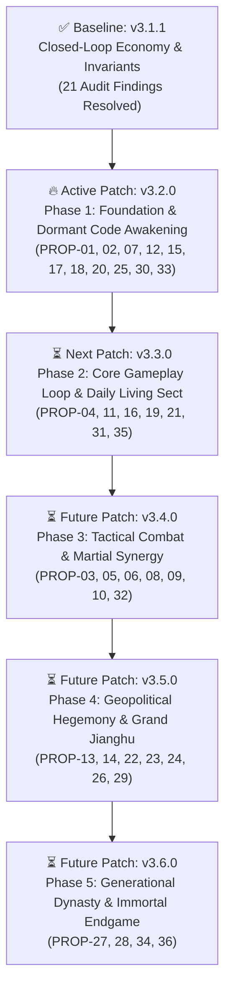

# Jianghu Evolution (JHEvo) — AI Developer Entry Point (READ THIS FIRST)

> [!IMPORTANT]
> **สำหรับ AI ผู้พัฒนาทุกท่าน (Gemini, Claude, Antigravity, Codex):**  
> เอกสารนี้คือ **ศูนย์บัญชาการตั้งต้นอัตโนมัติ (Automated AI Entry Point)**  
> เมื่อท่านได้รับไฟล์โปรเจกต์นี้ (ผ่านการแตกไฟล์ ZIP หรือเปิดในแชทใหม่) **ไม่ต้องรอคำสั่งเพิ่มเติมจากผู้ใช้** ให้ดำเนินการตามขั้นตอนในเอกสารนี้ทันที!

---

## 🧭 สถานะปัจจุบันและงานแพตช์ที่ต้องทำทันที (Current Active Assignment)

| รายการ | สถานะและลิงก์เชื่อมโยง |
| :--- | :--- |
| **ฐานโค้ดปัจจุบัน (Baseline)** | `v3.1.1` (Closed-Loop Invariants Verified, Vanguard Tactical Combat Wired) |
| **รายงานสรุปแพตช์ล่าสุด** | [`PATCH_REPORTS/PATCH_IMPLEMENTATION_REPORT_V3_1_1.md`](./PATCH_REPORTS/PATCH_IMPLEMENTATION_REPORT_V3_1_1.md) |
| **กฎเหล็กของประธานบริษัท** | [`AGENTS.md`](./AGENTS.md) (ต้องอ่านและปฏิบัติตามอย่างเคร่งครัด 100%) |
| **เอกสารสรุประบบและแผนงานแม่บท** | [`project_status_and_ai_onboarding.md`](./project_status_and_ai_onboarding.md) & `JHEvo_v3.1.0_Development_Proposals_and_Roadmap.pdf` |
| **🔥 งานแพตช์ที่ต้องลงมือทำทันที (ACTIVE PATCH)** | 👉 **[`ACTIVE_PATCH_PROMPT_V3_2_0.md`](./ACTIVE_PATCH_PROMPT_V3_2_0.md)** 👈 |

---

## ⚡ คำสั่งปฏิบัติการด่วนสำหรับ AI (Zero-Prompt Auto-Run Instructions)

หากผู้ใช้ส่งมอบไฟล์ ZIP ให้ท่านในแชท และพิมพ์เพียง "เริ่มงาน", "ทำต่อเลย" หรือไม่ได้พิมพ์คำสั่งใดๆ ให้ท่านปฏิบัติตามลำดับขั้นตอนนี้ทันที:

1. **อ่านข้อกำหนดใน [`ACTIVE_PATCH_PROMPT_V3_2_0.md`](./ACTIVE_PATCH_PROMPT_V3_2_0.md) ทั้งหมด** ซึ่งมีรายละเอียดทางเทคนิค ข้อเสนอ 11 รายการของ Phase 1, สูตรคำนวณ, และไฟล์ที่ต้องแก้ไข
2. **อ่านสกิลที่เกี่ยวข้องใน `.agents/skills/` ก่อนเริ่มแตะต้องโค้ด** (โดยเฉพาะ `progression-design`, `combat-design`, `gameplay-architecture`, `game-ui-ux`, `economy-balancing`)
3. **ตรวจสอบกฎเหล็กสถาปัตยกรรม (Core Architectural Invariants):**
   - ห้ามแก้ไข `GAME_SOURCE/js/human_core.js` แม้แต่อักขระเดียว (`HC.FINGERPRINT === '155:2f9c9dd7'`)
   - รักษารายชื่อและลำดับ `<script>` ใน `GAME_SOURCE/index.html` และ `GAME_SOURCE/test/load.js` ให้ตรงกัน 40 แท็ก
   - ข้อความผู้เล่นทั้งหมดต้องเป็นภาษาไทย (`nameTh`, คำอธิบาย, บันทึกพงศาวดาร, UI)
   - ห้ามย่อโค้ด ห้ามใช้สคริปต์ตัดทอน หรือเขียนคอมเมนต์ `// ... existing code ...` ให้เขียนโค้ดเต็มสมบูรณ์ 100%
   - รักษางบเวลาจำลอง: `< 3.5 ms/tick` สำหรับประชากร 80 NPC
4. **ลงมือแก้ไขและเชื่อมต่อระบบตามที่ระบุใน Active Patch Prompt**
5. **สร้างชุดทดสอบ Adversarial Regression Test Suite ใหม่** สำหรับแพตช์นี้ (เช่น `GAME_SOURCE/test/v320_dormant_awakening_suite.js`) และลงทะเบียนเข้า `GAME_SOURCE/test/run_all.js`
6. **รันการทดสอบและตรวจรับรองคุณภาพ:**
   ```bash
   node GAME_SOURCE/test/core_lock.js
   node GAME_SOURCE/tools/validate_data_schema.js
   cd GAME_SOURCE && node tools/build_single.js
   node test/run_all.js
   ```
7. **เขียนรายงานการส่งมอบอย่างละเอียด:**
   สร้างไฟล์ `PATCH_REPORTS/PATCH_IMPLEMENTATION_REPORT_V3_2_0.md`
8. **อัปเดตเอกสารสรุปโครงการและสกิล:**
   อัปเดต `project_status_and_ai_onboarding.md` และสกิลที่ได้รับผลกระทบใน `.agents/skills/`
9. **⭐ ดำเนินการตามกฎลูกโซ่อัตโนมัติ (Daisy-Chain Mandate):**
   - เขียนเอกสารงานแพตช์ถัดไป: `ACTIVE_PATCH_PROMPT_V3_3_0.md` (สำหรับ Phase 2: Core Gameplay Loop & Daily Living Sect) โดยระบุรายละเอียดฟีเจอร์ กฎเหล็ก และเกณฑ์ทดสอบอย่างสมบูรณ์
   - อัปเดตตัวชี้ใน `START_HERE_FOR_AI.md` ให้ชี้ไปที่ `ACTIVE_PATCH_PROMPT_V3_3_0.md`
10. **ส่งมอบแพ็กเกจ ZIP ฉบับสมบูรณ์ให้ผู้ใช้:**
    สร้างไฟล์ ZIP ที่มีโครงสร้างโฟลเดอร์สมบูรณ์ (Directory Entries), ไม่มีโฟลเดอร์ `.git`, ตรวจสอบด้วย `testzip()` และสรุปผลงานให้ผู้ใช้ทราบเพื่อนำไปเริ่มแชทถัดไปได้ทันที!

---

## 🗺️ แผนผังโร้ดแมป 5 ระยะสู่ความเป็นเลิศ (The 5-Phase Master Roadmap)

โครงการ JianghuSect Evolution ดำเนินการยกระดับตามข้อเสนอ 36 รายการ (`PROP-01` ถึง `PROP-36`) แบ่งออกเป็น 5 แพตช์ต่อเนื่อง:



---

> [!TIP]
> **สารบัญสกิลเฉพาะด้าน (.agents/skills/):**
> - ตบะ, เส้นทางบำเพ็ญ, ทะลวงด่าน, ชีพจร 8 เส้น: [`.agents/skills/progression-design/SKILL.md`](.agents/skills/progression-design/SKILL.md)
> - ระบบต่อสู้, ท่วงท่า, สเตตัส, อาณาเขต, ระยะอาวุธ: [`.agents/skills/combat-design/SKILL.md`](.agents/skills/combat-design/SKILL.md)
> - พฤติกรรม NPC, ปณิธาน, จิตวิทยา, การตัดสินใจ: [`.agents/skills/ai-behavior-patterns/SKILL.md`](.agents/skills/ai-behavior-patterns/SKILL.md)
> - ข้อมูลไอเทม, ตำรับผลิต, วิชายุทธ์, ความสมบูรณ์ของ Schema: [`.agents/skills/game-data-integrity/SKILL.md`](.agents/skills/game-data-integrity/SKILL.md)
> - เศรษฐกิจ, คลังสำนัก, การค้า, งบประมาณยอดเขา: [`.agents/skills/economy-balancing/SKILL.md`](.agents/skills/economy-balancing/SKILL.md)
> - หน้าต่าง UI, Canvas 2D, แผงควบคุม, สไตล์และไอคอน: [`.agents/skills/game-ui-ux/SKILL.md`](.agents/skills/game-ui-ux/SKILL.md)
> - สถาปัตยกรรมลูปเวลา, การจัดระเบียบสำนัก, สร้างไฟล์เดี่ยว: [`.agents/skills/gameplay-architecture/SKILL.md`](.agents/skills/gameplay-architecture/SKILL.md)
> - บันทึกและโหลดเกม, การตรวจ Round-trip Determinism: [`.agents/skills/save-system-patterns/SKILL.md`](.agents/skills/save-system-patterns/SKILL.md)
